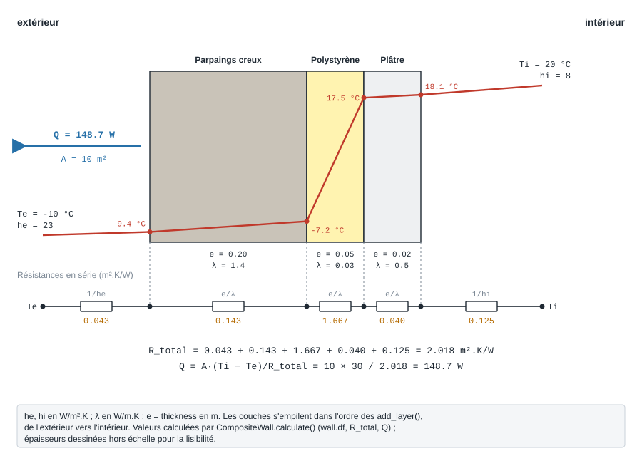

Mur composite — CompositeWall
=============================

   Simulation de l'exemple ci-dessous. Les couches s'empilent dans l'ordre des
   appels à ``add_layer`` : la première touche l'air extérieur (``Te``,
   ``he``), la dernière l'air intérieur (``Ti``, ``hi``). Profil de
   température, flux et résistances en série calculés par la bibliothèque :
   l'essentiel de l'écart se prend dans l'isolant.

Utilisation
-----------

.. code-block:: python

    from HeatTransfer import CompositeWall

    # Créer un mur composite
    wall = CompositeWall.Object(he=23, hi=8, Ti=20, Te=-10, A=10)

    # Ajouter des couches (de l'extérieur vers l'intérieur)
    wall.add_layer(thickness=0.20, material='Parpaings creux')
    wall.add_layer(thickness=0.05, material='Polystyrène')
    wall.add_layer(thickness=0.02, material='Plâtre')

    # Calculer le transfert
    wall.calculate()
    
    # Afficher les résultats
    print(f"Résistance totale: {wall.R_total:.3f} m².K/W")
    print(f"Flux thermique: {wall.Q:.2f} W")
    print(wall.df.to_string())   # tableau complet, sans colonnes masquées

Résultats ::

  Résistance totale: 2.018 m².K/W
  Flux thermique: 148.66 W
     Épaisseur (m)         Matériau  Conductivité (W/m.°C)  Résistance (m².°C/W)  Température entrée (°C)  Température sortie (°C)       Q (W)  A (m²)
  0            NaN    Air extérieur                    NaN              0.043478               -10.000000                -9.353644  148.661889      10
  1           0.20  Parpaings creux                   1.40              0.142857                -9.353644                -7.229903  148.661889      10
  2           0.05      Polystyrène                   0.03              1.666667                -7.229903                17.547079  148.661889      10
  3           0.02           Plâtre                   0.50              0.040000                17.547079                18.141726  148.661889      10
  4            NaN    Air intérieur                    NaN              0.125000                18.141726                20.000000  148.661889      10

Le calcul retourne :

- **Résistance thermique totale** (``R_total``) [m²·K/W]
- **Flux thermique** (``Q``) [W]
- **DataFrame détaillé** : Pour chaque couche

  - Épaisseur [m]
  - Matériau
  - Conductivité thermique [W/m·K]
  - Résistance thermique [m²·K/W]
  - Température entrée [°C]
  - Température sortie [°C]
  - Flux thermique [W]
  - Surface [m²]

Paramètres possibles
--------------------

**Matériaux disponibles** :

- ``'Laine de verre'`` (λ = 0.034 W/m·K)
- ``'Liège expansé aggloméré au brai'`` (λ = 0.048 W/m·K)
- ``'Liège expansé pur'`` (λ = 0.043 W/m·K)
- ``'Parpaings creux'`` (λ = 1.4 W/m·K)
- ``'Pierre calcaire dure (marbre)'`` (λ = 2.9 W/m·K)
- ``'Pierre calcaire tendre'`` (λ = 0.95 W/m·K)
- ``'Pierre granit'`` (λ = 3.5 W/m·K)
- ``'Polystyrène expansé'`` (λ = 0.047 W/m·K)
- ``'Polystyrène'`` (λ = 0.03 W/m·K)
- ``'Polystyrène extrudé'`` (λ = 0.035 W/m·K)
- ``'Mousse de polyuréthane'`` (λ = 0.03 W/m·K)
- ``'Plâtre'`` (λ = 0.5 W/m·K)
- ``'Verre'`` (λ = 1.0 W/m·K)
- ``'Air'`` (Lame d'air avec résistance selon épaisseur)

**Épaisseurs lame d'air et résistances associées** :

- 5-7 mm : R = 0.11 m²·K/W
- 7-9 mm : R = 0.13 m²·K/W
- 9-11 mm : R = 0.14 m²·K/W
- >11 mm : R = 0.16 m²·K/W

Paramètres à personnaliser
--------------------------

.. list-table::
   :header-rows: 1
   :widths: 24 26 50

   * - Paramètre
     - Valeurs essayées
     - Effet mesuré (mur de 10 m², −10 °C dehors, 20 °C dedans)
   * - ``thickness`` de l'isolant
     - 0,05 / 0,10 / 0,15 m
     - ``R_total`` 2,018 / 3,685 / 5,351 m²·K/W ; flux 148,7 / 81,4 / 56,1 W
   * - ``material``
     - nom de la base (liste ci-dessus)
     - fixe la conductivité ; un nom inconnu lève ``ValueError``
   * - ``conductivity``
     - 45,0 W/m·K (acier), couche de 0,20 m
     - ``R_total`` 0,173 m²·K/W ; flux 1 734,9 W : un mur sans isolant
   * - ``he``, ``hi``
     - 23 et 8 W/m²·K ici
     - résistances superficielles extérieure et intérieure (0,043 et 0,125)
   * - ``Ti``, ``Te``, ``A``
     - 20 °C, −10 °C, 10 m²
     - le flux est proportionnel à ``A`` et à l'écart ``Ti − Te``

Variante : doubler l'isolant
----------------------------

Même mur, mais l'épaisseur de polystyrène passe de 5 à 10 puis 15 cm : on lit la
résistance, le flux et la température de la face intérieure du mur.

.. code-block:: python

   # variante : épaisseur d'isolant 0,05 / 0,10 / 0,15 m
   from HeatTransfer import CompositeWall

   for ep in (0.05, 0.10, 0.15):
       w = CompositeWall.Object(he=23, hi=8, Ti=20, Te=-10, A=10)
       w.add_layer(thickness=0.20, material='Parpaings creux')
       w.add_layer(thickness=ep, material='Polystyrène')
       w.add_layer(thickness=0.02, material='Plâtre')
       w.calculate()
       print(ep, round(w.R_total, 3), round(w.Q, 2),
             round(w.df['Température sortie (°C)'].iloc[3], 2))

Sortie réelle :

.. code-block:: text

   0.05 2.018 148.66 18.14
   0.1 3.685 81.42 18.98
   0.15 5.351 56.06 19.3

Passer de 5 à 10 cm retire 45 % du flux ; le passage de 10 à 15 cm n'en retire
plus que 31 %, car chaque centimètre ajouté pèse moins sur une résistance déjà
élevée. La température de paroi intérieure se rapproche de ``Ti`` (18,1 °C, puis
19,0 °C, puis 19,3 °C), ce qui réduit le risque de paroi froide.

Fiche de lecture du modèle
--------------------------

* **Méthode** : résistances thermiques en série (Çengel & Ghajar, *Heat and
  Mass Transfer*, ch. 3) — ``1/he`` côté extérieur, ``e/λ`` par couche,
  ``1/hi`` côté intérieur ; températures d'interface de proche en proche. Le
  module reproduit les exemples 3-2 et 3-3 de l'ouvrage (vitrages).
* **Ordre des couches** : de l'**air extérieur** (côté ``Te``) vers
  l'intérieur (côté ``Ti``), dans l'ordre des appels à ``add_layer``.
* **Saisie compacte** : ``parse_layers("1|50 ; 100|0.04 ; 5|50")`` rend la
  liste ``(épaisseur m, λ ou None, matériau ou None)`` à passer à
  ``add_layer`` ; l'épaisseur est en **mm** dans la chaîne, la conductivité un
  nombre (W/m·K) ou un nom de ``Object.MATERIALS`` ; ``Air`` = lame d'air.
* **Synthèse** : ``summary(hours_per_year=…)`` rend ``heat_loss_kW``,
  ``U_W_m2K``, ``T_surface_ext_C`` (la peau, côté air extérieur),
  ``T_surface_int_C`` et ``heat_loss_MWh_per_year``.
* **Réserves écrites dans le code** : les conductivités de ``MATERIALS`` et la
  table des lames d'air n'ont pas de source citée ; pour un calcul engageant,
  saisissez les λ de vos fiches produit plutôt que les noms de matériaux.

Variante exécutée : isolation d'une enveloppe de chaudière
----------------------------------------------------------

Enveloppe de chaudière de 50 m² à 180 °C dans une chaufferie à 25 °C
(``he = 15``, ``hi = 20`` W/m²K) : tôle de 1 mm, laine (λ 0,04 W/m·K) d'épaisseur
variable, paroi acier de 5 mm, 6 000 h de fonctionnement par an.

.. code-block:: python

    # variante : épaisseur d'isolant d'une enveloppe de chaudière
    from HeatTransfer import CompositeWall
    from HeatTransfer.CompositeWall import parse_layers

    def enveloppe(e_laine_mm):
        paroi = CompositeWall.Object(he=15, hi=20, Ti=180, Te=25, A=50)
        # couches de l'air EXTÉRIEUR vers l'intérieur : tôle 1 mm, laine, acier 5 mm
        for epaisseur, lam, materiau in parse_layers(f"1|50 ; {e_laine_mm}|0.04 ; 5|50"):
            paroi.add_layer(epaisseur, conductivity=lam, material=materiau)
        paroi.calculate()
        return paroi, paroi.summary(hours_per_year=6000)

    print("laine (mm)    U (W/m2K)   pertes (kW)   MWh/an   peau (°C)")
    for e in [20, 50, 80, 100, 120, 150]:
        paroi, s = enveloppe(e)
        print(f"  {e:4d}         {s['U_W_m2K']:5.2f}        {s['heat_loss_kW']:5.1f}       "
              f"{s['heat_loss_MWh_per_year']:5.1f}     {s['T_surface_ext_C']:5.1f}")
    paroi, s = enveloppe(100)
    R_laine = paroi.layers[1]["resistance"]
    print(f"à 100 mm, la laine porte {R_laine:.2f} des {paroi.R_total:.3f} m2.K/W "
          f"({R_laine / paroi.R_total:.1%})")

Sortie réelle :

.. code-block:: text

   laine (mm)    U (W/m2K)   pertes (kW)   MWh/an   peau (°C)
       20          1.62         12.6        75.4      41.8
       50          0.73          5.7        34.0      32.6
       80          0.47          3.7        22.0      29.9
      100          0.38          3.0        17.8      28.9
      120          0.32          2.5        14.9      28.3
      150          0.26          2.0        12.0      27.7
   à 100 mm, la laine porte 2.50 des 2.617 m2.K/W (95.5%)

Lecture : passer de 20 à 50 mm économise 41 MWh/an ; de 100 à 150 mm, moins de
6 MWh/an — le rendement de chaque centimètre décroît vite. À 100 mm, l'isolant
porte 95,5 % de la résistance totale : tôles et échanges de surface ne pèsent
presque plus. La température de peau tombe sous 30 °C dès 80 mm.

Pièges du calcul enchaîné
-------------------------

.. code-block:: python

    # à la suite : summary() ne recalcule pas après une modification
    paroi, s = enveloppe(50)
    paroi.add_layer(0.050, conductivity=0.04)          # 50 mm de laine en plus
    print(f"summary sans recalcul : {paroi.summary()['heat_loss_kW']:.2f} kW (valeur périmée)")
    paroi.calculate()
    print(f"après calculate()     : {paroi.summary()['heat_loss_kW']:.2f} kW")
    try:
        parse_layers("100 laine")                        # séparateur « | » oublié
    except ValueError as erreur:
        print("Refusé :", erreur)

Sortie réelle :

.. code-block:: text

   summary sans recalcul : 5.67 kW (valeur périmée)
   après calculate()     : 2.96 kW
   Refusé : Couche illisible : '100 laine' (attendu « epaisseur_mm|lambda_ou_materiau »)

* **summary() ne recalcule pas** si ``calculate()`` a déjà été appelé : après
  un ``add_layer``, rappelez ``calculate()``, sinon la synthèse rend l'ancien
  flux.
* **parse_layers attend « épaisseur_mm|λ_ou_matériau »**, couches séparées par
  ``;`` : une ligne mal formée est refusée avec son texte.

Pièges d'usage
--------------

- **Le nom l'emporte sur la valeur.** Si ``material`` est fourni, ``conductivity``
  est ignoré, et un nom absent de la base lève ``ValueError``, même quand
  ``conductivity`` est renseigné. Pour un matériau hors base (acier, tôle, laine
  de roche…), ne passer que ``conductivity``.
- **Lame d'air.** ``material='Air'`` applique une résistance tabulée selon
  l'épaisseur (0,11 à 0,16 m²·K/W), et non une conduction.
- **Pas de dimensionnement inverse.** Aucune méthode ne rend l'épaisseur
  d'isolant nécessaire pour une perte cible : balayer les épaisseurs ou
  résoudre par dichotomie dans le code appelant.
- **Ordre des couches.** La première couche ajoutée touche le milieu à ``Te``,
  la dernière celui à ``Ti``.

Explication du modèle
----------------------

Ce modèle calcule le transfert thermique à travers un mur multicouche. 

Le calcul se base sur :

1. **Résistances en série** : Les résistances thermiques de chaque couche s'additionnent
2. **Convection aux surfaces** : Résistances convectives intérieure et extérieure
3. **Conduction dans les matériaux** : Résistance fonction de l'épaisseur et de la conductivité

Le modèle permet de :

- Calculer la résistance thermique totale
- Déterminer le flux thermique traversant le mur
- Obtenir le profil de température à travers les couches
- Analyser la contribution de chaque couche