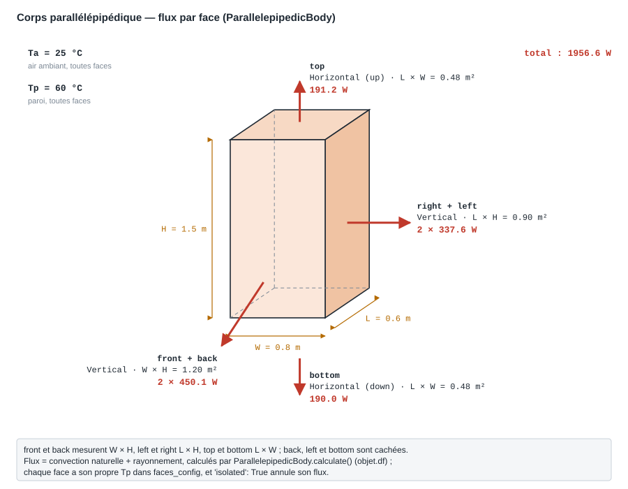

Corps parallélépipédique — ParallelepipedicBody
===============================================

   Simulation de l'exemple ci-dessous : flux de chaque face calculé par
   ``ParallelepipedicBody``. ``front`` et ``back`` mesurent ``W × H``,
   ``left`` et ``right`` ``L × H``, ``top`` et ``bottom`` ``L × W`` ; chaque
   face reçoit sa propre température ``Tp`` dans ``faces_config``.

Utilisation
-----------

.. code-block:: python

  from HeatTransfer import ParallelepipedicBody

  # Définir la configuration thermique de chaque face
  thermal_measurements = {
      'top': {'Tp': 60.0, 'isolated': False},
      'bottom': {'Tp': 60.0, 'isolated': False},
      'front': {'Tp': 60.0, 'isolated': False},
      'back': {'Tp': 60.0, 'isolated': False},
      'left': {'Tp': 60.0, 'isolated': False},
      'right': {'Tp': 60.0, 'isolated': False}
  }

  # Créer l'objet
  objet = ParallelepipedicBody.Object(
      L=0.6,  # Longueur [m]
      W=0.8,  # Largeur [m]
      H=1.5,  # Hauteur [m]
      Ta=25,  # Température ambiante [°C]
      faces_config=thermal_measurements
  )
  
  # Calculer les transferts
  objet.calculate()

  # Afficher les résultats
  print(f"Transfert total: {objet.get_total_heat_transfer():.2f} W")
  print(objet.df.to_string())   # tableau complet, sans colonnes masquées

Résultats ::

  Transfert total: 1956.56 W
       Face        Orientation  Surface (m²) Tp (°C)  Ta (°C) ΔT (°C) Isolated  Heat Transfer (W)  Heat Flux (W/m²)
  0     top    Horizontal (up)          0.48    60.0       25    35.0    False             191.19            398.31
  1  bottom  Horizontal (down)          0.48    60.0       25    35.0    False             189.98            395.80
  2   front           Vertical          1.20    60.0       25    35.0    False             450.11            375.09
  3    back           Vertical          1.20    60.0       25    35.0    False             450.11            375.09
  4    left           Vertical          0.90    60.0       25    35.0    False             337.58            375.09
  5   right           Vertical          0.90    60.0       25    35.0    False             337.58            375.09
  6   TOTAL                  -          5.16       -       25       -        -            1956.56            379.18

Le calcul retourne :

- **Transfert thermique total** : Somme des pertes par toutes les faces [W]
- **DataFrame détaillé** : Pour chaque face (top, bottom, front, back, left, right)
  
  - ``Orientation`` : ``Vertical``, ``Horizontal (up)`` ou ``Horizontal (down)``
  - ``Surface (m²)``, ``Tp (°C)``, ``Ta (°C)``, ``ΔT (°C)``, ``Isolated``
  - ``Heat Transfer (W)`` et ``Heat Flux (W/m²)`` de la face
  - une dernière ligne ``TOTAL`` (surface et flux cumulés)

Paramètres possibles
--------------------

**Configuration des faces** (dictionnaire ``faces_config``) :

Chaque face peut avoir :

- ``'Tp'`` : Température de paroi [°C]
- ``'isolated'`` : ``True`` ou ``False`` (face isolée ou non)

**Faces disponibles** : ``'top'``, ``'bottom'``, ``'front'``, ``'back'``, ``'left'``, ``'right'``

Paramètres à personnaliser
--------------------------

.. list-table::
   :header-rows: 1
   :widths: 24 26 50

   * - Paramètre
     - Valeurs essayées
     - Effet mesuré (boîte 0,6 × 0,8 × 1,5 m, ``Ta`` = 25 °C)
   * - ``Tp`` (par face)
     - 60 / 80 °C, toutes faces
     - 1 956,6 W / 3 454,1 W : la perte croît plus vite que l'écart (rayonnement)
   * - ``isolated``
     - ``True`` sur 5 faces, ``False`` sur ``bottom``
     - 190,0 W : seule la face du bas compte
   * - ``Tp`` = ``Ta``
     - 25 °C partout
     - 0,0 W
   * - ``L``, ``W``, ``H``
     - 0,6 / 0,8 / 1,5 m
     - fixent la surface de chaque face (voir la légende de la figure)
   * - ``Ta``
     - 25 °C
     - température de l'air ambiant, commune aux six faces

Variante : isoler la boîte
--------------------------

.. code-block:: python

  # variante : cinq faces isolées, seule la face du bas reste nue
  from HeatTransfer import ParallelepipedicBody

  faces = ['top', 'bottom', 'front', 'back', 'left', 'right']
  config = {f: {'Tp': 60.0, 'isolated': f != 'bottom'} for f in faces}
  objet = ParallelepipedicBody.Object(L=0.6, W=0.8, H=1.5, Ta=25,
                                      faces_config=config)
  objet.calculate()
  print(f"{objet.get_total_heat_transfer():.2f} W")

Sortie réelle :

.. code-block:: text

  189.98 W

On passe de 1 956,6 W à 190,0 W, soit 90 % de perte en moins. Une face isolée est
comptée pour zéro : le modèle ne calcule pas la perte à travers l'isolant.

Pièges d'usage
--------------

- **Les six faces sont obligatoires** dans ``faces_config`` : une face absente
  lève ``KeyError: 'bottom'``, sans message explicite.
- **Dimensions non contrôlées** : ``L=-1`` est accepté et rend -789,57 W
  (défaut de bibliothèque, voir ``BUGS_LIB.md``). Vérifier ses cotes.
- **``Tp`` = ``Ta``** donne 0 W, pas une erreur. **``Tp`` < ``Ta``** (paroi plus
  froide que l'ambiance, par exemple une cuve froide) fait échouer le calcul avec
  ``TypeError: type complex doesn't define __round__ method`` : le modèle ne
  traite que la perte d'un corps plus chaud que l'air.

Explication du modèle
----------------------

Ce modèle calcule le transfert thermique d'un corps parallélépipédique (boîte rectangulaire) vers l'environnement ambiant. 

Le calcul prend en compte :

1. **Convection naturelle** : Échange thermique entre la surface et l'air ambiant
2. **Rayonnement** : Émission de chaleur par radiation vers l'environnement

Pour chaque face, le modèle :

- Calcule la surface d'échange
- Détermine le coefficient de convection selon l'orientation (horizontale/verticale)
- Calcule les flux de convection et de rayonnement
- Somme les contributions pour obtenir le transfert total
