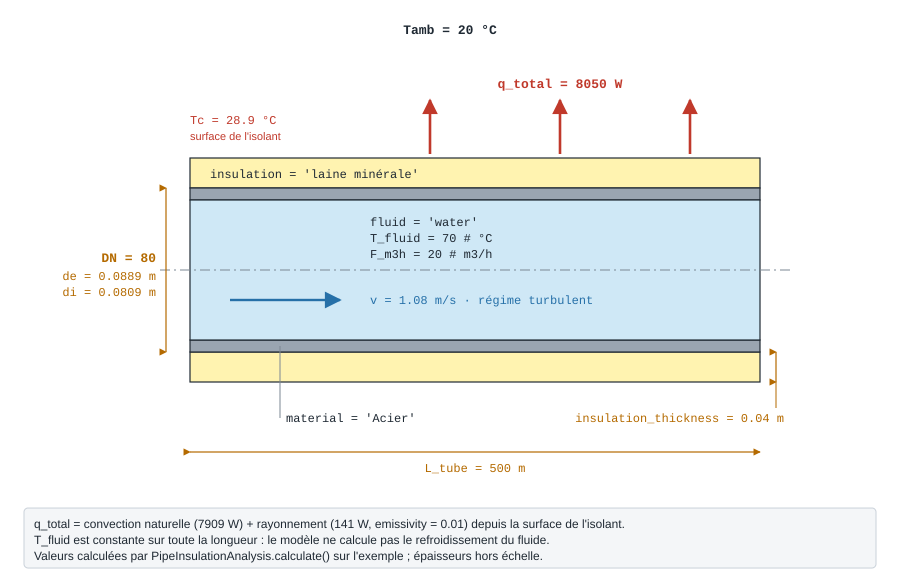

Isolation des tuyauteries — PipeInsulationAnalysis
==================================================

   Simulation de l'exemple ci-dessous. ``DN`` fixe les diamètres intérieur
   ``di`` et extérieur ``de`` de l'acier ; ``insulation_thickness`` s'ajoute
   autour ; ``material`` et ``insulation`` sont lus dans les tables du module
   (une valeur absente lève ``ValueError``). Le flux part de la surface de
   l'isolant (``Tc``) vers l'ambiance, par convection naturelle et rayonnement,
   calculés par la bibliothèque.

Utilisation
-----------

.. code-block:: python

    from HeatTransfer import PipeInsulationAnalysis

    # Créer un objet d'analyse d'isolation de tuyau
    pipe = PipeInsulationAnalysis.Object(
        fluid='water', 
        T_fluid=70, 
        F_m3h=20, 
        DN=80, 
        L_tube=500, 
        material='Acier', 
        insulation='laine minérale', 
        insulation_thickness=0.04, 
        Tamb=20
    )
    
    # Calculer les déperditions
    pipe.calculate()
    
    # Afficher les résultats
    print(f"Déperditions totales: {pipe.q_total:.2f} W")
    print(f"Température de surface: {pipe.Tc:.2f} °C")
    print(pipe.df)

Résultats ::

  Déperditions totales: 8050.03 W
  Température de surface: 28.87 °C
                                                           0
  Fluid                                                water
  Regime                                           turbulent
  T_fluid (°C)                                            70
  v (m/s)                                           1.080789
  F_m3h (m3/h)                                            20
  DN                                                    80.0
  di (m)                                              0.0809
  de (m)                                              0.0889
  L_tube (m)                                             500
  Material                                             Acier
  Insulation                                  laine minérale
  Insulation Thickness (m)                              0.04
  Emissivity                                            0.01
  Tamb (°C)                                               20
  Humidity (%)                                            40
  Flow Regime                                      turbulent
  Tc (°C)                                          28.868999
  Tf (°C)                                          24.434499
  Outer Diameter with Insulation (m)                  0.1689
  Prandtl Number (Pr)                               2.562899
  External Surface Area (m²)                      265.307276
  Rayleigh Number                             4226671.100079
  Nusselt Number                                   21.942496
  Average Heat Transfer Coefficient (W/m².K)        3.361376
  Convective Heat Transfer (W)                   7909.350594
  Radiative Heat Transfer (W)                      140.67688
  Total Heat Transfer (W)                        8050.027474
  Convective Resistance (K/W)                       0.001121
  Radiative Resistance (K/W)                        0.063045
  Equivalent Resistance (K/W)                       0.001102
  Internal Surface Area (m²)                      127.077315
  Reynolds Number (Re_fluid)                   211849.962282
  velocity (m/s)                                    1.080789
  Nusselt Number (self.Nu_fluid)                  611.002747
  Heat Transfer Coefficient (self.h_fluid)       4982.869046
  Internal Convective Resistance (K/W)              0.000002
  Internal Wall Temperature (°C)                   69.987287
  External Wall Temperature (°C)                   69.982454
  Insulation Temperature (°C)                      28.868999
  Conductive Resistance of Bare Tube (K/W)          0.000001

Le calcul retourne :

- **Déperditions thermiques totales** (``q_total``) [W]
- **Température de surface externe** (``Tc``) [°C]
- **DataFrame détaillé** incluant :

  - Propriétés du fluide (viscosité, conductivité, densité, Cp)
  - Régime d'écoulement (laminaire/turbulent)
  - Nombres adimensionnels (Reynolds, Prandtl, Nusselt, Rayleigh)
  - Coefficients de transfert thermique [W/m²·K]
  - Résistances thermiques [K/W]
  - Températures aux interfaces [°C]
  - Déperditions par convection et rayonnement [W]

Paramètres possibles
--------------------

**Matériaux de tuyau disponibles (material)** :

- ``'Cuivre'`` (λ = 380 W/m·K)
- ``'Plomb'`` (λ = 35 W/m·K)
- ``'Acier'`` (λ = 50 W/m·K)
- ``'Aluminium 99%'`` (λ = 160 W/m·K)
- ``'Fonte'`` (λ = 50 W/m·K)
- ``'Zinc'`` (λ = 110 W/m·K)

**Matériaux d'isolation disponibles (insulation)** :

- ``'aucun isolant'`` (λ = 0 W/m·K)
- ``'laine minérale'`` (λ = 0.04 W/m·K)
- ``'polyuréthanne PUR'`` (λ = 0.03 W/m·K)
- ``'polystyrène'`` (λ = 0.036 W/m·K)
- ``'polyéthylène'`` (λ = 0.038 W/m·K)
- ``'Liège (ICB)'`` (λ = 0.05 W/m·K)
- ``'Laine minérale (MW)'`` (λ = 0.045 W/m·K)
- ``'Polystyrène expansé (EPS)'`` (λ = 0.045 W/m·K)
- ``'Polyéthylène extrudé (PEF)'`` (λ = 0.045 W/m·K)
- ``'Mousse phénolique – revêtu (PF)'`` (λ = 0.045 W/m·K)
- ``'Polyuréthane – revêtu (PUR/PIR)'`` (λ = 0.035 W/m·K)
- ``'Polystyrène extrudé (XPS)'`` (λ = 0.04 W/m·K)
- ``'Verre cellulaire (CG)'`` (λ = 0.055 W/m·K)
- ``'Perlite (EPB)'`` (λ = 0.06 W/m·K)
- ``'Vermiculite'`` (λ = 0.065 W/m·K)
- ``'Vermiculite expansée (panneaux)'`` (λ = 0.09 W/m·K)

**Diamètres nominaux (DN) disponibles** :

DN de 6 à 1050 mm (voir table complète dans le code source)

Paramètres à personnaliser
--------------------------

.. list-table::
   :header-rows: 1
   :widths: 24 26 50

   * - Paramètre
     - Valeurs essayées
     - Effet mesuré (eau 70 °C, DN 80, 500 m, ``Tamb`` = 20 °C)
   * - ``insulation_thickness``
     - 0,02 / 0,04 / 0,08 m
     - 11 974,5 / 8 050,0 / 5 486,7 W ; surface à 34,6 / 28,9 / 25,0 °C
   * - ``insulation``
     - ``'aucun isolant'`` (épaisseur 0)
     - 40 726,5 W, surface à 69,9 °C : le tuyau nu perd 5 fois plus
   * - ``insulation``
     - nom de la table ci-dessous
     - fixe la conductivité ; un nom inconnu lève ``ValueError``
   * - ``DN``, ``L_tube``
     - 80 mm, 500 m
     - la perte est proportionnelle à la longueur
   * - ``T_fluid``, ``Tamb``
     - 70 °C, 20 °C
     - écart moteur de la perte
   * - ``F_m3h``
     - 20 m3/h
     - débit : fixe la vitesse (1,08 m/s) et le régime

Variante : épaisseur d'isolant
------------------------------

.. code-block:: python

    # variante : laine minérale 2, 4 et 8 cm, puis tuyau nu
    from HeatTransfer import PipeInsulationAnalysis

    for e, ins in [(0.02, 'laine minérale'), (0.04, 'laine minérale'),
                   (0.08, 'laine minérale'), (0.0, 'aucun isolant')]:
        p = PipeInsulationAnalysis.Object(
            fluid='water', T_fluid=70, F_m3h=20, DN=80, L_tube=500,
            material='Acier', insulation=ins, insulation_thickness=e, Tamb=20)
        p.calculate()
        print(e, ins, round(p.q_total, 1), round(p.Tc, 2))

Sortie réelle :

.. code-block:: text

    0.02 laine minérale 11974.5 34.57
    0.04 laine minérale 8050.0 28.87
    0.08 laine minérale 5486.7 25.04
    0.0 aucun isolant 40726.5 69.91

Doubler l'isolant de 4 à 8 cm retire 32 % de la perte ; l'isolation d'une ligne de
500 m évite 32,7 kW de perte par rapport au tuyau nu (à 2 cm : 28,8 kW évités).

Pièges d'usage
--------------

- **Un nom absent des tables lève ``ValueError``** (``'laine de roche'`` :
  « not found in the INSULATION_MATERIALS table ») : prendre l'un des noms listés.
- **Sans isolant, passer ``'aucun isolant'`` et une épaisseur nulle** : la surface
  rejoint alors la température du fluide (69,9 °C), perte maximale.

Explication du modèle
----------------------

Ce modèle calcule les déperditions thermiques d'un tuyau isolé transportant un fluide chaud ou froid.

Le calcul prend en compte :

1. **Convection interne** : Transfert entre le fluide et la paroi interne du tuyau
2. **Conduction dans le tuyau** : Transfert à travers la paroi métallique
3. **Conduction dans l'isolant** : Transfert à travers l'isolation
4. **Convection externe** : Transfert entre la surface et l'air ambiant (convection naturelle)
5. **Rayonnement** : Émission thermique vers l'environnement

Le modèle détermine automatiquement :

- Le régime d'écoulement (laminaire ou turbulent)
- Les propriétés thermophysiques du fluide via CoolProp
- Les coefficients de transfert thermique appropriés
- La température de surface par itération (équilibre thermique)