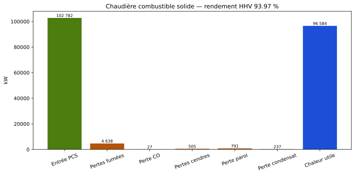

.. _chaudiere_biomasse:

Rendement de chaudière biomasse — SolidFuel_Boiler_Efficiency
=============================================================

À quoi ça sert
--------------

Vous exploitez une chaufferie bois (plaquette, granulé, broyat) ou une chaudière
charbon. Vous connaissez l'analyse du combustible, son humidité, et vous mesurez
les fumées : température, O₂, CO. Le modèle ``SolidFuel_Boiler_Efficiency`` en
tire le **rendement par la méthode indirecte** (on calcule les pertes, le
rendement est ce qui reste) selon EN 12952-15 (tubes d'eau) et EN 12953-11
(tubes de fumées), et vous dit **où part la chaleur** : fumées, CO, cendres
(chaleur sensible et imbrûlés), rayonnement des parois, condensat.

C'est la question d'un audit de chaufferie biomasse : que coûte un bois trop
humide, et que rapporte un condenseur sur les fumées ?

Le modèle est le pendant solide de :doc:`ng_boiler_efficiency` (gaz naturel) et
le parent de :doc:`chaudiere_fioul` ; il se règle de la même façon (paramètres
au constructeur, ``calculate()`` qui rend un tableau ``df``, résultats en
attributs).

Fiche de lecture du modèle
--------------------------

Relevé dans ``ThermodynamicCycles/Combustion/SolidFuel_Boiler_Efficiency_EN1295X.py`` :

* **Source** : le classeur Veolia « Solid fuel boiler efficiency - EN1295X »
  (rev. 2019-07-17), dont le modèle reproduit le bilan matière et énergie cellule
  par cellule ; le cas fourni est retrouvé à 2·10⁻⁵ près sur les rendements (test
  de la bibliothèque). Les constantes que le classeur attribue à EN 12952-15
  §4.2 sont reprises telles quelles : la norme elle-même n'est pas détenue.
* **Combustible** : analyse élémentaire **sur sec**, en fractions massiques des
  huit clés ``C``, ``H``, ``O``, ``N``, ``S``, ``Cl``, ``F``, ``ash`` (somme = 1),
  plus l'**humidité sur brut** à part. Le **PCI sur brut** (kJ/kg) est celui du
  fournisseur ; le PCS en est déduit selon NF ISO 1928 :
  ``PCS brut = PCI brut + 21 832 × H brut + 2 442,5 × humidité``.
  La méthode de classe ``heating_values(...)`` rend PCI et PCS sur brut, sec et
  sec sans cendres.
* **Air de combustion** humide (température, humidité relative, pression de la
  chaufferie), réparti en plusieurs entrées à des températures différentes
  (``air_streams`` : primaire, secondaire, tertiaire).
* **Excès d'air** déduit de l'O₂ mesuré, sur sec ou sur humide.
* **Pertes calculées** : fumées (sensible en base PCI ; sensible + latente en
  base PCS), CO (à partir des mg/Nm³ sur sec), **cendres** (sous foyer, sous
  échangeurs, volantes : chaleur sensible + imbrûlés comptés à 33 000 kJ/kg de
  carbone), rayonnement des parois, et en cas de condensation le condensat
  sortant (la chaleur de condensation récupérée est un gain, pas une perte).
* **Rayonnement** : ``C × Q^0,7``, ``Q`` étant la **puissance utile nominale** en MW
  (``design_useful_heat_kW``). ``C`` vaut 0,0315 (tubes d'eau, lignite / lit
  fluidisé), 0,0220 (tubes d'eau, houille), 0,0144 (tubes de fumées, combustible
  solide), ou toute valeur numérique saisie.
* **Débit de combustible** déduit de la chaleur utile par le bilan PCS (résolu
  directement, le bilan étant linéaire en débit ; le résidu est publié), ou
  imposé (``fuel_flow_kg_h``) et la chaleur utile en est déduite.
* **Propriétés** : fumées et air par mélange de gaz (CoolProp par constituant),
  pression de vapeur saturante par Hyland-Wexler (ASHRAE), eau par IF97 — et non
  les polynômes du classeur.
* **Deux écarts au classeur, corrigés et documentés dans le code** : la perte
  fumées PCI est calculée sur le débit **après** condensation (le classeur
  prend le débit avant ; 583,8 kW contre 680,0 kW sur le cas fourni, rendements
  inchangés), et les crédits de chaleur sont comptés dans les deux bases.
* **Non modélisé** (à ajouter par l'utilisateur en crédit ou en chaleur utile) :
  souffleurs de suie, réchauffeurs d'air vapeur, injection de chaux ou d'urée,
  incertitudes.
* **Ce qu'il refuse** (``ValueError``) : une clé d'analyse manquante ou inconnue,
  une analyse dont la somme n'est pas 1, une humidité hors [0 ; 0,995[, un O₂
  supérieur à celui de l'air, une constante de rayonnement inconnue, un
  combustible réchauffé sans Cp, une fraction de cendres sans température, une
  répartition d'air ou de cendres dont la somme n'est pas 1, des imbrûlés hors
  [0 ; 0,99[, l'absence de toute chaleur utile ou de tout débit.
* **Ports** : port eau ``Inlet`` / ``Outlet`` (avec la consigne ``To``) et port
  fumées ``FG_Outlet`` (CO₂, H₂O, N₂, O₂, Ar ; traces SO₂ / HCl / HF exclues),
  comme la chaudière gaz ; une méthode ``plot()`` trace le bilan.

Exemple : chaudière biomasse de 100 MW à condensation
-----------------------------------------------------

Le cas fourni avec le classeur : plaquette forestière à 30 % d'humidité,
PCI 12 000 kJ/kg sur brut, chaudière à tubes d'eau de 100 MW nominal, fumées
refroidies à 40 °C par un condenseur, 3,4 % d'O₂ sur sec, air préchauffé à
70 °C en trois étages.

.. code-block:: python

    from ThermodynamicCycles.Combustion.SolidFuel_Boiler_Efficiency_EN1295X import (
        SolidFuel_Boiler_Efficiency,
    )

    # Plaquette forestière : analyse élémentaire SÈCHE (fractions massiques, somme 1)
    BOIS_SEC = {'C': 0.461985, 'H': 0.06175, 'O': 0.4184275, 'N': 0.00665,
                'S': 0.00076, 'Cl': 0.00038, 'F': 0.0000475, 'ash': 0.05}

    chaudiere = SolidFuel_Boiler_Efficiency(
        fuel_composition_dry=BOIS_SEC,
        fuel_moisture=0.30,              # 30 % d'humidité sur brut
        fuel_LHV_ar_kJ_kg=12000,         # PCI sur brut
        fuel_temperature_C=25, fuel_cp_daf_kJ_kgK=1.03,
        flue_gas_temperature_C=40,       # fumées condensées
        O2_measured=0.03415, O2_basis='dry', CO_mg_Nm3_dry=100,
        ambient_temperature_C=25, ambient_RH=0.6,
        air_streams=[(0.40, 70), (0.5615, 70), (0.0385, 70)],   # primaire, secondaire, tertiaire
        ash_split={'bottom': 0.15, 'under_exchanger': 0.10, 'fly': 0.75},
        ash_unburned={'bottom': 0.01, 'under_exchanger': 0.06, 'fly': 0.06},
        ash_temperature_C={'bottom': 830, 'under_exchanger': 200},
        radiation_constant='water_tube_brown_coal_fluidized_bed',
        design_useful_heat_kW=100000,
        useful_heat_kW=87362.88,         # vapeur + purges, hors condensation
        blowdown_heat_kW=433.73,
    )
    chaudiere.calculate()
    print(chaudiere.df.to_string())

Sortie réelle :

.. code-block:: text

                                                                           Value
    Parameter
    --- INPUTS ---
    Fuel LHV as received (kJ/kg)                                           12000
    Fuel HHV as received (kJ/kg)                                         13676.4
    Fuel moisture (%)                                                       30.0
    T flue gas (C)                                                            40
    O2 dry (%)                                                             3.415
    Radiation constant (-)                                                0.0315
    --- COMBUSTION ---
    Fuel flow (kg/h)                                                    26375.04
    Air/fuel ratio (Nm3/kg)                                                3.687
    Excess air (%)                                                         19.28
    Air flow (Nm3/h)                                                     97244.4
    Flue gas flow (Nm3/h)                                               118940.4
    Flue gas H2O (% vol)                                                   20.47
    Condensation T (C)                                                     60.84
    Condensate (kg/h)                                                    13589.6
    --- HEAT BALANCE (HHV) ---
    Fuel heat input HHV (kW)                                            100199.1
    Air heat input HHV (kW)                                               2582.5
    Heat credits (kW)                                                        0.0
    Flue gas loss HHV (kW)                                                4638.3
    CO loss (kW)                                                           26.56
    Ash loss bottom (kW)                                                   39.09
    Ash loss under_exchanger (kW)                                          58.02
    Ash loss fly (kW)                                                     407.67
    Radiation loss (kW)                                                   791.24
    Condensate loss (kW)                                                  236.67
    Condensation recovery (kW)                                            9221.1
    Total losses HHV (kW)                                                 6197.6
    Useful heat (kW)                                                     96584.0
    Balance residual (kW)                                                   -0.0
    Efficiency HHV (%)                                                     93.97
    Efficiency HHV, blowdown as loss (%)                                  93.548
    --- HEAT BALANCE (LHV) ---
    Fuel heat input LHV (kW)                                             87916.8
    Flue gas loss LHV (kW)                                                 583.8
    Efficiency LHV (%)                                                    107.91
    Efficiency LHV, blowdown as loss (%)                                 107.426
    Source                                veolia_en1295x_solid_2019 (BOILER_HMB)

Lecture :

* rendement **93,97 % sur PCS** et **107,9 % sur PCI** : les fumées sortent à
  40 °C, sous leur point de rosée (**60,84 °C**), et la vapeur d'eau condense
  (13,6 t/h). La chaleur latente récupérée, 9 221 kW, est comptée en chaleur
  utile — elle n'est pas dans le PCI, d'où un rendement PCI au-delà de 100 % ;
* les fumées contiennent **20,5 % de vapeur d'eau** en volume (contre 12 % pour
  du fioul, :doc:`chaudiere_fioul`) : l'eau du bois humide s'ajoute à celle de la
  combustion de l'hydrogène. C'est pourquoi la condensation rapporte autant sur
  la biomasse ;
* sur 6 198 kW de pertes PCS, les fumées en emportent 4 638, le rayonnement 791,
  les **cendres** 505 (dont 408 pour les cendres volantes, surtout par leurs
  imbrûlés), le condensat évacué 237 et le CO 27 ;
* ``Efficiency HHV, blowdown as loss`` (93,55 %) compte les purges (434 kW) en
  perte au lieu de chaleur utile ;
* ``Balance residual`` nul (affiché ``-0.0``) : le bilan PCS est fermé.

Les mêmes grandeurs se lisent en attributs : ``efficiency_LHV``,
``efficiency_HHV`` (fractions, pas %), ``flue_gas_loss`` (PCI, kW),
``flue_gas_loss_HHV``, ``ash_loss`` et le détail ``ash_losses`` (débit, sensible,
imbrûlés par flux), ``radiation_loss``, ``CO_loss``, ``condensation_recovery``,
``condensate_kg_h``, ``T_condensation``, ``excess_air_pct``, ``useful_heat_HHV``,
``fuel_flow_kg_h_calc``, ``heating_values_kJ_kg``.

Le bilan se trace par la méthode du modèle, ``chaudiere.plot(basis='PCS')`` :

   Bilan PCS de la chaudière biomasse de 100 MW, tracé par ``plot()``. La
   chaleur utile inclut la récupération par condensation.

Paramètres à personnaliser
--------------------------

.. list-table::
   :header-rows: 1
   :widths: 26 14 60

   * - Paramètre
     - Défaut
     - Ce qu'il change, plage usuelle
   * - ``fuel_composition_dry``
     - (obligatoire)
     - Analyse élémentaire **sur sec**, huit clés ``C, H, O, N, S, Cl, F, ash``,
       somme 1. Bois ≈ 50 % C / 6 % H / 42 % O sur sec sans cendres ; cendres
       0,5 % (granulé) à 5 % et plus (écorces, broyat). ``Cl`` et ``F`` à 0 si
       l'analyse ne les donne pas — mais présentes.
   * - ``fuel_moisture``
     - (obligatoire)
     - Humidité **sur brut**, en fraction (0,30 = 30 %). Granulé 8 à 10 %,
       plaquette sèche 20 à 30 %, plaquette verte 40 à 55 %. Premier levier,
       voir la variante.
   * - ``fuel_LHV_ar_kJ_kg``
     - (obligatoire)
     - PCI **sur brut** à cette humidité : il dépend de l'humidité, le modèle ne le
       recalcule pas (voir les pièges).
   * - ``useful_heat_kW`` / ``fuel_flow_kg_h``
     - ``None``
     - L'un ou l'autre : chaleur utile **hors condensation** mesurée côté eau
       (le modèle retrouve le débit de bois), ou débit de bois pesé (le modèle
       en déduit la chaleur utile). À défaut, ports eau ``Inlet`` + ``To``.
   * - ``blowdown_heat_kW``
     - 0
     - Part des purges dans la chaleur utile, pour le rendement « purges en perte ».
   * - ``fuel_temperature_C`` / ``fuel_cp_daf_kJ_kgK``
     - 25 / ``None``
     - Combustible à une autre température que ``T_ref`` : le Cp sec sans cendres
       devient obligatoire (≈ 1,0 à 1,4 kJ/kg·K pour le bois).
   * - ``flue_gas_temperature_C``
     - 180
     - Température en sortie chaudière, économiseur ou condenseur. Sous le point
       de rosée (55 à 65 °C pour le bois), la condensation est comptée.
   * - ``O2_measured`` / ``O2_basis``
     - 0,06 / ``'dry'``
     - O₂ des fumées en **fraction** (0,06 = 6 %), sur sec ou ``'wet'``. Les
       foyers bois tournent avec plus d'excès d'air que le gaz (6 à 9 % d'O₂).
   * - ``CO_mg_Nm3_dry``
     - 0
     - CO des fumées en **mg/Nm³ sur sec** (pas en ppm, contrairement au fioul).
   * - ``air_streams`` / ``air_temperature_C``
     - ``None`` / ``None``
     - Liste ``[(fraction, T_C), …]`` des entrées d'air (somme des fractions 1) ;
       à défaut, un seul flux à ``air_temperature_C`` ou à l'ambiante.
   * - ``ash_split``
     - tout en cendres volantes
     - ``{'bottom', 'under_exchanger', 'fly'}``, somme 1 : répartition des
       cendres (foyer à grille : surtout ``bottom``).
   * - ``ash_unburned``
     - 0 partout
     - Imbrûlés, fraction massique dans chaque flux de cendres recueillies
       (1 à 10 % usuellement) ; chaque point coûte 33 000 kJ/kg de carbone.
   * - ``ash_temperature_C``
     - volantes à la T des fumées
     - Température des cendres de foyer et sous échangeurs, **obligatoire** pour
       tout flux non nul autre que ``fly``.
   * - ``radiation_constant``
     - ``'water_tube_brown_coal_fluidized_bed'``
     - Clé de la loi de rayonnement (``'fire_tube_solid_fuel'`` pour une
       chaudière bois de chauffage à tubes de fumées) ou valeur numérique ``C``.
   * - ``design_useful_heat_kW``
     - 1000
     - Puissance utile **nominale** : ne sert qu'au calcul du rayonnement.
   * - ``ambient_temperature_C``, ``ambient_RH``, ``ambient_pressure_mbar``
     - 25, 0,5, 1013,25
     - Air de chaufferie (humidité de l'air comburant).
   * - ``electrical_credit_kW``, ``other_heat_credit_kW``, ``T_ref``
     - 0, 0, 25
     - Apports auxiliaires comptés en entrée ; température de référence du bilan.

Variante exécutée : humidité du bois et condenseur sur une chaufferie de 3 MW
-----------------------------------------------------------------------------

Une chaufferie bois de réseau de chaleur, chaudière à tubes de fumées de 3 MW
nominal, qui doit fournir 2 500 kW. Le même bois livré à 20, 30, 40 ou 50 %
d'humidité : combien en faut-il, et que rapporte un condenseur qui refroidit
les fumées de 160 à 50 °C ? Le PCI sur brut de chaque humidité se déduit du PCI
sur sec (que rend ``heating_values``) par la relation du modèle.

.. code-block:: python

    # variante : chaufferie bois de 3 MW à tubes de fumées, plaquette plus ou moins humide
    PCI_SEC = SolidFuel_Boiler_Efficiency.heating_values(12000, 0.30, BOIS_SEC['H'], BOIS_SEC['ash'])['LHV_dry']

    def chaufferie_3MW(humidite, T_fumees=160, o2=0.07):
        pci_brut = PCI_SEC * (1 - humidite) - 2442.5 * humidite   # PCI sur brut à cette humidité
        b = SolidFuel_Boiler_Efficiency(
            fuel_composition_dry=BOIS_SEC, fuel_moisture=humidite, fuel_LHV_ar_kJ_kg=pci_brut,
            flue_gas_temperature_C=T_fumees, O2_measured=o2, CO_mg_Nm3_dry=200,
            ash_split={'bottom': 0.8, 'under_exchanger': 0.0, 'fly': 0.2},
            ash_unburned={'bottom': 0.05, 'fly': 0.10},
            ash_temperature_C={'bottom': 400},
            radiation_constant='fire_tube_solid_fuel', design_useful_heat_kW=3000,
            useful_heat_kW=2500)
        b.calculate()
        return b, pci_brut

    print(f"PCI sec : {PCI_SEC:.1f} kJ/kg")
    print("humid.  T fum.  PCI brut   η PCI   η PCS   bois       utile     rosée   condensat")
    for w, T in [(0.20, 160), (0.30, 160), (0.40, 160), (0.50, 160), (0.40, 50)]:
        b, pci = chaufferie_3MW(w, T)
        print(f"{w*100:4.0f} %  {T:4.0f} °C  {pci:6.0f}  {b.efficiency_LHV*100:6.1f} %  {b.efficiency_HHV*100:5.1f} %"
              f"  {b.fuel_flow_kg_h_calc:5.0f} kg/h  {b.useful_heat_HHV:5.0f} kW  {b.T_condensation:5.1f} °C  {b.condensate_kg_h:5.0f} kg/h")

Sortie réelle :

.. code-block:: text

    PCI sec : 18189.6 kJ/kg
    humid.  T fum.  PCI brut   η PCI   η PCS   bois       utile     rosée   condensat
      20 %   160 °C   14063    90.1 %   80.2 %    710 kg/h   2500 kW   53.7 °C      0 kg/h
      30 %   160 °C   12000    89.6 %   77.8 %    837 kg/h   2500 kW   56.9 °C      0 kg/h
      40 %   160 °C    9937    88.9 %   74.6 %   1019 kg/h   2500 kW   60.5 °C      0 kg/h
      50 %   160 °C    7874    87.9 %   70.1 %   1301 kg/h   2500 kW   64.4 °C      0 kg/h
      40 %    50 °C    9937   104.7 %   87.9 %    941 kg/h   2720 kW   60.5 °C    329 kg/h

Lecture :

* de 20 à 50 % d'humidité, il faut **1,8 fois plus de bois brut** (710 → 1 301
  kg/h) pour la même chaleur : chaque kilo livré contient moins de bois et plus
  d'eau à évaporer ;
* le **rendement PCI masque l'effet** (90,1 → 87,9 %, −2 points), car le PCI sur
  brut a déjà retranché l'évaporation de l'eau ; le **rendement PCS le montre**
  (80,2 → 70,1 %, −10 points). Pour juger un bois humide, raisonnez sur PCS ou,
  mieux, en kg de bois sec par MWh ;
* plus le bois est humide, plus le **point de rosée monte** (53,7 → 64,4 °C) :
  la condensation devient accessible avec un retour de réseau plus chaud ;
* à 40 % d'humidité, le **condenseur** (fumées à 50 °C) récupère 220 kW de
  chaleur latente (2 500 → 2 720 kW utiles) avec 8 % de bois en moins, et fait
  passer le rendement PCS de 74,6 à 87,9 %. ``useful_heat_kW`` est la chaleur
  **hors condensation** : la récupération s'y ajoute ;
* 329 kg/h de condensat à traiter et à évacuer : c'est la contrepartie.

Cas limites que le modèle refuse
--------------------------------

.. code-block:: python

    base = dict(fuel_composition_dry=BOIS_SEC, fuel_moisture=0.30, fuel_LHV_ar_kJ_kg=12000,
                flue_gas_temperature_C=160, O2_measured=0.07,
                radiation_constant='fire_tube_solid_fuel', design_useful_heat_kW=3000,
                useful_heat_kW=2500)
    cas = {
        "analyse sur brut (eau incluse)": {'fuel_composition_dry': {**{k: v * 0.7 for k, v in BOIS_SEC.items()}, 'H2O': 0.3}},
        "analyse sans fluor": {'fuel_composition_dry': {k: v for k, v in BOIS_SEC.items() if k != 'F'}},
        "humidité saisie en % (30)": {'fuel_moisture': 30},
        "O2 saisi en % (7)": {'O2_measured': 7},
        "constante 'grille_bois'": {'radiation_constant': 'grille_bois'},
        "bois réchauffé sans Cp": {'fuel_temperature_C': 60},
        "cendres de foyer sans T": {'ash_split': {'bottom': 0.8, 'fly': 0.2}},
        "ni chaleur utile ni débit": {'useful_heat_kW': None},
    }
    for nom, modif in cas.items():
        try:
            SolidFuel_Boiler_Efficiency(**{**base, **modif}).calculate()
            print(f"{nom:31s} -> accepté")
        except ValueError as e:
            print(f"{nom:31s} -> refusé : {e}")

Sortie réelle :

.. code-block:: text

    analyse sur brut (eau incluse)  -> refusé : Analyse elementaire : cles attendues ('C', 'H', 'O', 'N', 'S', 'Cl', 'F', 'ash') (manquantes [], inconnues ['H2O'])
    analyse sans fluor              -> refusé : Analyse elementaire : cles attendues ('C', 'H', 'O', 'N', 'S', 'Cl', 'F', 'ash') (manquantes ['F'], inconnues [])
    humidité saisie en % (30)       -> refusé : Humidite du combustible hors [0 ; 0,995[
    O2 saisi en % (7)               -> refusé : O2 des fumees superieur ou egal a celui de l'air
    constante 'grille_bois'         -> refusé : radiation_constant inconnue : 'grille_bois' (choix : ['fire_tube_gas_oil', 'fire_tube_solid_fuel', 'water_tube_brown_coal_fluidized_bed', 'water_tube_hard_coal', 'water_tube_oil_gas'])
    bois réchauffé sans Cp          -> refusé : Cp du combustible requis (fuel_cp_daf_kJ_kgK, fioul : fuel_cp_kJ_kgK) : temperature du combustible differente de T_ref
    cendres de foyer sans T         -> refusé : Temperature des cendres 'bottom' requise
    ni chaleur utile ni débit       -> refusé : Donner useful_heat_kW, les ports eau (Inlet + To) ou fuel_flow_kg_h

Tous ces refus sont voulus : le modèle ne devine ni une analyse incomplète, ni
une unité, ni une température de cendres. L'humidité ne fait pas partie de
l'analyse : elle se donne à part, par ``fuel_moisture``.

Pièges
------

* **Analyse sur sec, PCI sur brut** : l'analyse élémentaire est celle du bois
  **sec** ; le PCI est celui du bois **tel que livré**, humide. Une analyse sur
  brut (qui somme à 70 % sans l'eau) est refusée ; un PCI sur sec passé en
  ``fuel_LHV_ar_kJ_kg`` ne l'est pas, et surestime le rendement (mesuré sur la
  chaufferie de 3 MW à 30 % d'humidité, cendres non renseignées : 84,7 % sur PCS
  au lieu de 78,4 %).
* **Le PCI ne suit pas l'humidité** : changer ``fuel_moisture`` sans changer
  ``fuel_LHV_ar_kJ_kg`` décrit un combustible incohérent. Recalculez le PCI sur
  brut comme dans la variante.
* **Fractions, pas pourcentages** : ``fuel_moisture=0.30``, ``O2_measured=0.07``.
* **CO en mg/Nm³ sur sec**, alors que :doc:`chaudiere_fioul` le prend en ppm.
* **Rendement PCI au-delà de 100 %** en condensation : normal, voir l'exemple.
  Comparez des chaudières sur la même base.
* **La puissance nominale n'est pas la charge** : ``design_useful_heat_kW`` ne
  sert qu'au rayonnement, constant quelle que soit la charge (convention de la
  norme) ; à charge partielle il pèse plus en proportion.
* **Chaleur utile hors condensation** : ``useful_heat_kW`` exclut la
  récupération latente, que le modèle ajoute (``useful_heat_HHV``).

Voir aussi
----------

* :doc:`chaudiere_fioul` — même méthode pour le fioul (sans humidité ni cendres) ;
* :doc:`ng_boiler_efficiency` — même méthode pour le gaz naturel, avec
  récupération sur fumées et réglage d'excès d'air ;
* :doc:`../ports_connexions` — les ports eau et fumées (``FluidPort``, mélange de
  gaz humide).
