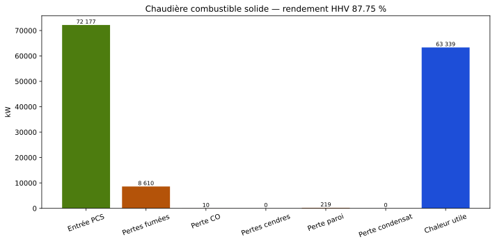

.. _chaudiere_fioul:

Rendement de chaudière fioul — FuelOil_Boiler_Efficiency
========================================================

À quoi ça sert
--------------

Vous avez une chaudière au fioul (domestique ou lourd), un compteur de fioul en
litres par heure, et une mesure des fumées : température, O₂, CO. Le modèle
``FuelOil_Boiler_Efficiency`` en tire le **rendement par la méthode indirecte**
(on calcule les pertes, le rendement est ce qui reste) selon EN 12952-15
(chaudières à tubes d'eau) et EN 12953-11 (chaudières à tubes de fumées), et
vous dit **où part la chaleur** : fumées, CO imbrûlé, rayonnement des parois.

C'est la question d'un audit de chaufferie : combien rapporte un économiseur
qui refroidit les fumées, ou un réglage de combustion qui baisse l'O₂ ?

Le modèle est le pendant fioul de :doc:`ng_boiler_efficiency` (gaz naturel) ; il
se règle de la même façon (paramètres au constructeur, ``calculate()`` qui rend
un tableau ``df``, résultats en attributs).

Fiche de lecture du modèle
--------------------------

Relevé dans ``ThermodynamicCycles/Combustion/FuelOil_Boiler_Efficiency_EN1295X.py`` :

* **Source** : le classeur Veolia « Fuel Oil boiler efficiency EN1295X »
  (rev. 2019-07-18), dont le modèle reproduit le cas fourni à 5·10⁻⁵ près sur les
  rendements (test de la bibliothèque). Les constantes que le classeur attribue
  à EN 12952-15 §4.2 sont reprises telles quelles : la norme elle-même n'est pas
  détenue.
* **Combustible** : analyse élémentaire en **fractions massiques** des seules
  espèces ``C``, ``H``, ``O``, ``N``, ``S`` (somme = 1) ; le fioul est traité
  comme un combustible sans humidité ni cendres. Le **PCI** (kWh/kg) est celui
  du livreur ; le PCS en est déduit par ``PCS = PCI + 21 832 × H`` (kJ/kg).
* **Débit** : en l/h avec la masse volumique (kg/l), ou directement en kg/h.
  À défaut, on peut imposer la chaleur utile (``useful_heat_kW``) et le modèle
  retrouve le débit.
* **Pertes calculées** : fumées (sensible en base PCI ; sensible + latente en
  base PCS), CO (à partir des ppm sur sec), rayonnement des parois, et en cas de
  condensation le condensat sortant (la chaleur de condensation récupérée est un
  gain, pas une perte).
* **Rayonnement** : ``0,0113 × Q^0,7`` pour une chaudière à tubes d'eau,
  ``0,0072 × Q^0,6`` pour une chaudière à tubes de fumées, avec ``Q`` la
  **puissance utile nominale** en MW (``design_useful_heat_kW``), pas la charge
  du moment.
* **Propriétés** : fumées par mélange de gaz (CoolProp), air humide par la
  pression de vapeur saturante, eau par IF97 — hérité du modèle combustible
  solide, dont ce modèle est une spécialisation.
* **Ce qu'il refuse** (``ValueError``) : une espèce hors de ``C, H, O, N, S``,
  une analyse dont la somme n'est pas 1, un ``boiler_type`` inconnu, un débit en
  l/h sans masse volumique, deux débits à la fois, un fioul réchauffé sans Cp,
  un O₂ supérieur à celui de l'air, l'absence de tout débit ou chaleur utile.
* **Ports** : port eau ``Inlet`` / ``Outlet`` (avec la consigne ``To``) et port
  fumées ``FG_Outlet``, comme la chaudière gaz ; une méthode ``plot()`` trace le
  bilan.

Exemple : chaudière de 69 MW à tubes d'eau
------------------------------------------

Le cas fourni avec le classeur : 6 800 l/h de fioul réchauffé à 140 °C, fumées à
140 °C, 3 % d'O₂ sur sec, 40 ppm de CO, air de combustion préchauffé à 60 °C.

.. code-block:: python

    from ThermodynamicCycles.Combustion.FuelOil_Boiler_Efficiency_EN1295X import (
        FuelOil_Boiler_Efficiency,
    )

    chaudiere = FuelOil_Boiler_Efficiency(
        fuel_composition={'C': 0.8571, 'H': 0.1387, 'O': 0.0010, 'N': 0.0009, 'S': 0.0023},
        fuel_LHV_kWh_kg=11.818,        # PCI donné par le livreur
        fuel_flow_l_h=6800,            # compteur fioul
        fuel_density_kg_l=0.81774,
        fuel_temperature_C=140, fuel_cp_kJ_kgK=2.0,
        flue_gas_temperature_C=140,    # sortie fumées
        O2_measured=0.03,              # 3 % sur sec
        CO_ppm=40,
        ambient_temperature_C=27, ambient_RH=0.35, air_temperature_C=60,
        boiler_type='water_tube',
        design_useful_heat_kW=69000,
    )
    chaudiere.calculate()
    print(chaudiere.df.to_string())

Sortie réelle :

.. code-block:: text

                                                                    Value
    Parameter
    Boiler type                                                water_tube
    Fuel LHV (kWh/kg)                                              11.818
    Fuel HHV (kWh/kg)                                             12.6591
    Fuel flow (kg/h)                                              5560.63
    Fuel flow (l/h)                                                6800.0
    --- INPUTS ---
    T flue gas (C)                                                    140
    O2 dry (%)                                                        3.0
    --- COMBUSTION ---
    Air/fuel ratio (Nm3/kg)                                       13.2489
    Excess air (%)                                                  15.58
    Air flow (Nm3/h)                                              73672.3
    Flue gas flow (Nm3/h)                                         77967.9
    Flue gas H2O (% vol)                                            12.16
    Condensation T (C)                                              49.96
    Condensate (kg/h)                                                 0.0
    --- HEAT BALANCE (HHV) ---
    Fuel heat input HHV (kW)                                      70748.1
    Air heat input HHV (kW)                                        1429.1
    Heat credits (kW)                                                 0.0
    Flue gas loss HHV (kW)                                         8610.2
    CO loss (kW)                                                     9.61
    Radiation loss (kW)                                            218.91
    Condensate loss (kW)                                              0.0
    Condensation recovery (kW)                                        0.0
    Total losses HHV (kW)                                          8838.7
    Useful heat (kW)                                              63338.5
    Balance residual (kW)                                             0.0
    Efficiency HHV (%)                                             87.754
    --- HEAT BALANCE (LHV) ---
    Fuel heat input LHV (kW)                                      66070.8
    Flue gas loss LHV (kW)                                         3438.8
    Efficiency LHV (%)                                             94.528
    Source                      veolia_en1295x_fuel_oil_2019 (BOILER_HMB)

Lecture :

* rendement **94,5 % sur PCI**, **87,8 % sur PCS** : l'écart de 6,8 points est
  la chaleur latente de la vapeur d'eau des fumées, perdue tant que les fumées
  restent au-dessus de leur point de rosée (**49,96 °C** ici) ;
* les fumées emportent presque tout (8 610 kW sur 8 839 kW de pertes en PCS) ; le
  rayonnement des parois (219 kW) et le CO (9,6 kW) sont secondaires ;
* ``Balance residual`` nul : le bilan PCS est fermé (entrées = pertes + utile).

Les mêmes grandeurs se lisent en attributs : ``efficiency_LHV``,
``efficiency_HHV`` (fractions, pas %), ``flue_gas_loss`` (PCI, kW),
``flue_gas_loss_HHV``, ``radiation_loss``, ``CO_loss``, ``T_condensation``,
``excess_air_pct``, ``useful_heat_HHV``, ``fuel_flow_kg_h_calc``.

Le bilan se trace par la méthode du modèle, ``chaudiere.plot(basis='PCS')`` :

   Bilan PCS de la chaudière de 69 MW, tracé par ``plot()``. Le titre du tracé
   dit « combustible solide » : défaut de la bibliothèque (voir les pièges).

Paramètres à personnaliser
--------------------------

.. list-table::
   :header-rows: 1
   :widths: 26 14 60

   * - Paramètre
     - Défaut
     - Ce qu'il change, plage usuelle
   * - ``fuel_composition``
     - (obligatoire)
     - Analyse élémentaire, fractions massiques ``C, H, O, N, S``, somme 1. Fioul
       domestique ≈ 86 % C / 13,5 % H ; fioul lourd plus soufré (S jusqu'à 1 à 3 %).
       ``H`` pilote l'écart PCI/PCS et le point de rosée.
   * - ``fuel_LHV_kWh_kg``
     - (obligatoire)
     - PCI du bulletin du livreur, ≈ 11,8 kWh/kg (FOD) ; 11,2 à 11,4 (fioul lourd).
   * - ``fuel_flow_l_h`` + ``fuel_density_kg_l``
     - ``None``
     - Débit au compteur et masse volumique (0,82 à 0,86 kg/l pour le FOD, 0,95 à
       1,0 pour le fioul lourd). Ou ``fuel_flow_kg_h`` seul.
   * - ``useful_heat_kW``
     - ``None``
     - À la place du débit : chaleur utile mesurée côté eau ; le modèle retrouve
       le débit de fioul.
   * - ``fuel_temperature_C`` / ``fuel_cp_kJ_kgK``
     - 25 / ``None``
     - Fioul réchauffé (fioul lourd : 100 à 140 °C) : le Cp devient obligatoire,
       ≈ 2,0 kJ/kg·K.
   * - ``flue_gas_temperature_C``
     - 180
     - Température en sortie chaudière (ou économiseur). Premier levier : environ
       0,5 point de rendement PCI par tranche de 10 K, voir la variante.
   * - ``O2_measured`` / ``O2_basis``
     - 0,03 / ``'dry'``
     - O₂ des fumées en **fraction** (0,03 = 3 %), sur sec ou ``'wet'``. Deuxième
       levier : excès d'air.
   * - ``CO_ppm``
     - 0
     - CO des fumées en ppm sur sec ; la perte reste faible sous 100 ppm.
   * - ``ambient_temperature_C``, ``ambient_RH``, ``ambient_pressure_mbar``
     - 25, 0,5, 1013,25
     - Air de chaufferie (référence des pertes, humidité de l'air comburant).
   * - ``air_temperature_C``
     - ``None`` (= ambiante)
     - Air comburant préchauffé (réchauffeur d'air).
   * - ``boiler_type``
     - ``'water_tube'``
     - ``'water_tube'`` (EN 12952-15) ou ``'fire_tube'`` (EN 12953-11) : choisit
       la loi de rayonnement.
   * - ``design_useful_heat_kW``
     - 1000
     - Puissance utile **nominale** : ne sert qu'au calcul du rayonnement.
   * - ``electrical_credit_kW``, ``other_heat_credit_kW``, ``T_ref``
     - 0, 0, 25
     - Apports d'énergie auxiliaires comptés en entrée ; température de référence
       du bilan.

Variante exécutée : économiseur et réglage d'O₂ sur une chaudière de 2 MW
--------------------------------------------------------------------------

Une chaudière de chauffage à tubes de fumées, 2 MW nominal, 200 l/h de fioul
domestique, fumées à 220 °C et 5 % d'O₂. Que rapportent un réglage de combustion
(O₂ à 3 %), puis un économiseur (fumées à 160 et 120 °C), puis un condenseur
(fumées à 40 °C) ?

.. code-block:: python

    # variante : chaudière à tubes de fumées, 2 MW, fioul domestique
    FIOUL = {'C': 0.8571, 'H': 0.1387, 'O': 0.0010, 'N': 0.0009, 'S': 0.0023}

    def chaudiere_2MW(T_fumees, o2=0.03):
        b = FuelOil_Boiler_Efficiency(
            fuel_composition=FIOUL, fuel_LHV_kWh_kg=11.818,
            fuel_flow_l_h=200, fuel_density_kg_l=0.845,
            flue_gas_temperature_C=T_fumees, O2_measured=o2, CO_ppm=40,
            boiler_type='fire_tube', design_useful_heat_kW=2000)
        b.calculate()
        return b

    print(" T fumées  O2   η PCI   η PCS   pertes fumées  rayonnement  condensat")
    for T, o2 in [(220, 0.05), (220, 0.03), (160, 0.03), (120, 0.03), (40, 0.03)]:
        b = chaudiere_2MW(T, o2)
        print(f"{T:6.0f} °C {o2*100:3.0f} %  {b.efficiency_LHV*100:5.1f} %  {b.efficiency_HHV*100:5.1f} %"
              f"  {b.flue_gas_loss:8.1f} kW  {b.radiation_loss:7.1f} kW  {b.condensate_kg_h:6.1f} kg/h")
    b = chaudiere_2MW(220)
    print("point de rosée", round(b.T_condensation, 2), "°C")

Sortie réelle :

.. code-block:: text

     T fumées  O2   η PCI   η PCS   pertes fumées  rayonnement  condensat
       220 °C   5 %   89.5 %   82.7 %     198.3 kW     10.9 kW     0.0 kg/h
       220 °C   3 %   90.5 %   83.7 %     179.4 kW     10.9 kW     0.0 kg/h
       160 °C   3 %   93.3 %   86.3 %     123.4 kW     10.9 kW     0.0 kg/h
       120 °C   3 %   95.1 %   88.0 %      86.5 kW     10.9 kW     0.0 kg/h
        40 °C   3 %  102.3 %   94.7 %      12.7 kW     10.9 kW   106.2 kg/h
    point de rosée 50.41 °C

Lecture :

* le **réglage de combustion** (5 → 3 % d'O₂) gagne 1 point ; l'**économiseur**
  (220 → 120 °C) en gagne 4,6 de plus : sur 200 l/h, c'est l'ordre de grandeur
  qui justifie l'investissement ;
* **sous le point de rosée** (50,4 °C), la vapeur des fumées condense (106 kg/h
  d'eau acide à évacuer) et le rendement **sur PCI dépasse 100 %** : ce n'est
  pas une erreur, le PCI ne compte pas la chaleur latente que l'on récupère.
  Raisonnez alors sur PCS (94,7 %) ;
* le rayonnement (10,9 kW) ne bouge pas : il ne dépend que de la puissance
  nominale et du type de chaudière.

Cas limites que le modèle refuse
--------------------------------

.. code-block:: python

    base = dict(fuel_composition=FIOUL, fuel_LHV_kWh_kg=11.818, fuel_flow_l_h=200,
                fuel_density_kg_l=0.845, flue_gas_temperature_C=160, O2_measured=0.03,
                boiler_type='fire_tube', design_useful_heat_kW=2000)
    cas = {
        "cendres dans l'analyse": {'fuel_composition': {**FIOUL, 'ash': 0.001}},
        "analyse sommant à 0,90": {'fuel_composition': {k: v * 0.9 for k, v in FIOUL.items()}},
        "chaudière à condensation": {'boiler_type': 'condensing'},
        "l/h sans masse volumique": {'fuel_density_kg_l': None},
        "fioul réchauffé sans Cp": {'fuel_temperature_C': 60},
        "O2 saisi en % (3)": {'O2_measured': 3},
    }
    for nom, modif in cas.items():
        try:
            FuelOil_Boiler_Efficiency(**{**base, **modif}).calculate()
            print(f"{nom:26s} -> accepté")
        except ValueError as e:
            print(f"{nom:26s} -> refusé : {e}")

Sortie réelle :

.. code-block:: text

    cendres dans l'analyse     -> refusé : Analyse elementaire du fioul : cles attendues ('C', 'H', 'O', 'N', 'S') (manquantes [], inconnues ['ash'])
    analyse sommant à 0,90     -> refusé : Analyse elementaire seche : somme = 0.900000, attendu 1
    chaudière à condensation   -> refusé : boiler_type inconnu : 'condensing' (choix : ['fire_tube', 'water_tube'])
    l/h sans masse volumique   -> refusé : fuel_density_kg_l requis avec fuel_flow_l_h
    fioul réchauffé sans Cp    -> refusé : Cp du combustible requis (fuel_cp_daf_kJ_kgK, fioul : fuel_cp_kJ_kgK) : temperature du combustible differente de T_ref
    O2 saisi en % (3)          -> refusé : O2 des fumees superieur ou egal a celui de l'air

Tous ces refus sont voulus : le modèle ne devine ni une analyse incomplète, ni
une unité. Une chaudière à condensation se calcule avec ``boiler_type`` réel
(tubes de fumées le plus souvent) et une température de fumées sous le point de
rosée, comme dans la variante.

Pièges
------

* **O₂ en fraction** : ``O2_measured=0.03`` pour 3 %. Saisir ``3`` est refusé
  (heureusement : 300 % d'O₂).
* **Rendement PCI au-delà de 100 %** en condensation : normal, voir la variante.
  Comparez des chaudières sur la même base.
* **La puissance nominale n'est pas la charge** : ``design_useful_heat_kW`` ne
  sert qu'au rayonnement. À charge partielle, la perte par rayonnement garde sa
  valeur nominale et pèse donc plus en proportion — c'est la convention de la
  norme.
* **Débit et chaleur utile** : donnez l'un *ou* l'autre ; ``fuel_flow_l_h`` et
  ``fuel_flow_kg_h`` ensemble sont refusés.
* **Titre de** ``plot()`` : il affiche « Chaudière combustible solide » et une
  barre « Pertes cendres » (toujours nulle) pour le fioul, hérités du modèle
  parent — défaut signalé dans ``BUGS_LIB.md`` ; les valeurs tracées sont justes.

Voir aussi
----------

* :doc:`ng_boiler_efficiency` — même méthode pour une chaudière gaz naturel,
  avec récupération sur fumées et réglage d'excès d'air ;
* :doc:`chaudiere_biomasse` — le modèle parent, pour le bois et le charbon
  (humidité, cendres, imbrûlés) ;
* :doc:`ng_heating_value` — PCI / PCS d'un gaz ;
* :doc:`../ports_connexions` — les ports eau et fumées (``FluidPort``, mélange de
  gaz humide).
