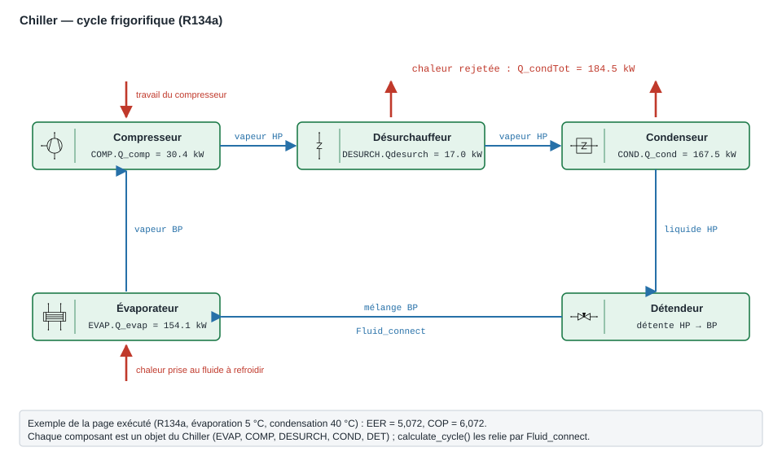
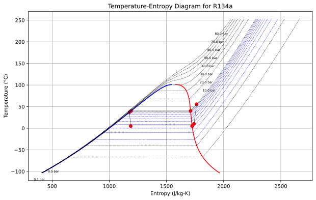
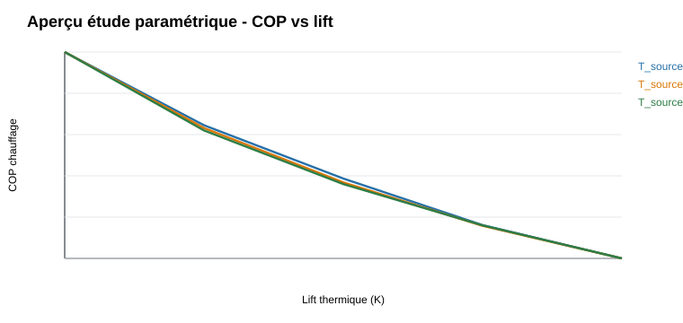

.. _chiller:

Groupe froid et pompe à chaleur — Chiller
=========================================

Le module ``Chiller`` modélise un cycle frigorifique complet : évaporateur, compresseur, désurchauffeur, condenseur, détendeur. En mode PAC, la chaleur au condenseur est valorisée.

   Le fluide frigorigène traverse successivement l'évaporateur, le
   compresseur, le désurchauffeur, le condenseur et le détendeur.

   Le même cycle dans l'IHM : scène livrée « 2 - Froid et cryogenie / Machine
   frigorifique », exportée telle quelle. De gauche à droite : source de R134a
   vapeur BP, compresseur (12 bar), condenseur (sous-refroidissement 5 K),
   détendeur (1 bar), évaporateur (surchauffe 5 K), sortie.

Le groupe se décrit par un fluide et trois dictionnaires — ``evap_params``,
``comp_params``, ``cond_params`` — détaillés dans la table
:ref:`chiller-personnalisation`.

Exemple
-------

.. code-block:: python

    from ThermodynamicCycles.Chiller import Object as Chiller

    ch = Chiller(
        fluid='R134a',
        evap_params={'Ti_degC': 5, 'surchauff': 5, 'F': 1.0},
        comp_params={'Tcond_degC': 40, 'eta_is': 0.75, 'Tdischarge_target': 90},
        cond_params={'subcooling': 3}
    )
    ch.calculate_cycle()
    print(ch.df)

    # Diagramme température-entropie du cycle (dôme de saturation + isobares + cycle)
    ch.plot()                 # figsize=(10, 6) par défaut
    # ch.plot(figsize=(12, 7))  # taille personnalisée
    # ch.plot_TS_diagram()      # alias de ch.plot()

Sortie ``ch.df`` (valeurs réelles pour l'exemple ci-dessus, R134a) :

.. list-table::
   :widths: 40 30 30
   :header-rows: 1

   * - Index (``ch.df``)
     - Valeur
     - Unité
   * - ``Fluid``
     - R134a
     - -
   * - ``T_evap (C)``
     - 5
     - degC
   * - ``T_cond (C)``
     - 40
     - degC
   * - ``Lift (K)``
     - 35
     - K
   * - ``EER``
     - 5,072
     - -
   * - ``COP``
     - 6,072
     - -
   * - ``COP_Carnot``
     - 8,95
     - -
   * - ``Eta_Carnot (%)``
     - 67,9
     - %
   * - ``Q_comp (kW)``
     - 30,39
     - kW
   * - ``Q_losses (kW)``
     - 0,0
     - kW
   * - ``Q_evap (kW)``
     - 154,13
     - kW
   * - ``Q_condTot (kW)``
     - 184,51
     - kW
   * - ``T_refoulement (C)``
     - 55,5
     - degC
   * - ``P_evap (bar)``
     - 3,50
     - bar
   * - ``P_cond (bar)``
     - 10,17
     - bar

Diagramme T-S généré par ``ch.plot()``
~~~~~~~~~~~~~~~~~~~~~~~~~~~~~~~~~~~~~~~~

La méthode ``ch.plot()`` (alias ``ch.plot_TS_diagram()``) construit un diagramme
température-entropie via ``Temperature_Entropy_Chart`` : dôme de saturation du
fluide (courbe liquide en bleu, vapeur en rouge), isobares en pointillés
étiquetées en bar, et les huit points du cycle (``ch.points``) reliés par des
flèches — évaporation, surchauffe, compression, désurchauffe, condensation,
sous-refroidissement, détente et retour à l'évaporateur.

   Sortie réelle de ``ch.plot()`` pour le cycle R134a de l'exemple (générée en
   exécutant la bibliothèque). Les points rouges parcourent le cycle
   frigorifique dans le sens horaire.

.. _chiller-personnalisation:

Paramètres à personnaliser
--------------------------

Les défauts de la colonne « si la clé manque » s'appliquent quand le
dictionnaire est fourni mais incomplet (relevé dans ``Chiller.py``).

.. list-table::
   :widths: 18 16 12 54
   :header-rows: 1

   * - Clé
     - Dictionnaire
     - Si la clé manque
     - Effet
   * - ``fluid``
     - (argument)
     - ``'R134a'``
     - Nom CoolProp du frigorigène (``'R290'``, ``'R717'``, ``'R1234ze(E)'``…).
       Fluide sous-critique uniquement (voir le cas limite ci-dessous).
   * - ``Ti_degC``
     - ``evap_params``
     - 5
     - Température d'évaporation (°C). +1 K ≈ +3,7 % d'EER.
   * - ``surchauff``
     - ``evap_params``
     - 2
     - Surchauffe en sortie d'évaporateur (K).
   * - ``F``
     - ``evap_params``
     - 1
     - Débit massique de frigorigène (kg/s). Toutes les puissances lui sont
       proportionnelles ; l'EER n'en dépend pas.
   * - ``Tcond_degC``
     - ``comp_params``
     - 40
     - Température de condensation (°C) ; fixe la haute pression.
       −1 K ≈ +3,5 % d'EER.
   * - ``eta_is``
     - ``comp_params``
     - 0,8
     - Rendement isentropique du compresseur (0 à 1).
   * - ``Tdischarge_target``
     - ``comp_params``
     - 80
     - Refoulement maximal (°C). Au-delà, le compresseur est refroidi et la
       chaleur retirée sort du cycle (``Q_losses``).
   * - ``Q_comp``
     - ``comp_params``
     - absent
     - Puissance compresseur imposée (W). Si elle est donnée, c'est elle qui
       fixe le débit, et ``F`` est ignoré.
   * - ``subcooling``
     - ``cond_params``
     - 2
     - Sous-refroidissement en sortie de condenseur (K).

Variante — même machine, trois fluides
--------------------------------------

Même débit massique (1 kg/s), mêmes températures : seul le fluide change.

.. code-block:: python

    from ThermodynamicCycles.Chiller import Object as Chiller

    # variante : même machine, même débit massique, trois fluides
    for fluide in ["R134a", "R290", "R717"]:
        ch = Chiller(
            fluid=fluide,
            evap_params={'Ti_degC': 5, 'surchauff': 5, 'F': 1.0},
            comp_params={'Tcond_degC': 40, 'eta_is': 0.75, 'Tdischarge_target': 90},
            cond_params={'subcooling': 3}
        )
        ch.calculate_cycle()
        r = ch.df['Chiller']
        q_pertes = r['Q_losses (kW)'] + 0.0   # + 0.0 : affiche 0.00 et non -0.00
        print(f"{fluide:6s} EER {r['EER']:.3f}  Q_evap {r['Q_evap (kW)']:7.2f} kW  "
              f"Q_comp {r['Q_comp (kW)']:6.2f} kW  Q_losses {q_pertes:5.2f} kW  "
              f"refoulement {r['T_refoulement (C)']:.1f} °C")

Sortie réelle :

.. code-block:: text

   R134a  EER 5.072  Q_evap  154.13 kW  Q_comp  30.39 kW  Q_losses  0.00 kW  refoulement 55.5 °C
   R290   EER 4.988  Q_evap  290.78 kW  Q_comp  58.29 kW  Q_losses  0.00 kW  refoulement 55.1 °C
   R717   EER 5.163  Q_evap 1104.93 kW  Q_comp 213.99 kW  Q_losses 55.55 kW  refoulement 90.0 °C

Ce qu'il faut en lire :

- **à débit massique égal, la puissance frigorifique n'a rien de comparable** :
  l'ammoniac porte 7 fois plus de chaleur latente par kilogramme que le R134a.
  Pour comparer des fluides à puissance égale, divisez ``F`` par le rapport des
  ``Q_evap`` — l'EER, lui, ne change pas ;
- l'ammoniac refoulerait bien au-delà de 90 °C : la limite
  ``Tdischarge_target`` s'active, 55,55 kW sont retirés au compresseur et
  **n'arrivent pas au condenseur**. L'EER reste juste, le COP chauffage baisse.

Variante — dimensionner à puissance compresseur imposée
-------------------------------------------------------

Quand on connaît la puissance absorbée d'un compresseur (plaque signalétique,
mesure) plutôt que son débit, on la donne par ``Q_comp`` (en **W**) :

.. code-block:: python

    from ThermodynamicCycles.Chiller import Object as Chiller

    # variante : puissance compresseur imposée (50 kW) au lieu du débit
    ch = Chiller(
        fluid='R134a',
        evap_params={'Ti_degC': 5, 'surchauff': 5},
        comp_params={'Tcond_degC': 40, 'eta_is': 0.75, 'Tdischarge_target': 90,
                     'Q_comp': 50000},          # W
        cond_params={'subcooling': 3}
    )
    ch.calculate_cycle()
    print(f"débit calculé : {ch.COMP.F:.3f} kg/s")
    print(ch.df.loc[['EER', 'Q_comp (kW)', 'Q_evap (kW)', 'Q_condTot (kW)']])

Sortie réelle :

.. code-block:: text

   débit calculé : 1.646 kg/s
                  Chiller
   EER              5.072
   Q_comp (kW)       50.0
   Q_evap (kW)     253.62
   Q_condTot (kW)  303.62

L'EER est celui de l'exemple (mêmes températures) ; le débit, donc toutes les
puissances, est mis à l'échelle de 50 / 30,39 = 1,646.

Variante — le même cycle assemblé à la main
-------------------------------------------

``Chiller`` n'est qu'un enchaînement de cinq composants du paquet, reliés par
``Fluid_connect``. Les assembler soi-même donne exactement les mêmes chiffres et
ouvre la porte à ce que ``Chiller`` ne permet pas : intercaler un échangeur, lire
l'état entre deux composants, changer de détendeur.

.. code-block:: python

    from ThermodynamicCycles.Evaporator import Evaporator
    from ThermodynamicCycles.Compressor import Compressor
    from ThermodynamicCycles.Desuperheater import Desuperheater
    from ThermodynamicCycles.Condenser import Condenser
    from ThermodynamicCycles.Expansion_Valve import Expansion_Valve
    from ThermodynamicCycles.Connect import Fluid_connect
    from ThermodynamicCycles.FluidPort.FluidPort import ThermoPropsSI

    # variante : les cinq composants du Chiller, reliés à la main
    fluide = "R134a"
    EVAP, COMP = Evaporator.Object(), Compressor.Object()
    DESURCH, COND, DET = Desuperheater.Object(), Condenser.Object(), Expansion_Valve.Object()
    for c in (EVAP, COMP, DESURCH, COND, DET):
        c.fluid = fluide

    EVAP.Ti_degC, EVAP.surchauff, EVAP.Inlet.F = 5, 5, 1.0
    COMP.Tcond_degC, COMP.eta_is, COMP.Tdischarge_target = 40, 0.75, 90
    COND.subcooling = 3

    # 1er passage : entrée évaporateur estimée (liquide à 40 °C sous 1 bar)
    EVAP.Inlet.h = ThermoPropsSI("H", "P", 1e5, "T", 40 + 273.15, fluide)
    EVAP.calculate()
    Fluid_connect(COMP.Inlet, EVAP.Outlet);    COMP.calculate()
    Fluid_connect(DESURCH.Inlet, COMP.Outlet); DESURCH.calculate()
    Fluid_connect(COND.Inlet, DESURCH.Outlet); COND.calculate()
    Fluid_connect(DET.Inlet, COND.Outlet)
    Fluid_connect(DET.Outlet, EVAP.Inlet)      # la basse pression remonte au détendeur
    DET.calculate()
    # Rebouclage : l'évaporateur est recalculé avec le titre réel en sortie de détendeur
    Fluid_connect(EVAP.Inlet, DET.Outlet);     EVAP.calculate()

    EER = EVAP.Q_evap / COMP.Q_comp
    Q_chaud = COND.Q_cond + DESURCH.Qdesurch
    print(f"Q_evap   = {EVAP.Q_evap/1000:.2f} kW")
    print(f"Q_comp   = {COMP.Q_comp/1000:.2f} kW")
    print(f"Qdesurch = {DESURCH.Qdesurch/1000:.2f} kW ; Q_cond = {COND.Q_cond/1000:.2f} kW")
    print(f"EER = {EER:.3f} ; COP = {Q_chaud/COMP.Q_comp:.3f}")
    print(f"titre en entrée d'évaporateur : {ThermoPropsSI('Q','P',EVAP.Inlet.P,'H',EVAP.Inlet.h,fluide):.3f}")

Sortie réelle :

.. code-block:: text

   Q_evap   = 154.13 kW
   Q_comp   = 30.39 kW
   Qdesurch = 17.03 kW ; Q_cond = 167.49 kW
   EER = 5.072 ; COP = 6.072
   titre en entrée d'évaporateur : 0.232

On retrouve l'EER et le COP de l'exemple, et l'on voit en plus ce que
``ch.df`` ne publie pas : la part du désurchauffeur (17,03 kW, soit 9 % de la
chaleur rejetée, disponible au-dessus de 40 °C) et le titre de 23 % de vapeur
de flash à l'entrée de l'évaporateur. Pour un cycle à recyclage résolu par
itération plutôt que par ce passage unique, voir ``FlowsheetSolver`` dans
:doc:`outils_diagrammes`.

Cas limite que le modèle refuse — cycle transcritique
-----------------------------------------------------

.. code-block:: python

    from ThermodynamicCycles.Chiller import Object as Chiller

    # Cas limite : CO2 (R744) condensé à 40 °C, au-delà de son point critique (31 °C)
    ch = Chiller(
        fluid='R744',
        evap_params={'Ti_degC': 5, 'surchauff': 5, 'F': 1.0},
        comp_params={'Tcond_degC': 40, 'eta_is': 0.75, 'Tdischarge_target': 90},
        cond_params={'subcooling': 3}
    )
    try:
        ch.calculate_cycle()
    except ValueError as err:
        print("refusé :", err)

Sortie réelle :

.. code-block:: text

   refusé : Temperature to QT_flash [313.15 K] may not be above the numerical critical point of 304.128200002981 K

Le refus est juste : au-dessus de 31 °C, le CO\ :sub:`2` ne se condense plus.
Un groupe au CO\ :sub:`2` en climat chaud (refroidisseur de gaz, haute pression
optimisée) n'est pas modélisé par ``Chiller``.

Pièges
------

- **Un dictionnaire omis ou vide est ignoré.** Sans ``comp_params`` (ou avec
  ``comp_params={}``), les défauts de la table ne s'appliquent pas :
  ``Tcond_degC`` reste à ``None`` et ``calculate_cycle()`` lève un
  ``TypeError: PropsSI(): incompatible function arguments`` qui ne dit pas
  quel paramètre manque. Même chose pour ``Ti_degC`` sans ``evap_params``.
  Passez toujours les trois dictionnaires avec **au moins une clé** chacun
  (``comp_params={'eta_is': 0.8}`` suffit à déclencher les autres défauts).
- **Une ligne parasite** ``test HP calculation 1016593.02…`` est imprimée par
  le compresseur à chaque calcul (haute pression en Pa). Elle est omise des
  sorties publiées sur cette page ; elle ne signale aucune erreur.
- ``Q_comp`` s'exprime en **W** dans ``comp_params`` mais se lit en **kW**
  dans ``ch.df``.
- ``Q_losses`` peut s'afficher ``-0.0`` : c'est un zéro.

Étude paramétrique
------------------

Le module fournit aussi ``Chiller.parametric_study(...)`` pour comparer le COP
selon la température source et la température cible.

.. code-block:: python

    from ThermodynamicCycles.Chiller import Object as Chiller

    df_study = Chiller.parametric_study(
        fluid="R134a",
        T_source_range=[0, 5, 10],
        T_cible_range=[35, 40, 45, 50],
        superheat=5,
        subcool=3,
        eta_is=0.78,
        save_fig="chiller_parametric.svg",
    )

    print(df_study)

Colonnes du DataFrame ``df_study`` retourné :

.. list-table::
   :widths: 35 45 20
   :header-rows: 1

   * - Résultat
     - Colonne du DataFrame
     - Unité
   * - Température source
     - ``T_source (degC)``
     - degC
   * - Température cible
     - ``T_cible (degC)``
     - degC
   * - Lift thermique
     - ``Lift (K)``
     - K
   * - COP chauffage
     - ``COP``
     - -
   * - EER froid
     - ``EER``
     - -
   * - COP de Carnot
     - ``COP Carnot``
     - -
   * - Efficacité de Carnot
     - ``Eta Carnot (%)``
     - %
   * - Puissance compresseur
     - ``W_comp (kW)``
     - kW
   * - Puissance condenseur
     - ``Q_cond (kW)``
     - kW

Extrait de ``df_study`` (R134a) — une ligne par couple (source, cible) valide :

.. list-table::
   :widths: 16 16 12 12 14 15 15
   :header-rows: 1

   * - T_source
     - T_cible
     - Lift
     - COP
     - W_comp
     - Q_cond
     - Eta Carnot
   * - 5
     - 40
     - 35
     - 6,28
     - 29,2
     - 183,3
     - 70,1 %
   * - 10
     - 40
     - 30
     - 7,40
     - 24,5
     - 181,6
     - 70,9 %
   * - 0
     - 50
     - 50
     - 4,30
     - 41,3
     - 177,4
     - 66,5 %

Plot sauvegardé par l'étude paramétrique (argument ``save_fig``) :

   Sortie réelle : figure à deux panneaux — à gauche le COP chauffage en
   fonction du lift thermique, à droite la puissance compresseur en fonction de
   la température cible, avec une courbe par température source.

Principe de calcul
------------------

``calculate_cycle()`` résout le cycle **séquentiellement**, composant par
composant. ``Fluid_connect(sortie, entrée)`` recopie l'état du fluide (débit,
pression, température, enthalpie, entropie) de la sortie d'un composant vers
l'entrée du suivant :

1. **Évaporateur** : évaporation à ``Ti_degC`` puis surchauffe de
   ``surchauff`` K. Le débit massique est celui de ``evap_params['F']``
   (kg/s). Il est **imposé** : à débit égal, deux fluides ne donnent donc pas
   la même puissance frigorifique.
2. **Compresseur** : compression jusqu'à la pression de saturation de
   ``Tcond_degC``, avec le rendement isentropique ``eta_is``. Si le refoulement
   dépasse ``Tdischarge_target``, le compresseur est refroidi jusqu'à cette
   valeur : la chaleur retirée sort du cycle (``Q_losses``) et n'arrive pas au
   condenseur.
3. **Désurchauffeur** : il ramène la vapeur haute pression à saturation
   (``Qdesurch``, chaleur récupérable à haute température).
4. **Condenseur** : condensation puis sous-refroidissement de ``subcooling`` K
   (``Q_cond``).
5. **Détendeur** : détente isenthalpique jusqu'à la pression d'évaporation.
6. **Rebouclage** : la sortie du détendeur redevient l'entrée de
   l'évaporateur, qui est recalculé avec ce titre vapeur réel.

Indicateurs produits dans ``ch.df`` :

.. math::

   EER = \frac{Q_{evap}}{Q_{comp}} \qquad
   COP = \frac{Q_{cond} + Q_{desurch}}{Q_{comp}} \qquad
   COP_{Carnot} = \frac{T_{cond}}{T_{cond} - T_{evap}}

Le rendement de Carnot affiché (``Eta_Carnot (%)``) est ``COP / COP_Carnot``,
c'est-à-dire en mode chauffage. Sans refroidissement du compresseur
(``Q_losses`` = 0), le bilan ``Q_condTot = Q_evap + Q_comp`` est exact. Dès que
``Q_losses`` > 0, ``Q_condTot = Q_evap + Q_comp - Q_losses`` : l'EER est
inchangé mais le COP baisse.

**Limite : cycle sous-critique uniquement.** Si la température de condensation
dépasse le point critique du fluide (31,0 °C pour le R744/CO\ :sub:`2`), CoolProp
refuse le calcul (``ValueError``). Un cycle transcritique, dont la haute pression
est un degré de liberté et où un refroidisseur de gaz remplace le condenseur,
n'est pas modélisé.

**Ordres de grandeur** (R134a et R717, eau glacée +5 °C, condensation
+40 °C, ``eta_is`` = 0,75 ; calcul réel du module) :

.. list-table::
   :header-rows: 1

   * - Variation
     - Effet sur l'EER
   * - +1 K à l'évaporation
     - +3,7 à +3,8 %
   * - −1 K à la condensation
     - +3,4 à +3,6 %
   * - +1 K de sous-refroidissement
     - +0,5 à +1,0 %
   * - Évaporation 5 → 0 °C
     - −16 % (−18 % si la condensation est à 35 °C)
   * - Condensation 35 → 45 °C (évaporation à 5 °C)
     - −30 %

Le rapport ``Q_condTot / Q_evap`` du cycle vaut 1,13 à 1,24 sur ces cas : c'est
``1 + 1/EER`` tant que ``Q_losses`` = 0.

Méthodes
--------

* ``ch.calculate_cycle()`` — Calcule le cycle complet
* ``ch.df`` — DataFrame de synthèse (EER, COP, puissances, pressions)
* ``ch.print_results()`` — Affiche le df de chaque composant
* ``ch.plot()`` — Diagramme T-S du cycle
* ``ch.summary()`` — Synthèse technique du cycle
* ``Chiller.parametric_study(...)`` — Étude paramétrique COP, EER, lift et puissance compresseur
