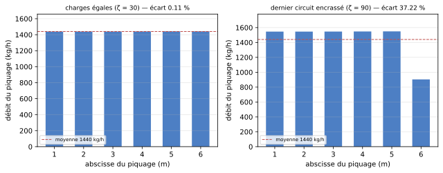

.. _collecteur_distributeur:

Distributeur et collecteur — Manifold
=====================================

À quoi ça sert
--------------

Vous dimensionnez un réseau d'eau chaude ou d'eau glacée : un collecteur
distribue vers plusieurs circuits (radiateurs, CTA, process) ou les recollecte.
La question qui décide du prix est toujours la même : **les piquages reçoivent-ils
le débit qu'on leur a promis ?** Un collecteur mal équilibré donne au premier
piquage plus que son dû et affame le dernier ; l'installateur compense alors avec
un équilibrage, ou le dernier circuit ne tient pas sa consigne.

``Hydraulic.Manifold`` calcule cette répartition : pertes linéaires du collecteur
piquage par piquage, pertes singulières d'entrée et de sortie (Idel'chik), et
récupération de pression dynamique le long du collecteur. Il rend le débit de
chaque piquage, l'écart de répartition, la perte totale et la vitesse dans le
collecteur. Il s'utilise de deux façons : **seul** (``Manifold.Object`` : chaque
piquage porte une résistance, pour étudier une géométrie) ou **dans un réseau**
(``add_manifold`` : ce sont les circuits branchés qui font la répartition).

Fiche de lecture du modèle
--------------------------

Relevé dans ``ThermodynamicCycles/Hydraulic/Manifold.py`` :

* **Géométrie** (``ManifoldSpec``) : ``kind`` (``'distributor'`` un entrant,
  N sortants ; ``'collector'`` N entrants, un sortant), diamètre intérieur du
  collecteur, abscisse de chaque piquage, diamètre des piquages (un seul ou un
  par piquage), **abscisse du raccord principal**, rugosité du collecteur
  (0,046 mm par défaut, acier du commerce) et ``model``.
* **Deux modèles** : ``'detailed'`` assemble un tronçon de collecteur entre
  chaque piquage (pertes linéaires, tés, récupération de dynamique) ;
  ``'pressure_node'`` ramène le collecteur à un nœud unique et ne garde qu'une
  perte d'entrée par piquage (``tap_zeta``, 0 = nœud parfait). Ce dernier sert
  à dégrossir, ou quand la géométrie n'est pas connue.
* **Singulières** : relations Idel'chik (diagramme 7.40 pour une distribution à
  section constante, caractéristique ``A1' = n · (d_piquage/d_collecteur)² /
  √(0,6 + (fs/fa)² + ζ_sec + ζ_app)``) ; la corrélation ``'legacy'`` reste
  disponible pour rejouer d'anciens résultats.
* **Ce qu'il refuse** (``ValueError``) : un ``kind`` ou un ``model`` inconnu, un
  diamètre négatif, aucun piquage, un nombre de diamètres différent du nombre de
  positions, une ``tap_zeta`` négative, un appel avec **``F`` et ``P_feed`` à la
  fois** (ou aucun des deux), et **aucune charge** sur les piquages — sans
  résistance aval, la répartition n'est pas déterminée.
* **Écart connu, publié et non masqué** : si le raccord principal débite des deux
  côtés (piquages de part et d'autre de son abscisse) en modèle détaillé, la perte
  du partage au té central n'est pas calculée ; ``feed_split_unmodelled`` vaut
  alors ``True`` pendant tout le calcul.

Exemple : collecteur de 6 piquages, 80 °C
-----------------------------------------

Un collecteur DN 100, six piquages DN 25 espacés de 1 m, raccord principal à
l'extrémité (abscisse 6 m). Chaque piquage alimente un circuit de même
résistance (ζ = 30 sur le diamètre du piquage) vers une pression commune de
2 bar. Le collecteur reçoit 2,4 kg/s au total.

.. code-block:: python

    from ThermodynamicCycles.Hydraulic.Manifold import ManifoldSpec, Object

    collecteur = Object()
    collecteur.spec = ManifoldSpec('collector', d_header=0.100,
                                   positions=[1.0, 2.0, 3.0, 4.0, 5.0, 6.0],
                                   d_taps=0.025, feed_position=6.0)
    collecteur.T_K = 353.15          # eau a 80 C
    collecteur.P_taps = 2.0e5        # Pa, pression commune a l'aval des circuits
    collecteur.F = 2.4               # kg/s au raccord principal
    collecteur.tap_load_zeta = 30.0  # une valeur = la meme pour les 6 piquages
    collecteur.calculate()
    print(collecteur.df.to_string())

Sortie réelle :

.. code-block:: text

    Manifold
    kind                                    collector
    model                                    detailed
    n_taps                                          6
    F_total_kgs                                   2.4
    V_header_ms                              0.314419
    dp_total_Pa                           10611.68285
    zeta_total                             220.894014
    maldistribution                          0.001125
    converged                                    True
    feed_split_unmodelled                        True

Les six piquages reçoivent 0,3996 à 0,4004 kg/s, soit **0,11 % d'écart de
répartition** (``maldistribution``) : la perte linéaire du tronçon de collecteur
entre deux piquages est si faible devant celle des circuits que le collecteur se
comporte comme un nœud de pression. Le solveur converge (résidu 1,9·10⁻¹⁶).

Variante : un piquage trois fois plus chargé
--------------------------------------------

Le dernier circuit reçoit un échangeur encrassé : sa résistance passe de ζ = 30 à
90. Que reçoivent les autres ?

.. code-block:: python

    # variante : le dernier circuit recoit un echangeur encrasse (zeta 30 -> 90)
    collecteur.tap_load_zeta = [30, 30, 30, 30, 30, 90]
    collecteur.calculate()
    print("debits kg/s      :", [round(m, 3) for m in collecteur.tap_flows])
    print("ecart de repart  : %.1f %%" % (100 * collecteur.maldistribution))
    print("perte totale Pa  : %.0f" % collecteur.dp_total)

Sortie réelle :

.. code-block:: text

    debits kg/s      : [0.429, 0.429, 0.43, 0.43, 0.43, 0.251]
    ecart de repart  : 37.2 %
    perte totale Pa  : 12255

Le piquage encrassé passe de 0,400 à 0,251 kg/s (−37 %) et les cinq autres
reçoivent 0,430 kg/s, soit **+7,5 %** : un circuit bouché fait débiter davantage
tous les autres. C'est ce que mesure un équilibrage : l'écart de répartition de
37 % (contre 0,1 % à charge égale) ne se devine pas, il se calcule.

   Répartition des débits le long du collecteur (2,4 kg/s, 80 °C), à charges
   égales et avec un dernier circuit de résistance triple. Le trait rouge est le
   débit moyen.

IHM PyqtSimulator
-----------------

Le nœud **« Distributeur / Collecteur »** (op. 977) expose la même géométrie
(``dmm``, ``positions``, ``dtaps``, ``feed``, ``rough``) et publie les débits de
piquage en m³/h, les pressions, la vitesse dans le collecteur, l'écart de
répartition (``maldis``) et une note qui signale la limite du modèle. Dans une
scène, il se relie aux circuits réels : ce sont les vannes, tuyaux et échangeurs
branchés sur ses piquages qui déterminent la répartition, pas une résistance
saisie.

Table de personnalisation
-------------------------

Tous les réglages sont des attributs de l'objet (ou du ``ManifoldSpec``) posés
avant ``calculate()`` :

.. list-table::
   :header-rows: 1

   * - Réglage
     - Défaut
     - À changer quand…
   * - ``spec.kind``
     - ``'collector'`` (imposé à la création)
     - le sens du fluide s'inverse : ``'distributor'``
   * - ``spec.d_header``
     - imposé (m)
     - le collecteur est d'un autre diamètre (DN 80, DN 150)
   * - ``spec.positions``
     - imposé (m)
     - l'espacement des piquages change (raccourcir l'écart réduit l'écart de
       répartition)
   * - ``spec.d_taps``
     - imposé (m, un ou par piquage)
     - un piquage a un diamètre différent (une dérivation de ballon)
   * - ``spec.feed_position``
     - ``0.0`` m
     - le raccord principal n'est pas à l'extrémité
   * - ``spec.model``
     - ``'detailed'``
     - la géométrie n'est pas connue : ``'pressure_node'`` avec ``tap_zeta``
   * - ``F``
     - aucun
     - vous imposez le débit total (le cas courant)
   * - ``P_feed``
     - aucun
     - vous imposez la pression au raccord (boucle fermée) — jamais avec ``F``
   * - ``P_taps``
     - ``1.0e5`` Pa
     - la pression commune à l'aval des circuits n'est pas atmosphérique
   * - ``T_K``
     - ``293.15`` K
     - l'eau est chaude (masse volumique) ou glacée
   * - ``tap_load_zeta``
     - aucun (obligatoire)
     - un ou plusieurs circuits changent de résistance (encrassement, vanne
       fermée : ζ élevée)
   * - ``fluid``
     - ``'water'``
     - autre fluide du réseau (solution, eau glycolée)

Pièges
------

* **``F`` ou ``P_feed``, jamais les deux** : le débit total et la pression au
  raccord ne peuvent pas être imposés ensemble (il n'y a qu'une inconnue au
  raccord). Le modèle lève plutôt que d'en ignorer un.
* **Une charge par piquage est obligatoire** : sans elle, rien ne fixe la
  répartition. Pour étudier la géométrie seule, donnez la même résistance à tous
  les piquages.
* **Raccord entre deux piquages** : en modèle détaillé, la perte du partage au té
  central n'est pas calculée, même avec un raccord à l'extrémité
  (``feed_split_unmodelled`` vaut ``True`` dès qu'il y a des piquages de part et
  d'autre, y compris sur l'abscisse du raccord) ; ne lisez pas la perte totale
  comme une valeur complète dans ce cas.
* **Abscisse du raccord** : elle change peu la répartition à charge égale
  (0,11 % pour un raccord à l'extrémité, 0,06 % au milieu sur l'exemple), car ce
  sont les circuits qui dominent la perte. Elle compte en revanche dès que les
  charges diffèrent : c'est elle qui décide de quel côté circule le débit du
  collecteur, donc des tronçons qui portent le plus de pertes.

Voir aussi
----------

* :doc:`../004-hydraulic/TA_valve` — la vanne qui équilibre ces circuits ;
* :doc:`../ports_connexions` — les ports fluides du réseau nodal
  (``HydraulicNetwork``, ``LocalLossElement``).

