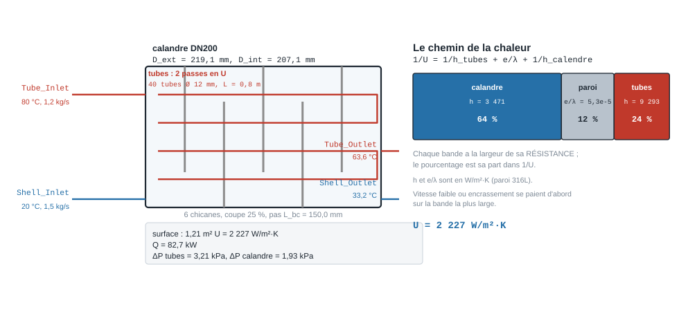

.. _echangeur_calandre:

Échangeur à calandre de catalogue — méthode de Kern
===================================================

.. index::
   pair: échangeur; calandre
   single: ShellAndTubeDesignHEX
   single: EchangeurCalandreDesignHEX
   single: Kern (méthode de)

Cette page documente ``ThermodynamicCycles.HEX.EchangeurCalandreDesignHEX``
(alias ``ShellAndTubeDesignHEX``), le seul modèle du catalogue ``HEX`` où le
**``UA`` n'est pas une entrée** : il découle de la géométrie réelle de
l'appareil, comme les **deux pertes de charge**.

Pourquoi ce modèle existe
-------------------------

   À gauche, la coupe de l'appareil tel que le modèle le voit : calandre
   DN200, chicanes segmentaires alternées, faisceau en deux épingles en U, et
   les quatre ports avec leurs températures ou débits. À droite, le **chemin
   de la chaleur** : chaque bande a la largeur de sa résistance, ce qui montre
   d'un coup d'œil où se joue le ``U``. Toutes les valeurs sont celles que la
   bibliothèque calcule pour le cas de cette page (eau 80 °C dans les tubes,
   eau 20 °C dans la calandre).

Tous les autres modules de ``HEX`` prennent ``UA`` en paramètre et des chutes
de pression ``P_drop`` / ``P_drop_2`` **imposées** : ils répondent à « que fait
cet échangeur si je lui donne cette conductance ? ». Aucun ne répondait à « que
vaut cet échangeur, que j'ai au catalogue, avec ses 40 tubes de 12 mm dans une
calandre DN200 ? » — la question du dimensionnement et du rétrofit.

Géométrie de référence : CIAT CORELIS UDH 219 08C 2B F03
--------------------------------------------------------

.. list-table:: Ce que décrit le code constructeur, et où le modèle le range
   :header-rows: 1
   :widths: 26 34 40

   * - Élément
     - Valeur
     - Attribut du modèle
   * - Calandre DN200
     - ``D_ext = 219,1 mm``
     - ``shell_d_ext``
   * - Épaisseur de paroi
     - 6 mm (valeur usuelle, à vérifier sur le plan)
     - ``shell_epaisseur``
   * - Faisceau 08
     - longueur droite 800 mm
     - ``L_tube``
   * - Tubes en U, 2 passes
     - Ø 12 ou 16 mm, e = 0,8 mm
     - ``d_ext``, ``epaisseur_tube``, ``passes``
   * - Tubes rainurés
     - ``E_h`` 1,5 à 2,2 ; ``E_f`` 2,0 à 3,5
     - ``E_h``, ``E_f``
   * - Chicanes segmentaires
     - coupe 20 à 25 %, pas ``L_bc``
     - ``coupe_chicane``, ``L_bc``
   * - Matériaux F03
     - acier carbone, 316L, cuivre
     - ``materiau``

.. warning::

   Le **nombre de tubes** (``nb_tubes``, 40 par défaut) et l'**épaisseur de
   calandre** ne figurent pas dans la spécification fournie : ce sont des
   valeurs de départ, déclarées comme telles. La surface annoncée par le
   constructeur (2,0 à 3,5 m²) sert de contrôle : avec 40 tubes de 12 mm sur
   800 mm, le modèle donne **1,21 m²**, en bas de cette plage. Passer à
   ``nb_tubes = 60`` porte la surface à 1,81 m².

Les corrélations, et leurs sources
----------------------------------

.. list-table:: Aucune constante n'est posée à la main
   :header-rows: 1
   :widths: 22 30 48

   * - Côté
     - Corrélation
     - Source
   * - Tubes
     - Gnielinski (1976), tubes lisses
     - VDI Heat Atlas, 2010, F3 ; Kern § 6 pour la démarche
   * - Tubes, perte de charge
     - Fanning, ``f = 0,0791 Re^-0,25``
     - Kern, *Process Heat Transfer*, 1950, § 6
   * - Calandre
     - ``h = 0,36 (λ/d_eq) Re^0,55 Pr^(1/3)``
     - Kern § 7 (pas triangulaire, coupe 25 %)
   * - Calandre, géométrie
     - diamètre équivalent ``d_eq``, pas ``L_bc``
     - Kern § 7, eq. 7.1 et 7.3
   * - Calandre, perte de charge
     - ``f = exp(0,576 − 0,19 ln Re)``
     - Kern § 7, eq. 7.7

.. note::

   L'exposant **+0,55** sur le Reynolds côté calandre est un point de panne :
   l'écrire sous la forme d'un ``j_H = 0,36 Re^-0,55`` qu'on multiplie ensuite
   par ``(λ/d_eq)`` divise par ``Re`` au lieu de multiplier par ``Re^0,55`` et
   rend un coefficient **4 500 fois trop petit**. Mesuré le 27/11/2026 :
   0,7 W/m²·K pour 3 470. Le test ``test_kern_calendre_croit_avec_le_reynolds``
   mesure le rapport entre deux débits, il ne peut pas passer avec cette forme.

Les deux résistances d'encrassement ne sont **pas** devinées
-------------------------------------------------------------

La spécification constructeur ne donne aucun facteur d'encrassement. Le modèle
n'en invente donc pas : ``fouling_resistance`` vaut ``0`` par défaut et il
publie **les deux** conductances, ``U_propre`` (sans encrassement) et
``U_global`` (avec, si on l'impose). Sur le cas ci-dessous, une résistance de
``2·10⁻⁴ m²·K/W`` fait passer la puissance de **82,7** à **67,5 kW**.

Exemple complet
---------------

.. code-block:: python

    from ThermodynamicCycles.Connect import Fluid_connect
    from ThermodynamicCycles.HEX import EchangeurCalandreDesignHEX
    from ThermodynamicCycles.Source import Source

    # Eau chaude 80 °C dans les tubes, eau à 20 °C dans la calandre.
    chaud, froid = Source.Object(), Source.Object()
    chaud.fluid, chaud.Ti_degC, chaud.Pi_bar, chaud.F = "water", 80.0, 3.0, 1.2
    chaud.calculate()
    froid.fluid, froid.Ti_degC, froid.Pi_bar, froid.F = "water", 20.0, 3.0, 1.5
    froid.calculate()

    ech = EchangeurCalandreDesignHEX()        # UDH 219 08C 2B, valeurs du catalogue
    ech.Tube_Inlet.P = None                   # voir la note sur les ports precharges
    ech.Shell_Inlet.P = None
    Fluid_connect(ech.Tube_Inlet, chaud.Outlet)
    Fluid_connect(ech.Shell_Inlet, froid.Outlet)
    ech.calculate()

    print("A =", round(ech.A_echange, 3), "m2")
    print("U propre =", round(ech.U_propre), "W/m2.K")
    print("Q =", round(ech.Qth / 1e3, 2), "kW")
    print("sorties :", round(ech.T_tube_out_K - 273.15, 2), "C /",
          round(ech.T_shell_out_K - 273.15, 2), "C")
    print("dP tubes =", round(ech.dP_tubes / 1e3, 2), "kPa, dP calandre =",
          round(ech.dP_calendre / 1e3, 2), "kPa")

Sortie réelle :

.. code-block:: text

   A = 1.206 m2
   U propre = 2227 W/m2.K
   Q = 82.7 kW
   sorties : 63.56 C / 33.19 C
   dP tubes = 3.21 kPa, dP calandre = 1.93 kPa

Ce que le modèle publie
-----------------------

.. list-table:: Résultats du cas ci-dessus (mesurés)
   :header-rows: 1
   :widths: 34 18 48

   * - Grandeur
     - Valeur
     - Sens
   * - ``A_echange``
     - 1,206 m²
     - 40 × π × 0,012 × 0,8
   * - ``Re_tubes``
     - 16 620
     - régime turbulent établi
   * - ``Re_calendre``
     - 2 807
     - au-dessus du seuil de Kern (2 000)
   * - ``h_tubes``
     - 5 466 W/m²·K
     - Gnielinski, tube lisse
   * - ``h_tubes_intensifie``
     - 9 293 W/m²·K
     - × ``E_h`` = 1,7 (tubes rainurés)
   * - ``h_calendre``
     - 3 471 W/m²·K
     - Kern, ``d_eq`` = 8,67 mm
   * - ``U_propre``
     - 2 227 W/m²·K
     - eau/eau, sans encrassement
   * - ``Qth``
     - 82,7 kW
     - bilan enthalpique exact des deux côtés
   * - ``dP_tubes``
     - 3,21 kPa
     - 1,47 kPa sans les rainures (``E_f`` = 2,6)
   * - ``dP_calendre``
     - 1,93 kPa
     - Kern eq. 7.7, 6 chicanes

Limites, dites explicitement
----------------------------

* **Pas de changement de phase.** Les propriétés sont prises à la température
  moyenne de chaque courant (hypothèse de Kern). Pour un service vapeur, la
  convection par condensation n'est pas dans ce module : utiliser
  ``Condenser`` / ``Evaporator``, qui traitent l'état, ou passer par un
  échangeur à ``UA`` imposée.
* **Régime établi uniquement.** En dessous de Re = 2 300 côté tubes (Gnielinski)
  ou de Re = 2 000 côté calandre (Kern), le modèle **lève** au lieu de rendre
  un chiffre hors domaine.
* **Pas de modèle mécanique.** Ni dilatation, ni vibrations induites par
  l'écoulement, ni tenue des plaques tubulaires : c'est un modèle thermique et
  hydraulique, pas un code de calcul de chaudronnerie.
* **``nb_tubes`` et l'épaisseur de calandre sont des hypothèses** déclarées,
  tant qu'elles ne sont pas lues sur le plan du constructeur.

Le nœud PyqtSimulator
---------------------

Le modèle a son nœud : **« Échangeur à calandre (Kern) »**, code d'opération
**505**, dans la palette ``PyqtSimulator``, avec son icône propre (calandre,
chicanes alternées, deux passes en U, quatre ports).

.. list-table:: Ce que le panneau du nœud demande
   :header-rows: 1
   :widths: 34 18 48

   * - Champ
     - Unité
     - Remarque
   * - Calandre D ext / épaisseur
     - mm
     - 219,1 / 6 par défaut (DN200)
   * - Nombre de chicanes / coupe
     - — / —
     - 6 et 0,25 par défaut
   * - Pas des chicanes
     - mm
     - **0 = déduit** par le modèle (0,4 à 0,8 ``D_int``)
   * - Nombre de tubes
     - —
     - 40 par défaut, doit être **pair** (épingles)
   * - Tube D ext / épaisseur / longueur
     - mm, mm, m
     - 12 / 0,8 / 0,8 par défaut
   * - Pas triangulaire
     - mm
     - **0 = 1,25 × D ext**
   * - ``E_h`` / ``E_f``
     - —
     - intensification des tubes rainurés (1,7 / 2,6)
   * - Encrassement ``R_f``
     - m²·K/W
     - **0 par défaut** : jamais deviné
   * - Passes / matériau
     - liste
     - 2 / 4 / 6 / 1 passes ; 316L, acier carbone, cuivre

Le nœud a **2 entrées et 2 sorties** de fluide (plus le connecteur de signal),
comme les nœuds ε-NUT, DTLM, pincement et discrétisé :

* entrée 1 = **tubes**, entrée 2 = **calandre** ;
* sortie 1 = tubes, sortie 2 = calandre ;
* côté chaud : **mesuré**, pas supposé — le nœud affiche lequel des deux
  courants est le chaud.

Il publie la puissance, la surface, ``U``, les deux coefficients ``h``, les deux
températures de sortie et **les deux pertes de charge**.

.. note::

   Le côté chaud n'est pas un réglage : le modèle le déduit des enthalpies
   entrantes. Brancher l'eau chaude sur la calandre plutôt que sur les tubes
   donne le même résultat physique, et le nœud l'indique.

Conformité à la construction de la librairie
--------------------------------------------

Le modèle suit les conventions des autres modules à deux courants :

.. list-table:: Ce que la librairie attend, et ce que ce modèle fait
   :header-rows: 1
   :widths: 32 30 38

   * - Convention
     - Exemple existant
     - Ici
   * - Ports nommés par courant
     - ``AirCoolerDesignHEX`` : ``Fluid_`` / ``Air_``
     - ``Tube_`` / ``Shell_``
   * - ``Inlet`` / ``Outlet`` sur chaque courant
     - ``SolutionHEX`` : ``Rich_``, ``Poor_``
     - ``Tube_Inlet``, ``Tube_Outlet``, …
   * - Connexion par ``Fluid_connect``
     - tous les modèles
     - ``Fluid_connect(ech.Tube_Inlet, source.Outlet)``
   * - Sortie = état complet
     - ``Condenser`` : ``h``, ``P``, ``T``
     - ``h``, ``P``, ``T``, ``cp``, ``mu``, ``rho``, ``lamda``
   * - Composition propagée
     - ``Fluid_connect`` la transmet
     - ``Tube_Outlet`` / ``Shell_Outlet`` la reçoivent
   * - Pas d'affichage dans ``calculate()``
     - aucun ``print``
     - aucun ``print``

.. note::

   Deux défauts de conformité ont été trouvés en vérifiant, puis corrigés : la
   sortie ne publiait **pas** ``cp`` (un modèle branché en aval recevait une
   enthalpie sans propriétés) et la **composition** ne suivait pas le courant.
   Trois tests les verrouillent : ``test_la_sortie_est_un_etat_COMPLET_pour_un_modele_aval``,
   ``test_la_sortie_alimente_un_autre_modele_en_chaine`` et
   ``test_la_composition_traverse_le_modele``.

Personnaliser le cas
--------------------

Les trois réglages qui comptent en pratique : le **nombre de tubes** (la surface,
donc la puissance), les **coefficients d'intensification** des tubes rainurés, et
l'**encrassement**. La variante suivante part de la page précédente et mesure
l'effet de chacun.

.. code-block:: python

    # variante : 60 tubes, puis encrassement, puis tubes de 16 mm
    from ThermodynamicCycles.HEX import EchangeurCalandreDesignHEX
    from ThermodynamicCycles.Connect import Fluid_connect
    from ThermodynamicCycles.Source import Source
    import contextlib, io

    def essai(nb_tubes=40, d_ext=0.012, fouling=0.0):
        chaud, froid = Source.Object(), Source.Object()
        chaud.fluid, chaud.Ti_degC, chaud.Pi_bar, chaud.F = "water", 80.0, 3.0, 1.2
        chaud.calculate()
        froid.fluid, froid.Ti_degC, froid.Pi_bar, froid.F = "water", 20.0, 3.0, 1.5
        froid.calculate()
        e = EchangeurCalandreDesignHEX(nb_tubes=nb_tubes, d_ext=d_ext,
                                      fouling_resistance=fouling)
        e.Tube_Inlet.P = None
        e.Shell_Inlet.P = None
        Fluid_connect(e.Tube_Inlet, chaud.Outlet)
        Fluid_connect(e.Shell_Inlet, froid.Outlet)
        e.calculate()
        return e

    for etiquette, reglages in (
            ("40 tubes (defaut)", {}),
            ("60 tubes          ", {"nb_tubes": 60}),
            ("16 mm, 40 tubes   ", {"d_ext": 0.016}),
            ("encrasse Rf=2e-4 ", {"fouling": 2e-4})):
        e = essai(**reglages)
        print(etiquette, "A = %.2f m2  U = %4.0f  Q = %.1f kW" % (
            e.A_echange, e.U_global, e.Qth / 1e3))

Sortie réelle :

.. code-block:: text

   40 tubes (defaut) A = 1.21 m2  U = 2227  Q = 82.7 kW
   60 tubes           A = 1.81 m2  U = 2023  Q = 95.0 kW
   16 mm, 40 tubes    A = 1.61 m2  U = 1728  Q = 84.1 kW
   encrasse Rf=2e-4  A = 1.21 m2  U = 1536  Q = 67.5 kW

Trois effets, tous explicables :

* **plus de tubes** : la surface augmente de 50 %, la puissance de 15 %
  seulement. Le ``U`` **baisse** (2 227 → 2 023) parce que le débit se partage
  entre plus de tubes : la vitesse, donc le Reynolds et le coefficient côté
  tubes, diminuent. C'est le compromis surface / vitesse d'un dimensionnement
  réel, pas une anomalie ;
* **tubes de 16 mm** : la section de passage croît comme ``d²`` alors que la
  surface ne croît que comme ``d`` — la vitesse chute, et le ``U`` avec elle
  (1 728) ;
* **encrassement** : ``U`` de 2 227 à 1 536 pour ``R_f = 2·10⁻⁴ m²·K/W``, et
  18 % de puissance en moins.

Une limite de la librairie, pas du modèle
-----------------------------------------

``Fluid_connect`` **ne copie pas la pression** d'une sortie vers une entrée :
c'est un défaut mesuré et documenté de la librairie (voir
``test_AirCoolerDesignHEX``). D'où le ``.P = None`` des exemples : un port
préchargé garderait son ancienne pression. Ce modèle ne fait pas exception, il
se branche comme les autres.

