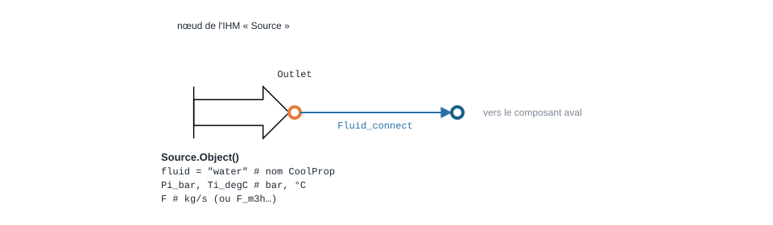

.. _fluid_source:

Source de fluide — Source
=========================

   Forme, ports et raccordement ; paramètres sous leur nom de code, avec leur valeur par défaut.

Utilisation
-----------

.. code-block:: python

    from ThermodynamicCycles.Source import Source

    # Créer un objet Source
    SOURCE = Source.Object()

    # Paramètres d'entrée
    SOURCE.Pi_bar = 1.01325
    SOURCE.Ti_degC = 25          # température d'entrée obligatoire
    SOURCE.fluid = "air"
    SOURCE.F = 1                 # débit massique [kg/s]

    # Calcul
    SOURCE.calculate()

    # Résultats
    print(SOURCE.df)

Sortie réelle (``SOURCE.df``) :

.. code-block:: text

                                Source
    Timestamp      2026-07-04 23:33:33
    fluid                          air
    Ti_degC                       25.0
    Pi_bar                        1.01
    F_Sm3h                      2937.5
    F_Nm3h                 2784.081453
    F_m3h                       3039.7
    F_kgh                         3600
    F_kgs                            1
    F_m3s                        0.844
    F_Sm3s                       0.816
    self.Outlet.h        424436.043917

Le DataFrame contient : la température d'entrée ``Ti_degC`` [°C], la pression
``Pi_bar`` [bar], les débits déclinés en Sm³/h, Nm³/h, m³/h, kg/h, kg/s, m³/s,
Sm³/s, et l'enthalpie de sortie ``Outlet.h`` [J/kg].

.. note::
   ``SOURCE.fluid``, ``SOURCE.Pi_bar`` et ``SOURCE.Ti_degC`` sont **obligatoires** :
   si l'un manque, ``calculate()`` lève ``Source.MissingInputError`` (une
   ``ValueError``) qui nomme l'entrée absente, par exemple « entrée(s)
   obligatoire(s) non renseignée(s) : Ti_degC ». Jusqu'à la version de la
   bibliothèque du 28/09/2026, l'absence de ``Ti_degC`` finissait en
   ``TypeError`` sur un ``None``.

Paramètres possibles
--------------------

**Fluides disponibles dans CoolProp**

**Fluides purs courants :**

- ``'Water'`` - Eau
- ``'Air'`` - Air
- ``'Ammonia'`` (ou ``'NH3'``) - Ammoniac
- ``'CO2'`` (ou ``'CarbonDioxide'``) - Dioxyde de carbone
- ``'Nitrogen'`` (ou ``'N2'``) - Azote
- ``'Oxygen'`` (ou ``'O2'``) - Oxygène
- ``'Hydrogen'`` (ou ``'H2'``) - Hydrogène
- ``'Methane'`` - Méthane
- ``'Propane'`` - Propane
- ``'n-Butane'`` - n-Butane
- ``'IsoButane'`` - Isobutane

**Frigorigènes HFC :**

- ``'R134a'`` - 1,1,1,2-Tétrafluoroéthane
- ``'R32'`` - Difluorométhane
- ``'R125'`` - Pentafluoroéthane
- ``'R143a'`` - 1,1,1-Trifluoroéthane
- ``'R152a'`` - 1,1-Difluoroéthane
- ``'R404A'`` - Mélange (R125/143a/134a)
- ``'R407C'`` - Mélange (R32/125/134a)
- ``'R410A'`` - Mélange (R32/125)
- ``'R507A'`` - Mélange (R125/143a)

**Frigorigènes naturels et autres :**

- ``'R290'`` (ou ``'Propane'``) - Propane
- ``'R600a'`` (ou ``'IsoButane'``) - Isobutane
- ``'R717'`` (ou ``'Ammonia'``) - Ammoniac
- ``'R744'`` (ou ``'CO2'``) - Dioxyde de carbone
- ``'R1234yf'`` - 2,3,3,3-Tétrafluoropropène
- ``'R1234ze(E)'`` - trans-1,3,3,3-Tétrafluoropropène

**Fluides industriels :**

- ``'Toluene'`` - Toluène
- ``'Ethanol'`` - Éthanol
- ``'Acetone'`` - Acétone
- ``'Methanol'`` - Méthanol

.. note::
   Pour la liste complète des fluides disponibles, consultez la documentation officielle de CoolProp : http://www.coolprop.org/fluid_properties/PurePseudoPure.html

**Types de débits disponibles** :

- ``F`` : Débit massique [kg/s]
- ``F_kgh`` : Débit massique [kg/h]
- ``F_Sm3s`` / ``F_Sm3h`` : Débit volumique standard [Sm³/s] / [Sm³/h]
- ``F_Nm3s`` / ``F_Nm3h`` : Débit volumique normal [Nm³/s] / [Nm³/h]
- ``F_m3s`` / ``F_m3h`` : Débit volumique aux conditions d'entrée [m³/s] / [m³/h]

Paramètres à personnaliser
--------------------------

.. list-table::
   :header-rows: 1
   :widths: 22 26 52

   * - Grandeur
     - Valeur à saisir
     - Effet sur le résultat
   * - ``fluid``
     - nom CoolProp exact (``"water"``, ``"Methane"``, ``"R134a"``…)
     - Obligatoire. Un nom inconnu (``"eau"``) lève une ``ValueError`` de
       CoolProp.
   * - ``Pi_bar``
     - pression **absolue** en bar
     - Obligatoire. Avec ``Ti_degC``, fixe l'état (liquide, vapeur,
       supercritique) et ``Outlet.P`` en Pa.
   * - ``Ti_degC``
     - température en °C
     - Obligatoire. ``Outlet.h`` est l'enthalpie à (``Pi_bar``, ``Ti_degC``).
   * - Un seul débit parmi ``F`` (kg/s), ``F_kgh``, ``F_m3h``, ``F_m3s``,
       ``F_Nm3h``, ``F_Nm3s``, ``F_Sm3h``, ``F_Sm3s``
     - l'unité de votre compteur ou de votre fiche technique
     - Converti en kg/s. Nm³ : 1,01325 bar et 0 °C ; Sm³ : 1,01325 bar et
       15 °C ; m³ : conditions réelles (``Pi_bar``, ``Ti_degC``).

Variante exécutée : un débit de gaz naturel dans trois unités
-------------------------------------------------------------

Un compteur de gaz affiche des m³ réels, une facture des Nm³ ou des kWh, une
fiche de brûleur des Sm³/h : la source convertit dans les deux sens.

.. code-block:: python

    # variante : un même débit de gaz naturel saisi dans trois unités
    from ThermodynamicCycles.Source import Source

    def source_methane(**debit):
        SOURCE = Source.Object()
        SOURCE.fluid = "Methane"
        SOURCE.Ti_degC = 10          # gaz en conduite
        SOURCE.Pi_bar = 5            # 5 bar absolus
        for unite, valeur in debit.items():
            setattr(SOURCE, unite, valeur)
        SOURCE.calculate()
        return SOURCE.df["Source"]   # les débits se lisent dans df

    for saisie in [dict(F_Nm3h=1000), dict(F_Sm3h=1055.3), dict(F_m3h=208.4)]:
        d = source_methane(**saisie)
        print(f"{str(saisie):22s} -> {d['F_Nm3h']:7.1f} Nm3/h, {d['F_Sm3h']:7.1f} Sm3/h, "
              f"{d['F_m3h']:6.1f} m3/h réels, {d['F_kgh']:6.1f} kg/h")

Sortie réelle :

.. code-block:: text

   {'F_Nm3h': 1000}       ->  1000.0 Nm3/h,  1055.3 Sm3/h,  208.4 m3/h réels,  717.5 kg/h
   {'F_Sm3h': 1055.3}     ->  1000.0 Nm3/h,  1055.3 Sm3/h,  208.4 m3/h réels,  717.4 kg/h
   {'F_m3h': 208.4}       ->  1000.1 Nm3/h,  1055.4 Sm3/h,  208.4 m3/h réels,  717.5 kg/h

Lecture : à 5 bar et 10 °C, 1 000 Nm³/h de méthane n'occupent que 208 m³/h
réels ; un m³ « standard » (15 °C) vaut 0,948 Nm³. Confondre les deux fausse
une facture de 5,5 %. Le méthane pur est ici un modèle du gaz naturel : pour
une composition réelle, voir :doc:`ng_heating_value`.

Cas limite refusé : entrée obligatoire manquante
------------------------------------------------

.. code-block:: python

    from ThermodynamicCycles.Source import Source

    SOURCE = Source.Object()
    SOURCE.fluid = "water"
    SOURCE.Pi_bar = 1.0
    SOURCE.F = 2.0               # Ti_degC oublié
    try:
        SOURCE.calculate()
    except Source.MissingInputError as erreur:
        print("Refusé :", erreur)

Sortie réelle :

.. code-block:: text

   Refusé : Source.calculate() : entrée(s) obligatoire(s) non renseignée(s) : Ti_degC (fluid = nom CoolProp, Pi_bar = pression en bar, Ti_degC = température en °C).

Pièges
------

.. code-block:: python

    from ThermodynamicCycles.Source import Source

    def eau(Ti_degC, Pi_bar=1.01325, **debit):
        SOURCE = Source.Object()
        SOURCE.fluid = "water"
        SOURCE.Ti_degC = Ti_degC
        SOURCE.Pi_bar = Pi_bar
        for unite, valeur in debit.items():
            setattr(SOURCE, unite, valeur)
        SOURCE.calculate()
        return SOURCE

    # 1) deux débits saisis : le débit volumique l'emporte sur F
    s = eau(20, F=2.0, F_m3h=36.0)
    print("F saisi 2 kg/s, F_m3h 36 m3/h -> F =", round(s.F, 3), "kg/s")
    # 2) aucun débit : pas d'erreur, débit nul
    print("sans débit -> F =", eau(20).F)
    # 3) eau à 100 °C sous 1,01325 bar : déjà de la vapeur
    print("100 °C, 1 atm ->", eau(100, F=1.0).fluid_quality)
    # 4) après calcul, les débits saisis sont remis à None
    print("F_m3h après calcul :", s.F_m3h)

Sortie réelle :

.. code-block:: text

   F saisi 2 kg/s, F_m3h 36 m3/h -> F = 9.982 kg/s
   sans débit -> F = 0
   100 °C, 1 atm -> vapor
   F_m3h après calcul : None

* **Deux débits saisis : pas d'erreur, l'un écrase l'autre.** Les unités
  sont lues dans l'ordre ``F_Sm3h``, ``F_Nm3h``, ``F_m3s``, ``F_m3h``,
  ``F_kgh``, ``F_Sm3s``, ``F_Nm3s`` après ``F`` : la dernière renseignée
  gagne. Ne saisissez qu'un débit.
* **Aucun débit : pas d'erreur, débit nul.** Toute la ligne aval calcule
  alors des puissances nulles.
* **L'état se décide sur (P, T).** De l'eau à 100 °C sous 1,01325 bar est de
  la vapeur (saturation à 99,97 °C). Une source définie par (P, T) ne peut
  pas fournir un mélange liquide-vapeur.
* **Les débits saisis sont remis à None après calcul** : lisez-les dans
  ``SOURCE.df`` (ou ``SOURCE.F`` en kg/s), pas sur l'objet.
* **La source affiche des lignes « [SOURCE-CALLBACK] flow update… »** quand
  un composant aval (une pompe, par exemple) recale son débit : ce n'est pas
  une erreur, c'est le débit au point de fonctionnement.

Voir aussi : :doc:`sink` pour l'autre extrémité d'une ligne,
:doc:`pompe` pour le recalage du débit, :doc:`../ports_connexions` pour
``Fluid_connect``.

Explication du modèle
----------------------

Le modèle Fluid Source calcule le débit massique en fonction de diverses conditions d'entrée et des propriétés du fluide. Le modèle utilise la bibliothèque CoolProp pour déterminer les propriétés du fluide et effectue les calculs suivants :

1. Convertir les débits volumiques en débits massiques en utilisant la densité du fluide.
2. Calculer l'enthalpie de sortie et déterminer la qualité du fluide (liquide, vapeur, diphasique ou supercritique).
3. Mettre à jour les propriétés de sortie et générer un DataFrame avec les résultats.

Les principales équations utilisées dans le modèle sont :

- Débit massique à partir de mètres cubes standards par heure (Sm³/h) :

  .. math::
    \dot{m} = \frac{F_{Sm3h}}{3600} \cdot \rho(P_{std}, T_{std})

- Débit massique à partir de mètres cubes normaux par heure (Nm³/h) :

  .. math::
    \dot{m} = \frac{F_{Nm3h}}{3600} \cdot \rho(P_{std}, T_{norm})

- Débit massique à partir de mètres cubes par seconde (m³/s) :

  .. math::
    \dot{m} = F_{m3s} \cdot \rho(P_{in}, T_{in})

- Enthalpie de sortie :

  .. math::
    h_{out} = \text{PropsSI}('H', 'P', P_{out}, 'T', T_{in}, \text{fluid})

- Qualité du fluide :

  .. math::
    Q = 1 - \frac{H_v - h_{out}}{H_v - H_l}

où :

- :math:`\rho` est la densité du fluide,
- :math:`P_{std}` et :math:`T_{std}` sont la pression et la température standards,
- :math:`P_{norm}` et :math:`T_{norm}` sont la pression et la température normales,
- :math:`P_{in}` et :math:`T_{in}` sont la pression et la température d'entrée,
- :math:`H_v` et :math:`H_l` sont les enthalpies de la vapeur et du liquide à la pression d'entrée.
