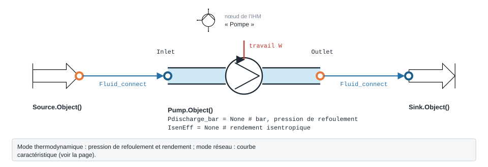

.. _pompe:

Pompe — Pump
============

   Forme, ports et raccordement ; paramètres sous leur nom de code, avec leur valeur par défaut.

Le module ``ThermodynamicCycles.Pump`` modélise une **pompe** de circulation de
liquide. Selon les paramètres fournis, il fonctionne dans **deux modes** distincts
(chemin additif, sans redondance) :

- un mode **débit imposé / thermodynamique** (compression liquide isentropique
  avec rendement), adapté aux cycles de puissance (Rankine, ORC) et aux essais à
  débit constant ;
- un mode **courbe caractéristique**, où le point de fonctionnement est déterminé
  par régression polynomiale (scikit-learn) sur la courbe HMT / rendement de la
  pompe et son intersection avec la caractéristique du réseau.

Dans les deux cas la pompe est traitée comme **isotherme** côté fluide : une pompe
liquide n'échauffe/ne refroidit pas de façon significative, la **température
d'aspiration est conservée** et l'enthalpie de refoulement est **recalculée à la
pression de refoulement** (voir plus bas).

La classe s'instancie via ``ThermodynamicCycles.Pump.Pump.Object()``.

Connecteurs
-----------

.. list-table::
   :header-rows: 1
   :widths: 18 20 62

   * - Port
     - Type
     - Rôle
   * - ``Inlet``
     - ``FluidPort``
     - aspiration (fluide, pression :math:`P`, enthalpie :math:`h`, débit
       :math:`F` en kg/s)
   * - ``Outlet``
     - ``FluidPort``
     - refoulement ; porte un **callback** ``on_pressure_change`` déclenché quand
       le réseau aval impose ``Outlet.P``

Mode 1 — Débit imposé / thermodynamique (isentropique + rendement)
------------------------------------------------------------------

Ce mode est **actif dès que** ``IsenEff`` est défini (cycle de puissance) **ou**
que ``F_impose`` (kg/s) est fourni (essai à débit constant). Il **court-circuite**
la courbe caractéristique : le débit est imposé, et la température de refoulement
est un **résultat** de la compression liquide isentropique.

Le rendement isentropique retenu est :math:`\eta = \text{IsenEff}` (ou ``0.7`` par
défaut si seul ``F_impose`` est fourni). Avec :math:`HP` la pression de
refoulement (``Pdischarge`` ou, à défaut, ``Inlet.P``) :

.. math::

   s_1 &= s(P_{in},\, h_{in}) \\
   h_{o,is} &= h(HP,\, s_1) \\
   h_{o} &= h_{in} + \frac{h_{o,is} - h_{in}}{\eta} \\
   T_{o} &= T(HP,\, h_{o}) \\
   \dot W_{pump} &= F \,\bigl(h_{o} - h_{in}\bigr)

Le refoulement est écrit sur ``Outlet`` (``Outlet.h = Ho``, ``Outlet.P = HP``,
``Outlet.F = Inlet.F``), le callback étant neutralisé pendant l'écriture de la
pression. En prime, une **courbe de pompe idéale** passant par le point de
fonctionnement :math:`(Q^\*, HMT^\*)` est proposée (centrifuge parabolique
:math:`HMT(Q) = H_0 - k\,Q^2` avec :math:`H_0 = 1{,}25\,HMT^\*`, rendement maximal
au BEP), puis ajustée par régression : le **même modèle** sert ainsi au
dimensionnement et à la simulation.

Mode 2 — Courbe caractéristique (régression polynomiale)
--------------------------------------------------------

En l'absence de ``IsenEff`` et de ``F_impose``, la pompe utilise sa **courbe
caractéristique**. Les points de construction sont fournis via ``X_F`` (débit
volumique, m³/h), ``Y_hmt`` (hauteur manométrique, m) et ``Y_eta`` (rendement).
Valeurs par défaut si non renseignés :

.. code-block:: python

   X_F   = [7, 50, 100, 150]     # m³/h
   Y_hmt = [12, 60, 80, 68]      # m
   Y_eta = [0.5, 0.7, 0.5, 0.4]  # -

Une régression polynomiale ``LinearRegression`` sur ``PolynomialFeatures`` de
**degré** :math:`n = \text{len}(X\_F) - 1` (interpolation exacte des points)
ajuste séparément HMT(Q) et η(Q). La qualité d'ajustement HMT est reportée
(``rmse_hmt``, ``r2_hmt``).

Selon les données fournies, le point de fonctionnement est déterminé ainsi :

- **``Pdischarge`` donnée** → ``calculate_flow_rate()`` : la HMT cible est déduite
  du réseau (:math:`HMT = \Delta P / (\rho g)`), puis le débit correspondant est
  trouvé sur la courbe HMT(Q) par minimisation ``L-BFGS-B`` de
  :math:`|HMT_{pred}(Q) - HMT|` ;
- **``F_m3h`` donné, sans ``Pdischarge``** → ``calculate_hmt()`` : la HMT est
  prédite par la corrélation au débit donné, puis :math:`\Delta P = \rho g\,HMT`.

Le rendement au point de fonctionnement provient de ``calculate_eta()``
(prédiction η(Q)). La puissance absorbée vaut :

.. math::

   \Delta P = \rho\, g\, HMT
   \qquad
   Q_{pump} = \frac{\dot V \,\Delta P}{\eta}

avec :math:`\dot V` = ``F_m3s`` (débit volumique, m³/s) et :math:`\rho` la masse
volumique du fluide à l'aspiration (``ThermoPropsSI("D", ...)``), :math:`g = 9{,}81`
m/s².

Équations clés
--------------

.. list-table::
   :header-rows: 1
   :widths: 30 70

   * - Grandeur
     - Relation
   * - HMT ↔ pression
     - :math:`\Delta P = \rho\, g\, HMT` ; réciproquement :math:`HMT = \Delta P/(\rho g)`
   * - Rendement (mode courbe)
     - :math:`\eta = \eta_{model}(Q)` (corrélation polynomiale)
   * - Puissance (mode courbe)
     - :math:`Q_{pump} = \dot V \,\Delta P / \eta`
   * - Compression isentropique (mode thermo)
     - :math:`h_o = h_{in} + (h_{o,is}-h_{in})/\eta`
   * - Puissance (mode thermo)
     - :math:`\dot W_{pump} = F\,(h_o - h_{in})`

Comportement réseau (couplage courbe ∩ réseau)
----------------------------------------------

Le ``Outlet`` porte un callback ``on_pressure_change`` : lorsque le **réseau aval
impose** une nouvelle pression ``Outlet.P``, la pompe **recalcule automatiquement
son point de fonctionnement** via ``calculate_from_network_pressure()`` :

1. :math:`\Delta P_{réseau} = Outlet.P - Inlet.P` puis
   :math:`HMT = \Delta P_{réseau}/(\rho g)` ;
2. le **débit** correspondant est cherché sur la courbe HMT(Q) par minimisation
   ``L-BFGS-B`` — c'est l'**intersection courbe pompe ∩ courbe réseau** ;
3. la **masse** est propagée : ``Inlet.F = F_m3s·ρ``, ``Outlet.F = Inlet.F`` (et
   le callback amont ``Inlet.callback`` est appelé si présent) ;
4. **isotherme** : la température d'aspiration est conservée, l'enthalpie de
   refoulement est recalculée à la pression réseau
   ``Outlet.h = ThermoPropsSI('H','P',Outlet.P,'T',Ti_degC+273.15,fluid)`` ;
5. le rendement est réévalué par ``calculate_eta()``.

Des garde-fous (attributs ``_calculating`` / ``_calculating_inverse``) évitent les
boucles infinies pendant les phases de calcul.

Paramètres configurables
------------------------

.. list-table::
   :header-rows: 1
   :widths: 22 16 62

   * - Paramètre
     - Défaut
     - Description
   * - ``IsenEff``
     - ``None``
     - rendement isentropique ; **active le mode thermodynamique** (``1`` = pompe idéale)
   * - ``F_impose``
     - ``None``
     - débit massique imposé (kg/s) ; **active le mode débit imposé**
   * - ``Pdischarge_bar``
     - ``None``
     - pression de refoulement (bar) ; convertie en ``Pdischarge`` (Pa)
   * - ``Pdischarge``
     - ``None``
     - pression de refoulement (Pa)
   * - ``eta``
     - ``None``
     - rendement (renseigné/prédit selon le mode)
   * - ``X_F``
     - ``[7,50,100,150]``
     - points de débit volumique de la courbe (m³/h)
   * - ``Y_hmt``
     - ``[12,60,80,68]``
     - points de hauteur manométrique (m)
   * - ``Y_eta``
     - ``[0.5,0.7,0.5,0.4]``
     - points de rendement (-)
   * - ``Timestamp``
     - ``None``
     - horodatage propagé dans le DataFrame résultat

Sorties principales
-------------------

- ``df`` : DataFrame de synthèse. En **mode courbe** : ``pump_F_kgs``,
  ``pump_F_m3h``, ``hmt(m)``, ``delta_p (Pa)``, ``Qpump(KW)``, ``self.eta``. En
  **mode thermodynamique** : ``P_aspiration_bar``, ``P_refoulement_bar``,
  ``T_refoulement_degC``, ``eta_is``, ``W_pump_kW``.
- ``F_m3h`` / ``F_m3s`` : débit volumique au point de fonctionnement.
- ``hmt`` / ``delta_p`` : hauteur manométrique (m) et différence de pression (Pa).
- ``eta``, ``Q_pump`` (mode courbe) ; ``W_pump``, ``To``, ``Ho``, ``Ho_is``
  (mode thermodynamique).
- ``rmse_hmt`` / ``r2_hmt`` : indicateurs d'ajustement de la corrélation HMT.

Exemple (Source → Pompe, courbe caractéristique)
------------------------------------------------

.. code-block:: python

    from ThermodynamicCycles.Source import Source
    from ThermodynamicCycles.Pump import Pump
    from ThermodynamicCycles.Connect import Fluid_connect

    # Source d'eau : 20 °C, 1 bar, 5 kg/s
    source = Source.Object()
    source.fluid = "water"
    source.Ti_degC = 20
    source.Pi_bar = 1.0
    source.F = 5.0
    source.calculate()

    # Pompe alimentée par la source
    pump = Pump.Object()
    Fluid_connect(pump.Inlet, source.Outlet)   # copie fluide, P, h, F

    # Point de fonctionnement fixé par la pression de refoulement (mode courbe)
    pump.Pdischarge_bar = 4.0
    pump.calculate()

    print(pump.df)               # F_m3h, hmt, delta_p, Qpump, eta
    pump.plot_pump_curve()       # courbe HMT/ΔP + rendement, point de fonctionnement

Sortie réelle :

.. code-block:: text

   [SOURCE-CALLBACK] flow update: 5.000 -> 5.731 kg/s
      New volumetric flow: 20.67 m3/h
                                       Pump
   Timestamp     2026-09-28 11:57:48.262405
   pump_fluid                         water
   pump_F_kgs                      5.731113
   pump_F_m3h                     20.669077
   hmt(m)                         30.635984
   delta_p (Pa)                    300000.0
   Qpump(KW)                       2.751426
   self.eta                        0.626011

Les deux premières lignes sont imprimées par la bibliothèque elle-même : la
pompe a recalé le débit de la source (5 → 5,731 kg/s) sur le point de
fonctionnement de sa courbe à ΔP = 3 bar. C'est ce débit recalé qu'on lit ensuite
dans ``pump_F_kgs``.

Pour un **cycle de puissance** (mode thermodynamique), fixer plutôt
``pump.IsenEff = 0.75`` (et éventuellement ``pump.F_impose`` pour un débit
imposé) avant ``pump.calculate()`` : la température de refoulement ``To`` et la
puissance ``W_pump`` deviennent les résultats de la compression liquide
isentropique.

Paramètres à personnaliser
--------------------------

.. list-table::
   :header-rows: 1
   :widths: 24 22 54

   * - Grandeur
     - Valeur à saisir
     - Effet sur le résultat
   * - ``Pdischarge_bar``
     - pression de refoulement voulue (bar absolus)
     - Mode courbe : fixe la HMT demandée, la pompe en déduit le débit. Mode
       thermodynamique : pression d'arrivée de la compression.
   * - ``X_F`` / ``Y_hmt`` / ``Y_eta``
     - 3 à 5 points lus sur la courbe du constructeur, **même nombre** dans
       les trois listes
     - Remplacent la courbe par défaut. Le polynôme passe exactement par les
       points (degré = nombre de points − 1).
   * - ``IsenEff``
     - 0,5 à 0,85 (1 = pompe idéale)
     - Bascule en mode thermodynamique : débit imposé par l'amont,
       température de refoulement et ``W_pump`` deviennent des résultats.
   * - ``F_impose``
     - débit massique (kg/s)
     - Mode débit imposé, avec un rendement de 0,7 si ``IsenEff`` est vide.
   * - Fluide et état d'aspiration (``Source``)
     - ``fluid``, ``Ti_degC``, ``Pi_bar``
     - Fixent la masse volumique, donc la conversion HMT ↔ pression.

Variante exécutée : une courbe de constructeur
----------------------------------------------

La courbe par défaut (``X_F = [7, 50, 100, 150]``) n'est pas celle d'une pompe
centrifuge : sa hauteur **croît** avec le débit jusqu'à 100 m³/h. On la remplace
par quatre points d'une petite pompe de chauffage : 35 m à débit nul, 17 m à
30 m³/h.

.. code-block:: python

    # variante : pression de refoulement et courbe constructeur
    from ThermodynamicCycles.Source import Source
    from ThermodynamicCycles.Pump import Pump
    from ThermodynamicCycles.Connect import Fluid_connect

    def point(Pdischarge_bar, X_F=None, Y_hmt=None, Y_eta=None):
        source = Source.Object()
        source.fluid = "water"
        source.Ti_degC = 20
        source.Pi_bar = 1.0
        source.F = 5.0                   # débit de départ, recalé par la pompe
        source.calculate()
        pump = Pump.Object()
        if X_F is not None:              # courbe constructeur (3 à 5 points)
            pump.X_F, pump.Y_hmt, pump.Y_eta = X_F, Y_hmt, Y_eta
        Fluid_connect(pump.Inlet, source.Outlet)
        pump.Pdischarge_bar = Pdischarge_bar
        pump.calculate()
        return pump

    print("petite pompe : 0-30 m3/h, 35 m à débit nul")
    for p in [2, 2.5, 3, 3.5, 4]:
        pp = point(p, X_F=[0, 10, 20, 30], Y_hmt=[35, 33, 27, 17],
                   Y_eta=[0.0, 0.55, 0.68, 0.60])
        hors = "  hors courbe" if pp.extrapolated else ""
        print(f"  {p:>3} bar : {pp.F_m3h:5.2f} m3/h, HMT {pp.hmt:4.1f} m, "
              f"eta {pp.eta:.3f}, {pp.Q_pump / 1000:4.2f} kW{hors}")

Sortie réelle :

.. code-block:: text

   petite pompe : 0-30 m3/h, 35 m à débit nul
       2 bar : 35.21 m3/h, HMT 10.2 m, eta 0.545, 1.79 kW  hors courbe
     2.5 bar : 31.37 m3/h, HMT 15.3 m, eta 0.584, 2.24 kW  hors courbe
       3 bar : 27.00 m3/h, HMT 20.4 m, eta 0.634, 2.37 kW
     3.5 bar : 21.76 m3/h, HMT 25.5 m, eta 0.675, 2.24 kW
       4 bar : 14.77 m3/h, HMT 30.6 m, eta 0.652, 1.89 kW

Lecture : plus le réseau résiste (refoulement élevé), moins la pompe débite —
c'est l'intersection courbe pompe ∩ courbe réseau. Sous 2,5 bar, le point tombe
au-delà du dernier point fourni (30 m³/h) : ``pump.extrapolated`` passe à
``True`` et le polynôme est prolongé sans garantie. Les lignes imprimées par la
source (« [SOURCE-CALLBACK] flow update… ») sont omises ici.

Variante exécutée : pompe alimentaire d'un cycle à vapeur
---------------------------------------------------------

En mode thermodynamique, la courbe ne sert plus : le débit vient de l'amont et
le rendement isentropique fixe le travail.

.. code-block:: python

    # variante : pompe alimentaire d'un cycle de Rankine (mode thermodynamique)
    from ThermodynamicCycles.Source import Source
    from ThermodynamicCycles.Pump import Pump
    from ThermodynamicCycles.Connect import Fluid_connect

    source = Source.Object()
    source.fluid = "water"
    source.Ti_degC = 40          # condensat sortant du condenseur
    source.Pi_bar = 0.1          # vide du condenseur (saturation 45,8 °C)
    source.F = 10.0              # kg/s
    source.calculate()

    for eta in [1.0, 0.75, 0.5]:
        pump = Pump.Object()
        Fluid_connect(pump.Inlet, source.Outlet)
        pump.IsenEff = eta       # active le mode thermodynamique
        pump.Pdischarge_bar = 80 # pression chaudière
        pump.calculate()
        print(f"eta {eta:.2f} : T refoulement {pump.To - 273.15:6.3f} °C, "
              f"W_pump {pump.W_pump / 1000:6.2f} kW")

Sortie réelle :

.. code-block:: text

   eta 1.00 : T refoulement 40.234 °C, W_pump  80.39 kW
   eta 0.75 : T refoulement 40.878 °C, W_pump 107.19 kW
   eta 0.50 : T refoulement 42.166 °C, W_pump 160.78 kW

Lecture : relever 10 kg/s d'eau de 0,1 à 80 bar coûte 80 kW au minimum ; le
travail perdu par le rendement échauffe l'eau (+1,9 K à η = 0,5), il n'est pas
perdu pour le cycle.

Cas limite refusé : courbe aux listes de longueurs différentes
--------------------------------------------------------------

.. code-block:: python

    from ThermodynamicCycles.Source import Source
    from ThermodynamicCycles.Pump import Pump
    from ThermodynamicCycles.Connect import Fluid_connect

    source = Source.Object()
    source.fluid = "water"
    source.Ti_degC = 20
    source.Pi_bar = 1.0
    source.F = 5.0
    source.calculate()

    pump = Pump.Object()
    pump.X_F = [0, 10, 20]               # 3 débits...
    pump.Y_hmt = [35, 33, 27, 17]        # ... pour 4 hauteurs
    pump.Y_eta = [0.0, 0.55, 0.68, 0.60]
    Fluid_connect(pump.Inlet, source.Outlet)
    pump.Pdischarge_bar = 3
    try:
        pump.calculate()
    except ValueError as erreur:
        print("Refusé :", erreur)

Sortie réelle :

.. code-block:: text

   Refusé : Found input variables with inconsistent numbers of samples: [3, 4]

Le message vient de scikit-learn ; il signifie que ``X_F`` et ``Y_hmt`` (ou
``Y_eta``) n'ont pas le même nombre de points.

Pièges
------

Le plus coûteux : une pression de refoulement **hors de portée** de la pompe
n'est pas refusée.

.. code-block:: python

    from ThermodynamicCycles.Source import Source
    from ThermodynamicCycles.Pump import Pump
    from ThermodynamicCycles.Connect import Fluid_connect

    source = Source.Object()
    source.fluid = "water"
    source.Ti_degC = 20
    source.Pi_bar = 1.0
    source.F = 5.0
    source.calculate()

    pump = Pump.Object()
    pump.X_F = [0, 10, 20, 30]
    pump.Y_hmt = [35, 33, 27, 17]        # 35 m au maximum, à débit nul
    pump.Y_eta = [0.0, 0.55, 0.68, 0.60]
    Fluid_connect(pump.Inlet, source.Outlet)
    pump.Pdischarge_bar = 4.5            # 35,7 m demandés : hors de portée
    pump.calculate()                     # aucune exception
    print("point trouvé :", pump.operating_point_found)
    print("débit rendu  :", round(pump.F_m3h, 2), "m3/h")
    print(pump.operating_point_warning)

Sortie réelle :

.. code-block:: text

   point trouvé : False
   débit rendu  : 0.1 m3/h
   aucun debit de la courbe ne fournit la hauteur demandee (35.74 m) : sur [0.1 ; 45] m3/h la courbe va de -5.50 a 35.00 m. La pression de refoulement imposee est hors de portee de cette pompe.

* **Testez** ``pump.operating_point_found`` après chaque calcul à pression
  imposée : à ``False``, le débit rendu (ici la borne de 0,1 m³/h) n'est pas un
  point de fonctionnement. Le nœud ``PyqtSimulator`` le refuse, un script
  Python non.
* **La courbe par défaut monte avec le débit** (12 m à 7 m³/h, 80 m à
  100 m³/h) : à 2 bar elle rend 5,80 m³/h sur sa branche montante. Saisissez
  toujours la courbe de votre pompe.
* **La pompe réécrit le débit de la source** (5 → 5,731 kg/s dans l'exemple) :
  le débit saisi sur ``Source`` n'est qu'un point de départ en mode courbe.
* **Une pression de refoulement inférieure à l'aspiration** donne une HMT
  négative ; même traitement : ``operating_point_found`` à ``False``.
* **Puissances en W** sur l'objet (``Q_pump``, ``W_pump``) ; ``df`` les
  affiche en kW.

Voir aussi : :doc:`chiller` pour un cycle complet, et les pages du chapitre
hydraulique pour la courbe réseau (pertes de charge des tronçons).

Signaux publiés par la pompe
----------------------------

Dans l'IHM, l'afficheur multi-signaux et les liaisons de signal lisent les
**attributs du modèle** sous la forme ``Nœud.attribut``. La liste exacte de ce
qu'une pompe publie se lit avec ``list_model_signals`` (tous les attributs
numériques du modèle, paramètres et résultats) :

.. code-block:: python

    # à la suite : ce qu'une pompe publie comme signaux (afficheur multi-signaux de l'IHM)
    from ThermodynamicCycles.Signals.Signals import list_model_signals

    pp = point(3, X_F=[0, 10, 20, 30], Y_hmt=[35, 33, 27, 17],
               Y_eta=[0.0, 0.55, 0.68, 0.60])
    signaux = list_model_signals(pp)
    print(len(signaux), "attributs publiables")
    for nom in ["F_m3h", "hmt", "delta_p", "eta", "Q_pump", "Pdischarge_bar"]:
        print(f"  {nom:15s} = {signaux[nom]:.4g}")

Sortie réelle :

.. code-block:: text

   36 attributs publiables
     F_m3h           = 27
     hmt             = 20.42
     delta_p         = 2e+05
     eta             = 0.6336
     Q_pump          = 2367
     Pdischarge_bar  = 3

Les unités sont celles du modèle : ``F_m3h`` en m³/h, ``hmt`` en m,
``delta_p`` en Pa, ``Q_pump`` en **W** (pas en kW). Pour un afficheur en kW,
appliquez un facteur 0,001 dans la ligne de l'afficheur. La scène
« Pompes en parallèle avec clapets » (:doc:`../interface/scenes`) affiche ces
grandeurs pour chaque pompe.

Méthodes
--------

* ``calculate()`` — Calcule le point de fonctionnement (aiguille automatiquement vers le bon mode)
* ``calculate_hmt()`` — HMT prédite par la corrélation au débit ``F_m3h``
* ``calculate_flow_rate()`` — Débit sur la courbe pour un ``Pdischarge`` imposé
* ``calculate_eta()`` — Rendement prédit par la corrélation au débit ``F_m3h``
* ``calculate_from_network_pressure()`` — Recalcul du point sur pression réseau imposée (callback)
* ``plot_pump_curve(figsize=(14, 10))`` — Tracé de la courbe caractéristique (HMT/ΔP et rendement) avec point de fonctionnement
