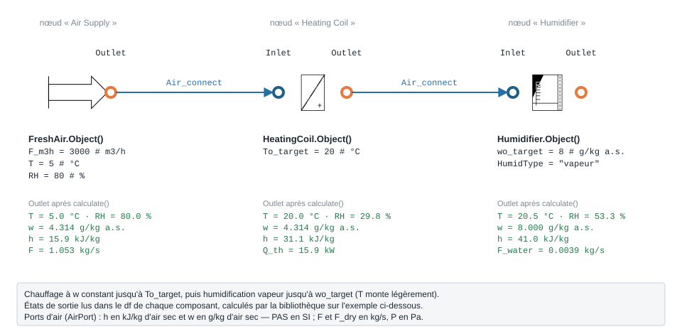
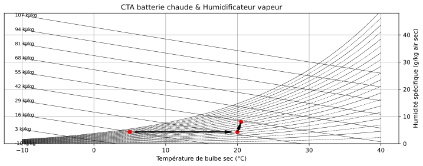

.. _cta_air_neuf:

CTA d'air neuf
==============

Utilisation
-----------

.. code-block:: python

    from AHU import FreshAir, HeatingCoil
    from AHU.Humidification import Humidifier
    from AHU.Connect import Air_connect
    from AHU.air_humide import PsychrometricChart

    # Air neuf
    AN = FreshAir.Object()
    AN.F_m3h = 3000
    AN.T = 5
    AN.RH = 80
    AN.calculate()

    # Batterie de chauffage
    BC = HeatingCoil.Object()
    BC.To_target = 20
    Air_connect(BC.Inlet, AN.Outlet)
    BC.calculate()

    # Humidificateur
    HMD = Humidifier.Object()
    HMD.wo_target = 8
    Air_connect(HMD.Inlet, BC.Outlet)
    HMD.HumidType = "vapeur"
    HMD.calculate()

    print(BC.df.to_string())
    print(HMD.df.to_string())

    # Diagramme psychrométrique
    chart = PsychrometricChart.Object(figsize=(12, 4))
    chart.set_title('CTA batterie chaude & Humidificateur vapeur')
    
    custom_points = [
        {'h': BC.Inlet.h, 'w': BC.Inlet.w},
        {'h': BC.Outlet.h, 'w': BC.Outlet.w},
        {'h': HMD.Outlet.h, 'w': HMD.Outlet.w}
    ]
    chart.add_points(custom_points)
    chart.show(draw_arrows=True)

**Diagramme psychrométrique** :

**Sortie réelle** (``print(BC.df)`` puis ``print(HMD.df)``) :

.. code-block:: text

                         HeatingCoil
    ID                         2.000
    Outlet.T (C)              20.000
    Outlet.RH (%)             29.800
    Outlet.F (kg/s)            1.053
    Outlet.F_dry (kg/s)        1.048
    Outlet.P (Pa)         101325.000
    Outlet.P/10^5 (bar)        1.000
    Outlet.h (kJ/kg)          31.100
    Outlet.w (g/kgdry)         4.314
    Outlet.Pv_sat (Pa)      2338.800
    Q_th (kW)                 15.900
                         Humidifier
    ID                          None
    Outlet.T (C)                20.5
    Outlet.RH (%)               53.3
    Outlet.F (kg/s)            1.056
    Outlet.F_dry (kg/s)        1.048
    Outlet.P (Pa)             101325
    Outlet.P/10^5 (bar)          1.0
    Outlet.h (kJ/kg)            41.0
    Outlet.w (g/kgdry)             8
    Outlet.Pv_sat (Pa)        2415.2
    HumidType                 vapeur
    F_water (kg/s)          0.003863
    Q_th (kW)                   0.01

Lecture : pour réchauffer 3 000 m³/h d'air de 5 °C à 20 °C il faut **15,9 kW** ;
pour amener ensuite l'air à 8 g/kg il faut injecter **0,0039 kg/s de vapeur**
(≈ 14 kg/h), soit une dérive de température de seulement 0,5 K.

Paramètres possibles
--------------------

**FreshAir (Air neuf)** :

- ``F_m3h`` : Débit volumique [m³/h]
- ``T`` : Température [°C]
- ``RH`` : Humidité relative [%]
- ``P`` : Pression atmosphérique [Pa] (défaut: 101325)

**HeatingCoil (Batterie de chauffage)** :

- ``To_target`` : Température de sortie cible [°C]
- ``Inlet`` : Connecté via ``Air_connect()``
- Calcule automatiquement ``Q_th`` (puissance thermique) [kW]

**Humidifier** :

- ``wo_target`` : Humidité absolue de sortie cible [g/kg_air_sec]
- ``HumidType`` : Type d'humidification
  
  - ``"adiabatique"`` (défaut) : Humidification par évaporation d'eau
  - ``"vapeur"`` : Injection de vapeur

- ``Inlet`` : Connecté via ``Air_connect()``
- Calcule automatiquement ``F_water`` (débit d'eau) [kg/s] et ``Q_th`` [kW]

**PsychrometricChart** :

- ``figsize`` : Dimensions du graphique (largeur, hauteur)
- ``set_title()`` : Définir le titre du diagramme
- ``add_points()`` : Liste de points avec coordonnées ``{'h': enthalpie, 'w': humidité}``
- ``show(draw_arrows=True)`` : Afficher avec flèches de transformation

Paramètres à personnaliser
--------------------------

.. list-table::
   :header-rows: 1
   :widths: 18 24 20 38

   * - Paramètre
     - Où
     - Plage essayée
     - Effet
   * - ``F_m3h``
     - ``FreshAir``
     - 500 à 20 000 m³/h
     - Proportionnel : puissance de chauffe et débit de vapeur suivent le débit.
   * - ``T`` / ``RH``
     - ``FreshAir``
     - −10 à 35 °C, 0 à 100 %
     - Fixent l'état de l'air à traiter ; plus l'air est froid, plus la chauffe est forte.
   * - ``To_target``
     - ``HeatingCoil``
     - 15 à 35 °C
     - Consigne de la batterie ; si l'air entre déjà plus chaud, ``Q_th = 0``.
   * - ``wo_target``
     - ``Humidifier``
     - 5 à 12 g/kg
     - Humidité absolue de sortie ; **refusée** si elle dépasse la saturation.
   * - ``HumidType``
     - ``Humidifier``
     - ``"vapeur"`` ou ``"adiabatique"``
     - Vapeur : la température monte à peine. Adiabatique : l'air se **refroidit**.

Variante : humidification adiabatique et air d'été
--------------------------------------------------

Même chaîne, mais avec un air plus chaud (12 °C) et une humidification
adiabatique (évaporation d'eau, enthalpie constante) :

.. code-block:: python

    # variante : air neuf 12 °C / 60 %, consigne 22 °C, humidification adiabatique à 9 g/kg
    AN2 = FreshAir.Object()
    AN2.F_m3h, AN2.T, AN2.RH = 3000, 12, 60
    AN2.calculate()

    BC2 = HeatingCoil.Object()
    BC2.To_target = 22
    Air_connect(BC2.Inlet, AN2.Outlet)
    BC2.calculate()

    HMD2 = Humidifier.Object()
    HMD2.wo_target = 9
    HMD2.HumidType = "adiabatique"
    Air_connect(HMD2.Inlet, BC2.Outlet)
    HMD2.calculate()
    print(BC2.df.loc["Q_th (kW)"].iloc[0], HMD2.df.loc["Outlet.T (C)"].iloc[0])

.. code-block:: text

    10.4 12.6

La batterie fournit **10,4 kW** ; l'humidificateur adiabatique ramène l'air à
**12,6 °C** (contre 22 °C en entrée) avec ``Q_th = 0`` : l'eau s'évapore aux
dépens de la chaleur sensible de l'air. L'humidité relative en sortie est de
**99,2 %** : l'air est presque saturé, ce qui est la limite physique de
l'humidification adiabatique à 9 g/kg.

Piège : une consigne inatteignable est refusée
----------------------------------------------

Demander 8 g/kg à un air resté trop froid (la batterie réglée à 2 °C au lieu de
20 °C) lève une ``ValueError`` qui nomme la cause : la sortie serait à
**HR = 141 %**, au-delà de la saturation. Remède : relever ``To_target`` ou
baisser ``wo_target``.

.. code-block:: text

    ValueError: Humidifier (vapeur) : wo_target = 8 g/kg n'est pas atteignable depuis
    l'air d'entrée (w = 4.314 g/kg, h = 15.86 kJ/kg) : la sortie serait à HR = 141.2 %
    (T = 5.62 °C), au-delà de la saturation. Réduisez wo_target ou réchauffez l'air en amont.

Deux autres pièges, mesurés : une consigne ``wo_target`` **inférieure** à
l'humidité de l'air entrant n'humidifie rien (``F_water = 0``, l'air traverse
inchangé) ; et ``RH`` n'est **pas contrôlé** à l'entrée (120 % est accepté
sans erreur) — restez entre 0 et 100.

Explication du modèle
----------------------

Ce modèle simule une Centrale de Traitement d'Air (CTA) simple composée de trois éléments en série :

1. **Prise d'air neuf** : Introduction d'air extérieur avec conditions définies (T, RH, débit)
2. **Batterie de chauffage** : Réchauffage de l'air à température constante d'humidité absolue
3. **Humidificateur** : Ajout d'humidité par injection de vapeur ou évaporation adiabatique

Le module utilise les propriétés de l'air humide pour calculer :

- Les transformations sur le diagramme psychrométrique (h, w)
- Les puissances thermiques nécessaires
- Les débits de fluides (air sec, air humide, eau d'humidification)

La fonction ``Air_connect()`` permet de chaîner les composants en connectant la sortie d'un composant à l'entrée du suivant.

**Transformations psychrométriques** :

- **Chauffage** : Ligne horizontale (w constant) vers la droite (T augmente)
- **Humidification vapeur** : Ligne quasi-horizontale (T légèrement augmente)
- **Humidification adiabatique** : Ligne isoenthalpique (h constant)
