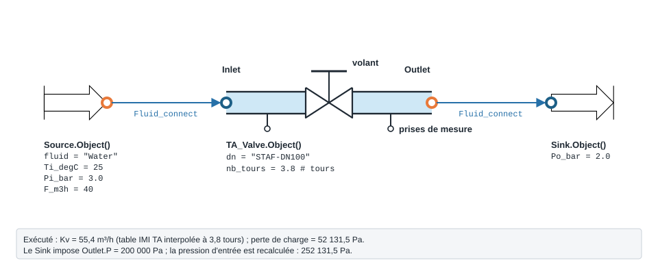
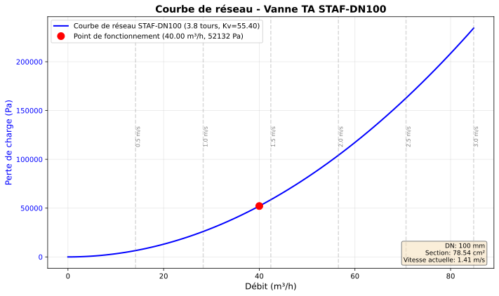

.. _ta_valve:

Vanne d'équilibrage TA
======================

Les vannes d'équilibrage **TA** (Tour & Andersson / IMI Hydronic Engineering) permettent l'équilibrage hydraulique des circuits CVC pour garantir les débits nominaux et optimiser la performance énergétique des installations.

Cette classe Python calcule les pertes de charge à travers différents modèles de vannes TA en utilisant les **données Kv officielles** du fabricant IMI TA en fonction du nombre de tours d'ouverture.

Utilisation
-----------

.. code-block:: python

    from ThermodynamicCycles.Hydraulic import TA_Valve
    from ThermodynamicCycles.Source import Source
    from ThermodynamicCycles.Sink import Sink
    from ThermodynamicCycles.Connect import Fluid_connect

    # Configuration de la source d'eau
    SOURCE = Source.Object()
    SOURCE.Ti_degC = 25           # Température d'entrée : 25°C
    SOURCE.Pi_bar = 3.0           # Pression d'entrée : 3 bar
    SOURCE.fluid = "Water"        # Fluide : eau
    SOURCE.F_m3h = 40             # Débit : 40 m³/h
    SOURCE.calculate()

    # Configuration de la vanne STAF-DN100
    VALVE = TA_Valve.Object()
    VALVE.dn = "STAF-DN100"       # Type : STAF-DN100 (bride fonte, PN 16/25)
    VALVE.nb_tours = 3.8          # Ouverture : 3.8 tours (interpolation auto)
    Fluid_connect(VALVE.Inlet, SOURCE.Outlet)
    VALVE.calculate()

    # Configuration du puits (sink)
    SINK = Sink.Object()
    Fluid_connect(SINK.Inlet, VALVE.Outlet)
    SINK.Po_bar = 2.0
    SINK.calculate()

    # Affichage des résultats
    print(VALVE.df)
    VALVE.Plot()

.. note::
   Le **Puits (Sink)** impose sa pression de sortie (2.0 bar = 200000 Pa) à la vanne. 
   La pression d'entrée de la vanne est donc **recalculée automatiquement** en fonction de la perte de charge :
   
   P_entrée = P_sortie + ΔP = 200000 Pa + 52131.53 Pa = 252131.53 Pa

Résultats ::

                             
  Débit (m3/h)                      40.0
  Nombre de tours                    3.8
  Diamètre nominal (DN)       STAF-DN100
  Kv                                55.4
  Pression d'entrée (Pa)   252131.527845
  Perte de charge (Pa)      52131.527845
  Pression de sortie (Pa)       200000.0

**Courbe de réseau de la vanne :**

Paramètres à personnaliser
--------------------------

.. list-table::
   :header-rows: 1
   :widths: 22 30 48

   * - Grandeur
     - Valeur à saisir
     - Effet sur le résultat
   * - ``dn``
     - référence **complète** de la vanne : série + diamètre, par exemple
       ``"STAD-DN25"``, ``"STAF-DN100"``
     - Choisit la table de Kv du constructeur. Une écriture courte
       (``"DN25"``, ``25``) est refusée.
   * - ``nb_tours``
     - position de réglage, dans la plage de la référence (0,5 à 4 tours pour
       une STAD ; 0 pour un régulateur ou un orifice fixe)
     - Kv lu dans la table, interpolé linéairement entre deux positions.
   * - Débit et fluide (``Source``)
     - débit nominal du circuit
     - ``delta_P = (Q / Kv)² × 10⁵`` : la perte croît comme le carré du
       débit.
   * - Pression aval (``Sink.Po_bar``)
     - pression imposée par le réseau en sortie
     - La pression d'entrée de la vanne est recalculée (note ci-dessus).

Variante exécutée : diamètre d'une vanne d'équilibrage et finesse de réglage
-----------------------------------------------------------------------------

Deux départs sur un même collecteur, 1,5 m³/h visés sur chacun. Le départ
proche ne présente que 8 kPa de résistance propre, l'éloigné 25 kPa : sans
vanne, le proche prendrait tout le débit. Quel diamètre de STAD choisir, et
que coûte une erreur d'un quart de tour au réglage ?

.. code-block:: python

    # variante : diamètre d'une vanne d'équilibrage et finesse de réglage
    from ThermodynamicCycles.Hydraulic.TA_Valve import Object as TAValve

    Q_NOM = 1.5      # m3/h visés sur chaque départ
    DP_A = 8000.0    # Pa : résistance propre du départ proche
    DP_B = 25000.0   # Pa : résistance propre du départ éloigné

    # Le collecteur doit fournir la perte du circuit le plus défavorable :
    # la vanne du départ proche dissipe la différence.
    a_dissiper = DP_B - DP_A
    kv_requis = Q_NOM / (a_dissiper / 1e5) ** 0.5
    print(f"Départ proche : {a_dissiper:.0f} Pa à dissiper -> Kv requis = {kv_requis:.2f}")

    def position_pour(vanne, kv_cible):
        """Position (en tours, pas de 0,05) dont le Kv tabulé est le plus proche."""
        meilleur, t = None, 0.5
        while t <= 4.0001:
            vanne.nb_tours = round(t, 2)
            ecart = abs(vanne.get_kv_value() - kv_cible)
            if meilleur is None or ecart < meilleur[1]:
                meilleur = (round(t, 2), ecart)
            t += 0.05
        return meilleur[0]

    v = TAValve()
    print("DN         réglage   course   Kv     Kv à -1/4 tour   débit")
    for dn in ("STAD-DN20", "STAD-DN25", "STAD-DN32", "STAD-DN40", "STAD-DN50"):
        v.dn = dn
        t0 = position_pour(v, kv_requis)
        v.nb_tours = t0
        kv0 = v.get_kv_value()
        v.nb_tours = max(0.5, t0 - 0.25)
        kv1 = v.get_kv_value()
        # à perte de charge imposée par le réseau, le débit suit le Kv
        print(f"{dn:10s} {t0:4.2f} tr   {100 * t0 / 4:3.0f} %   {kv0:5.2f}      "
              f"{kv1:5.2f}        {100 * (kv1 - kv0) / kv0:+5.1f} %")

Sortie réelle :

.. code-block:: text

   Départ proche : 17000 Pa à dissiper -> Kv requis = 3.64
   DN         réglage   course   Kv     Kv à -1/4 tour   débit
   STAD-DN20  2.95 tr    74 %    3.61       3.11        -13.9 %
   STAD-DN25  2.00 tr    50 %    3.64       2.88        -20.7 %
   STAD-DN32  1.55 tr    39 %    3.55       2.85        -19.6 %
   STAD-DN40  1.10 tr    28 %    3.67       2.95        -19.7 %
   STAD-DN50  0.85 tr    21 %    3.66       2.92        -20.2 %

Lecture :

* **Les cinq diamètres savent faire le réglage** : chacun atteint le Kv requis
  à quelques pour cent près. Le critère de choix n'est pas la capacité, mais la
  position où tombe le réglage : 74 % de la course en DN20, 21 % en DN50.
* **Un quart de tour d'erreur casse l'équilibrage** : il retire 14 % de débit
  sur la DN20 et 20 % sur les autres, au-delà d'un critère d'acceptation
  courant de 10 % d'écart. La DN20, réglée aux trois quarts de sa course,
  travaille dans la partie la plus plate de sa courbe Kv ; la DN50, près de sa
  butée, dans la plus raide.
* **Surdimensionner une vanne d'équilibrage déplace son réglage vers la zone
  où la clé est la moins précise** : on choisit le plus petit diamètre qui
  passe le débit, à l'inverse du réflexe habituel pour les autres organes du
  réseau.

.. warning::

   Ces Kv sont ceux d'un constructeur (IMI TA), relevés de sa documentation.
   Ils ne sont **pas transposables** à une autre marque : deux vannes de même
   DN annoncées « équilibrage » n'ont ni la même plage de Kv, ni la même loi
   d'ouverture. Un réglage exprimé en tours n'a de sens qu'avec la référence
   exacte de la vanne.

Cas limites refusés
-------------------

.. code-block:: python

    from ThermodynamicCycles.Hydraulic.TA_Valve import Object as TAValve

    for dn, tours in [("STAD-DN20", 6.0), ("DN65", 2.0)]:
        v = TAValve()
        v.dn = dn
        v.nb_tours = tours
        try:
            v.get_kv_value()
        except ValueError as erreur:
            print("Refusé :", erreur)

Sortie réelle :

.. code-block:: text

   Refusé : Nombre de tours hors limites pour STAD-DN20: 6.0. Plage disponible: 0.5 - 4
   Refusé : Diamètre nominal non valide: DN65

Signaux publiés par la vanne d'équilibrage
------------------------------------------

L'afficheur multi-signaux et les liaisons de signal de l'IHM lisent les
attributs numériques du modèle (``Nœud.attribut``). Pour une vanne TA, la liste
est courte :

.. code-block:: python

    # signaux publiés par une vanne d'équilibrage (afficheur multi-signaux)
    from ThermodynamicCycles.Hydraulic import TA_Valve
    from ThermodynamicCycles.Source import Source
    from ThermodynamicCycles.Connect import Fluid_connect
    from ThermodynamicCycles.Signals.Signals import list_model_signals

    eau = Source.Object()
    eau.fluid = "Water"; eau.Ti_degC = 25; eau.Pi_bar = 3.0; eau.F_m3h = 40
    eau.calculate()
    ta = TA_Valve.Object()
    ta.dn = "STAF-DN100"
    ta.nb_tours = 3.8
    Fluid_connect(ta.Inlet, eau.Outlet)
    ta.calculate()

    signaux = list_model_signals(ta)
    print(len(signaux), "attributs publiables")
    for nom in sorted(signaux):
        print(f"  {nom:9s} = {signaux[nom]:.5g}")
    print("Kv publié ?", "Kv" in signaux, "| Kv lu dans df :", round(ta.df.loc["Kv"].iloc[0], 2))

Sortie réelle :

.. code-block:: text

   4 attributs publiables
     delta_P   = 52132
     nb_tours  = 3.8
     q         = 40
     rho       = 997.14
   Kv publié ? False | Kv lu dans df : 55.4

``q`` est en m³/h, ``delta_P`` en Pa, ``nb_tours`` est le réglage (seul signal
utile en entrée : un régulateur peut l'écrire). **Le Kv au réglage n'est pas
publié** : le nœud l'affiche, mais un afficheur ou une liaison de signal ne peut
pas le relayer ; il se lit dans ``df`` (ligne « Kv »). La scène « Pompe et
vanne d equilibrage » (:doc:`../interface/scenes`) emploie ce modèle.

Pièges
------

* **La référence doit être complète** : ``"DN65"`` ou ``65`` sont refusés ;
  écrivez ``"STAF-DN65"``. Deux séries de même DN n'ont pas le même Kv à la
  même position (STAD-DN20 : 1,95 ; STAV-DN20 : 1,90 à 2 tours).
* **nb_tours laissé à None** lève une ``TypeError`` peu explicite (comparaison
  avec ``None``) au lieu d'un message nommant le paramètre.
* **Le débit suit le Kv à perte de charge imposée** : dans un réseau, fermer
  une vanne reporte le débit sur les autres départs. Pour le voir, il faut le
  réseau complet (:ref:`resolution_circuit`), pas la vanne seule.

Paramètres possibles
--------------------

**Types de vannes TA disponibles**

La classe ``TA_Valve`` supporte **plus de 100 références** de vannes d'équilibrage IMI TA :

.. list-table:: **Types de vannes TA et références disponibles**
   :header-rows: 1
   :widths: 25 20 55

   * - **Série**
     - **Plage DN**
     - **Application typique**
   * - **STAD**
     - DN10-50
     - Réseaux secondaires filetés (PN 25)
   * - **STAV**
     - DN15-50
     - Réseaux secondaires Venturi économiques (PN 20)
   * - **TBV / TBV-C**
     - DN10-20
     - Unités terminales : radiateurs, ventilo-convecteurs (PN 20)
   * - **STAF**
     - DN20-400
     - Réseaux primaires fonte à brides (PN 16/25)
   * - **STAF-SG**
     - DN65-400
     - Grands réseaux fonte GS haute résistance (PN 16/25)
   * - **STAG**
     - DN65-300
     - Installation rapide avec raccords rainurés Victaulic (PN 16)
   * - **STA**
     - DN15-150
     - Anciennes installations (maintenance)
   * - **STAP / STAM**
     - DN15-100
     - Régulateurs ΔP pour équilibrage dynamique
   * - **MDFO**
     - DN20-900
     - Orifices fixes de mesure (Kv fixe)

.. note::
   Le paramètre ``dn`` est la **référence complète** de la vanne (ex. ``"STAF-DN100"``,
   ``"STAD-DN25"``). Une écriture courte (``"DN65"``) ou un entier (``65``) est refusé
   (``ValueError: Diamètre nominal non valide``), mesuré le 24/11/2026.

**Paramètres de configuration**

.. list-table::
   :header-rows: 1
   :widths: 20 60 20

   * - Paramètre
     - Description
     - Unité
   * - **nb_tours**
     - Nombre de tours d'ouverture de la vanne (0 pour régulateurs/orifices fixes)
     - tours
   * - **dn**
     - Diamètre nominal ou référence de la vanne (chaîne ou entier)
     - -
   * - **q**
     - Débit volumique calculé à partir du débit massique
     - m³/h
   * - **Kv**
     - Coefficient de débit selon tables IMI TA (interpolé si nécessaire)
     - m³/h
   * - **delta_P**
     - Perte de charge à travers la vanne
     - Pa
   * - **rho**
     - Masse volumique du fluide (calculée via CoolProp)
     - kg/m³
   * - **Ti_degC**
     - Température d'entrée
     - °C
   * - **Pi_bar**
     - Pression d'entrée
     - bar
   * - **F_m3h**
     - Débit volumique
     - m³/h
   * - **F_kgs**
     - Débit massique
     - kg/s
   * - **Inlet**
     - Port d'entrée du fluide
     - FluidPort
   * - **Outlet**
     - Port de sortie du fluide
     - FluidPort

.. note::
   Les propriétés thermodynamiques du fluide (densité, viscosité) sont calculées automatiquement via **CoolProp** en fonction de la température et de la pression.

**Conseils de sélection :**

1. **Réseaux primaires (> DN50)** : Préférer STAF, STAF-SG ou STAG
2. **Réseaux secondaires (DN15-50)** : Utiliser STAD ou STAV
3. **Unités terminales** : Choisir TBV ou TBV-C
4. **Équilibrage automatique** : Utiliser STAP ou STAM
5. **Orifices de mesure** : MDFO pour mesure TA-Scope

**Dimensionnement :**

- Calculer le débit nominal du circuit
- Sélectionner le DN pour une perte de charge entre **3 et 15 kPa** au débit nominal
- Vérifier la plage de réglage disponible (nombre de tours)
- Prévoir une marge pour les ajustements futurs

.. warning::
   - Ne pas dépasser les limites de température du fluide (typiquement -20°C à +120°C)
   - Respecter les pressions nominales PN 16/20/25 selon les modèles
   - Vérifier la compatibilité fluide/matériau (eau glycolée, etc.)
   - Pour régulateurs (STAP, STAM, STAZ) et orifices fixes (MDFO), utiliser **nb_tours = 0**

Explication du modèle
---------------------

**Principe du coefficient Kv**

Le coefficient Kv représente le **débit d'eau en m³/h** traversant la vanne avec une perte de charge de **1 bar** à 15-20°C. Plus le Kv est élevé, plus la vanne laisse passer de débit pour une perte de charge donnée.

**Équations de calcul**

**1. Débit volumique à partir du débit massique :**

.. math::

  Q = \frac{\dot{m} \cdot 3600}{\rho}

Où :

- **Q** : Débit volumique (m³/h)
- **ṁ** : Débit massique (kg/s)
- **ρ** : Masse volumique du fluide (kg/m³)

**2. Perte de charge en fonction du Kv :**

.. math::

  \Delta P = \left(\frac{Q}{K_v}\right)^2 \cdot 10^5

Où :

- **ΔP** : Perte de charge (Pa)
- **Q** : Débit volumique (m³/h)
- **Kv** : Coefficient de débit pour l'ouverture donnée (m³/h)
- **10⁵** : Facteur de conversion (1 bar = 10⁵ Pa)

**Exemple de calcul :**

Pour Q = 70 m³/h et Kv = 81.4 m³/h :

.. math::

  \Delta P = \left(\frac{70}{81.4}\right)^2 \cdot 10^5 = (0.860)^2 \cdot 10^5 = 73960 \text{ Pa}

**3. Interpolation du Kv :**

Si le nombre de tours ne correspond pas exactement à une valeur tabulée, une **interpolation linéaire** est effectuée :

.. math::

  K_v = K_{v,inf} + \frac{(K_{v,sup} - K_{v,inf}) \cdot (n_{tours} - n_{inf})}{(n_{sup} - n_{inf})}

**Exemple d'interpolation :**

Pour une vanne STAF-DN100 avec 4.3 tours (entre 4 tours et 4.5 tours) :

- Kv(4 tours) = 66 m³/h
- Kv(4.5 tours) = 91.7 m³/h
- Interpolation : Kv(4.3) = 66 + (91.7-66) × (4.3-4)/(4.5-4) = 66 + 25.7 × 0.6 = 81.4 m³/h

**4. Conservation des propriétés thermodynamiques :**

À travers la vanne (transformation isenthalpique) :

- **Débit massique conservé :** :math:`\dot{m}_{sortie} = \dot{m}_{entrée}`
- **Température conservée :** :math:`T_{sortie} = T_{entrée}`
- **Pression réduite :** :math:`P_{sortie} = P_{entrée} - \Delta P`

Sources des données et références
----------------------------------

Les données Kv utilisées proviennent de la **documentation technique officielle IMI TA** :

**Sources documentaires :**

- **STAD_PN25_FR_FR_low.pdf** : Tables Kv pour vannes STAD DN10-50
- **STAF_STAF-SG_EN_MAIN.pdf** : Tables Kv pour vannes STAF et STAF-SG DN20-400
- Catalogues techniques IMI Hydronic Engineering
- Fiches produits TA-Scope (MDFO, STAP, STAM)

**Certification et conformité :**

- Valeurs Kv certifiées selon **EN 1267** (Robinetterie industrielle)
- Normes **PN 16**, **PN 20**, **PN 25** selon les modèles
- Compatible avec systèmes de mesure **TA-Scope** et **TA-Surveyor**

**Documentation complémentaire :**

- Site officiel : `https://www.imi-hydronic.com <https://www.imi-hydronic.com>`_
- Logiciel : TA-Designer (dimensionnement de réseaux hydrauliques)
- Formation : Équilibrage hydraulique et utilisation du TA-Scope
