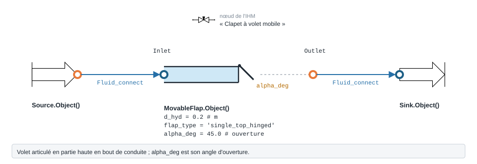

.. _movable_flap:

Clapet à volet mobile
=====================

   Forme, ports et raccordement de ``MovableFlap`` ; paramètres sous leur
   nom de code, avec leur valeur par défaut.

À quoi ça sert
--------------

``MovableFlap`` donne la perte de charge d'un clapet ou d'un volet mobile
(clapet à battant, volet d'obturation) selon son **angle d'ouverture**, son
type (un volet articulé en haut, deux volets, volet à axe central) et ses
proportions. Les coefficients ζ viennent des tables d'Idel'chik (*Handbook of
Hydraulic Resistance*, 4ᵉ éd., diagramme 4.23, p. 306-308), interpolées
linéairement ; la perte vaut ``ΔP = ζ ρ V² / 2``, avec ``V`` la vitesse dans la
section de diamètre ``d_hyd``.

Exemple : clapet à battant DN200, 100 m³/h d'eau
-------------------------------------------------

.. code-block:: python

    from ThermodynamicCycles.Source import Source
    from ThermodynamicCycles.Connect import Fluid_connect
    from ThermodynamicCycles.Hydraulic import MovableFlap

    SOURCE = Source.Object()
    SOURCE.fluid = "water"
    SOURCE.Ti_degC = 20
    SOURCE.Pi_bar = 3.0
    SOURCE.F_m3h = 100                 # 100 m3/h
    SOURCE.calculate()

    CLAPET = MovableFlap.Object()
    CLAPET.d_hyd = 0.20                # DN200
    CLAPET.flap_type = "single_top_hinged"   # un volet articulé en haut
    CLAPET.alpha_deg = 45.0            # angle d'ouverture du volet
    CLAPET.l_over_b = 1.0              # volet carré (longueur / largeur)
    Fluid_connect(CLAPET.Inlet, SOURCE.Outlet)
    CLAPET.calculate()

    print(f"V = {CLAPET.V:.3f} m/s, zeta = {CLAPET.ksi_loc:.2f}, dP = {CLAPET.delta_P:.0f} Pa")

Sortie réelle :

.. code-block:: text

   V = 0.884 m/s, zeta = 3.00, dP = 1171 Pa

Entrées du modèle
-----------------

* **Ports** : ``Inlet``, ``Outlet`` (voir :doc:`../ports_connexions`).
* **Nœud de l'IHM** : « Clapet à volet mobile ».
* **Exceptions levées par le code** : ``ValueError``.

.. list-table::
   :header-rows: 1
   :widths: 26 26 48

   * - Entrée
     - Défaut
     - Commentaire du code
   * - ``d_hyd``
     - ``0.2``
     - —
   * - ``flap_type``
     - ``'single_top_hinged'``
     - single_top_hinged \| double_top_hinged \| single_center_hinged
   * - ``alpha_deg``
     - ``45.0``
     - —
   * - ``l_over_b``
     - ``1.0``
     - —
   * - ``apply_handbook_corrections``
     - ``False``
     - —
   * - ``handbook_roughness_multiplier``
     - ``None``
     - —
   * - ``handbook_aspect_ratio``
     - ``None``
     - —

Lignes du ``df`` de sortie : ``fluid``, ``F_kgs``, ``d_hyd_mm``, ``flap_type``, ``alpha_deg``, ``l_over_b``, ``V_ms``, ``Re``, ``ksi_loc_base``, ``ksi_loc``, ``dP_Pa``, ``dP_mbar``.

Paramètres à personnaliser
--------------------------

.. list-table::
   :header-rows: 1
   :widths: 24 30 46

   * - Grandeur
     - Valeur à saisir
     - Effet sur le résultat
   * - ``alpha_deg``
     - angle d'ouverture du volet (°), **entre 15 et 90°** (domaine du
       tableau)
     - Premier facteur : ζ passe de 11 à 2 entre 15 et 90° pour un volet
       carré articulé en haut.
   * - ``flap_type``
     - ``"single_top_hinged"``, ``"double_top_hinged"`` ou
       ``"single_center_hinged"``
     - Change la table de ζ.
   * - ``l_over_b``
     - longueur / largeur du volet (1 à 10 ; au-delà, traité comme 10)
     - Un volet allongé freine davantage aux petits angles.
   * - ``d_hyd``
     - diamètre de la section où l'on définit la vitesse (m)
     - ``ΔP`` varie comme ``1/d⁴`` à débit donné.
   * - ``apply_handbook_corrections``
     - ``False`` par défaut
     - Facteurs correctifs du module ``HandbookCorrections`` (voir
       :doc:`coudes_tes_singularites`).

Variante exécutée : angle d'ouverture et type de volet
------------------------------------------------------

Même débit, même DN ; on fait varier l'angle et le type de volet.

.. code-block:: python

    # variante : angle d'ouverture et type de volet (à la suite de l'exemple)
    print("angle   un volet haut   deux volets haut   axe central   (dP en Pa)")
    for angle in [15, 20, 30, 45, 60, 90]:
        ligne = []
        for type_volet in ["single_top_hinged", "double_top_hinged", "single_center_hinged"]:
            CLAPET.flap_type = type_volet
            CLAPET.alpha_deg = angle
            CLAPET.calculate()
            ligne.append(CLAPET.delta_P)
        print(f"{angle:4d}°   {ligne[0]:12.0f}   {ligne[1]:15.0f}   {ligne[2]:11.0f}")

Sortie réelle :

.. code-block:: text

   angle   un volet haut   deux volets haut   axe central   (dP en Pa)
     15°           4293              6244          5463
     20°           2458              4293          3512
     30°           1561              2224          1912
     45°           1171              1444          1483
     60°            976              1210          1171
     90°            780              1015           937

Lecture : un clapet entrouvert à 15° perd 5,5 fois plus qu'ouvert à 90° (4,3
contre 0,8 kPa ici). Pour un clapet anti-retour, c'est le débit qui fixe
l'angle d'ouverture : à faible débit, le volet reste peu ouvert et la perte
relative est la plus forte. Le modèle ne calcule pas cet équilibre : l'angle
est une **donnée**.

Cas limites refusés
-------------------

.. code-block:: python

    # à la suite : saisies refusées
    for nom, reglage in [("type inconnu", dict(flap_type="clapet_a_bille")),
                         ("angle nul", dict(flap_type="single_top_hinged", alpha_deg=0.0))]:
        for attribut, valeur in reglage.items():
            setattr(CLAPET, attribut, valeur)
        try:
            CLAPET.calculate()
        except ValueError as erreur:
            print(f"{nom:13s} refusé : {erreur}")

Sortie réelle :

.. code-block:: text

   type inconnu  refusé : flap_type invalide
   angle nul     refusé : alpha_deg doit etre > 0

Pièges
------

.. code-block:: python

    # à la suite : angles hors du tableau (15 à 90°) ramenés à la borne
    CLAPET.flap_type = "single_top_hinged"
    for angle in [5.0, 15.0, 90.0, 120.0]:
        CLAPET.alpha_deg = angle
        CLAPET.calculate()
        print(f"alpha {angle:5.1f}° : zeta = {CLAPET.ksi_loc:5.2f}")

Sortie réelle :

.. code-block:: text

   alpha   5.0° : zeta = 11.00
   alpha  15.0° : zeta = 11.00
   alpha  90.0° : zeta =  2.00
   alpha 120.0° : zeta =  2.00

* **Hors de 15 à 90°, l'angle est ramené à la borne sans message** : un volet
  ouvert à 5° reçoit le ζ de 15°, donc une perte **sous-estimée** d'autant
  plus que le volet est fermé. De même ``l_over_b`` au-delà de 10.
* **Le message « flap_type invalide » ne donne pas la liste** des types
  acceptés : ce sont les trois noms de la table ci-dessus.
* **L'angle n'est pas calculé à partir du débit** : pour un clapet
  anti-retour réel, il dépend du poids du volet et du débit, ce que le modèle
  ne représente pas.

Voir :doc:`index` pour la liste de tous les modèles hydrauliques.
