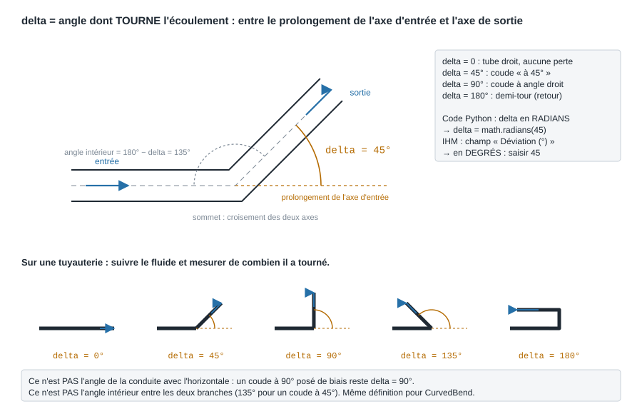
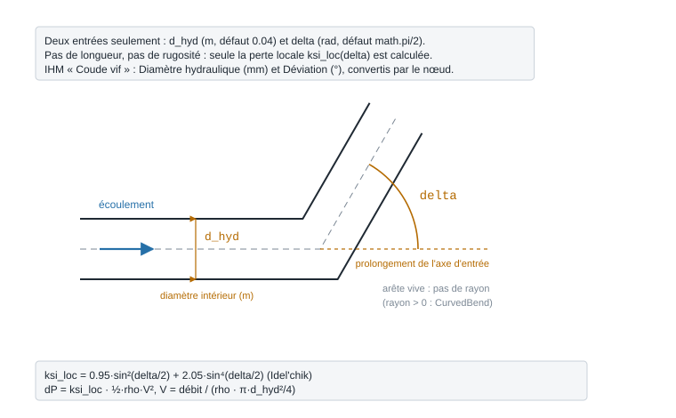
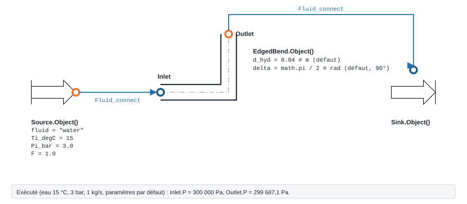
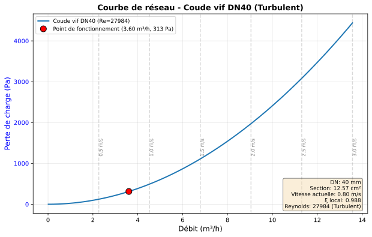
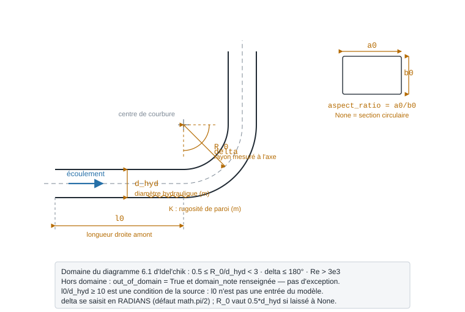
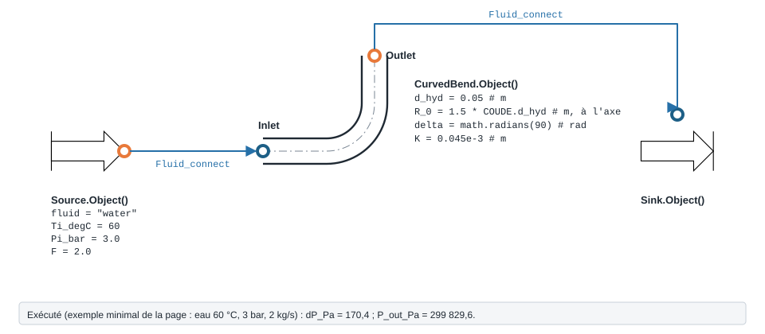
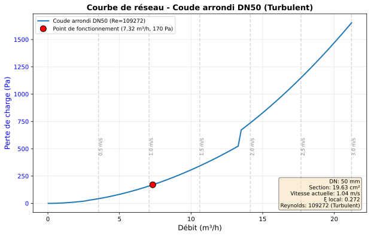

.. _coudes_tes_singularites:

Coude
=====

Deux modèles chiffrent la perte de charge d'un coude, selon sa fabrication :

.. list-table::
   :header-rows: 1
   :widths: 22 30 48

   * - Coude sur site
     - Modèle (nœud de l'IHM)
     - Ce qu'il faut relever
   * - Coude soudé d'onglet, à arête vive (deux tubes coupés en biais)
     - ``EdgedBend`` (« Coude vif »)
     - diamètre intérieur, angle de déviation
   * - Coude cintré, coude à souder « 1 D », « 1,5 D », « 3 D »
     - ``CurvedBend`` (« Coude courbe »)
     - diamètre intérieur, **rayon de courbure à l'axe**, angle de déviation,
       rugosité
   * - Serpentin, coude de rayon ≥ 3 diamètres
     - ``Coil`` (« Serpentin »)
     - voir :doc:`serpentin`

Tous deux suivent la loi :math:`\Delta P = \xi \cdot \tfrac{1}{2}\rho V^2` ; le
coefficient :math:`\xi` dépend surtout de l'**angle** et, pour le coude cintré,
du rapport rayon / diamètre.

.. _angle_deviation_coude:

Configurer un coude : l'angle se mesure par rapport à quoi ?
------------------------------------------------------------

   ``delta`` est l'angle dont **tourne l'écoulement** : entre le prolongement de
   l'axe d'entrée et l'axe de sortie, au croisement des deux axes.

L'angle ``delta`` des deux modèles est l'**angle de déviation** du diagramme 6.1
d'Idel'chik : on suit le fluide, et on mesure de combien sa direction a tourné
entre l'entrée et la sortie du coude.

* **0°** : pas de coude (tube droit, perte nulle) ; **90°** : coude à angle droit ;
  **180°** : demi-tour (retour en épingle).
* Un coude « à 45° » du catalogue a ``delta`` = 45°, alors que l'angle **intérieur**
  entre ses deux branches vaut 135° : c'est l'erreur de relevé la plus fréquente.
  Si vous mesurez l'angle intérieur θ entre les deux branches, saisissez
  ``delta`` = 180° − θ.
* L'orientation du coude dans l'espace n'intervient pas : un coude à 90° posé de
  biais, ou dont l'entrée monte à 30° sur l'horizontale, reste ``delta`` = 90°.
  Le dénivelé, lui, se compte dans les tronçons droits (:ref:`straight_pipe`).

Les autres dimensions :

* ``d_hyd`` est le **diamètre intérieur** (m), pas le DN nominal : à DN égal, il dépend
  de l'épaisseur (série) du tube. C'est lui qui fixe la vitesse, donc la perte :
  à débit et :math:`\xi` donnés, elle varie comme :math:`1/d^4`.
* ``R_0`` (coude cintré seulement) est le rayon de courbure **mesuré à l'axe** de
  la conduite, pas à l'intrados ni à l'extrados — voir :ref:`le schéma coté
  <curved_bend>`. Un coude « 1,5 D » a ``R_0`` = 1,5 × ``d_hyd``.

Saisie en Python et dans l'IHM
~~~~~~~~~~~~~~~~~~~~~~~~~~~~~~

Les **unités diffèrent** entre le code et les nœuds de ``PyqtSimulator`` : le nœud
convertit lui-même ses champs en millimètres et en degrés.

.. list-table::
   :header-rows: 1
   :widths: 24 24 28 24

   * - Grandeur
     - Python (attribut, unité)
     - IHM (champ du nœud, unité)
     - Défaut IHM
   * - Diamètre intérieur
     - ``d_hyd`` (m)
     - « Diamètre hydraulique (mm) »
     - 40
   * - Angle de déviation
     - ``delta`` (**rad**) : ``math.radians(45)``
     - « Déviation (°) », en **degrés** : 45
     - 90
   * - Rayon de courbure à l'axe (coude courbe)
     - ``R_0`` (m)
     - « Rayon courbure R0 (mm) »
     - 20
   * - Rugosité (coude courbe)
     - ``K`` (m)
     - « Rugosité (mm) »
     - 0.0015
   * - Corrélation (coude courbe)
     - ``correlation``
     - liste « Corrélation »
     - ``idelchik``

Dans l'IHM, l'infobulle du champ « Déviation (°) » rappelle la définition
ci-dessus. Les valeurs par défaut du nœud « Coude courbe » (R0 = 20 mm pour
D = 40 mm) décrivent un coude **serré**, R_0/d_hyd = 0,5, au bord du domaine de
la source : remplacez-les par celles de votre coude.

.. _edged_bend:

Coude vif — ``EdgedBend``
-------------------------

   Le coude vif n'a que deux entrées : ``d_hyd`` et ``delta``. Pas de rayon, pas
   de longueur, pas de rugosité.

   Assemblage d'un coude vif : ``Inlet`` reçoit la sortie de la ``Source``, ``Outlet``
   alimente le ``Sink``. Paramètres par défaut du code, résultat exécuté en cartouche.

À quoi ça sert
~~~~~~~~~~~~~~

Chiffrer la perte d'un coude **sans rayon** : deux tubes soudés d'onglet, un
changement de direction en gaine, un piquage à angle vif. C'est le coude le plus
coûteux à angle égal au-delà de 45° — le remplacer par un coude cintré est une
action d'économie de pompage classique, et ce modèle sert à la chiffrer.

Le modèle applique la corrélation d'Idel'chik
:math:`\xi = 0{,}95\,\sin^2(\delta/2) + 2{,}05\,\sin^4(\delta/2)`. Il ne calcule
**que** la perte locale : ni frottement (pas de longueur), ni effet du nombre de
Reynolds ou de la rugosité, sauf correction optionnelle (voir plus bas).

Dans ``PyqtSimulator``, c'est le nœud **« Coude vif »**.

Exemple minimal
~~~~~~~~~~~~~~~

Mêmes conditions que l'exemple du coude cintré plus bas, pour comparer :

.. code-block:: python

   import math
   from ThermodynamicCycles.Source import Source
   from ThermodynamicCycles.Hydraulic import EdgedBend
   from ThermodynamicCycles.Connect import Fluid_connect

   # Amont : eau de chauffage à 60 °C, 3 bar, 2 kg/s
   SOURCE = Source.Object()
   SOURCE.fluid = "water"
   SOURCE.Pi_bar = 3.0        # bar
   SOURCE.Ti_degC = 60        # °C
   SOURCE.F = 2.0             # kg/s
   SOURCE.calculate()

   # Coude vif DN50 à 90° (deux tubes soudés d'onglet)
   COUDE = EdgedBend.Object()
   Fluid_connect(COUDE.Inlet, SOURCE.Outlet)
   COUDE.d_hyd = 0.05              # m — diamètre intérieur
   COUDE.delta = math.radians(90)  # rad — angle de déviation, saisi en radians
   COUDE.calculate()

   print(COUDE.df.drop("Timestamp"))

Sortie réelle :

.. code-block:: text

                     EdgedBend
   fluid                 water
   F_kgs                   2.0
   d_hyd_mm               50.0
   delta_deg              90.0
   V_ms               1.035909
   Re            109271.515452
   ksi_loc_base         0.9875
   ksi_loc              0.9875
   dP_Pa            520.989428
   dP_mbar            5.209894
   P_in_Pa            300000.0
   P_out_Pa      299479.010572

Lecture : 521 Pa, **trois fois** le coude cintré « 1,5 D » de même diamètre
(170 Pa, plus bas). ``delta_deg`` relit l'angle en degrés : c'est la ligne à
regarder pour vérifier qu'il a été saisi en radians. ``ksi_loc_base`` est le
coefficient de la corrélation, ``ksi_loc`` celui qui a servi, après corrections
éventuelles (ici aucune : les deux sont égaux).

   Courbe de réseau du coude vif de l'assemblage ci-dessus (paramètres par
   défaut) : perte de charge en fonction du débit, point de fonctionnement.

Ce qu'on personnalise
~~~~~~~~~~~~~~~~~~~~~

.. list-table::
   :header-rows: 1
   :widths: 28 42 30

   * - Paramètre (défaut)
     - Effet
     - Plage raisonnable
   * - ``d_hyd`` (``0.04`` m)
     - Diamètre intérieur ; à débit donné, la perte varie comme 1/d⁴
     - DN15 à DN300
   * - ``delta`` (``math.pi / 2`` rad)
     - Angle de déviation (voir :ref:`angle_deviation_coude`) ;
       ``math.radians(45)`` pour un coude à 45°
     - 0 à π (180°)
   * - ``apply_handbook_corrections`` (``False``)
     - Active un multiplicateur sur ``ksi_loc`` : ×1,1 si Re > 4·10⁴ (rugosité),
       et ×1,05 si ``handbook_aspect_ratio`` sort de 0,6 – 1,7
     - ``False`` sauf étude de sensibilité
   * - ``handbook_roughness_multiplier`` (``None``)
     - Remplace le ×1,1 par votre propre facteur (> 0)
     - 1,1 à 1,2
   * - ``handbook_aspect_ratio`` (``None``)
     - Rapport a/b d'une section rectangulaire, pris en compte seulement avec
       ``apply_handbook_corrections = True``
     - 0,6 à 1,7 : aucun effet

Variante exécutée : l'angle de déviation, coude vif contre coude cintré
« 1,5 D » de même diamètre et même débit.

.. code-block:: python

   import math
   from ThermodynamicCycles.Source import Source
   from ThermodynamicCycles.Hydraulic import EdgedBend, CurvedBend
   from ThermodynamicCycles.Connect import Fluid_connect

   SOURCE = Source.Object()
   SOURCE.fluid = "water"; SOURCE.Pi_bar = 3.0; SOURCE.Ti_degC = 60; SOURCE.F = 2.0
   SOURCE.calculate()

   # variante : angle de déviation, coude vif contre coude cintré 1.5 D
   print("delta   ksi vif   dP vif (Pa)   dP 1.5 D (Pa)")
   for angle in (30, 45, 60, 90, 120, 180):
       VIF = EdgedBend.Object()
       Fluid_connect(VIF.Inlet, SOURCE.Outlet)
       VIF.d_hyd = 0.05
       VIF.delta = math.radians(angle)
       VIF.calculate()

       CINTRE = CurvedBend.Object()
       Fluid_connect(CINTRE.Inlet, SOURCE.Outlet)
       CINTRE.d_hyd = 0.05
       CINTRE.R_0 = 1.5 * CINTRE.d_hyd
       CINTRE.delta = math.radians(angle)
       CINTRE.K = 0.045e-3
       CINTRE.calculate()
       print(f"{angle:4d}°  {VIF.ksi_loc:7.4f}  {VIF.delta_P:11.1f}  {CINTRE.delta_P:13.1f}")

Sortie réelle :

.. code-block:: text

   delta   ksi vif   dP vif (Pa)   dP 1.5 D (Pa)
     30°   0.0728         38.4           73.5
     45°   0.1831         96.6          104.8
     60°   0.3656        192.9          129.8
     90°   0.9875        521.0          170.4
    120°   1.8656        984.3          203.3
    180°   3.0000       1582.8          254.8

Ce que ça dit : la perte du coude vif croît très vite avec l'angle (×13 de 30° à
90°, ×3 de 90° à 180°) ; à 90°, remplacer un coude vif par un coude cintré
1,5 D divise la perte par trois. Sous 45°, le tableau donne au contraire le
coude vif **moins** coûteux que le coude cintré : ce n'est pas un résultat
physique établi, c'est la conséquence de deux corrélations différentes (le
coude cintré ajoute le frottement sur la longueur de l'arc et la correction de
Reynolds, le coude vif ni l'un ni l'autre). Ne pas en tirer d'argument pour un
coude vif à petit angle ; l'écart est inscrit dans ``BUGS_LIB.md`` pour être
confronté à la source.

Éprouver le modèle
~~~~~~~~~~~~~~~~~~

Le coude vif contrôle très peu ses entrées. Trois cas à connaître, et le seul
refus :

.. code-block:: python

   import math
   from ThermodynamicCycles.Source import Source
   from ThermodynamicCycles.Hydraulic import EdgedBend
   from ThermodynamicCycles.Connect import Fluid_connect

   SOURCE = Source.Object()
   SOURCE.fluid = "water"; SOURCE.Pi_bar = 3.0; SOURCE.Ti_degC = 60; SOURCE.F = 2.0
   SOURCE.calculate()

   def coude_vif(delta, **options):
       C = EdgedBend.Object()
       Fluid_connect(C.Inlet, SOURCE.Outlet)
       C.d_hyd = 0.05
       C.delta = delta
       for nom, valeur in options.items():
           setattr(C, nom, valeur)
       C.calculate()
       return C

   # 1) l'angle saisi en degrés au lieu de radians : aucune erreur
   C = coude_vif(90)
   print("delta = 90      -> delta_deg =", round(C.df.loc["delta_deg"].iloc[0], 1),
         " ksi =", round(C.ksi_loc, 4), " dP =", round(C.delta_P, 1), "Pa")

   # 2) un angle hors de 0..180° : accepté, et confondu avec 90°
   for d in (270, -90):
       C = coude_vif(math.radians(d))
       print(f"delta = {d:4d}°   -> ksi = {C.ksi_loc:.4f}")

   # 3) les corrections « handbook » : multiplicateur sur ksi
   C = coude_vif(math.radians(90), apply_handbook_corrections=True)
   print("corrections handbook : ksi", round(C.ksi_loc_base, 4), "->", round(C.ksi_loc, 4))

   # 4) multiplicateur de rugosité nul : refusé
   try:
       coude_vif(math.radians(90), apply_handbook_corrections=True,
                 handbook_roughness_multiplier=0)
   except ValueError as e:
       print("refusé :", e)

Sortie réelle :

.. code-block:: text

   delta = 90      -> delta_deg = 5156.6  ksi = 1.7625  dP = 929.9 Pa
   delta =  270°   -> ksi = 0.9875
   delta =  -90°   -> ksi = 0.9875
   corrections handbook : ksi 0.9875 -> 1.0863
   refusé : roughness_multiplier doit etre > 0

Pièges nommés :

* **Degrés au lieu de radians.** ``delta = 90`` est lu comme 90 rad : la perte
  calculée (930 Pa) est fausse de +78 % et rien ne lève. Le signal est dans le
  ``df`` : ``delta_deg`` = 5 156,6. Toujours écrire ``math.radians(...)``. Le
  nœud de l'IHM, lui, attend des degrés et convertit.
* **Angle hors de 0 – 180°.** 270° ou −90° sont acceptés et donnent la perte d'un
  coude à 90° : le modèle ne refuse pas un angle qui n'a pas de sens.
* **Corrections « handbook ».** Le facteur ×1,1 (et ×1,05 pour une section
  rectangulaire allongée) n'est rattaché à aucune page de la source dans le
  code : à n'activer qu'en étude de sensibilité, et à signaler dans un rapport.
* **Diamètre nul.** ``d_hyd = 0`` rend une perte de 0 Pa au lieu d'une erreur.

Ces défauts de contrôle sont inscrits dans ``BUGS_LIB.md``.

.. note::
   **D'où viennent les courbes de réseau.** Elles sont tracées par la bibliothèque,
   par le chemin qu'emprunte le nœud de l'IHM : ``compute_network_curve(modele,
   **modele.network_plot_kwargs())`` puis ``render_network_figure``, importés de
   ``ThermodynamicCycles.Hydraulic.network_plot``. ``modele.Plot()`` trace la même figure dans une fenêtre
   autonome (``Plot()`` levait ``TypeError`` jusqu'à la version de la
   bibliothèque du 28/09/2026 ; corrigé).

.. note::
   Ces modèles sont **bidirectionnels** : si la pression d'une sortie est imposée
   (aval), le modèle remonte la (les) pression(s) d'entrée
   (:math:`P_{in}=P_{out}+\Delta P`). Voir :doc:`propagation_pression`.

.. _curved_bend:

Coude arrondi — ``CurvedBend``
------------------------------

   Où se mesure chaque paramètre de ``CurvedBend``. ``R_0`` se prend **à
   l'axe** de la conduite, et ``delta`` se saisit en **radians**.
   L'angle ``delta`` coté au centre de courbure est le même que l'angle entre le
   prolongement de l'axe d'entrée et l'axe de sortie (:ref:`angle_deviation_coude`).

   L'assemblage de l'exemple ci-dessous : mêmes valeurs, même résultat.

À quoi ça sert
~~~~~~~~~~~~~~

Chiffrer la perte de charge d'un coude cintré ou d'un coude « 1.5 D », « 3 D »
d'un réseau d'eau, de vapeur ou de gaz : c'est ce qui décide, avec le tube
droit, de la hauteur manométrique d'une pompe. Le modèle applique le
**diagramme 6.1 d'Idel'chik** : une perte **locale** due à la déviation, qui
dépend de l'angle, du rayon de courbure, du nombre de Reynolds et de la
rugosité, plus le **frottement** le long de la longueur développée de l'arc.

Ne vous en servez pas pour un coude soudé à angle vif (``EdgedBend``) ni pour
un serpentin (R_0/d_hyd ≥ 3, modèle ``Hydraulic.Coil``). La corrélation vaut
pour un coude **isolé**, précédé d'au moins dix diamètres de conduite droite :
deux coudes rapprochés interagissent, et le modèle ne le sait pas.

Dans ``PyqtSimulator``, le même modèle est le nœud **« Coude courbe »** de la
palette.

Exemple minimal
~~~~~~~~~~~~~~~

Le coude reçoit son état de l'amont par ``Fluid_connect`` (voir
:doc:`../ports_connexions`).

.. code-block:: python

   import math
   from ThermodynamicCycles.Source import Source
   from ThermodynamicCycles.Hydraulic import CurvedBend
   from ThermodynamicCycles.Connect import Fluid_connect

   # Amont : eau de chauffage à 60 °C, 3 bar, 2 kg/s
   SOURCE = Source.Object()
   SOURCE.fluid = "water"
   SOURCE.Pi_bar = 3.0        # bar
   SOURCE.Ti_degC = 60        # °C
   SOURCE.F = 2.0             # kg/s
   SOURCE.calculate()

   # Coude DN50 « 1.5 D » à 90°
   COUDE = CurvedBend.Object()
   Fluid_connect(COUDE.Inlet, SOURCE.Outlet)
   COUDE.d_hyd = 0.05              # m — diamètre intérieur
   COUDE.R_0 = 1.5 * COUDE.d_hyd   # m — rayon de courbure, mesuré à l'axe
   COUDE.delta = math.radians(90)  # rad — l'angle se saisit en radians
   COUDE.K = 0.045e-3              # m — rugosité d'un acier commercial
   COUDE.calculate()

   print(COUDE.df.drop("Timestamp"))
   print("hors domaine :", COUDE.out_of_domain)

Sortie réelle :

.. code-block:: text

                    CurvedBend
   fluid                 water
   F_kgs                   2.0
   d_hyd_mm               50.0
   R0_d_hyd                1.5
   delta_deg              90.0
   V_ms               1.035909
   Re            109271.515452
   correlation        idelchik
   regime                  kRe
   ksi_loc_base       0.271636
   ksi_loc            0.271636
   ksi_fr             0.051368
   lambda_FRI         0.021801
   dP_Pa            170.411742
   dP_mbar            1.704117
   P_in_Pa            300000.0
   P_out_Pa      299829.588258
   hors domaine : False

Lecture : à 1 m/s, ce coude coûte 170 Pa, dont 84 % par la déviation
(``ksi_loc`` = 0,272) et 16 % par le frottement le long de l'arc (``ksi_fr`` =
0,051). ``regime = kRe`` signifie que Re (1,1·10⁵) est sous 2·10⁵ : la
correction de Reynolds du diagramme s'applique. ``dP_Pa`` est la grandeur à
reporter dans un bilan de réseau ; ``P_out_Pa`` est déjà la pression aval.

   Courbe de réseau du coude de l'exemple : 170 Pa à 7,32 m³/h.

Le **saut** vers 13,4 m³/h n'est pas un défaut de tracé. À Re = 2·10⁵, le
diagramme 6.1 change de ligne dans sa table de correction de rugosité : mesuré sur
ce coude, ``kD`` passe de 1,338 à 1,900 pendant que ``kRe`` tombe de 1,099 à 1 —
``ksi_loc`` augmente de 29 % d'un coup (0,252 → 0,326). La source publie une
table, pas une loi continue ; le modèle l'applique telle quelle.

Ce qu'on personnalise
~~~~~~~~~~~~~~~~~~~~~

.. list-table::
   :header-rows: 1
   :widths: 22 38 22 18

   * - Paramètre
     - Effet
     - Plage raisonnable
     - Source
   * - ``d_hyd`` (m)
     - Diamètre intérieur ; fixe la vitesse, donc Re et la pression dynamique
     - DN15 à DN300
     - —
   * - ``R_0`` (m)
     - Rayon de courbure à l'axe. Le rapport ``R_0/d_hyd`` est ce qui compte ;
       ``None`` donne 0,5 × ``d_hyd``
     - 0,5 ≤ R_0/d_hyd < 3
     - Idel'chik, diag. 6.1
   * - ``delta`` (rad)
     - Angle de déviation (voir :ref:`angle_deviation_coude`) ;
       ``math.radians(45)`` pour un coude à 45°
     - 0 à π (180°)
     - Idel'chik, diag. 6.1
   * - ``K`` (m)
     - Rugosité absolue ; agit par ``lambda_FRI`` et par la correction k_Δ
       au-dessus de Re = 4·10⁴
     - 1,5·10⁻⁶ (défaut, tube lisse) à 0,2·10⁻³
     - —
   * - ``aspect_ratio``
     - Rapport a0/b0 d'une gaine rectangulaire ; ``None`` = section circulaire
     - 0,25 à 8
     - Idel'chik, diag. 6.1 (C1)
   * - ``correlation``
     - ``'idelchik'`` (défaut) ou ``'legacy'``, l'ancienne formule, conservée
       pour reproduire des résultats antérieurs
     - —
     - —
   * - ``apply_reynolds_factor``, ``apply_roughness_factor``
     - Désactivent k_Re ou k_Δ ; à ``True`` sauf étude de sensibilité
     - —
     - —

.. warning::
   ``correlation = 'legacy'`` sous-estime la perte des coudes courants : à
   R_0/d_hyd = 1,5, son ``ksi_loc`` vaut 0,076 là où Idel'chik imprime 0,17
   (–55 %), et son facteur d'angle est linéaire. Ne l'employez que pour
   retrouver un ancien calcul.

Variante exécutée : le même débit, en faisant varier le rayon puis l'angle.

.. code-block:: python

   import math
   from ThermodynamicCycles.Source import Source
   from ThermodynamicCycles.Hydraulic import CurvedBend
   from ThermodynamicCycles.Connect import Fluid_connect

   SOURCE = Source.Object()
   SOURCE.fluid = "water"; SOURCE.Pi_bar = 3.0; SOURCE.Ti_degC = 60; SOURCE.F = 2.0
   SOURCE.calculate()

   # variante : rayon de courbure et angle
   print("R_0/d_hyd  delta   ksi_loc  ksi_fr   dP (Pa)")
   for r_sur_d, angle in ((0.5, 90), (1.0, 90), (1.5, 90), (2.0, 90), (1.5, 45), (1.5, 180)):
       COUDE = CurvedBend.Object()
       Fluid_connect(COUDE.Inlet, SOURCE.Outlet)
       COUDE.d_hyd = 0.05
       COUDE.R_0 = r_sur_d * COUDE.d_hyd
       COUDE.delta = math.radians(angle)
       COUDE.K = 0.045e-3
       COUDE.calculate()
       print(f"{r_sur_d:8.1f}  {angle:4d}°  {COUDE.ksi_loc:7.3f}  {COUDE.ksi_fr:6.3f}  {COUDE.delta_P:8.1f}")

Sortie réelle :

.. code-block:: text

   R_0/d_hyd  delta   ksi_loc  ksi_fr   dP (Pa)
        0.5    90°    1.792   0.017     954.4
        1.0    90°    0.333   0.034     193.6
        1.5    90°    0.272   0.051     170.4
        2.0    90°    0.235   0.068     160.2
        1.5    45°    0.173   0.026     104.8
        1.5   180°    0.380   0.103     254.8

Ce que ça dit : passer d'un coude serré (R_0/d_hyd = 0,5) à un coude « 1 D »
divise la perte **par cinq** ; au-delà, le gain s'essouffle (–12 % de 1 à 1,5,
–6 % de 1,5 à 2) parce que le frottement le long d'un arc plus long reprend une
partie de ce que la déviation perd. L'angle n'agit pas proportionnellement : un
demi-tour à 180° coûte 1,5 fois un coude à 90°, pas deux fois.

Éprouver le modèle
~~~~~~~~~~~~~~~~~~

Le modèle a **deux façons** de réagir hors du diagramme, et elles ne se
ressemblent pas :

* hors de 0,5 ≤ R_0/d_hyd < 3, ou pour Re ≤ 3·10³, il **calcule quand même**,
  mais pose ``out_of_domain = True`` et explique pourquoi dans ``domain_note``.
  C'est à vous de lire ce drapeau ;
* à faible débit (3·10³ < Re < 10⁴), la source change de formule, et sa table
  A2 s'arrête à R_0/d_hyd = 2. Au-delà, le modèle **refuse** par
  ``OutOfTableError`` plutôt que d'extrapoler.

.. code-block:: python

   import math
   from ThermodynamicCycles.Source import Source
   from ThermodynamicCycles.Hydraulic import CurvedBend
   from ThermodynamicCycles.Hydraulic.CurvedBend import OutOfTableError
   from ThermodynamicCycles.Connect import Fluid_connect

   def coude(r_sur_d, F):
       SOURCE = Source.Object()
       SOURCE.fluid = "water"; SOURCE.Pi_bar = 3.0; SOURCE.Ti_degC = 60; SOURCE.F = F
       SOURCE.calculate()
       COUDE = CurvedBend.Object()
       Fluid_connect(COUDE.Inlet, SOURCE.Outlet)
       COUDE.d_hyd = 0.05
       COUDE.R_0 = r_sur_d * COUDE.d_hyd
       COUDE.delta = math.radians(90)
       return COUDE

   # 1) coude plus serré que le diagramme 6.1 : calculé, mais signalé
   C = coude(0.3, 2.0)
   C.calculate()
   print("R_0/d_hyd = 0.3 -> dP =", round(C.delta_P, 1), "Pa, hors domaine :", C.out_of_domain)
   print("  note :", C.domain_note)

   # 2) faible débit (3e3 < Re < 1e4) sur un grand rayon : la source ne publie rien
   C = coude(2.5, 0.12)
   try:
       C.calculate()
   except OutOfTableError as e:
       print("refusé :", e)

Sortie réelle :

.. code-block:: text

   R_0/d_hyd = 0.3 -> dP = 2377.5 Pa, hors domaine : True
     note : R0/D0 = 0.30 hors du domaine 0.5 <= R0/D0 < 3 du Diagramme 6.1 (au-dela de 3 : Diagramme 6.2, modele Hydraulic.Coil)
   refusé : Coude a R0/D0 = 2.50 en regime 3e3 < Re < 1e4 : la table A2 du Diagramme 6.1 (p.424) s'arrete a R0/D0 = 2.0 et rien n'est publie au-dela. Aucune valeur n'est extrapolee. Pour R0/D0 >= 3 c'est le Diagramme 6.2 (serpentins) qui s'applique ; sinon, poser apply_reynolds_factor = False pour n'obtenir que zeta_qu + zeta_fr, en connaissance de cause.

Les 2 377 Pa du premier cas sont une **extrapolation** de la formule en
(R_0/d_hyd)⁻²·⁵ : le chiffre existe, mais la source ne le garantit pas. Le
modèle ne vérifie pas non plus la longueur droite amont (l0/d_hyd ≥ 10) : ce
n'est pas une de ses entrées.

Pour aller plus loin
~~~~~~~~~~~~~~~~~~~~

* :ref:`straight_pipe` — la perte linéaire des tronçons droits.
* :ref:`propagation_pression` — comment ``P_out_Pa`` se propage dans un réseau.
* :doc:`../ports_connexions` — ce que transporte ``Inlet`` / ``Outlet``.
* Source : I. E. Idel'chik, *Handbook of Hydraulic Resistance*, 4ᵉ éd., Begell
  House, 2008, diagramme 6.1, p. 424-426. Les formules de k_Re et le
  coefficient A2 y sont qualifiés de « tentatives » par l'auteur lui-même : ce
  sont des ordres de grandeur. Entre 70 et 100°, la source ne donne qu'une
  table ; le modèle l'interpole linéairement.
