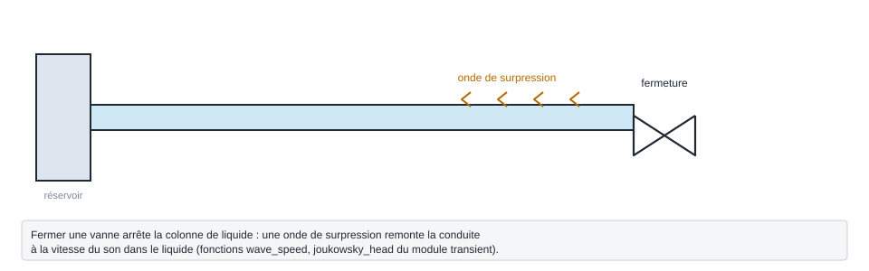

.. _transient:

Coups de bélier
===============

   Forme, ports et raccordement de ``transient`` ; paramètres sous leur
   nom de code, avec leur valeur par défaut.

Régime transitoire d'un réseau de liquide : la surpression d'un coup de bélier, par exemple à la fermeture d'une vanne.

À quoi ça sert
--------------

Avant de simuler un réseau, l'ingénieur veut l'ordre de grandeur : **quelle
surpression maximale** si une vanne se ferme brusquement, et **en combien de
temps** une fermeture cesse d'être « brusque ». Le module ``transient`` fournit
pour cela trois fonctions tirées de M. Frelin, *Coups de bélier*, Techniques de
l'Ingénieur BM 4 176 (2002) :

* ``liquid_bulk_modulus(fluid, T_K, P_Pa)`` — module d'élasticité du liquide
  ε = ρ a² (éq. 13), à partir de CoolProp ;
* ``wave_speed(rho, bulk_modulus, D_inner, wall_thickness, young_modulus)`` —
  célérité des ondes dans une conduite **mince** déformable (éq. 40) ;
* ``joukowsky_head(c, delta_V)`` — surpression d'un arrêt brusque, Δh = c ΔV / g
  (éq. 9).

La simulation complète d'un réseau (méthode des caractéristiques, fermeture
progressive, cavitation détectée) est décrite dans
:doc:`../013-simulation-temporelle/coup_de_belier`, à partir d'une scène de
l'IHM. Cette page ne la répète pas.

Exemple : surpression maximale dans une conduite acier DN200
------------------------------------------------------------

.. code-block:: python

    from CoolProp.CoolProp import PropsSI
    from ThermodynamicCycles.Hydraulic.transient import (
        liquid_bulk_modulus, wave_speed, joukowsky_head)

    T, P = 293.15, 3e5                       # eau à 20 °C, 3 bar
    rho = PropsSI("D", "T", T, "P", P, "water")
    eps = liquid_bulk_modulus("water", T, P) # module d'élasticité du liquide (Pa)

    c = wave_speed(rho, eps, D_inner=0.2101, wall_thickness=0.0063,
                   young_modulus=210e9)      # acier DN200, 6,3 mm
    dH = joukowsky_head(c, delta_V=1.5)      # arrêt brusque d'une vitesse de 1,5 m/s

    print(f"epsilon = {eps / 1e9:.2f} GPa, célérité c = {c:.0f} m/s")
    print(f"surpression de Joukowsky = {dH:.0f} m de colonne = {rho * 9.80665 * dH / 1e5:.1f} bar")
    print(f"fermeture « brusque » si plus rapide que 2L/c = {2 * 1000 / c:.2f} s (L = 1 000 m)")

Sortie réelle :

.. code-block:: text

   epsilon = 2.19 GPa, célérité c = 1277 m/s
   surpression de Joukowsky = 195 m de colonne = 19.1 bar
   fermeture « brusque » si plus rapide que 2L/c = 1.57 s (L = 1 000 m)

Une vanne qui se ferme en moins de 1,6 s sur 1 000 m de conduite produit la
surpression complète de 19 bar, quelle que soit sa loi de fermeture ; au-delà,
la surpression diminue et seule la simulation la chiffre.

Contenu du module
-----------------

* **Fonctions publiques** : ``K_from_kv``, ``check_valve_reversals``, ``from_hydraulic_network``, ``joukowsky_head``, ``linear_closure``, ``liquid_bulk_modulus``, ``wave_speed``.
* **Classes** : ``ConversionReport``, ``TransientNetwork``, ``TransientNode``, ``TransientPipe``, ``TransientResult``, ``TransientValve``.

Paramètres à personnaliser
--------------------------

.. list-table::
   :header-rows: 1
   :widths: 24 30 46

   * - Grandeur
     - Valeur à saisir
     - Effet sur le résultat
   * - ``D_inner``, ``wall_thickness``
     - diamètre intérieur et épaisseur de la fiche du tube (m)
     - Un tube mince et souple ralentit les ondes. Hypothèse de la source :
       épaisseur petite devant le diamètre.
   * - ``young_modulus``
     - module d'Young du matériau de la conduite (Pa), sur la fiche du tube
     - Premier facteur : un plastique divise la célérité par 3,5 à 4,5.
   * - ``liquid_bulk_modulus(fluid, T, P)``
     - fluide et température réels
     - ~2,2 GPa pour l'eau à 20 °C.
   * - ``delta_V``
     - variation de vitesse : la vitesse en service pour une fermeture
       totale
     - Surpression proportionnelle.

Variante exécutée : le matériau de la conduite
----------------------------------------------

Même diamètre intérieur, même vitesse ; les épaisseurs et modules d'Young
ci-dessous sont des **valeurs indicatives** à remplacer par celles de la fiche
du tube.

.. code-block:: python

    # variante : matériau de la conduite (à la suite de l'exemple)
    tubes = [  # (nom, épaisseur m, module d'Young Pa) -- valeurs indicatives
        ("acier 6,3 mm",    0.0063, 210e9),
        ("fonte ductile 6 mm", 0.006, 170e9),
        ("PVC 9,6 mm",      0.0096, 3.0e9),
        ("PEHD 18,2 mm",    0.0182, 1.0e9),
    ]
    for nom, e, E in tubes:
        c_tube = wave_speed(rho, eps, D_inner=0.2101, wall_thickness=e, young_modulus=E)
        dH_tube = joukowsky_head(c_tube, delta_V=1.5)
        print(f"{nom:19s}: c = {c_tube:5.0f} m/s, surpression {dH_tube:4.0f} m "
              f"({rho * 9.80665 * dH_tube / 1e5:4.1f} bar), 2L/c = {2000 / c_tube:4.1f} s")

Sortie réelle :

.. code-block:: text

   acier 6,3 mm       : c =  1277 m/s, surpression  195 m (19.1 bar), 2L/c =  1.6 s
   fonte ductile 6 mm : c =  1230 m/s, surpression  188 m (18.4 bar), 2L/c =  1.6 s
   PVC 9,6 mm         : c =   359 m/s, surpression   55 m ( 5.4 bar), 2L/c =  5.6 s
   PEHD 18,2 mm       : c =   289 m/s, surpression   44 m ( 4.3 bar), 2L/c =  6.9 s

Lecture : une conduite plastique encaisse 3,5 à 4,5 fois moins de surpression
qu'une conduite métallique pour la même manœuvre, mais une fermeture y reste
« brusque » 3,5 à 4,5 fois plus longtemps (2L/c de 5,6 à 6,9 s au lieu de 1,6 s).
Remplacer un tronçon acier par du PEHD change donc à la fois la surpression et
le temps de fermeture minimal à imposer aux vannes.

Cas limite refusé
-----------------

.. code-block:: python

    # à la suite : épaisseur nulle refusée
    try:
        wave_speed(rho, eps, D_inner=0.2101, wall_thickness=0.0, young_modulus=210e9)
    except ValueError as erreur:
        print("Refusé :", erreur)

Sortie réelle :

.. code-block:: text

   Refusé : wave_speed : wall_thickness doit etre > 0, recu 0.0

Pièges
------

.. code-block:: python

    # à la suite : ce que la formule ne vérifie pas
    print("vitesse négative  :", round(joukowsky_head(c, delta_V=-1.5)), "m")
    print("tube très épais   :", round(wave_speed(rho, eps, D_inner=0.05, wall_thickness=0.05,
                                                 young_modulus=210e9)), "m/s")

Sortie réelle :

.. code-block:: text

   vitesse négative  : -195 m
   tube très épais   : 1475 m/s

* **La formule de tube mince est appliquée à tout tube** : une épaisseur égale
  au diamètre (cas absurde ci-dessus) est acceptée. La source donne, pour un
  tube épais, une constante correctrice (tableau 1) non implémentée ; restez
  dans le domaine épaisseur ≪ diamètre.
* **Joukowsky donne un maximum, pas une évolution** : c'est la surpression
  d'une fermeture plus rapide que ``2L/c``. Pour une fermeture plus lente,
  une pompe qui s'arrête ou un réseau maillé, utilisez la simulation de
  :doc:`../013-simulation-temporelle/coup_de_belier`.
* **Le signe de ``delta_V`` donne le sens** : une baisse de vitesse en amont
  d'une vanne crée une surpression, en aval une dépression (risque de
  cavitation), que la fonction rend négative sans commentaire.
* **Ajoutez la pression de service** : la surpression s'ajoute à la pression
  statique en régime permanent pour vérifier la tenue (PN) de la conduite.

Voir :doc:`index` pour la liste de tous les modèles hydrauliques.
