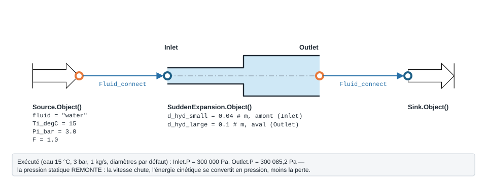
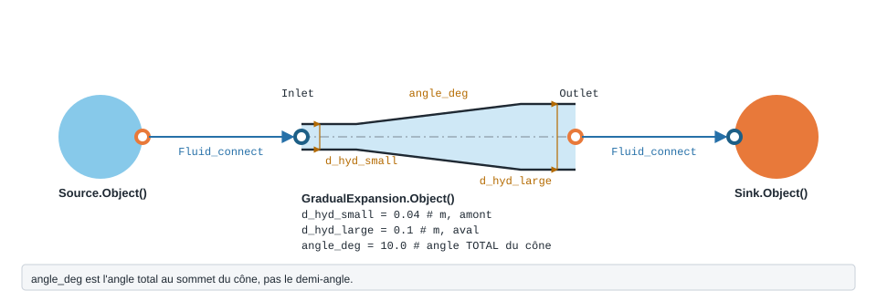
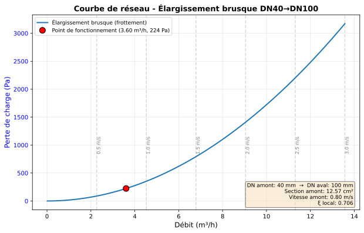

.. _elargissement_section:

Élargissement de section
========================

   Élargissement brusque : les rôles s'inversent — ``d_hyd_small`` en amont,
   ``d_hyd_large`` en aval. Mesuré : la pression **remonte** de 85 Pa.

   Forme, ports et raccordement de ``GradualExpansion`` ; paramètres sous leur
   nom de code, avec leur valeur par défaut.

Passage d'un petit diamètre à un grand : brusque (``SuddenExpansion``) ou
progressif, par un diffuseur conique (``GradualExpansion``). La vitesse chute
et la pression statique **remonte**, diminuée de la perte.

Exemple : élargissement brusque DN50 → DN100
--------------------------------------------

.. code-block:: python

    from ThermodynamicCycles.Source import Source
    from ThermodynamicCycles.Connect import Fluid_connect
    from ThermodynamicCycles.Hydraulic import SuddenExpansion, GradualExpansion

    def source(debit_m3h=15.0):
        s = Source.Object()
        s.fluid, s.Ti_degC, s.Pi_bar = "water", 20, 3.0
        s.F_m3h = debit_m3h
        s.calculate()
        return s

    # Élargissement brusque DN50 -> DN100, 15 m3/h d'eau
    EL = SuddenExpansion.Object()
    EL.d_hyd_small, EL.d_hyd_large = 0.050, 0.100
    Fluid_connect(EL.Inlet, source().Outlet)
    EL.calculate()
    print(f"V {EL.V_small:.2f} -> {EL.V_large:.2f} m/s, zeta {EL.ksi_loc:.3f}, "
          f"perte {EL.delta_P_friction:.0f} Pa, pression statique {EL.delta_P_static:+.0f} Pa")

Sortie réelle :

.. code-block:: text

   V 2.12 -> 0.53 m/s, zeta 0.562, perte 1264 Pa, pression statique +843 Pa

La vitesse est divisée par quatre : l'énergie cinétique libérée (2 107 Pa) se
partage entre une **perte** irréversible de 1 264 Pa (Borda-Carnot,
ζ = (1 − A₁/A₂)² = 0,5625 rapporté à la vitesse amont) et une **remontée** de
pression statique de 843 Pa. ``delta_P_static`` est la variation P_aval − P_amont :
positive ici.

Fiches des deux modèles
-----------------------

``SuddenExpansion`` — elargissement brusque (Modelica PressureLoss.Orifice.SuddenExpansionOrifice).

.. code-block:: python

   from ThermodynamicCycles.Hydraulic import SuddenExpansion
   modele = SuddenExpansion.Object()

* **Ports** : ``Inlet``, ``Outlet`` (voir :doc:`../ports_connexions`).
* **Nœud de l'IHM** : « Elargissement ».

.. list-table::
   :header-rows: 1
   :widths: 26 26 48

   * - Entrée
     - Défaut
     - Commentaire du code
   * - ``d_hyd_small``
     - ``0.04``
     - m -- amont (Inlet)
   * - ``d_hyd_large``
     - ``0.1``
     - m -- aval (Outlet)
   * - ``correlation``
     - ``'Borda-Carnot'``
     - —
   * - ``roughness``
     - ``1.5e-06``
     - m
   * - ``apply_handbook_corrections``
     - ``False``
     - —
   * - ``handbook_roughness_multiplier``
     - ``None``
     - —
   * - ``handbook_aspect_ratio``
     - ``None``
     - —

Lignes du ``df`` de sortie : ``fluid``, ``F_kgs``, ``d_small_mm``, ``d_large_mm``, ``V_small_ms``, ``V_large_ms``, ``correlation``, ``Re_small``, ``darcy_factor``, ``ksi_loc_base``, ``ksi_loc``, ``dP_friction_Pa``, ``dP_static_Pa``.

   Courbe de réseau de l'élargissement brusque ci-dessus.

.. note::
   **D'où viennent les courbes de réseau.** Elles sont tracées par la bibliothèque,
   par le chemin qu'emprunte le nœud de l'IHM : ``compute_network_curve(modele,
   **modele.network_plot_kwargs())`` puis ``render_network_figure``, importés de
   ``ThermodynamicCycles.Hydraulic.network_plot``. ``modele.Plot()`` trace la même figure dans une fenêtre
   autonome (``Plot()`` levait ``TypeError`` jusqu'à la version de la
   bibliothèque du 28/09/2026 ; corrigé).

``GradualExpansion`` — diffuseur conique (elargissement progressif).

.. code-block:: python

   from ThermodynamicCycles.Hydraulic import GradualExpansion
   modele = GradualExpansion.Object()

* **Ports** : ``Inlet``, ``Outlet`` (voir :doc:`../ports_connexions`).
* **Nœud de l'IHM** : « Diffuseur conique ».
* **Exceptions levées par le code** : ``ValueError``.

.. list-table::
   :header-rows: 1
   :widths: 26 26 48

   * - Entrée
     - Défaut
     - Commentaire du code
   * - ``d_hyd_small``
     - ``0.04``
     - m -- amont (Inlet)
   * - ``d_hyd_large``
     - ``0.1``
     - m -- aval (Outlet)
   * - ``angle_deg``
     - ``10.0``
     - angle TOTAL du cone
   * - ``roughness``
     - ``1.5e-06``
     - m
   * - ``correlation``
     - ``'idelchik'``
     - —
   * - ``ksi_exp``
     - ``None``
     - —
   * - ``ksi_fr``
     - ``None``
     - —
   * - ``phi_exp``
     - ``None``
     - —

Lignes du ``df`` de sortie : ``fluid``, ``F_kgs``, ``d_small_mm``, ``d_large_mm``, ``angle_deg``, ``length_m``, ``V_small_ms``, ``V_large_ms``, ``Re_small``, ``correlation``, ``darcy_factor``, ``ksi_exp``, ``ksi_fr``, ``ksi_loc``, ``dP_friction_Pa``, ``dP_static_Pa``.

.. note::
   Ces modèles sont **bidirectionnels** : si la pression d'une sortie est imposée
   (aval), le modèle remonte la (les) pression(s) d'entrée
   (:math:`P_{in}=P_{out}+\Delta P`). Voir :doc:`propagation_pression`.

Paramètres à personnaliser
--------------------------

.. list-table::
   :header-rows: 1
   :widths: 24 30 46

   * - Grandeur
     - Valeur à saisir
     - Effet sur le résultat
   * - ``d_hyd_small`` / ``d_hyd_large``
     - diamètres intérieurs amont (petit) et aval (grand), en m
     - Le rapport des sections fixe à la fois la perte et la remontée de
       pression.
   * - ``angle_deg`` (``GradualExpansion``)
     - angle **total** au sommet du cône, ]0 ; 180]
     - Fixe ζ et la longueur du cône (``length``).
   * - ``correlation``
     - ``SuddenExpansion`` : ``"Borda-Carnot"`` (défaut) ou ``"hooper"`` ;
       ``GradualExpansion`` : ``"idelchik"`` (tableau, défaut),
       ``"idelchik_formula"``, ``"hooper"``
     - Change la source des coefficients ; Hooper fait intervenir le
       frottement et la rugosité.
   * - Débit (``Source``)
     - débit en service
     - Perte et remontée varient comme le carré du débit.

Variante exécutée : brusque ou conique, et quel angle ?
-------------------------------------------------------

Même DN50 → DN100, même débit ; on remplace l'élargissement brusque par un
diffuseur conique de 6 à 180°.

.. code-block:: python

    # variante : diffuseur conique selon l'angle (à la suite de l'exemple)
    print("angle   longueur   zeta   perte (Pa)   remontée de pression (Pa)")
    for angle in [6, 10, 20, 30, 60, 90, 180]:
        D = GradualExpansion.Object()
        D.d_hyd_small, D.d_hyd_large, D.angle_deg = 0.050, 0.100, angle
        Fluid_connect(D.Inlet, source().Outlet)
        D.calculate()
        print(f"{angle:4d}°   {D.length:6.3f} m   {D.ksi_loc:5.3f}   {D.delta_P_friction:9.0f}   "
              f"{D.delta_P_static:+12.0f}")
    print(f"brusque  (Borda)   {EL.ksi_loc:5.3f}   {EL.delta_P_friction:9.0f}   {EL.delta_P_static:+12.0f}")

Sortie réelle :

.. code-block:: text

   angle   longueur   zeta   perte (Pa)   remontée de pression (Pa)
      6°    0.477 m   0.124         279          +1829
     10°    0.286 m   0.118         265          +1842
     20°    0.142 m   0.255         574          +1533
     30°    0.093 m   0.469        1055          +1052
     60°    0.043 m   0.625        1404           +703
     90°    0.025 m   0.599        1346           +761
    180°    0.000 m   0.584        1312           +796
   brusque  (Borda)   0.562        1264           +843

Lecture : un cône de 6 à 10° récupère 87 % de l'énergie cinétique (1 842 Pa
sur 2 107) contre 40 % pour l'élargissement brusque, au prix d'une longueur de
0,3 à 0,5 m. Au-delà d'environ 30°, le cône ne gagne plus rien ; entre 60 et
180°, le tableau d'Idel'chik donne même une perte légèrement **supérieure** à
celle de l'élargissement brusque (Borda-Carnot). Quand on cherche
à récupérer de la pression, c'est la remontée de pression qui compte : choisissez un
cône court seulement s'il reste sous 20°.

Cas limite refusé
-----------------

.. code-block:: python

    # à la suite : corrélation inconnue refusée
    D = GradualExpansion.Object()
    D.d_hyd_small, D.d_hyd_large = 0.050, 0.100
    D.correlation = "borda"
    Fluid_connect(D.Inlet, source().Outlet)
    try:
        D.calculate()
    except ValueError as erreur:
        print("Refusé :", erreur)

Sortie réelle :

.. code-block:: text

   Refusé : correlation inconnue 'borda' ; attendu idelchik | idelchik_formula | hooper

Pièges
------

.. code-block:: python

    # à la suite : trois saisies qui ne sont pas refusées proprement
    EL2 = SuddenExpansion.Object()
    EL2.d_hyd_small, EL2.d_hyd_large = 0.100, 0.050     # diamètres intervertis
    Fluid_connect(EL2.Inlet, source().Outlet)
    EL2.calculate()
    print(f"brusque inversé : zeta {EL2.ksi_loc:.2f}")

    D2 = GradualExpansion.Object()
    D2.d_hyd_small, D2.d_hyd_large = 0.100, 0.050       # diffuseur qui rétrécit
    Fluid_connect(D2.Inlet, source().Outlet)
    D2.calculate()
    print(f"cône inversé    : zeta {D2.ksi_loc:.3f}")

    D3 = GradualExpansion.Object()
    D3.angle_deg = 0.0
    Fluid_connect(D3.Inlet, source().Outlet)
    try:
        D3.calculate()
    except ZeroDivisionError:
        print("angle nul       : ZeroDivisionError")

Sortie réelle :

.. code-block:: text

   brusque inversé : zeta 9.00
   cône inversé    : zeta 0.105
   angle nul       : ZeroDivisionError

* **Des diamètres intervertis ne sont pas refusés.** Avec ``d_hyd_small`` plus
  grand que ``d_hyd_large``, l'élargissement brusque applique Borda-Carnot à un
  rétrécissement (ζ = 9) et le diffuseur rend un ζ de 0,105 pour un cône qui
  rétrécit. Pour un passage du grand au petit diamètre, utilisez
  :doc:`reduction_section`.
* **Un angle nul** lève une ``ZeroDivisionError`` brute (longueur infinie),
  au lieu du message « angle_deg doit être dans ]0, 180] » qu'affiche la
  formule d'Idel'chik.
* **delta_P_static est signé** : positif = la pression remonte vers l'aval ;
  ``delta_P_friction`` est la seule perte irréversible.

Voir :doc:`index` pour la liste de tous les modèles hydrauliques.
