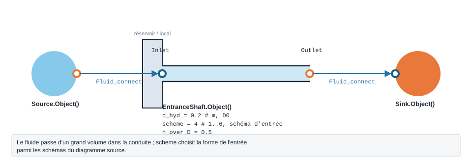

.. _entrance_shaft:

Entrée de conduite
==================

   Forme, ports et raccordement de ``EntranceShaft`` ; paramètres sous leur
   nom de code, avec leur valeur par défaut.

À quoi ça sert
--------------

``EntranceShaft`` donne la perte de charge à l'**entrée d'un puits ou d'une
gaine circulaire droite** (prise d'air, cheminée d'aspiration), d'après le
diagramme 3.18 d'Idel'chik (*Handbook of Hydraulic Resistance*, 4ᵉ éd.). Le
coefficient ζ est lu dans une table selon le **numéro de schéma** (1 à 6, les
profils d'entrée dessinés sur le diagramme) et le rapport ``h/D0``, puis
``ΔP = ζ ρ V² / 2`` avec ``V`` la vitesse dans la gaine.

.. note::

   La bibliothèque ne décrit pas les six profils : le numéro ``scheme`` et la
   cote ``h`` sont ceux du diagramme 3.18, à consulter pour choisir le schéma
   qui correspond à votre entrée. Cette page n'en invente pas la description.

Exemple : prise d'air de 400 mm, 3 000 m³/h
--------------------------------------------

.. code-block:: python

    from ThermodynamicCycles.Source import Source
    from ThermodynamicCycles.Connect import Fluid_connect
    from ThermodynamicCycles.Hydraulic import EntranceShaft

    def source():
        s = Source.Object()
        s.fluid, s.Ti_degC, s.Pi_bar = "air", 20, 1.01325
        s.F_m3h = 3000                     # 3 000 m3/h d'air
        s.calculate()
        return s

    ENT = EntranceShaft.Object()
    ENT.d_hyd = 0.40                       # gaine de 400 mm
    ENT.scheme = 4                         # numéro du schéma du diagramme 3.18
    ENT.h_over_D = 0.5                     # cote h rapportée au diamètre
    Fluid_connect(ENT.Inlet, source().Outlet)
    ENT.calculate()
    print(f"V = {ENT.V:.2f} m/s, zeta = {ENT.ksi_loc:.2f}, dP = {ENT.delta_P:.1f} Pa")

Sortie réelle :

.. code-block:: text

   V = 6.63 m/s, zeta = 0.75, dP = 19.9 Pa

Fiche du modèle
---------------

* **Ports** : ``Inlet``, ``Outlet`` (voir :doc:`../ports_connexions`).
* **Nœud de l'IHM** : « Prise d'entrée en puits ».
* **Exceptions levées par le code** : ``ValueError``.

.. list-table::
   :header-rows: 1
   :widths: 26 26 48

   * - Entrée
     - Défaut
     - Commentaire du code
   * - ``d_hyd``
     - ``0.2``
     - m, D0
   * - ``scheme``
     - ``4``
     - 1..6 selon diagramme
   * - ``h_over_D``
     - ``0.5``
     - —
   * - ``apply_handbook_corrections``
     - ``False``
     - —
   * - ``handbook_roughness_multiplier``
     - ``None``
     - —
   * - ``handbook_aspect_ratio``
     - ``None``
     - —

Lignes du ``df`` de sortie : ``fluid``, ``F_kgs``, ``d_hyd_mm``, ``scheme``, ``h_over_D``, ``V_ms``, ``Re``, ``ksi_loc_base``, ``ksi_loc``, ``dP_Pa``, ``dP_mbar``.

Paramètres à personnaliser
--------------------------

.. list-table::
   :header-rows: 1
   :widths: 22 30 48

   * - Grandeur
     - Valeur à saisir
     - Effet sur le résultat
   * - ``scheme``
     - entier de 1 à 6, numéro du schéma du diagramme 3.18
     - Change toute la table de ζ (facteur 4 entre schémas à h/D = 1).
   * - ``h_over_D``
     - cote ``h`` du diagramme rapportée à ``D0``, **entre 0,1 et 1**
       (au-delà de 1, ζ ne varie plus)
     - Aux faibles ``h/D``, ζ explose : jusqu'à 48 pour le schéma 2.
   * - ``d_hyd``
     - diamètre de la gaine ``D0`` (m)
     - ``ΔP`` varie comme ``1/D0⁴`` à débit donné.
   * - Débit et fluide (``Source``)
     - débit d'air (ou de liquide) en service
     - Perte proportionnelle au carré du débit.

Variante exécutée : cote h/D et schéma
--------------------------------------

Même gaine, même débit ; on parcourt la table.

.. code-block:: python

    # variante : cote h/D et schéma (à la suite de l'exemple ; dP en Pa)
    print("h/D   " + "".join(f"  sch.{s}" for s in range(1, 7)))
    for hd in [0.1, 0.2, 0.3, 0.5, 0.7, 1.0]:
        ligne = []
        for s in range(1, 7):
            ENT.scheme, ENT.h_over_D = s, hd
            ENT.calculate()
            ligne.append(ENT.delta_P)
        print(f"{hd:3.1f}  " + "".join(f"{x:7.1f}" for x in ligne))

Sortie réelle :

.. code-block:: text

   h/D     sch.1  sch.2  sch.3  sch.4  sch.5  sch.6
   0.1    116.5 1271.3   69.7   56.4   76.8   35.0
   0.2     56.9  169.5   48.5   34.4   50.3   20.4
   0.3     47.1   72.0   40.5   25.2   42.1   15.9
   0.5     35.8   38.9   34.7   19.9   35.2   10.9
   0.7     29.9   30.7   30.5   17.2   30.5    7.7
   1.0     28.1   28.1   28.1   15.9   28.1    6.6

Lecture : à ``h/D`` ≥ 0,7, le choix du schéma fait passer la perte de 6,6 à
30 Pa ; à ``h/D`` = 0,1, une même gaine perd de 35 Pa à 1,27 kPa selon le
profil. Une petite cote ``h`` peut coûter plus cher que tout le reste du
réseau d'aspiration : vérifiez-la sur le diagramme avant de figer l'entrée.

Cas limites refusés
-------------------

.. code-block:: python

    # à la suite : saisies refusées
    for nom, reglage in [("schéma 7", dict(scheme=7, h_over_D=0.5)),
                         ("schéma '4' (texte)", dict(scheme="4", h_over_D=0.5)),
                         ("h/D nul", dict(scheme=4, h_over_D=0.0))]:
        for attribut, valeur in reglage.items():
            setattr(ENT, attribut, valeur)
        try:
            ENT.calculate()
        except ValueError as erreur:
            print(f"{nom:19s} refusé : {erreur}")

Sortie réelle :

.. code-block:: text

   schéma 7            refusé : scheme doit etre dans 1..6
   schéma '4' (texte)  refusé : scheme doit etre dans 1..6
   h/D nul             refusé : h_over_D doit etre > 0

Pièges
------

.. code-block:: python

    # à la suite : h/D hors du tableau (0,1 à 1) ramené à la borne
    ENT.scheme = 2
    for hd in [0.02, 0.05, 0.1]:
        ENT.h_over_D = hd
        ENT.calculate()
        print(f"schéma 2, h/D {hd:4.2f} : zeta = {ENT.ksi_loc:5.1f}")

Sortie réelle :

.. code-block:: text

   schéma 2, h/D 0.02 : zeta =  48.0
   schéma 2, h/D 0.05 : zeta =  48.0
   schéma 2, h/D 0.10 : zeta =  48.0

* **Sous h/D = 0,1, ζ est figé à la valeur de 0,1 sans message** : la perte
  réelle d'une entrée encore plus obstruée est sous-estimée.
* **scheme doit être un entier** : ``"4"`` (texte, par exemple lu dans un
  fichier) est refusé avec le même message qu'un schéma inexistant.
* **Le message ne liste pas les profils** : il faut le diagramme 3.18 pour
  savoir à quoi correspond chaque numéro.

Voir aussi : :doc:`sortie_libre` (perte à la sortie d'une conduite) et
:doc:`coudes_tes_singularites`.

Voir :doc:`index` pour la liste de tous les modèles hydrauliques.
