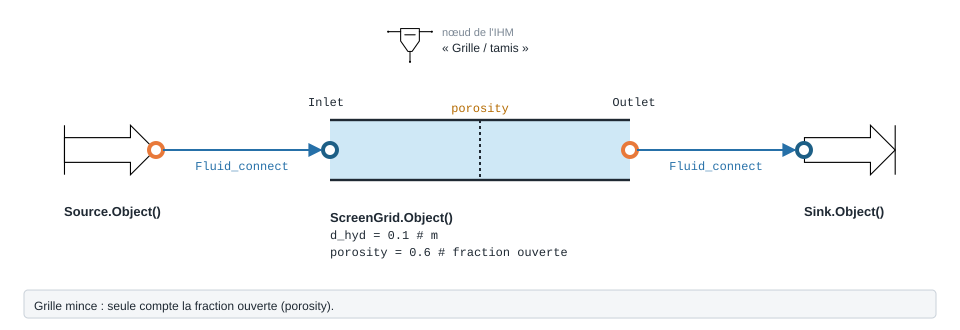
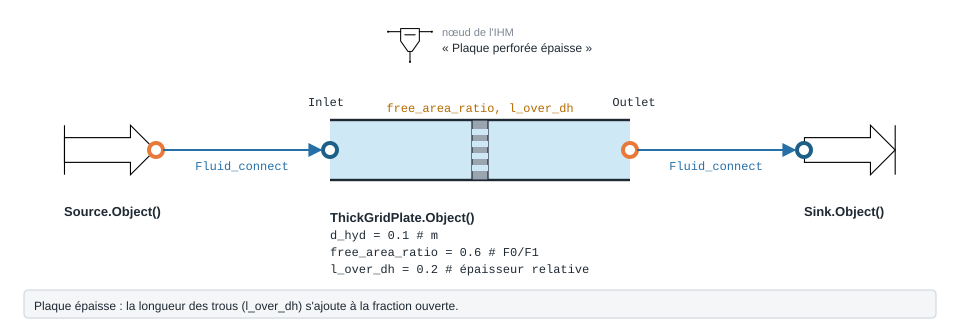

.. _screen_grid:

Grille et plaque perforée
=========================

   Forme, ports et raccordement de ``ScreenGrid`` ; paramètres sous leur
   nom de code, avec leur valeur par défaut.

   Forme, ports et raccordement de ``ThickGridPlate`` ; paramètres sous leur
   nom de code, avec leur valeur par défaut.

À quoi ça sert
--------------

``ScreenGrid`` donne la perte de charge d'un élément à porosité uniforme sur
toute la section : tamis, grillage, tôle perforée mince, filtre à mailles. La
grandeur qui compte est la **porosité** (fraction de surface ouverte).
``ThickGridPlate`` traite une plaque perforée **épaisse**, où la longueur des
trous ajoute du frottement.

Deux modèles coexistent dans ``ScreenGrid`` :

* ``zeta_model = "idelchik"`` — la forme complète d'Idel'chik (*Handbook of
  Hydraulic Resistance*, 4ᵉ éd., diagramme 8.6, p. 634) :
  ``ζ = k0 (1 − φ) + (1/φ − 1)²``, avec ``k0`` l'état de surface du fil ;
* ``zeta_model = "legacy"`` — **le défaut**, conservé pour ne pas changer les
  résultats anciens, qui n'a que le second terme et sous-estime la perte
  (voir la variante).

Exemple : tamis DN100 sur 30 m³/h d'eau
---------------------------------------

.. code-block:: python

    from ThermodynamicCycles.Source import Source
    from ThermodynamicCycles.Connect import Fluid_connect
    from ThermodynamicCycles.Hydraulic import ScreenGrid

    def source(debit_m3h=30.0):
        s = Source.Object()
        s.fluid, s.Ti_degC, s.Pi_bar = "water", 20, 3.0
        s.F_m3h = debit_m3h
        s.calculate()
        return s

    GR = ScreenGrid.Object()
    GR.d_hyd = 0.10                    # DN100
    GR.porosity = 0.6                  # 60 % de surface ouverte
    GR.zeta_model = "idelchik"         # forme complète d'Idel'chik (diagramme 8.6)
    GR.k0 = 1.3                        # fil métallique de surface courante
    Fluid_connect(GR.Inlet, source().Outlet)
    GR.calculate()
    print(f"V = {GR.V:.2f} m/s, Re = {GR.Re:.0f} ({GR.re_regime}), "
          f"zeta = {GR.ksi_loc:.3f}, dP = {GR.delta_P:.0f} Pa")

Sortie réelle :

.. code-block:: text

   V = 1.06 m/s, Re = 105760 (turbulent), zeta = 0.964, dP = 542 Pa

Paramètres à personnaliser (ScreenGrid)
---------------------------------------

.. list-table::
   :header-rows: 1
   :widths: 22 30 48

   * - Grandeur
     - Valeur à saisir
     - Effet sur le résultat
   * - ``zeta_model``
     - ``"idelchik"`` (recommandé) ou ``"legacy"`` (défaut historique)
     - Voir la variante : écart de −14 à −91 % selon la porosité.
   * - ``porosity``
     - fraction de surface ouverte, strictement entre 0 et 1 (fiche du
       tamis ou de la tôle)
     - Premier facteur : ζ est multiplié par 45 entre 0,9 et 0,3.
   * - ``k0``
     - état de surface du fil (Idel'chik éq. 8.3) : 1,0 grillage neuf,
       1,3 fil métallique courant, 2,1 fil de soie
     - Ne compte qu'en mode ``"idelchik"`` ; ce n'est **pas** un facteur
       d'ajustement.
   * - ``shape_factor``
     - facteur global du mode ``"legacy"``
     - Sans effet en mode ``"idelchik"``.
   * - ``d_hyd``
     - diamètre de la conduite où est posé le tamis (m)
     - ``ΔP`` varie comme ``1/d⁴`` à débit donné.

Variante exécutée : porosité, et ce que coûte le modèle par défaut
------------------------------------------------------------------

.. code-block:: python

    # variante : porosité, et écart du modèle par défaut 'legacy' (à la suite)
    print("porosité   zeta idelchik   zeta legacy   écart legacy")
    for phi in [0.3, 0.5, 0.6, 0.8, 0.9]:
        z = {}
        for modele in ["idelchik", "legacy"]:
            GR.porosity, GR.zeta_model = phi, modele
            GR.calculate()
            z[modele] = GR.ksi_loc
        print(f"  {phi:4.2f}      {z['idelchik']:9.3f}     {z['legacy']:9.3f}     "
              f"{z['legacy'] / z['idelchik'] - 1:+6.0%}")

Sortie réelle :

.. code-block:: text

   porosité   zeta idelchik   zeta legacy   écart legacy
     0.30          6.354         5.444       -14%
     0.50          1.650         1.000       -39%
     0.60          0.964         0.444       -54%
     0.80          0.322         0.062       -81%
     0.90          0.142         0.012       -91%

Lecture : le mode ``"legacy"`` oublie le terme ``k0 (1 − φ)``, qui domine
justement aux fortes porosités des grilles réelles : à 80 % de surface
ouverte, il donne une perte cinq fois trop faible. Les écarts mesurés
retombent exactement sur ceux que la bibliothèque déclare dans son code.
**Écrivez toujours** ``zeta_model = "idelchik"`` ; le défaut n'est conservé que
pour ne pas changer d'anciens résultats.

Cas limites refusés
-------------------

.. code-block:: python

    # à la suite : saisies refusées
    for nom, reglage in [("porosité 1,0", dict(porosity=1.0, zeta_model="idelchik")),
                         ("modèle 'borda'", dict(porosity=0.6, zeta_model="borda"))]:
        for attribut, valeur in reglage.items():
            setattr(GR, attribut, valeur)
        try:
            GR.calculate()
        except ValueError as erreur:
            print(f"{nom:15s} refusé : {erreur}")

Sortie réelle :

.. code-block:: text

   porosité 1,0    refusé : porosity doit etre dans ]0.0, 1.0[
   modèle 'borda'  refusé : zeta_model inconnu : 'borda' (attendu 'legacy' ou 'idelchik')

Pièges
------

.. code-block:: python

    # à la suite : faible Reynolds signalé, pas corrigé
    lent = ScreenGrid.Object()
    lent.d_hyd, lent.porosity = 0.10, 0.6
    for modele in ["idelchik", "legacy"]:
        lent.zeta_model = modele
        Fluid_connect(lent.Inlet, source(debit_m3h=0.02).Outlet)
        lent.calculate()
        print(f"{modele:8s}: Re = {lent.Re:.0f}, régime {lent.re_regime}, "
              f"hors domaine {lent.out_of_domain}, zeta = {lent.ksi_loc:.3f}")

Sortie réelle :

.. code-block:: text

   idelchik: Re = 71, régime transition, hors domaine True, zeta = 0.964
   legacy  : Re = 71, régime transition, hors domaine True, zeta = 1.616

* **Le modèle par défaut sous-estime la perte** (variante ci-dessus).
* **À faible Reynolds (< 1 000), la correction n'est pas appliquée, elle est
  signalée** : ``re_regime`` et ``out_of_domain`` le disent, mais ζ reste
  celui de l'écoulement turbulent en mode ``"idelchik"``, car la correction
  d'Idel'chik n'est publiée que sous forme d'abaque. Le mode ``"legacy"``
  applique, lui, un renforcement **sans source** identifiée. Testez
  ``out_of_domain`` avant d'exploiter le résultat.
* **ThickGridPlate** (plaque épaisse) n'a pas de variante sur cette page :
  ses entrées sont dans la fiche ci-dessous.

Fiches des modèles
------------------

``ScreenGrid`` — grille/ecran/perfore uniforme.

.. code-block:: python

   from ThermodynamicCycles.Hydraulic import ScreenGrid
   modele = ScreenGrid.Object()

* **Ports** : ``Inlet``, ``Outlet`` (voir :doc:`../ports_connexions`).
* **Nœud de l'IHM** : « Grille / tamis ».
* **Exceptions levées par le code** : ``ValueError``.

.. list-table::
   :header-rows: 1
   :widths: 26 26 48

   * - Entrée
     - Défaut
     - Commentaire du code
   * - ``d_hyd``
     - ``0.1``
     - m
   * - ``porosity``
     - ``0.6``
     - fraction ouverte 0<phi<1
   * - ``shape_factor``
     - ``1.0``
     - facteur geometrique global
   * - ``zeta_model``
     - ``'legacy'``
     - —
   * - ``k0``
     - ``1.3``
     - —
   * - ``apply_handbook_corrections``
     - ``False``
     - —
   * - ``handbook_roughness_multiplier``
     - ``None``
     - —
   * - ``handbook_aspect_ratio``
     - ``None``
     - —

Lignes du ``df`` de sortie : ``fluid``, ``F_kgs``, ``d_hyd_mm``, ``porosity``, ``shape_factor``, ``V_ms``, ``Re``, ``ksi_loc_base``, ``ksi_loc``, ``dP_Pa``, ``dP_mbar``.

``ThickGridPlate`` — grille epaisse/plaque perforee.

.. code-block:: python

   from ThermodynamicCycles.Hydraulic import ThickGridPlate
   modele = ThickGridPlate.Object()

* **Ports** : ``Inlet``, ``Outlet`` (voir :doc:`../ports_connexions`).
* **Nœud de l'IHM** : « Plaque perforée épaisse ».
* **Exceptions levées par le code** : ``ValueError``.

.. list-table::
   :header-rows: 1
   :widths: 26 26 48

   * - Entrée
     - Défaut
     - Commentaire du code
   * - ``d_hyd``
     - ``0.1``
     - m
   * - ``free_area_ratio``
     - ``0.6``
     - f = F0/F1
   * - ``l_over_dh``
     - ``0.2``
     - —
   * - ``lambda_fric``
     - ``0.02``
     - —
   * - ``tau_override``
     - ``None``
     - —
   * - ``apply_handbook_corrections``
     - ``False``
     - —
   * - ``handbook_roughness_multiplier``
     - ``None``
     - —
   * - ``handbook_aspect_ratio``
     - ``None``
     - —

Lignes du ``df`` de sortie : ``fluid``, ``F_kgs``, ``d_hyd_mm``, ``free_area_ratio``, ``l_over_dh``, ``lambda_fric``, ``tau``, ``V_ms``, ``Re``, ``ksi_loc_base``, ``ksi_loc``, ``dP_Pa``.

Voir :doc:`index` pour la liste de tous les modèles hydrauliques.
