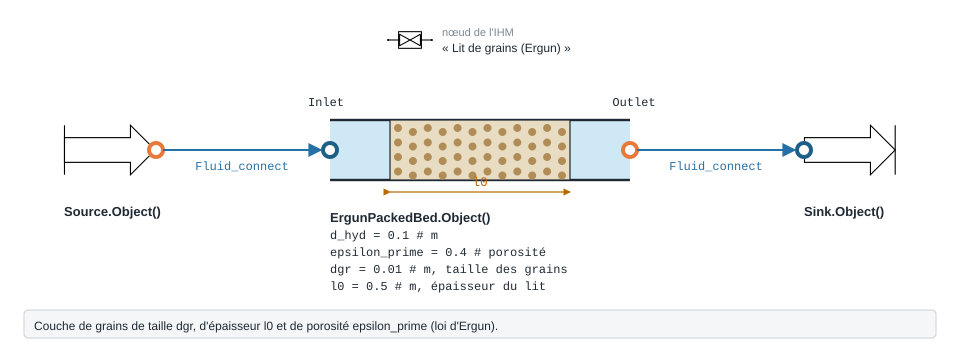

.. _ergun_packed_bed:

Lit de grains
=============

   Forme, ports et raccordement de ``ErgunPackedBed`` ; paramètres sous leur
   nom de code, avec leur valeur par défaut.

À quoi ça sert
--------------

``ErgunPackedBed`` donne la perte de charge d'un fluide qui traverse un **lit de
grains** : filtre à sable, lit de charbon actif, garnissage, lit de résine. La
relation est celle de type Ergun rappelée par Idel'chik (section 8, éq. 8.7 et
8.8) :

.. math::

   \zeta = \left[\frac{360 (1-\varepsilon)^2}{\varepsilon^3 Re_1}
           + \frac{B' (1-\varepsilon)}{\varepsilon^3}\right]\frac{l_0}{\delta},
   \qquad \Delta P = \zeta \frac{\rho w_1^2}{2}

avec ``w1`` la vitesse en fût vide (débit / section de la cuve), ``δ = φ₁ dgr``
la taille caractéristique des grains et ``Re1 = w1 δ / ν``. Le premier terme
(visqueux) domine aux faibles vitesses, le second (inertiel) aux fortes.

Exemple : filtre à sable de 1,6 m, 20 m³/h d'eau
-------------------------------------------------

.. code-block:: python

    from ThermodynamicCycles.Source import Source
    from ThermodynamicCycles.Connect import Fluid_connect
    from ThermodynamicCycles.Hydraulic import ErgunPackedBed

    def source(debit_m3h=20.0):
        s = Source.Object()
        s.fluid, s.Ti_degC, s.Pi_bar = "water", 15, 3.0
        s.F_m3h = debit_m3h
        s.calculate()
        return s

    FILTRE = ErgunPackedBed.Object()
    FILTRE.d_hyd = 1.6                 # cuve de 1,6 m de diamètre
    FILTRE.epsilon_prime = 0.42        # porosité du lit de sable
    FILTRE.dgr = 0.001                 # grains de 1 mm
    FILTRE.phi1 = 1.0                  # coefficient de forme
    FILTRE.Bprime = 1.8                # grains lisses (4,0 rugueux)
    FILTRE.l0 = 1.0                    # 1 m de sable
    Fluid_connect(FILTRE.Inlet, source().Outlet)
    FILTRE.calculate()
    print(f"vitesse de filtration {FILTRE.w1 * 3600:.1f} m/h, Re1 = {FILTRE.Re1:.1f}, "
          f"dP = {FILTRE.delta_P / 1000:.2f} kPa ({FILTRE.delta_P / 9806.65:.2f} m d'eau)")

Sortie réelle :

.. code-block:: text

   vitesse de filtration 9.9 m/h, Re1 = 2.4, dP = 2.62 kPa (0.27 m d'eau)

Fiche du modèle
---------------

* **Ports** : ``Inlet``, ``Outlet`` (voir :doc:`../ports_connexions`).
* **Nœud de l'IHM** : « Lit de grains (Ergun) ».
* **Exceptions levées par le code** : ``ValueError``.

.. list-table::
   :header-rows: 1
   :widths: 26 26 48

   * - Entrée
     - Défaut
     - Commentaire du code
   * - ``d_hyd``
     - ``0.1``
     - m
   * - ``epsilon_prime``
     - ``0.4``
     - porosite (0..1)
   * - ``dgr``
     - ``0.01``
     - m, taille moyenne des grains
   * - ``phi1``
     - ``1.0``
     - coeff. de forme des grains
   * - ``Bprime``
     - ``1.8``
     - 1.8 lisse ; 4.0 rugueux
   * - ``l0``
     - ``0.5``
     - m, epaisseur du lit

Lignes du ``df`` de sortie : ``fluid``, ``F_kgs``, ``d_hyd_mm``, ``epsilon_prime``, ``dgr_mm``, ``phi1``, ``Bprime``, ``l0_m``, ``w1_ms``, ``Re1``, ``lambda_bed``, ``ksi_loc``, ``dP_Pa``, ``dP_kPa``.

Paramètres à personnaliser
--------------------------

.. list-table::
   :header-rows: 1
   :widths: 22 30 48

   * - Grandeur
     - Valeur à saisir
     - Effet sur le résultat
   * - ``d_hyd``
     - diamètre de la **cuve** (m), pas d'un grain
     - Fixe la vitesse en fût vide ``w1``.
   * - ``epsilon_prime``
     - porosité du lit, strictement entre 0 et 1
     - Effet très fort, en ``(1 − ε)² / ε³`` : c'est elle qui baisse quand le
       filtre se colmate.
   * - ``dgr`` et ``phi1``
     - taille moyenne des grains (m) et coefficient de forme ; ``δ = φ₁ dgr``
     - En régime visqueux, la perte varie comme ``1/δ²``.
   * - ``Bprime``
     - 1,8 grains lisses, 4,0 grains rugueux (commentaire du code)
     - Pèse sur le terme inertiel, donc aux fortes vitesses.
   * - ``l0``
     - épaisseur du lit (m)
     - Proportionnelle.

Variante exécutée : taille des grains et colmatage
--------------------------------------------------

Même filtre, même débit ; on change le sable et on simule le colmatage par une
porosité qui baisse.

.. code-block:: python

    # variante : taille des grains et colmatage (porosité qui baisse), à la suite
    print("grains   porosité 0,45   porosité 0,42   porosité 0,38   porosité 0,34  (kPa)")
    for d_mm in [0.5, 1.0, 2.0]:
        ligne = []
        for eps in [0.45, 0.42, 0.38, 0.34]:
            FILTRE.dgr, FILTRE.epsilon_prime = d_mm / 1000, eps
            FILTRE.calculate()
            ligne.append(FILTRE.delta_P / 1000)
        print(f"{d_mm:3.1f} mm " + "".join(f"{x:15.2f}" for x in ligne))

Sortie réelle :

.. code-block:: text

   grains   porosité 0,45   porosité 0,42   porosité 0,38   porosité 0,34  (kPa)
   0.5 mm            7.59          10.38          16.01          25.31
   1.0 mm            1.92           2.62           4.04           6.39
   2.0 mm            0.49           0.67           1.03           1.63

Lecture : diviser la taille des grains par deux multiplie la perte par
quatre (régime visqueux). Une porosité qui passe de 0,42 à 0,34 en se
colmatant multiplie la perte par 2,4 : c'est la montée de ΔP qu'on surveille
pour déclencher un lavage, et la pompe doit être dimensionnée sur le filtre
**colmaté**, pas propre.

Cas limites refusés
-------------------

.. code-block:: python

    # à la suite : saisies refusées
    for nom, reglage in [("porosité 1,0", dict(epsilon_prime=1.0)),
                         ("grains de 0 mm", dict(epsilon_prime=0.42, dgr=0.0))]:
        for attribut, valeur in reglage.items():
            setattr(FILTRE, attribut, valeur)
        try:
            FILTRE.calculate()
        except ValueError as erreur:
            print(f"{nom:15s} refusé : {erreur}")

Sortie réelle :

.. code-block:: text

   porosité 1,0    refusé : epsilon_prime doit etre dans ]0,1[
   grains de 0 mm  refusé : dgr doit etre > 0

Pièges
------

.. code-block:: python

    # à la suite : rebrancher le même filtre sur une autre source
    from ThermodynamicCycles.Connect import detach_port

    FILTRE.dgr, FILTRE.epsilon_prime = 0.001, 0.42
    for debit in [200.0, 50.0]:                   # sans détacher : débits empilés
        Fluid_connect(FILTRE.Inlet, source(debit).Outlet)
        FILTRE.calculate()
        print(f"sans detach_port, source {debit:5.0f} m3/h : débit vu {FILTRE.Inlet.F * 3.6:6.1f} t/h")
    detach_port(FILTRE.Inlet)                     # on repart d'un port propre
    Fluid_connect(FILTRE.Inlet, source(50.0).Outlet)
    FILTRE.calculate()
    print(f"avec detach_port, source    50 m3/h : débit vu {FILTRE.Inlet.F * 3.6:6.1f} t/h")

Sortie réelle :

.. code-block:: text

   sans detach_port, source   200 m3/h : débit vu  199.8 t/h
   sans detach_port, source    50 m3/h : débit vu  219.8 t/h
   avec detach_port, source    50 m3/h : débit vu   50.0 t/h

* **Rebrancher un composant déjà raccordé empile les débits.** Un nouveau
  ``Fluid_connect`` sur le même port ajoute une branche au nœud hydraulique
  au lieu de remplacer l'ancienne : à partir du troisième branchement, le
  débit vu est la somme des sources précédentes (219,8 t/h au lieu de 50).
  Dans une boucle, appelez ``detach_port(port)`` (module
  ``ThermodynamicCycles.Connect``) avant de rebrancher, ou créez un objet neuf.
  Ce comportement vaut pour tous les composants à ports, pas seulement pour
  ce modèle.
* **Le sens d'écoulement n'est pas vu** : un lavage à contre-courant qui
  soulève le lit (fluidisation) n'est pas modélisé ; au-delà de la vitesse de
  fluidisation, la perte réelle plafonne au poids apparent du lit.
* **d_hyd est le diamètre de la cuve** : y mettre la taille des grains donne
  une vitesse absurde sans message.

Voir :doc:`index` pour la liste de tous les modèles hydrauliques.
