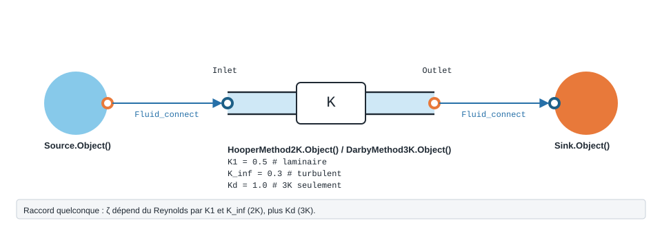

.. _methodes_k:

Singularité quelconque — méthodes 2K et 3K
==========================================

   Forme, ports et raccordement de ``HooperMethod2K`` ; paramètres sous leur
   nom de code, avec leur valeur par défaut.

À quoi ça sert
--------------

Cette page regroupe les outils pour chiffrer un raccord ou un robinet qui n'a
pas de modèle dédié :

* ``crane_valves`` et ``crane_data`` — les coefficients **publiés** de Crane
  (*Technical Paper No. 410*, éd. 2009) : pour un robinet à pleine ouverture,
  ``K = n × f_T``, avec ``n`` lu dans les tables p. A-28 à A-30 selon la
  famille, et ``f_T`` le facteur de frottement en turbulence complète de la
  taille nominale (p. A-27, acier commercial Schedule 40) ;
* ``HooperMethod2K`` (Hooper, 1981 : ``ζ = K1/Re + K∞ (1 + 1/D_pouces)``) et
  ``DarbyMethod3K`` (``ζ = K1/Re + K∞ (1 + Kd / D_pouces^0,3)``) — des
  composants à ports qui font dépendre ζ du Reynolds et de la taille. **Leurs
  coefficients ``K1``, ``K∞``, ``Kd`` sont à saisir** pour le raccord visé,
  depuis la publication d'origine : les valeurs par défaut n'ont pas de source
  (voir les pièges).

Exemple : coefficients Crane des robinets en DN50 (2")
------------------------------------------------------

.. code-block:: python

    from ThermodynamicCycles.Hydraulic import crane_valves, crane_data

    NPS = 2                                          # diamètre nominal en pouces (DN50)
    f_T = crane_data.friction_factor_turbulent(NPS)  # Crane TP-410 p. A-27
    print(f"f_T({NPS}\") = {f_T}")
    for famille in ["ball", "gate", "globe_y", "swing_check", "globe_z", "lift_check"]:
        n = crane_valves.n_factor(famille)
        print(f"{famille:12s} K = {n:3d} x f_T = {crane_valves.zeta(famille, NPS):6.3f}")

Sortie réelle :

.. code-block:: text

   f_T(2") = 0.019
   ball         K =   3 x f_T =  0.057
   gate         K =   8 x f_T =  0.152
   globe_y      K =  55 x f_T =  1.045
   swing_check  K = 100 x f_T =  1.900
   globe_z      K = 340 x f_T =  6.460
   lift_check   K = 600 x f_T = 11.400

Familles disponibles : robinet à tournant sphérique (``ball``), robinet-vanne
(``gate``), robinet à soupape droit (``globe_z``) ou incliné (``globe_y``),
clapets à battant (``swing_check``) et à soulèvement (``lift_check``). Les
papillons et clapets à disque inclinable ont leurs propres fonctions
(``butterfly_zeta``, ``tilting_check_zeta``). ``crane_valves.citation(famille)``
rend la page et la figure exactes de la source.

Paramètres à personnaliser
--------------------------

.. list-table::
   :header-rows: 1
   :widths: 24 30 46

   * - Grandeur
     - Valeur à saisir
     - Effet sur le résultat
   * - ``famille`` (``crane_valves.zeta``)
     - l'une des familles listées ci-dessus
     - Fixe ``n`` : de 3 (sphérique) à 600 (clapet à soulèvement).
   * - ``nps_inch``
     - taille nominale en **pouces**, dans les plages de la table A-27
     - Fixe ``f_T`` : K baisse légèrement quand la taille augmente.
   * - ``K1``, ``K_inf`` (et ``Kd`` pour 3K)
     - coefficients publiés du raccord (Hooper 1981, Darby)
     - Sans eux, les composants 2K / 3K ne calculent qu'un ζ arbitraire.
   * - ``D_in_pouces`` et ``d_hyd``
     - **la même** taille, l'une en pouces, l'autre en mètres
     - Le modèle ne vérifie pas leur cohérence.

Variante exécutée : ce que coûte chaque robinet
-----------------------------------------------

À 10 m³/h d'eau dans un DN50 (diamètre intérieur Schedule 40 : 52,5 mm), et K
du robinet à soupape selon la taille :

.. code-block:: python

    # variante : perte de charge de chaque robinet sur 10 m3/h d'eau en DN50 (à la suite)
    import math
    rho, Q, d = 998.0, 10.0 / 3600, 0.0525           # eau, m3/s, diamètre intérieur Sch40 2"
    V = Q / (math.pi * d ** 2 / 4)
    print(f"V = {V:.2f} m/s")
    for famille in ["ball", "gate", "globe_y", "swing_check", "globe_z", "lift_check"]:
        K = crane_valves.zeta(famille, NPS)
        print(f"{famille:12s} dP = {K * rho * V ** 2 / 2:7.0f} Pa")
    for nps in [1, 4, 8, 12]:
        print(f"robinet à soupape droit {nps:2d}\" : K = {crane_valves.zeta('globe_z', nps):5.2f}")

Sortie réelle :

.. code-block:: text

   V = 1.28 m/s
   ball         dP =      47 Pa
   gate         dP =     125 Pa
   globe_y      dP =     859 Pa
   swing_check  dP =    1561 Pa
   globe_z      dP =    5308 Pa
   lift_check   dP =    9367 Pa
   robinet à soupape droit  1" : K =  7.48
   robinet à soupape droit  4" : K =  5.44
   robinet à soupape droit  8" : K =  4.76
   robinet à soupape droit 12" : K =  4.42

Lecture : sur le même débit, un robinet à soupape droit perd 110 fois plus
qu'un robinet à tournant sphérique (5,3 kPa contre 47 Pa) ; un clapet à
soulèvement, 200 fois plus. Remplacer des robinets d'isolement à soupape par
des robinets sphériques sur une boucle est une économie de pompage directe.

Cas limites refusés
-------------------

.. code-block:: python

    # à la suite : saisies refusées
    for famille, nps in [("vanne", 2), ("gate", 100)]:
        try:
            crane_valves.zeta(famille, nps)
        except ValueError as erreur:
            print(f"({famille!r}, {nps}) refusé : {str(erreur)[:90]}")

Sortie réelle :

.. code-block:: text

   ('vanne', 2) refusé : unknown Crane valve family 'vanne'. Known families: ball, gate, globe_y, globe_z, lift_che
   ('gate', 100) refusé : nominal size 100" is not tabulated in Crane TP-410 p. A-27 (the table is piecewise constan

Pièges
------

.. code-block:: python

    # à la suite : la méthode 2K avec ses coefficients par défaut
    from ThermodynamicCycles.Source import Source
    from ThermodynamicCycles.Connect import Fluid_connect
    from ThermodynamicCycles.Hydraulic import HooperMethod2K

    src = Source.Object()
    src.fluid, src.Ti_degC, src.Pi_bar, src.F_m3h = "water", 20, 3.0, 10.0
    src.calculate()
    H = HooperMethod2K.Object()                      # K1 = 0,5 ; K_inf = 0,3 par défaut
    Fluid_connect(H.Inlet, src.Outlet)
    H.calculate()
    print(f"défauts : K1 = {H.K1}, K_inf = {H.K_inf}, D_in = {H.D_in_pouces} -> zeta = {H.zeta:.4f}")
    H.D_in_pouces = 8.0                              # incohérent avec d_hyd = 0,05 m
    H.calculate()
    print(f"D_in = 8 pouces pour d_hyd = {H.d_hyd} m : zeta = {H.zeta:.4f} (accepté)")

Sortie réelle :

.. code-block:: text

   défauts : K1 = 0.5, K_inf = 0.3, D_in = 2.0 -> zeta = 0.4500
   D_in = 8 pouces pour d_hyd = 0.05 m : zeta = 0.3375 (accepté)

* **Les coefficients par défaut de HooperMethod2K et DarbyMethod3K n'ont pas
  de source** : avec ``K1 = 0,5``, le terme visqueux est négligeable à tout
  Reynolds réaliste, et ζ = 0,45 ne correspond à aucun raccord identifié.
  Saisissez ``K1`` et ``K_inf`` de la publication pour votre raccord.
* **D_in_pouces et d_hyd sont indépendants** : un DN50 déclaré à 8 pouces
  passe sans message et change ζ de 25 %.
* **Crane ne vaut qu'à pleine ouverture** (``beta = 1``) et en turbulence
  complète : pour une vanne partiellement fermée ou un robinet à passage
  réduit, les formules de la p. A-27 ne sont pas implémentées.

Fiches des modèles
------------------

``HooperMethod2K`` — Singularité hydraulique utilisant la méthode 2K de Hooper.

.. code-block:: python

   from ThermodynamicCycles.Hydraulic import HooperMethod2K
   modele = HooperMethod2K.Object()

* **Ports** : ``Inlet``, ``Outlet`` (voir :doc:`../ports_connexions`).
* **Nœud de l'IHM** : « Singularité Hooper 2K ».

.. list-table::
   :header-rows: 1
   :widths: 26 26 48

   * - Entrée
     - Défaut
     - Commentaire du code
   * - ``d_hyd``
     - ``0.05``
     - Diamètre hydraulique (m)
   * - ``D_in_pouces``
     - ``2.0``
     - Diamètre nominal en pouces
   * - ``K1``
     - ``0.5``
     - Coefficient régime laminaire (augmente perte à faible Re)
   * - ``K_inf``
     - ``0.3``
     - Coefficient régime turbulent asymptotique

Lignes du ``df`` de sortie : ``fluid``, ``V (m/s)``, ``Re``, ``ζ (-)``, ``ΔP (Pa)``, ``P_in (Pa)``, ``P_out (Pa)``.

``DarbyMethod3K`` — Singularité hydraulique utilisant la méthode 3K de Darby.

.. code-block:: python

   from ThermodynamicCycles.Hydraulic import DarbyMethod3K
   modele = DarbyMethod3K.Object()

* **Ports** : ``Inlet``, ``Outlet`` (voir :doc:`../ports_connexions`).
* **Nœud de l'IHM** : « Singularité Darby 3K ».

.. list-table::
   :header-rows: 1
   :widths: 26 26 48

   * - Entrée
     - Défaut
     - Commentaire du code
   * - ``d_hyd``
     - ``0.05``
     - Diamètre hydraulique (m)
   * - ``D_in_pouces``
     - ``2.0``
     - Diamètre nominal en pouces
   * - ``K1``
     - ``0.5``
     - Coefficient régime laminaire
   * - ``K_inf``
     - ``0.3``
     - Coefficient régime turbulent asymptotique
   * - ``Kd``
     - ``1.0``
     - Coefficient de correction géométrique

Lignes du ``df`` de sortie : ``fluid``, ``V (m/s)``, ``Re``, ``ζ (-)``, ``ΔP (Pa)``, ``P_in (Pa)``, ``P_out (Pa)``.

``crane_valves`` — Crane TP-410 resistance coefficients for valves: K = n * f_T.

.. code-block:: python

   import ThermodynamicCycles.Hydraulic.crane_valves

* **Fonctions publiques** : ``butterfly_n_factor``, ``butterfly_zeta``, ``citation``, ``n_factor``, ``zeta``.

``crane_data`` — Crane TP-410 friction data: turbulent friction factor f_T and absolute roughness.

.. code-block:: python

   import ThermodynamicCycles.Hydraulic.crane_data

* **Fonctions publiques** : ``absolute_roughness``, ``friction_factor_source``, ``friction_factor_table``, ``friction_factor_turbulent``, ``list_materials``, ``material_info``, ``roughness_source``.

Voir :doc:`index` pour la liste de tous les modèles hydrauliques.
