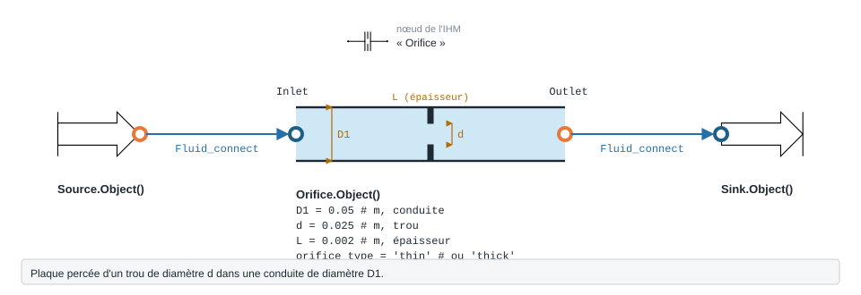

.. _orifice:

Orifice
=======

   Forme, ports et raccordement de ``Orifice`` ; paramètres sous leur
   nom de code, avec leur valeur par défaut.

À quoi ça sert
--------------

``Orifice`` donne la perte de charge d'un trou calibré dans une paroi : diaphragme
de réglage ou de limitation de débit, orifice de mesure, trou dans une tôle. Deux
modes :

* ``orifice_type = "thin"`` (défaut, tôle mince) : ``ζ = 0,5 (1 − β²)² + 0,5/Re``,
  avec ``β = d / D1`` ;
* ``orifice_type = "thick"`` avec ``L > d`` : contraction ``0,5 (1 − β²)²`` +
  frottement dans le trou ``f L/d`` + ré-expansion ``(1 − β²)²``.

ζ est rapporté à la vitesse **dans le trou**. Lisez la réserve de la variante
avant de dimensionner un diaphragme avec ce modèle.

Exemple : trou de 25 mm dans une conduite DN50, 10 m³/h d'eau
-------------------------------------------------------------

.. code-block:: python

    from ThermodynamicCycles.Source import Source
    from ThermodynamicCycles.Connect import Fluid_connect
    from ThermodynamicCycles.Hydraulic import Orifice

    def source(debit_m3h=10.0):
        s = Source.Object()
        s.fluid, s.Ti_degC, s.Pi_bar = "water", 20, 3.0
        s.F_m3h = debit_m3h
        s.calculate()
        return s

    def orifice(d, orifice_type="thin", L=0.002, D1=0.05):
        o = Orifice.Object()
        o.D1, o.d, o.L, o.orifice_type = D1, d, L, orifice_type
        Fluid_connect(o.Inlet, source().Outlet)
        o.calculate()
        return o

    o = orifice(0.025)                        # DN50, trou de 25 mm, tôle de 2 mm
    print(f"V orifice {o.V:.2f} m/s, zeta {o.zeta_total:.4f} (rapporté à V orifice), "
          f"dP {o.delta_P:.0f} Pa")

Sortie réelle :

.. code-block:: text

   V orifice 5.66 m/s, zeta 0.2813 (rapporté à V orifice), dP 4496 Pa

Fiche du modèle
---------------

* **Ports** : ``Inlet``, ``Outlet`` (voir :doc:`../ports_connexions`).
* **Nœud de l'IHM** : « Orifice ».

.. list-table::
   :header-rows: 1
   :widths: 26 26 48

   * - Entrée
     - Défaut
     - Commentaire du code
   * - ``D1``
     - ``0.05``
     - Diamètre amont (m)
   * - ``d``
     - ``0.025``
     - Diamètre orifice (m)
   * - ``L``
     - ``0.002``
     - Épaisseur paroi / longueur orifice (m)
   * - ``orifice_type``
     - ``'thin'``
     - 'thin' ou 'thick'

Lignes du ``df`` de sortie : ``fluid``, ``V (m/s)``, ``Re``, ``ζ_total (-)``, ``ΔP (Pa)``, ``P_in (Pa)``, ``P_out (Pa)``.

Paramètres à personnaliser
--------------------------

.. list-table::
   :header-rows: 1
   :widths: 22 30 48

   * - Grandeur
     - Valeur à saisir
     - Effet sur le résultat
   * - ``d``
     - diamètre du trou (m), plus petit que ``D1``
     - Premier facteur : la perte varie à peu près comme ``1/d⁴``.
   * - ``D1``
     - diamètre intérieur de la conduite amont (m)
     - Entre dans ``β = d / D1``.
   * - ``orifice_type``
     - ``"thin"`` ou ``"thick"`` (exactement)
     - Change la formule (voir ci-dessus) ; toute autre valeur donne le mode
       mince.
   * - ``L``
     - épaisseur de la paroi (m) ; le mode épais n'est pris que si ``L > d``
     - Frottement dans le trou en mode épais.

Variante exécutée : diamètre du trou, mince contre épais
--------------------------------------------------------

.. code-block:: python

    # variante : diamètre du trou, orifice mince contre épais (à la suite)
    print("d (mm)  beta   dP mince (Pa)   dP épais L=3d (Pa)   épais / mince")
    for d_mm in [15, 20, 25, 30, 35]:
        d = d_mm / 1000
        mince = orifice(d, "thin")
        epais = orifice(d, "thick", L=3 * d)
        print(f"{d_mm:5d}   {d / 0.05:4.2f}   {mince.delta_P:12.0f}   {epais.delta_P:17.0f}"
              f"   {epais.delta_P / mince.delta_P:10.2f}")

Sortie réelle :

.. code-block:: text

   d (mm)  beta   dP mince (Pa)   dP épais L=3d (Pa)   épais / mince
      15   0.30          51066              159115         3.12
      20   0.40          13768               43238         3.14
      25   0.50           4496               14306         3.18
      30   0.60           1579                5143         3.26
      35   0.70            541                1849         3.42

.. warning::

   **Le mode mince omet la perte de ré-expansion du jet.** Sa formule ne garde
   que le terme de contraction ``0,5 (1 − β²)²``, alors que le mode épais
   ajoute ``(1 − β²)²`` pour la ré-expansion. Résultat : un orifice épais sort
   **trois fois plus résistant** qu'un orifice mince de même trou, alors qu'un
   orifice à paroi mince, où le jet ne se recolle pas, est normalement le plus
   pénalisant des deux. Le docstring annonce une formule de Hooper que le code
   n'applique pas. Pour un diaphragme de réglage ou de mesure, confrontez le
   résultat à une source (diagrammes des diaphragmes d'Idel'chik, norme de
   l'organe de mesure) avant de dimensionner ; l'écart est consigné dans
   ``BUGS_LIB.md``.

Cas limites : aucun n'est refusé
--------------------------------

.. code-block:: python

    # à la suite : aucune saisie n'est refusée
    for nom, kw in [("type 'epais' (faute de frappe)", dict(d=0.025, orifice_type="epais", L=0.075)),
                    ("épais mais L < d", dict(d=0.025, orifice_type="thick", L=0.010)),
                    ("trou plus grand que la conduite", dict(d=0.060)),
                    ("trou de 0 mm", dict(d=0.0)),
                    ("diamètre négatif", dict(d=-0.020))]:
        o = orifice(**kw)
        print(f"{nom:32s}: dP {o.delta_P:6.0f} Pa")

Sortie réelle :

.. code-block:: text

   type 'epais' (faute de frappe)  : dP   4496 Pa
   épais mais L < d                : dP   4496 Pa
   trou plus grand que la conduite : dP     47 Pa
   trou de 0 mm                    : dP      0 Pa
   diamètre négatif                : dP  13767 Pa

Pièges
------

* **Un trou fermé (d = 0) donne une perte nulle**, au lieu d'un débit
  impossible : le modèle ne vérifie aucune dimension.
* **Une faute de frappe sur le type** (``"epais"``) ou une paroi plus mince que
  le trou font retomber silencieusement sur le mode mince.
* **Un trou plus grand que la conduite** (β > 1) est calculé sans message
  (47 Pa ci-dessus).
* **ζ est rapporté à la vitesse dans le trou**, pas à celle de la conduite :
  ne le mélangez pas avec un ζ de catalogue rapporté à la conduite.

Voir :doc:`index` pour la liste de tous les modèles hydrauliques.
