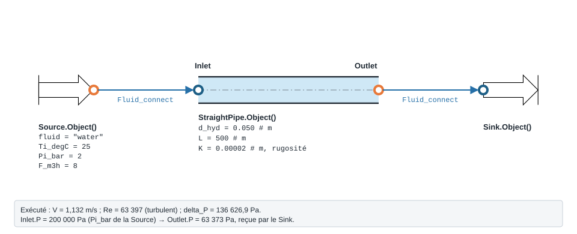
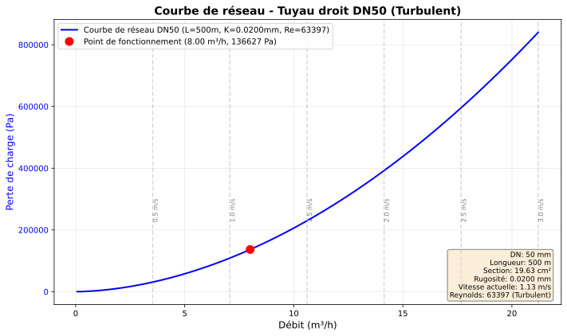

.. _straight_pipe:

Perte de charge linéaire dans une conduite
==========================================

Utilisation
-----------

.. code-block:: python

    from ThermodynamicCycles.Hydraulic import StraightPipe
    from ThermodynamicCycles.Source import Source
    from ThermodynamicCycles.Sink import Sink
    from ThermodynamicCycles.Connect import Fluid_connect

    # Source
    SOURCE = Source.Object()
    SOURCE.fluid = "water"
    SOURCE.Ti_degC = 25
    SOURCE.Pi_bar = 2
    SOURCE.F_m3h = 8
    SOURCE.calculate()

    # Tuyau droit
    STRAIGHT_PIPE = StraightPipe.Object()
    STRAIGHT_PIPE.d_hyd = 0.050
    STRAIGHT_PIPE.L = 500
    STRAIGHT_PIPE.K = 0.00002
    Fluid_connect(STRAIGHT_PIPE.Inlet, SOURCE.Outlet)
    STRAIGHT_PIPE.calculate()

    # Puits
    SINK = Sink.Object()
    Fluid_connect(SINK.Inlet, STRAIGHT_PIPE.Outlet)
    SINK.calculate()

    # Affichage
    print(SOURCE.df)
    print(STRAIGHT_PIPE.df)
    print(SINK.df)

    # Tracer la courbe de réseau avec le point de fonctionnement
    STRAIGHT_PIPE.Plot()

Sortie réelle :

.. code-block:: text

                                      Source
   Timestamp      2026-09-28 13:28:15.545515
   fluid                               water
   Ti_degC                              25.0
   Pi_bar                                  2
   F_Sm3h                                8.0
   F_Nm3h                               None
   F_m3h                                 8.0
   F_kgh                            7976.737
   F_kgs                               2.216
   F_m3s                               0.002
   F_Sm3s                              0.002
   self.Outlet.h               105011.491495
                                  StraightPipe
   Timestamp        2026-09-28 13:28:15.559597
   fluid                                 water
   Ti_degC                                25.0
   Inlet.F (kg/s)                        2.216
   Inlet.h (j/kg)                     105011.0
   Outlet.h (j/kg)                    105011.0
   A (m2)                                0.002
   V (m/s)                               1.132
   Re                                  63397.0
   delta_P(Pa)                        136626.9
   Inlet.P(Pa)                          200000
   Outlet.P(Pa)                        63373.0
                                        Sink
   Timestamp      2026-09-28 13:28:15.606531
   fluid                               water
   F_kgs                               2.216
   Inlet.P(Pa)                       63373.1
   Inlet.P(bar)                          0.6
   Inlet.h(J/kg)                    105011.0
   H(W)                             232680.0
   fluid_quality                      liquid
   Q                               -0.113929
   D (kg/m3)                           997.0
   F_Sm3h                                8.0
   F_m3h                                 8.0
   F_kgh                              7977.0

**Source** :

- Fluide : water
- T_entrée : 25°C
- P_entrée : 2 bar (200000 Pa)
- Débit : 8 m³/h = 2.216 kg/s

**StraightPipe** :

- Diamètre hydraulique : 0.050 m
- Longueur : 500 m
- Rugosité : 0.00002 m
- Section : 0.002 m²
- Vitesse : 1.132 m/s
- Reynolds : 63397 (turbulent)
- **Perte de pression : 136627 Pa** (1.37 bar)

**Sink** :

- P_sortie : 63373 Pa (0.63 bar)
- Densité : 997.0 kg/m³
- Qualité fluide : liquide

**Courbe de réseau :**

Paramètres à personnaliser
--------------------------

.. list-table::
   :header-rows: 1
   :widths: 24 30 46

   * - Grandeur
     - Valeur à saisir
     - Effet sur le résultat
   * - ``d_hyd``
     - diamètre **intérieur** réel en m (un DN100 Sch40 mesure 102,3 mm)
     - La perte de charge varie à peu près comme ``d⁻⁵`` à débit donné : le
       paramètre le plus influent.
   * - ``L``
     - longueur droite du tronçon (m)
     - Proportionnelle ; les coudes et vannes sont à ajouter à part.
   * - ``material`` ou ``K``
     - un nom de la table normalisée (``"commercial_steel"``,
       ``"cast_iron_uncoated"``…) ou une rugosité absolue en m
     - ``material`` remplace ``K`` ; un nom inconnu est refusé et la liste
       des noms valides est affichée.
   * - ``alpha`` et ``include_static_head``
     - inclinaison en rad (défaut π/2 : **vertical**) ; hauteur statique
       désactivée par défaut
     - Sans effet tant que ``include_static_head`` vaut ``False`` ; sinon
       ajoute ``ρ g L sin(alpha)``.
   * - Débit et fluide (``Source``)
     - débit nominal, température du fluide
     - La perte croît comme ``Q^1,9`` environ (voir la variante).

Variante exécutée : perte de charge d'un tronçon et effet de la variation de vitesse
------------------------------------------------------------------------------------

Un tronçon de 250 m d'eau glacée à 7 °C, 90 m³/h au nominal. Quel diamètre, et
que rapporte un variateur de vitesse sur la pompe ?

.. code-block:: python

    # variante : perte de charge d'un tronçon et effet de la variation de vitesse
    from ThermodynamicCycles.Source import Source
    from ThermodynamicCycles.Connect import Fluid_connect
    from ThermodynamicCycles.Hydraulic.StraightPipe import Object as StraightPipe

    def troncon(debit_m3h, dn_mm, longueur=250.0):
        """Un tronçon droit d'eau glacée à 7 °C ; renvoie l'objet calculé."""
        src = Source.Object()
        src.fluid, src.Ti_degC, src.Pi_bar = "water", 7.0, 4.0
        src.F_m3h = debit_m3h
        src.calculate()

        pipe = StraightPipe()
        pipe.Inlet.callback = pipe.Outlet.callback = None
        Fluid_connect(pipe.Inlet, src.Outlet)
        pipe.Inlet.callback = pipe.Outlet.callback = None
        pipe.Outlet.P = None                 # mode direct : P amont connue
        pipe.d_hyd = dn_mm / 1000.0
        pipe.L = longueur
        pipe.material = "commercial_steel"   # K = 0,046 mm, table normalisée
        pipe.alpha = 0.0                     # tronçon horizontal
        pipe.calculate()
        return pipe

    # 1. Choix du diamètre au débit nominal
    for dn in (100, 125, 150):
        p = troncon(90.0, dn)
        print(f"DN{dn:<4d} V={p.V:4.2f} m/s  dP={p.delta_P:6.0f} Pa  dP/L={p.delta_P / p.L:4.0f} Pa/m")

    # 2. Variation de vitesse sur le DN retenu
    ref = troncon(90.0, 125)
    p_ref = ref.delta_P * ref.Inlet.F / ref.rho
    for frac in (1.0, 0.8, 0.6, 0.5):
        p = troncon(90.0 * frac, 125)
        puis = p.delta_P * p.Inlet.F / p.rho
        print(f"Q={frac * 100:3.0f}%  dP={p.delta_P:6.0f} Pa ({p.delta_P / ref.delta_P:.3f})  "
              f"Phyd={puis:5.0f} W ({puis / p_ref:.3f})")

Sortie réelle :

.. code-block:: text

   DN100  V=3.18 m/s  dP=234748 Pa  dP/L= 939 Pa/m
   DN125  V=2.04 m/s  dP= 76468 Pa  dP/L= 306 Pa/m
   DN150  V=1.41 m/s  dP= 30823 Pa  dP/L= 123 Pa/m
   Q=100%  dP= 76468 Pa (1.000)  Phyd= 1912 W (1.000)
   Q= 80%  dP= 50228 Pa (0.657)  Phyd= 1005 W (0.525)
   Q= 60%  dP= 29333 Pa (0.384)  Phyd=  440 W (0.230)
   Q= 50%  dP= 20910 Pa (0.273)  Phyd=  261 W (0.137)

Lecture :

* **Le diamètre se joue avant le variateur** : un seul DN d'écart change la
  perte de charge d'un facteur 3 (939 Pa/m en DN100, 306 Pa/m en DN125). Aucun
  variateur ne rattrape un diamètre trop faible : il modulerait une perte qui
  n'aurait pas dû exister.
* **L'exposant réel n'est pas 3** : sur ces quatre points (50 à 100 % du
  débit), ΔP varie comme ``Q^1,87`` et la puissance hydraulique comme
  ``Q^2,87``, parce que le coefficient de frottement augmente quand le
  Reynolds baisse. À 80 % de débit, la puissance tombe à 52,5 % et non à
  51,2 % ; à 50 %, à 13,7 % et non à 12,5 %. La loi cubique surestime
  légèrement l'économie.
* **C'est le cas le plus favorable** : réseau à pertes purement linéaires,
  sans hauteur géométrique ni consigne de pression différentielle. Dès qu'une
  pression minimale est maintenue au point défavorable, l'exposant apparent
  chute nettement sous 3 ; il faut aussi compter les rendements de la pompe,
  du moteur et du variateur à charge partielle, absents de cette puissance
  hydraulique.

Cas limites refusés
-------------------

.. code-block:: python

    # À la suite du bloc précédent : deux saisies refusées
    for nom, reglage in [("matériau 'acier'", dict(material="acier")),
                         ("DN50 à 90 m3/h", dict(d_hyd=0.050))]:
        src = Source.Object()
        src.fluid, src.Ti_degC, src.Pi_bar = "water", 7.0, 4.0
        src.F_m3h = 90.0
        src.calculate()
        pipe = StraightPipe()
        pipe.Inlet.callback = pipe.Outlet.callback = None
        Fluid_connect(pipe.Inlet, src.Outlet)
        pipe.Inlet.callback = pipe.Outlet.callback = None
        pipe.Outlet.P = None
        pipe.d_hyd, pipe.L, pipe.material, pipe.alpha = 0.125, 250.0, "commercial_steel", 0.0
        for attribut, valeur in reglage.items():
            setattr(pipe, attribut, valeur)
        try:
            pipe.calculate()
        except ValueError as erreur:
            print(f"{nom} refusé : {str(erreur)[:95]}")

Sortie réelle :

.. code-block:: text

   matériau 'acier' refusé : unknown material 'acier'. Known materials: asbestos_cement, cast_iron_asphalted, cast_iron_bitu
   DN50 à 90 m3/h refusé : StraightPipe : pression de sortie non physique (-7736720 Pa) -- la perte de charge (8136720 Pa

Pièges
------

.. code-block:: python

    # À la suite : hauteur statique et inclinaison par défaut
    src = Source.Object()
    src.fluid, src.Ti_degC, src.Pi_bar = "water", 7.0, 4.0
    src.F_m3h = 90.0
    src.calculate()
    pipe = StraightPipe()
    pipe.Inlet.callback = pipe.Outlet.callback = None
    Fluid_connect(pipe.Inlet, src.Outlet)
    pipe.Inlet.callback = pipe.Outlet.callback = None
    pipe.Outlet.P = None
    pipe.d_hyd, pipe.L, pipe.material = 0.125, 250.0, "commercial_steel"
    pipe.include_static_head = True       # alpha laissé à sa valeur par défaut
    try:
        pipe.calculate()
    except ValueError:
        print("alpha par défaut :", round(pipe.alpha, 4), "rad -> tube vertical,",
              round(pipe.delta_P_static / 1e5, 1), "bar de colonne d'eau ajoutés")

Sortie réelle :

.. code-block:: text

   alpha par défaut : 1.5708 rad -> tube vertical, 24.5 bar de colonne d'eau ajoutés

* **L'inclinaison par défaut est verticale** (``alpha = π/2``). Tant que
  ``include_static_head`` vaut ``False``, elle ne compte pas ; dès qu'on
  l'active, un tronçon horizontal de 250 m devient une colonne d'eau de 250 m
  (24,5 bar). Fixez ``alpha = 0`` pour un tronçon horizontal.
* **Les noms de matériau sont en anglais** (``commercial_steel``) ; la liste
  de la section « Paramètres possibles » ci-dessous donne des rugosités ``K``
  à saisir directement, pas des noms de ``material``.
* **Le DN n'est pas le diamètre intérieur** : saisir 0,100 m pour un DN100
  sous-estime légèrement la section réelle.
* **Les callbacks des ports** : dans une boucle, la variante coupe
  ``Inlet.callback`` et ``Outlet.callback`` et remet ``Outlet.P`` à ``None``
  pour forcer le calcul direct (pression amont connue) à chaque appel.

Paramètres possibles
--------------------

**Source.Object()** :

- ``fluid`` : Nom du fluide (ex: "water", "air", voir CoolProp)
- ``Ti_degC`` : Température d'entrée [°C]
- ``Pi_bar`` : Pression d'entrée [bar]
- Débits possibles :
  
  - ``F_m3h`` : Débit volumique [m³/h]
  - ``F_m3s`` : Débit volumique [m³/s]
  - ``F_Sm3h`` : Débit volumique standard [Sm³/h]
  - ``F_Sm3s`` : Débit volumique standard [Sm³/s]
  - ``F_kgh`` : Débit massique [kg/h]
  - ``F`` : Débit massique [kg/s]

**StraightPipe.Object()** :

- ``d_hyd`` : Diamètre hydraulique [m]
- ``L`` : Longueur du tuyau [m]
- ``K`` : Rugosité absolue [m]
  
  - Acier commercial : 0.000045 m
  - Acier galvanisé : 0.00015 m
  - Fonte : 0.00026 m
  - PVC/Plastique : 0.0000015 m
  - Cuivre : 0.0000015 m

- ``alpha`` : Angle d'inclinaison du tube par rapport à l'horizontale [rad]
  (optionnel, défaut : π/2, soit un tube vertical)
- ``Inlet`` : Connecté via ``Fluid_connect()``

**Sink.Object()** :

- ``Inlet`` : Connecté via ``Fluid_connect()``
- Calcule automatiquement les propriétés de sortie

Explication du modèle
----------------------

Ce modèle calcule la perte de charge (perte de pression) due aux frottements dans un tuyau droit cylindrique.

**Équations utilisées** :

1. **Nombre de Reynolds** :
   
   .. math::
      Re = \frac{\rho \cdot V \cdot d_{hyd}}{\mu}

2. **Facteur de friction** (Colebrook-White pour écoulement turbulent) :
   
   .. math::
      \frac{1}{\sqrt{f}} = -2 \log_{10}\left(\frac{K/d_{hyd}}{3.7} + \frac{2.51}{Re\sqrt{f}}\right)

3. **Perte de pression** (Darcy-Weisbach) :
   
   .. math::
      \Delta P = f \cdot \frac{L}{d_{hyd}} \cdot \frac{\rho \cdot V^2}{2}

**Types d'écoulement** :

- **Laminaire** (Re < 2300) : f = 64/Re
- **Turbulent** (Re > 4000) : Équation de Colebrook-White
- **Transition** (2300 < Re < 4000) : Zone instable

Le modèle prend en compte :

- Les propriétés thermodynamiques du fluide via CoolProp
- La rugosité de la paroi interne du tuyau
- La géométrie (diamètre, longueur)
- L'effet de l'inclinaison (optionnel)
