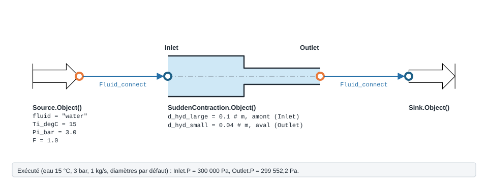
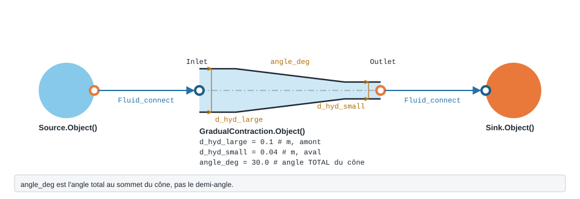
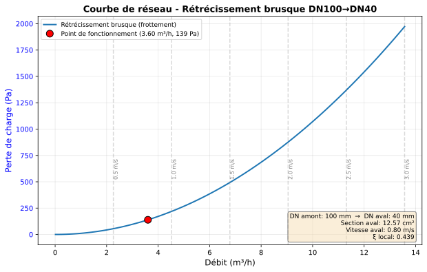

.. _reduction_section:

Réduction de section
====================

   Rétrécissement brusque : ``d_hyd_large`` est le diamètre **amont** (``Inlet``),
   ``d_hyd_small`` le diamètre **aval** (``Outlet``).

   Forme, ports et raccordement de ``GradualContraction`` ; paramètres sous leur
   nom de code, avec leur valeur par défaut.

Passage d'un grand diamètre à un petit : brusque (``SuddenContraction``) ou
progressif, par un confuseur conique (``GradualContraction``). La pression
statique chute : perte par frottement et hausse de la pression dynamique.

Exemple : rétrécissement brusque DN100 → DN50
---------------------------------------------

.. code-block:: python

    from ThermodynamicCycles.Source import Source
    from ThermodynamicCycles.Connect import Fluid_connect
    from ThermodynamicCycles.Hydraulic import SuddenContraction, GradualContraction

    def source(debit_m3h=15.0):
        s = Source.Object()
        s.fluid, s.Ti_degC, s.Pi_bar = "water", 20, 3.0
        s.F_m3h = debit_m3h
        s.calculate()
        return s

    # Rétrécissement brusque DN100 -> DN50, 15 m3/h d'eau
    RE = SuddenContraction.Object()
    RE.d_hyd_large, RE.d_hyd_small = 0.100, 0.050
    Fluid_connect(RE.Inlet, source().Outlet)
    RE.calculate()
    print(f"V {RE.V_large:.2f} -> {RE.V_small:.2f} m/s, zeta {RE.ksi_loc:.3f}, "
          f"perte {RE.delta_P_friction:.0f} Pa, pression statique {RE.delta_P_static:+.0f} Pa")

Sortie réelle :

.. code-block:: text

   V 0.53 -> 2.12 m/s, zeta 0.403, perte 906 Pa, pression statique -3013 Pa

La vitesse est multipliée par quatre : la pression statique baisse de 3 013 Pa,
dont 2 107 Pa sont seulement convertis en pression dynamique (récupérables plus
loin) et 906 Pa perdus (ζ = 0,5 (1 − A₂/A₁)^0,75 = 0,403, rapporté à la vitesse
aval). ``delta_P_static`` est P_aval − P_amont : négatif ici.

Fiches des modèles
------------------

``SuddenContraction`` — retrecissement brusque (Modelica PressureLoss.Orifice.SuddenContractionOrifice).

.. code-block:: python

   from ThermodynamicCycles.Hydraulic import SuddenContraction
   modele = SuddenContraction.Object()

* **Ports** : ``Inlet``, ``Outlet`` (voir :doc:`../ports_connexions`).
* **Nœud de l'IHM** : « Retrecissement ».

.. list-table::
   :header-rows: 1
   :widths: 26 26 48

   * - Entrée
     - Défaut
     - Commentaire du code
   * - ``d_hyd_small``
     - ``0.04``
     - m -- aval (Outlet)
   * - ``d_hyd_large``
     - ``0.1``
     - m -- amont (Inlet)
   * - ``correlation``
     - ``'Idelcik'``
     - —
   * - ``roughness``
     - ``1.5e-06``
     - m
   * - ``apply_handbook_corrections``
     - ``False``
     - —
   * - ``handbook_roughness_multiplier``
     - ``None``
     - —
   * - ``handbook_aspect_ratio``
     - ``None``
     - —

Lignes du ``df`` de sortie : ``fluid``, ``F_kgs``, ``d_small_mm``, ``d_large_mm``, ``V_small_ms``, ``V_large_ms``, ``correlation``, ``Re_large``, ``darcy_factor``, ``ksi_loc_base``, ``ksi_loc``, ``dP_friction_Pa``, ``dP_static_Pa``.

   Courbe de réseau du rétrécissement brusque ci-dessus.

.. note::
   **D'où viennent les courbes de réseau.** Elles sont tracées par la bibliothèque,
   par le chemin qu'emprunte le nœud de l'IHM : ``compute_network_curve(modele,
   **modele.network_plot_kwargs())`` puis ``render_network_figure``, importés de
   ``ThermodynamicCycles.Hydraulic.network_plot``. ``modele.Plot()`` trace la même figure dans une fenêtre
   autonome (``Plot()`` levait ``TypeError`` jusqu'à la version de la
   bibliothèque du 28/09/2026 ; corrigé).

``GradualContraction`` — confuseur conique (retrecissement progressif).

.. code-block:: python

   from ThermodynamicCycles.Hydraulic import GradualContraction
   modele = GradualContraction.Object()

* **Ports** : ``Inlet``, ``Outlet`` (voir :doc:`../ports_connexions`).
* **Nœud de l'IHM** : « Confuseur conique ».
* **Exceptions levées par le code** : ``ValueError``.

.. list-table::
   :header-rows: 1
   :widths: 26 26 48

   * - Entrée
     - Défaut
     - Commentaire du code
   * - ``d_hyd_small``
     - ``0.04``
     - m -- aval (Outlet)
   * - ``d_hyd_large``
     - ``0.1``
     - m -- amont (Inlet)
   * - ``angle_deg``
     - ``30.0``
     - angle TOTAL du cone
   * - ``roughness``
     - ``1.5e-06``
     - m
   * - ``correlation``
     - ``'idelchik'``
     - —
   * - ``ksi_conv``
     - ``None``
     - —
   * - ``ksi_fr``
     - ``None``
     - —

Lignes du ``df`` de sortie : ``fluid``, ``F_kgs``, ``d_small_mm``, ``d_large_mm``, ``angle_deg``, ``length_m``, ``V_small_ms``, ``V_large_ms``, ``Re_small``, ``correlation``, ``darcy_factor``, ``ksi_conv``, ``ksi_fr``, ``ksi_loc``, ``dP_friction_Pa``, ``dP_static_Pa``.

``Hooper1988PipeSizeChange`` — Hooper (1988) correlations for losses caused by pipe-size changes.

.. code-block:: python

   import ThermodynamicCycles.Hydraulic.Hooper1988PipeSizeChange

* **Fonctions publiques** : ``darcy_friction_factor``, ``gradual_contraction_k``, ``gradual_expansion_k``, ``rounded_contraction_k``, ``sharp_contraction_k``, ``sharp_expansion_k``.

.. note::
   Ces modèles sont **bidirectionnels** : si la pression d'une sortie est imposée
   (aval), le modèle remonte la (les) pression(s) d'entrée
   (:math:`P_{in}=P_{out}+\Delta P`). Voir :doc:`propagation_pression`.

Paramètres à personnaliser
--------------------------

.. list-table::
   :header-rows: 1
   :widths: 24 30 46

   * - Grandeur
     - Valeur à saisir
     - Effet sur le résultat
   * - ``d_hyd_large`` / ``d_hyd_small``
     - diamètres intérieurs amont (grand) et aval (petit), en m
     - Le rapport des sections fixe la perte et la chute de pression.
   * - ``angle_deg`` (``GradualContraction``)
     - angle **total** du cône, ]0 ; 180]
     - Fixe ζ et la longueur du confuseur.
   * - ``correlation``
     - ``SuddenContraction`` : défaut ``"Idelcik"`` (orthographe du code) ou
       ``"hooper"`` ; ``GradualContraction`` : ``"idelchik"`` (défaut),
       ``"idelchik_formula"``, ``"hooper"``
     - Change la source des coefficients.
   * - Débit (``Source``)
     - débit en service
     - Perte et chute varient comme le carré du débit.

Variante exécutée : brusque ou conique, et quel angle ?
-------------------------------------------------------

.. code-block:: python

    # variante : confuseur conique selon l'angle (à la suite de l'exemple)
    print("angle   longueur   zeta   perte (Pa)   chute de pression (Pa)")
    for angle in [10, 30, 60, 90, 120, 180]:
        C = GradualContraction.Object()
        C.d_hyd_large, C.d_hyd_small, C.angle_deg = 0.100, 0.050, angle
        Fluid_connect(C.Inlet, source().Outlet)
        C.calculate()
        print(f"{angle:4d}°   {C.length:6.3f} m   {C.ksi_loc:5.3f}   {C.delta_P_friction:9.0f}   "
              f"{C.delta_P_static:+12.0f}")
    print(f"brusque           {RE.ksi_loc:5.3f}   {RE.delta_P_friction:9.0f}   {RE.delta_P_static:+12.0f}")

Sortie réelle :

.. code-block:: text

   angle   longueur   zeta   perte (Pa)   chute de pression (Pa)
     10°    0.286 m   0.047         106          -2213
     30°    0.093 m   0.044          99          -2206
     60°    0.043 m   0.068         153          -2260
     90°    0.025 m   0.174         391          -2498
    120°    0.014 m   0.268         602          -2710
    180°    0.000 m   0.408         917          -3024
   brusque           0.403         906          -3013

Lecture : un rétrécissement perd peu dès qu'il est un peu profilé. Un confuseur
de 30° (9 cm de long) divise la perte par neuf par rapport au rétrécissement
brusque ; au-delà de 60°, le gain fond. C'est l'inverse de l'élargissement
(:doc:`elargissement_section`), où il faut un cône très fermé (6 à 10°) : un
écoulement qui accélère se décolle beaucoup moins qu'un écoulement qui ralentit.
Les 2 107 Pa de pression dynamique, eux, sont les mêmes dans tous les cas.

Cas limites refusés
-------------------

.. code-block:: python

    # à la suite : saisies refusées par le confuseur
    for nom, reglage in [("corrélation inconnue", dict(correlation="borda")),
                         ("cône inversé", dict(d_hyd_large=0.050, d_hyd_small=0.100,
                                               correlation="idelchik_formula"))]:
        C = GradualContraction.Object()
        C.d_hyd_large, C.d_hyd_small = 0.100, 0.050
        for attribut, valeur in reglage.items():
            setattr(C, attribut, valeur)
        Fluid_connect(C.Inlet, source().Outlet)
        try:
            C.calculate()
        except ValueError as erreur:
            print(f"{nom:21s} refusé : {erreur}")

Sortie réelle :

.. code-block:: text

   corrélation inconnue  refusé : correlation inconnue 'borda' ; attendu idelchik | idelchik_formula | hooper
   cône inversé          refusé : F0/F1 doit etre dans ]0, 1], recu 4.0

Pièges
------

.. code-block:: python

    # à la suite : ce qui passe sans message
    RE2 = SuddenContraction.Object()
    RE2.d_hyd_large, RE2.d_hyd_small = 0.100, 0.050
    RE2.correlation = "borda"                     # nom inconnu : formule d'Idel'chik prise
    Fluid_connect(RE2.Inlet, source().Outlet)
    RE2.calculate()
    print(f"corrélation 'borda' : zeta {RE2.ksi_loc:.3f} (comme le défaut)")

    C2 = GradualContraction.Object()
    C2.d_hyd_large, C2.d_hyd_small = 0.050, 0.100  # cône qui s'élargit, corrélation par défaut
    Fluid_connect(C2.Inlet, source().Outlet)
    C2.calculate()
    print(f"confuseur inversé   : zeta {C2.ksi_loc:.3f}")

    C3 = GradualContraction.Object()
    C3.angle_deg = 0.0
    Fluid_connect(C3.Inlet, source().Outlet)
    try:
        C3.calculate()
        print("angle nul accepté")
    except (ValueError, ZeroDivisionError) as erreur:
        print("angle nul           :", type(erreur).__name__)

Sortie réelle :

.. code-block:: text

   corrélation 'borda' : zeta 0.403 (comme le défaut)
   confuseur inversé   : zeta 0.040
   angle nul           : ZeroDivisionError

* **SuddenContraction accepte n'importe quel nom de corrélation** : tout ce qui
  ne commence pas par « hooper » donne la formule d'Idel'chik, sans message (le
  défaut s'écrit même ``"Idelcik"``).
* **Le confuseur inversé n'est refusé qu'avec ``"idelchik_formula"``** : avec
  la corrélation par défaut (tableau), un cône qui s'élargit reçoit un ζ de
  0,040. Pour un passage du petit au grand diamètre, utilisez
  :doc:`elargissement_section`.
* **Un angle nul** lève une ``ZeroDivisionError`` brute, comme pour le
  diffuseur.
* **delta_P_static est signé** (négatif = la pression baisse) ;
  ``delta_P_friction`` est la seule perte irréversible.

Voir :doc:`index` pour la liste de tous les modèles hydrauliques.
