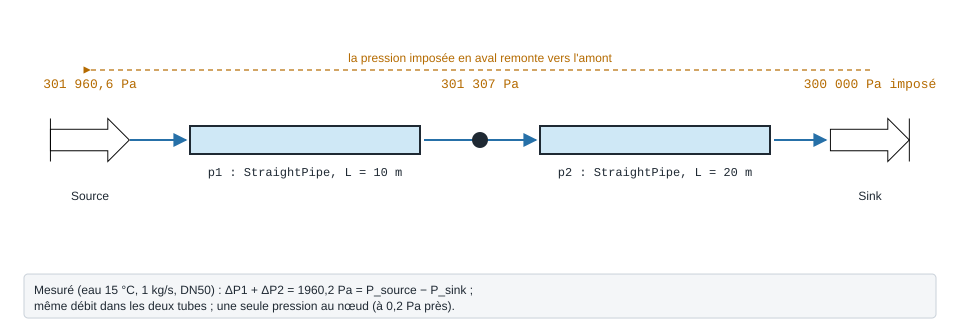

.. _resolution_circuit:

Résolution d'un circuit hydraulique
===================================

Assembler des modèles par ``Fluid_connect`` suffit à résoudre une **chaîne**
de composants : la pression imposée en aval remonte de composant en composant
(:doc:`propagation_pression`), et chaque raccordement applique la loi des nœuds
(:doc:`loi_des_noeuds`).

Circuit série : deux tubes entre une source et un puits
-------------------------------------------------------

   Le circuit de l'exemple ci-dessous, avec les pressions **mesurées** à son exécution.

.. code-block:: python

   from ThermodynamicCycles.Source import Source
   from ThermodynamicCycles.Hydraulic import StraightPipe
   from ThermodynamicCycles.Connect import Fluid_connect

   src = Source.Object(); src.fluid = "water"; src.Ti_degC = 15
   src.Pi_bar = 5; src.F = 1.0; src.calculate()

   p1 = StraightPipe.Object(); p1.L = 10; p1.d_hyd = 0.05
   p2 = StraightPipe.Object(); p2.L = 20; p2.d_hyd = 0.05

   Fluid_connect(p1.Inlet, src.Outlet); p1.calculate()
   Fluid_connect(p2.Inlet, p1.Outlet); p2.calculate()

   # Le puits impose le POTENTIEL aval -> il remonte jusqu'à la source
   p2.Outlet.P = 3.0e5

   dP1 = p1.Inlet.P - p1.Outlet.P
   dP2 = p2.Inlet.P - p2.Outlet.P
   print("pression au nœud   : p1.Outlet.P =", round(p1.Outlet.P, 1), "Pa ; p2.Inlet.P =", round(p2.Inlet.P, 1), "Pa")
   print("mailles (KVL)      : P_amont - P_aval =", round(p1.Inlet.P - p2.Outlet.P, 1), "Pa ; dP1 + dP2 =", round(dP1 + dP2, 1), "Pa")
   print("nœuds (KCL)        : débits =", p1.Inlet.F, p1.Outlet.F, p2.Inlet.F, p2.Outlet.F, "kg/s")
   print("pression à la source remontée :", round(src.Outlet.P, 1), "Pa")

Sortie réelle :

.. code-block:: text

   pression au nœud   : p1.Outlet.P = 301307.2 Pa ; p2.Inlet.P = 301307.0 Pa
   mailles (KVL)      : P_amont - P_aval = 1960.3 Pa ; dP1 + dP2 = 1960.2 Pa
   nœuds (KCL)        : débits = 1.0 1.0 1.0 1.0 kg/s
   pression à la source remontée : 301960.6 Pa

Les trois lois sont vérifiées : le nœud entre les deux tubes a une pression
unique (à 0,2 Pa près), la somme des deux chutes égale l'écart total de
pression (à 0,1 Pa près), et le débit est le même partout. La pression imposée
au puits (3 bar) est remontée jusqu'à la source.

.. note::
   Jusqu'à la version de la bibliothèque du 28/09/2026, ``StraightPipe``
   imprimait une vingtaine de traces à chaque recalcul (« StraightPipe: … »,
   « Détection d'un changement … »), étiquetées « bar » sur des pascals. Elles
   sont désormais muettes par défaut ; pour les revoir, en pascals :
   ``StraightPipe.DEBUG_STRAIGHTPIPE = True``.

Réseau maillé ou bouclé : le solveur nodal
------------------------------------------

La propagation par les ports converge sur des chaînes et de petits parallèles,
mais, comme le dit le code lui-même, **ne garantit rien sur un réseau maillé
ou une boucle fermée**. Pour ces réseaux, la bibliothèque fournit un solveur
nodal : inconnues = débit de chaque branche et pression de chaque nœud libre,
équations = chute de pression par branche et loi des nœuds, résolution par
Newton.

``network`` — solveur de reseau hydraulique en regime permanent (noeuds / branches).

.. code-block:: python

   import ThermodynamicCycles.Hydraulic.network

* **Fonctions publiques** : ``kv_density_factor``.
* **Classes** : ``AreaChangeElement``, ``AshraeFittingElement``, ``AshraeTeeElement``, ``Branch``, ``CheckValveElement``, ``CoilElement``, ``ControlValveElement``, ``CurvedBendElement``, ``DpRegulatorElement``, ``DuctElement``, ``EdgedBendElement``, ``Element``, ``FlowContext``, ``FunctionElement``, ``HazenWilliamsPipeElement``, ``HydraulicNetwork``, ``KvElement``, ``LocalLossElement``, ``ModelLossElement``, ``NetworkResult``, ``Node``, ``PipeElement``, ``PumpElement``, ``SimulationResult``, ``TAValveElement``, ``Tank``, ``TeeElement``, ``ThreeWayValveElement``.

Variante exécutée : deux départs en parallèle, avec le solveur nodal
--------------------------------------------------------------------

Deux départs sur un même collecteur, 3 m³/h au total. Le départ proche ne
présente que 8 kPa de résistance à 1,5 m³/h, l'éloigné 25 kPa. Chaque départ
est décrit par un ``KvElement`` (perte ``(Q/Kv)²`` bar) ; le collecteur est
un nœud qui reçoit le débit de la pompe (``demand`` négatif = injection) et le
retour un nœud à pression imposée.

.. code-block:: python

    # variante : répartition entre deux départs, sans puis avec vanne d'équilibrage
    from ThermodynamicCycles.Hydraulic.network import HydraulicNetwork, KvElement

    Q_TOTAL = 3.0 / 3.6            # 3 m3/h d'eau -> kg/s (rho ~ 1 000)

    def collecteur(kv_vanne_proche=None):
        net = HydraulicNetwork(fluid="water", T_K=293.15)
        net.add_node("depart", demand=-Q_TOTAL)          # la pompe injecte 3 m3/h
        net.add_node("retour", fixed_pressure=3.0e5)     # référence de pression
        proche = [KvElement(1.5 / 0.08 ** 0.5, name="départ proche (8 kPa à 1,5 m3/h)")]
        if kv_vanne_proche is not None:
            proche.append(KvElement(kv_vanne_proche, name="vanne d'équilibrage"))
        net.add_branch("proche", "depart", "retour", proche)
        net.add_branch("eloigne", "depart", "retour",
                       [KvElement(1.5 / 0.25 ** 0.5, name="départ éloigné (25 kPa à 1,5 m3/h)")])
        return net.solve()

    for titre, kv in [("sans vanne", None), ("vanne Kv 3,64", 3.64)]:
        r = collecteur(kv)
        q = {b: r.flows[b] * 3.6 for b in ("proche", "eloigne")}
        print(f"{titre:14s}: proche {q['proche']:.2f} m3/h, éloigné {q['eloigne']:.2f} m3/h, "
              f"dP collecteur {r.branch_dp['eloigne'] / 1000:.1f} kPa, convergé {r.converged}")

Sortie réelle :

.. code-block:: text

   sans vanne    : proche 1.92 m3/h, éloigné 1.08 m3/h, dP collecteur 13.1 kPa, convergé True
   vanne Kv 3,64 : proche 1.50 m3/h, éloigné 1.50 m3/h, dP collecteur 25.1 kPa, convergé True

Lecture :

* **Sans équilibrage, le départ proche prend 64 % du débit** et l'éloigné
  reste à 72 % de son besoin. La répartition est un **résultat** du solveur,
  pas une donnée.
* **Une vanne de Kv 3,64 sur le départ proche rétablit 1,5 / 1,5 m³/h** : c'est
  exactement le Kv calculé dans :doc:`TA_valve` pour dissiper les
  17 kPa d'écart. Le choix du diamètre et de la position de la vanne se fait
  sur cette page.
* **Le collecteur doit fournir 25,1 kPa au lieu de 13,1** : équilibrer ne
  supprime pas de perte, il impose à la pompe la pression du départ le plus
  défavorable. C'est cette hauteur qui sert à choisir la pompe.

Paramètres à personnaliser (solveur nodal)
------------------------------------------

.. list-table::
   :header-rows: 1
   :widths: 26 30 44

   * - Grandeur
     - Valeur à saisir
     - Effet sur le résultat
   * - ``HydraulicNetwork(fluid, T_K, P_ref)``
     - fluide CoolProp, température, pression de référence (ou ``rho`` /
       ``mu`` imposés)
     - Fixe masse volumique et viscosité de tout le réseau.
   * - ``add_node(nom, fixed_pressure=…, demand=…)``
     - au moins **un** nœud à pression imposée ; ``demand`` en kg/s
       (> 0 soutiré, < 0 injecté)
     - Les pressions des autres nœuds sont des résultats.
   * - ``add_branch(nom, amont, aval, [éléments], fixed_flow=…)``
     - une liste d'éléments en série (``PipeElement``, ``KvElement``,
       ``LocalLossElement``, ``PumpElement``…), jamais vide
     - Les débits de branche sont des résultats, sauf ``fixed_flow``.
   * - ``solve(initial_flow, tol, max_iter)``
     - défauts 0,5 kg/s, 1e-8, 500
     - Rend un ``NetworkResult`` : ``flows``, ``pressures``, ``branch_dp``,
       ``breakdown`` (perte par élément), ``converged``, ``residual_max``.

Cas limites refusés (solveur nodal)
-----------------------------------

.. code-block:: python

    # à la suite : réseaux refusés
    cas = []
    net = HydraulicNetwork(fluid="water")
    net.add_node("a", fixed_pressure=3.0e5)
    net.add_node("b")
    try:
        net.add_branch("vide", "a", "b", [])                  # branche sans élément
    except ValueError as erreur:
        print("branche vide      refusée :", erreur)

    net = HydraulicNetwork(fluid="water")
    net.add_node("a", demand=-0.5)
    net.add_node("b", demand=0.5)
    net.add_branch("t", "a", "b", [KvElement(5.0)])
    try:
        net.solve()                                          # aucune pression imposée
    except ValueError as erreur:
        print("sans référence    refusé  :", str(erreur)[:80])

Sortie réelle :

.. code-block:: text

   branche vide      refusée : la branche 'vide' n'a aucun element
   sans référence    refusé  : aucun noeud a pression imposee : le niveau de pression est indetermine (ajouter

Pièges
------

* **Lisez converged et residual_max** avant d'exploiter un résultat :
  ``converged`` est calculé sur le résidu des équations et peut valoir
  ``False``.
* **Les débits sont en kg/s** (``flows``) ; divisez par la masse volumique
  pour des m³/s. Ci-dessus, la conversion ``× 3,6`` suppose ρ ≈ 1 000 kg/m³.
* **Les ports et le solveur sont deux moteurs** : un composant à ports
  (``StraightPipe``, ``TA_Valve``…) ne s'ajoute pas tel quel à
  ``HydraulicNetwork`` ; on y emploie les éléments du module ``network``
  (``PipeElement``, ``TAValveElement``…), ou une scène de l'IHM, qui fait la
  conversion.
* **Rebrancher un port** dans une chaîne à ports empile les débits : voir
  :doc:`lit_grains` (``detach_port``).

Des réseaux complets, prêts à ouvrir, sont livrés avec l'IHM : voir la liste des
17 scènes en fin de :doc:`index`.
