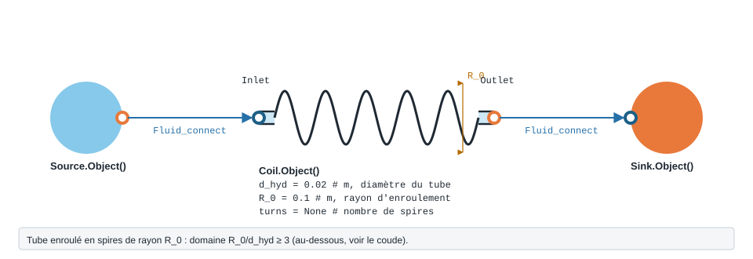

.. _coil:

Serpentin
=========

   Forme, ports et raccordement de ``Coil`` ; paramètres sous leur
   nom de code, avec leur valeur par défaut.

À quoi ça sert
--------------

``Coil`` donne la perte de charge d'un **serpentin** : tube lisse enroulé à
grand rayon (``R_0 / d_hyd ≥ 3``), comme l'échangeur noyé d'un ballon ou d'une
cuve. Au-delà de ce rapport, la courbure n'est plus une singularité mais un
**frottement majoré** : Idel'chik (diagramme 6.2, p. 426-428) remplace le
coefficient de frottement λ du tube droit par un ``λ_el`` de tube courbe, et

.. math::

   \zeta = \lambda_{el} \frac{L_{dev}}{d_{hyd}}, \qquad
   L_{dev} = \delta \, R_0 , \qquad \Delta P = \zeta \frac{\rho V^2}{2}

``λ_el`` vient soit de formules (si ``X = Re √(d/2R_0)`` est entre 50 et 5 000),
soit d'une table ; ``lambda_source_used`` dit laquelle a servi.

Exemple : serpentin de ballon, 10 spires, 0,6 m³/h d'eau à 60 °C
----------------------------------------------------------------

.. code-block:: python

    from ThermodynamicCycles.Source import Source
    from ThermodynamicCycles.Connect import Fluid_connect
    from ThermodynamicCycles.Hydraulic import Coil

    def source(debit_m3h=0.6):
        s = Source.Object()
        s.fluid, s.Ti_degC, s.Pi_bar = "water", 60, 3.0
        s.F_m3h = debit_m3h
        s.calculate()
        return s

    SERP = Coil.Object()
    SERP.d_hyd = 0.020                 # tube de 20 mm intérieur (cuivre, lisse)
    SERP.R_0 = 0.15                    # rayon d'enroulement
    SERP.turns = 10                    # 10 spires
    Fluid_connect(SERP.Inlet, source().Outlet)
    SERP.calculate()
    print(f"longueur développée {SERP.L_dev:.2f} m, V {SERP.V:.2f} m/s, Re {SERP.Re:.0f}, "
          f"X {SERP.X:.0f}, lambda_el {SERP.lambda_el:.4f} ({SERP.lambda_source_used}), "
          f"dP {SERP.delta_P / 1000:.2f} kPa")

Sortie réelle :

.. code-block:: text

   longueur développée 9.42 m, V 0.53 m/s, Re 22384, X 5780, lambda_el 0.0412 (table), dP 2.69 kPa

Fiche du modèle
---------------

* **Ports** : ``Inlet``, ``Outlet`` (voir :doc:`../ports_connexions`).
* **Nœud de l'IHM** : « Serpentin ».

.. list-table::
   :header-rows: 1
   :widths: 26 26 48

   * - Entrée
     - Défaut
     - Commentaire du code
   * - ``d_hyd``
     - ``0.02``
     - m -- diametre (Dh si non circulaire)
   * - ``R_0``
     - ``0.1``
     - m -- rayon d'enroulement
   * - ``turns``
     - ``None``
     - spires ; si renseigne, impose delta
   * - ``K``
     - ``1.5e-06``
     - m -- rugosite (diagnostic seulement)
   * - ``section``
     - ``'circular'``
     - circular \| square \| rectangular
   * - ``aspect_ratio``
     - ``None``
     - b0/a0, obligatoire si rectangular
   * - ``lambda_source``
     - ``'auto'``
     - auto \| formula \| table

Lignes du ``df`` de sortie : ``fluid``, ``F_kgs``, ``d_hyd_mm``, ``R0_d_hyd``, ``delta_deg``, ``L_dev_m``, ``V_ms``, ``Re``, ``X``, ``lambda_el``, ``lambda_source``, ``ksi_total``, ``dP_Pa``, ``dP_mbar``.

Paramètres à personnaliser
--------------------------

.. list-table::
   :header-rows: 1
   :widths: 22 30 48

   * - Grandeur
     - Valeur à saisir
     - Effet sur le résultat
   * - ``d_hyd``
     - diamètre intérieur du tube (m)
     - Vitesse, Reynolds et ``L/d``.
   * - ``R_0``
     - rayon d'enroulement (m), au moins 3 fois ``d_hyd``
     - Courbure : plus elle est forte, plus ``λ_el`` dépasse λ droit.
   * - ``turns``
     - nombre de spires (sinon ``delta`` en radians)
     - Fixe la longueur développée ``2π R_0 × spires``.
   * - ``lambda_source``
     - ``"auto"`` (défaut), ``"formula"`` ou ``"table"``
     - Voir la variante : **préférez** ``"table"`` tant que l'écart ci-dessous
       n'est pas résolu.
   * - ``section``, ``aspect_ratio``
     - ``"circular"``, ``"square"`` ou ``"rectangular"`` (avec b0/a0)
     - Autres corrélations du même diagramme.
   * - ``K``
     - rugosité (m), **diagnostic seulement**
     - Le diagramme ne vaut que pour des tubes lisses ; au-delà de 2·10⁻⁴
       de rugosité relative, ``out_of_domain`` passe à ``True``.

Variante exécutée : rayon d'enroulement, formule ou table
---------------------------------------------------------

Même tube, mêmes 10 spires ; on change le rayon et on compare au même tube
déroulé en ligne droite (``StraightPipe``).

.. code-block:: python

    # variante : rayon d'enroulement, choix formule / table, comparé au tube déroulé
    from ThermodynamicCycles.Hydraulic import StraightPipe

    print("R0/d   L (m)   auto (source)       table    dP auto   dP table   dP droit (Pa)")
    for R0 in [0.06, 0.10, 0.15, 0.30, 0.60]:
        SERP.R_0, SERP.lambda_source = R0, "auto"
        SERP.calculate()
        lam_auto, src, dp_auto = SERP.lambda_el, SERP.lambda_source_used, SERP.delta_P
        SERP.lambda_source = "table"
        SERP.calculate()
        droit = StraightPipe.Object()
        droit.d_hyd, droit.L, droit.K, droit.alpha = 0.020, SERP.L_dev, 1.5e-6, 0.0
        Fluid_connect(droit.Inlet, source().Outlet)
        droit.calculate()
        print(f"{R0 / 0.020:4.0f}  {SERP.L_dev:6.2f}   {lam_auto:.4f} ({src:7s})   {SERP.lambda_el:.4f}"
              f"   {dp_auto:7.0f}   {SERP.delta_P:8.0f}   {droit.delta_P:9.0f}")

Sortie réelle :

.. code-block:: text

   R0/d   L (m)   auto (source)       table    dP auto   dP table   dP droit (Pa)
      3    3.77   0.0494 (table  )   0.0494      1289       1289         660
      5    6.28   0.0439 (table  )   0.0439      1910       1910        1100
      8    9.42   0.0412 (table  )   0.0412      2688       2688        1650
     15   18.85   0.0216 (formula)   0.0327      2822       4267        3299
     30   37.70   0.0179 (formula)   0.0289      4665       7528        6598

.. warning::

   **En mode ``"auto"``, la formule rend un serpentin moins résistant que le
   même tube droit** (R0/d = 15 et 30 : 2 822 Pa contre 3 299 Pa, 4 665 contre
   6 598), ce qui est physiquement impossible : la courbure ajoute toujours du
   frottement. La table du même diagramme donne, elle, 4 267 et 7 528 Pa, au-
   dessus du tube droit. L'écart formule / table atteint 34 à 38 %, bien
   au-delà des 6 à 12 % que la bibliothèque déclare dans son code, et il crée
   un saut de λ_el au changement de branche (0,0412 → 0,0216). Une hypothèse à
   vérifier sur la source : ces formules visent un domaine de Reynolds plus
   bas que celui de l'exemple. En attendant, **imposez**
   ``lambda_source = "table"`` et comparez toujours au tube droit. L'écart est
   consigné dans ``BUGS_LIB.md``.

Lecture (avec la table) : un serpentin serré (R0/d = 3) perd deux fois plus
que le même tube droit ; l'écart retombe à 14 % pour R0/d = 30.

Cas limites refusés
-------------------

.. code-block:: python

    # à la suite : saisies refusées
    for nom, reglage in [("rectangulaire sans rapport", dict(section="rectangular")),
                         ("source 'moody'", dict(section="circular", lambda_source="moody"))]:
        for attribut, valeur in reglage.items():
            setattr(SERP, attribut, valeur)
        try:
            SERP.calculate()
        except ValueError as erreur:
            print(f"{nom:27s} refusé : {str(erreur)[:85]}")

Sortie réelle :

.. code-block:: text

   rectangulaire sans rapport  refusé : Serpentin rectangulaire : le rapport b0/a0 est obligatoire (parametre aspect_ratio) -
   source 'moody'              refusé : lambda_source inconnue 'moody' ; attendu auto | formula | table

Pièges
------

.. code-block:: python

    # à la suite : hors domaine signalé, pas corrigé
    SERP.lambda_source, SERP.section = "auto", "circular"
    for nom, R0, K in [("cuivre lisse, R0/d 7,5", 0.15, 1.5e-6),
                       ("acier du commerce", 0.15, 0.046e-3),
                       ("R0/d = 2 (un coude)", 0.04, 1.5e-6)]:
        SERP.R_0, SERP.K = R0, K
        SERP.calculate()
        print(f"{nom:23s}: lambda_el {SERP.lambda_el:.4f}, hors domaine {SERP.out_of_domain}")

Sortie réelle :

.. code-block:: text

   cuivre lisse, R0/d 7,5 : lambda_el 0.0412, hors domaine False
   acier du commerce      : lambda_el 0.0412, hors domaine True
   R0/d = 2 (un coude)    : lambda_el 0.0494, hors domaine True

* **La rugosité ne change pas le résultat** : elle n'est que signalée
  (``out_of_domain``), parce que le diagramme ne publie aucune correction. Un
  serpentin en acier est donc calculé comme un tube lisse.
* **Sous R0/d = 3, rien n'est refusé** : le résultat est signalé hors domaine
  et ``domain_note`` renvoie au diagramme des coudes (:doc:`coudes_tes_singularites`).
* **Lisez lambda_source_used**, pas ``lambda_source`` : en mode ``"auto"``,
  c'est lui qui dit si la formule ou la table a servi.

Voir :doc:`index` pour la liste de tous les modèles hydrauliques.
