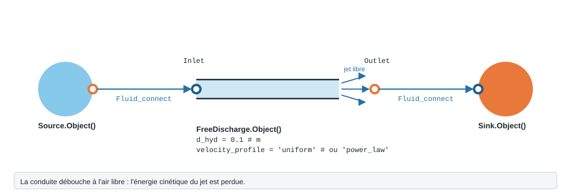

.. _free_discharge:

Sortie libre
============

   Forme, ports et raccordement de ``FreeDischarge`` ; paramètres sous leur
   nom de code, avec leur valeur par défaut.

À quoi ça sert
--------------

``FreeDischarge`` donne la perte à la **sortie libre** d'un tube ou d'une gaine
dans un grand volume (rejet d'air en toiture, refoulement dans une bâche) :
toute l'énergie cinétique du jet est perdue. D'après Idel'chik (section 11) :

* profil de vitesse uniforme : ``ζ = 1`` ;
* profil en puissance ``1/m`` : ``ζ = (2m+1)³ (m+1)³ / [4 m⁴ (2m+3)(m+3)]`` ;

puis ``ΔP = ζ ρ w0² / 2``, avec ``w0`` la vitesse moyenne dans la section de
sortie.

Exemple : rejet d'air en gaine de 400 mm, 3 000 m³/h
----------------------------------------------------

.. code-block:: python

    from ThermodynamicCycles.Source import Source
    from ThermodynamicCycles.Connect import Fluid_connect
    from ThermodynamicCycles.Hydraulic import FreeDischarge

    def source(debit_m3h=3000.0):
        s = Source.Object()
        s.fluid, s.Ti_degC, s.Pi_bar = "air", 20, 1.01325
        s.F_m3h = debit_m3h
        s.calculate()
        return s

    def rejet(d, profil="uniform", m=7.0):
        r = FreeDischarge.Object()
        r.d_hyd, r.velocity_profile, r.m_profile = d, profil, m
        Fluid_connect(r.Inlet, source().Outlet)
        r.calculate()
        return r

    r = rejet(0.40)                          # rejet d'air en gaine de 400 mm
    print(f"w0 {r.w0:.2f} m/s, zeta {r.ksi_loc:.3f}, dP {r.delta_P:.1f} Pa")

Sortie réelle :

.. code-block:: text

   w0 6.63 m/s, zeta 1.000, dP 26.5 Pa

Fiche du modèle
---------------

* **Ports** : ``Inlet``, ``Outlet`` (voir :doc:`../ports_connexions`).
* **Nœud de l'IHM** : « Décharge libre ».
* **Exceptions levées par le code** : ``ValueError``.

.. list-table::
   :header-rows: 1
   :widths: 26 26 48

   * - Entrée
     - Défaut
     - Commentaire du code
   * - ``d_hyd``
     - ``0.1``
     - —
   * - ``velocity_profile``
     - ``'uniform'``
     - uniform \| power_law
   * - ``m_profile``
     - ``7.0``
     - —

Lignes du ``df`` de sortie : ``fluid``, ``F_kgs``, ``d_hyd_mm``, ``velocity_profile``, ``m_profile``, ``w0_ms``, ``ksi_loc``, ``dP_Pa``.

Paramètres à personnaliser
--------------------------

.. list-table::
   :header-rows: 1
   :widths: 24 30 46

   * - Grandeur
     - Valeur à saisir
     - Effet sur le résultat
   * - ``d_hyd``
     - diamètre de la section de **sortie** (m)
     - ``ΔP`` varie comme ``1/d⁴`` : c'est le levier principal.
   * - ``velocity_profile``
     - ``"uniform"`` (défaut) ou ``"power_law"`` (exactement)
     - Le profil développé d'une longue conduite perd un peu plus que le
       profil plat.
   * - ``m_profile``
     - exposant du profil en puissance (7 pour un écoulement turbulent
       développé courant)
     - ζ passe de 1,156 (m = 4) à 1,031 (m = 10).

Variante exécutée : profil de vitesse et diamètre de sortie
-----------------------------------------------------------

.. code-block:: python

    # variante : profil de vitesse et diamètre de sortie (à la suite)
    for m in [4.0, 7.0, 10.0]:
        print(f"profil en puissance 1/{m:.0f} : zeta {rejet(0.40, 'power_law', m).ksi_loc:.3f}")
    print("diamètre de sortie (profil uniforme) :")
    for d in [0.40, 0.50, 0.63]:
        r = rejet(d)
        puissance = r.delta_P * 3000 / 3600          # W perdus au rejet
        print(f"  {d * 1000:3.0f} mm : w0 {r.w0:5.2f} m/s, dP {r.delta_P:5.1f} Pa, {puissance:5.1f} W")

Sortie réelle :

.. code-block:: text

   profil en puissance 1/4 : zeta 1.156
   profil en puissance 1/7 : zeta 1.058
   profil en puissance 1/10 : zeta 1.031
   diamètre de sortie (profil uniforme) :
     400 mm : w0  6.63 m/s, dP  26.5 Pa,  22.1 W
     500 mm : w0  4.24 m/s, dP  10.8 Pa,   9.0 W
     630 mm : w0  2.67 m/s, dP   4.3 Pa,   3.6 W

Lecture : le profil de vitesse change ζ de quelques pour cent, le diamètre de
sortie le divise par six. Agrandir la bouche de rejet de 400 à 630 mm ramène
la puissance aéraulique perdue au rejet de 22 à 3,6 W, à condition de passer
par un diffuseur dont la perte propre est à compter (:doc:`elargissement_section`).
Les watts ci-dessus sont la puissance de l'air (``ΔP × débit``), pas la
puissance électrique du ventilateur, plus élevée de l'inverse de son
rendement.

Cas limites refusés
-------------------

.. code-block:: python

    # à la suite : saisies refusées
    for nom, kw in [("diamètre nul", dict(d=0.0)),
                    ("exposant nul", dict(d=0.40, profil="power_law", m=0.0))]:
        try:
            rejet(**kw)
        except ValueError as erreur:
            print(f"{nom:13s} refusé : {erreur}")

Sortie réelle :

.. code-block:: text

   diamètre nul  refusé : d_hyd doit etre > 0
   exposant nul  refusé : m_profile doit etre > 0

Pièges
------

.. code-block:: python

    # à la suite : profil mal orthographié
    for profil in ["power_law", "powerlaw", "turbulent"]:
        print(f"velocity_profile = {profil!r:12s} : zeta {rejet(0.40, profil, 7.0).ksi_loc:.3f}")

Sortie réelle :

.. code-block:: text

   velocity_profile = 'power_law'  : zeta 1.058
   velocity_profile = 'powerlaw'   : zeta 1.000
   velocity_profile = 'turbulent'  : zeta 1.000

* **Un nom de profil inconnu retombe sur le profil uniforme sans message** :
  ``"powerlaw"`` (sans tiret bas) donne ζ = 1, et ``m_profile`` est ignoré.
* **La sortie dans un grand volume seulement** : si le jet débouche dans une
  autre gaine, c'est un élargissement (:doc:`elargissement_section`), pas une
  sortie libre.
* **Le pendant à l'aspiration** est l'entrée de conduite :
  :doc:`entree_conduite`.

Voir :doc:`index` pour la liste de tous les modèles hydrauliques.
