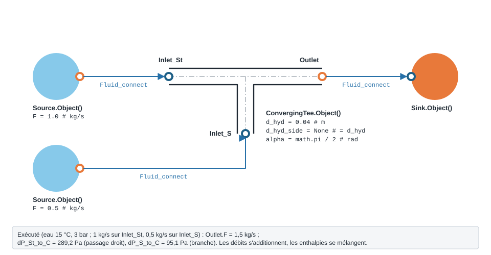
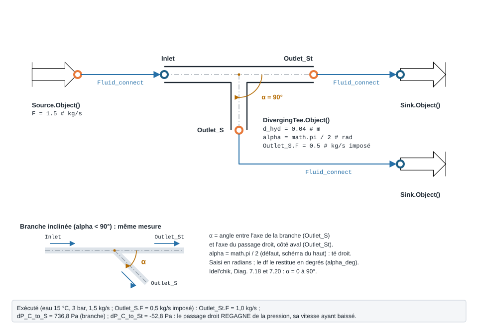
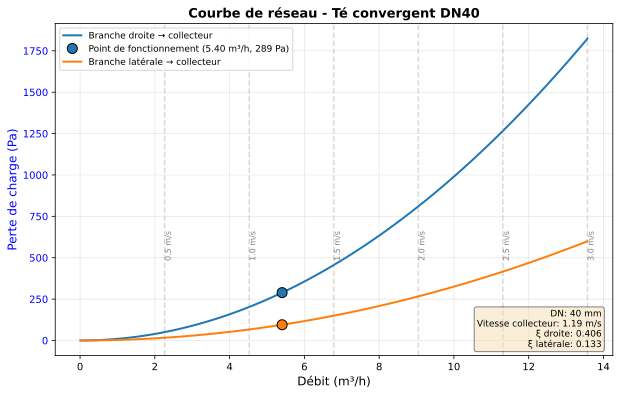
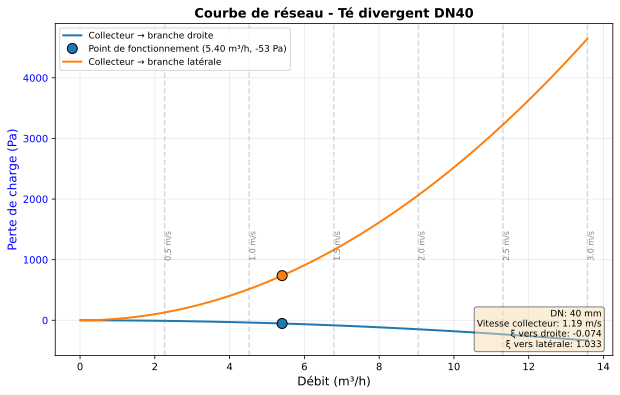

.. _te_jonction:

Té / jonction 3 ports
=====================

   Té convergent : **deux** composants amont, un sur le passage droit
   (``Inlet_St``), un sur la branche (``Inlet_S``) ; les débits s'additionnent.
   L'angle ``alpha`` se mesure au croisement des axes, entre l'axe de la branche
   et l'axe du passage droit côté **amont** (``Inlet_St``) : 90° = té droit.

   Té divergent : le débit de la branche s'**impose** par ``Outlet_S.F`` ; le passage
   droit ``Outlet_St`` reçoit le reste (1,5 − 0,5 = 1,0 kg/s, mesuré).
   Ici ``alpha`` se mesure entre l'axe de la branche et l'axe du passage droit
   côté **aval** (``Outlet_St``) : c'est l'angle dont la branche dévie du
   courant.

Deux modèles à trois ports : le té **convergent** réunit deux courants, le té
**divergent** en partage un. Bilan de masse sur les trois ports ; le té
convergent mélange aussi les enthalpies.

Exemple : té divergent DN40, 6 m³/h, 30 % vers la branche
---------------------------------------------------------

Dans un té **divergent**, on impose le débit de la branche (``Outlet_S.F``) ;
le passage droit reçoit le reste. Les coefficients viennent d'Idel'chik
(diagrammes 7.18 pour la branche et 7.20 pour le passage droit), rapportés à la
vitesse du **collecteur**.

.. code-block:: python

    from ThermodynamicCycles.Source import Source
    from ThermodynamicCycles.Connect import Fluid_connect
    from ThermodynamicCycles.Hydraulic import DivergingTee

    def source(debit_m3h=6.0):
        s = Source.Object()
        s.fluid, s.Ti_degC, s.Pi_bar = "water", 20, 3.0
        s.F_m3h = debit_m3h
        s.calculate()
        return s

    def te(part_branche, correlation="idelchik", d_branche=None):
        t = DivergingTee.Object()
        t.d_hyd, t.d_hyd_side, t.correlation = 0.040, d_branche, correlation
        Fluid_connect(t.Inlet, source().Outlet)
        t.Outlet_S.F = part_branche * t.Inlet.F          # débit imposé dans la branche
        t.calculate()
        return t

    t = te(0.3)                                          # DN40, 6 m3/h, 30 % vers la branche
    print(f"V collecteur {t.V_C:.2f} m/s, Qs/Qc {t.q_ratio:.2f} : "
          f"branche zeta {t.ksi_S:.3f} -> {t.dP_C_to_S:.0f} Pa ; "
          f"passage droit zeta {t.ksi_St:.3f} -> {t.dP_C_to_St:+.0f} Pa")

Sortie réelle :

.. code-block:: text

   V collecteur 1.33 m/s, Qs/Qc 0.30 : branche zeta 1.027 -> 902 Pa ; passage droit zeta -0.072 -> -63 Pa

Le passage droit **regagne** 63 Pa : le courant y ralentit (30 % du débit est
parti par la branche) et une partie de sa pression dynamique redevient
statique. La branche, elle, perd environ une pression dynamique du collecteur.

Fiches des modèles
------------------

``ConvergingTee`` — te convergent (Idel'chik, Diagrammes 7.1 a 7.4).

.. code-block:: python

   from ThermodynamicCycles.Hydraulic import ConvergingTee
   modele = ConvergingTee.Object()

* **Ports** : ``Inlet_St``, ``Inlet_S``, ``Outlet`` (voir :doc:`../ports_connexions`).
* **Nœud de l'IHM** : « Té convergent ».
* **Exceptions levées par le code** : ``ValueError``.

.. list-table::
   :header-rows: 1
   :widths: 26 26 48

   * - Entrée
     - Défaut
     - Commentaire du code
   * - ``d_hyd``
     - ``0.04``
     - m -- diametre commun (collecteur = passage droit)
   * - ``d_hyd_side``
     - ``None``
     - m -- diametre de la branche (None = d_hyd)
   * - ``alpha``
     - ``math.pi / 2``
     - rad -- angle de la branche
   * - ``correlation``
     - ``'idelchik'``
     - 'idelchik' (Diag. 7.1-7.4) \| 'legacy'
   * - ``A_factor``
     - ``None``
     - Table 7.1
   * - ``ksi_St``
     - ``None``
     - —
   * - ``ksi_S``
     - ``None``
     - —

Lignes du ``df`` de sortie : ``fluid``, ``F_St_kgs``, ``F_S_kgs``, ``F_C_kgs``, ``q_ratio``, ``Fs_Fc``, ``V_C_ms``, ``correlation``, ``ksi_St``, ``ksi_S``, ``dP_St_C_Pa``, ``dP_S_C_Pa``, ``alpha_deg``.

``DivergingTee`` — te divergent (Idel'chik, Diagrammes 7.18 et 7.20).

.. code-block:: python

   from ThermodynamicCycles.Hydraulic import DivergingTee
   modele = DivergingTee.Object()

* **Ports** : ``Inlet``, ``Outlet_St``, ``Outlet_S`` (voir :doc:`../ports_connexions`).
* **Nœud de l'IHM** : « Té divergent ».
* **Exceptions levées par le code** : ``ValueError``.

.. list-table::
   :header-rows: 1
   :widths: 26 26 48

   * - Entrée
     - Défaut
     - Commentaire du code
   * - ``d_hyd``
     - ``0.04``
     - m -- diametre commun (collecteur = passage droit)
   * - ``d_hyd_side``
     - ``None``
     - m -- diametre de la branche (None = d_hyd)
   * - ``height_ratio``
     - ``None``
     - hs/hc (None = sqrt(Fs/Fc), tubes circulaires)
   * - ``alpha``
     - ``math.pi / 2``
     - rad -- angle de la branche (defaut 90°)
   * - ``correlation``
     - ``'idelchik'``
     - 'idelchik' (Diag. 7.18/7.20) \| 'legacy'
   * - ``ksi_St``
     - ``None``
     - —
   * - ``ksi_S``
     - ``None``
     - —
   * - ``domain_note``
     - ``''``
     - —

Lignes du ``df`` de sortie : ``fluid``, ``F_C_kgs``, ``F_St_kgs``, ``F_S_kgs``, ``q_ratio``, ``Fs_Fc``, ``V_C_ms``, ``correlation``, ``ksi_St``, ``ksi_S``, ``dP_C_St_Pa``, ``dP_C_S_Pa``, ``alpha_deg``.

   Courbes de réseau du té convergent : une courbe par chemin, passage droit et
   branche vers le collecteur.

   Courbes de réseau du té divergent : la branche latérale perd de la pression, le
   passage droit en **regagne** (courbe sous zéro, −53 Pa au point de fonctionnement).

.. note::
   **D'où viennent les courbes de réseau.** Elles sont tracées par la bibliothèque,
   par le chemin qu'emprunte le nœud de l'IHM : ``compute_network_curve(modele,
   **modele.network_plot_kwargs())`` puis ``render_network_figure``, importés de
   ``ThermodynamicCycles.Hydraulic.network_plot``. ``modele.Plot()`` trace la même figure dans une fenêtre
   autonome (``Plot()`` levait ``TypeError`` jusqu'à la version de la
   bibliothèque du 28/09/2026 ; corrigé).

.. note::
   Ces modèles sont **bidirectionnels** : si la pression d'une sortie est imposée
   (aval), le modèle remonte la (les) pression(s) d'entrée
   (:math:`P_{in}=P_{out}+\Delta P`). Voir :doc:`propagation_pression`.

Paramètres à personnaliser (té divergent)
-----------------------------------------

.. list-table::
   :header-rows: 1
   :widths: 24 30 46

   * - Grandeur
     - Valeur à saisir
     - Effet sur le résultat
   * - ``Outlet_S.F``
     - débit de la branche (kg/s), au plus le débit d'entrée
     - Fixe ``Qs/Qc``, la grandeur qui pilote les deux ζ.
   * - ``d_hyd`` / ``d_hyd_side``
     - diamètre du collecteur et de la branche (``None`` = même diamètre)
     - Une branche plus petite accélère le courant latéral et perd plus.
   * - ``alpha``
     - angle de la branche en **radians** (défaut π/2 = 90°)
     - Voir la figure en tête de page pour le repère de l'angle.
   * - ``correlation``
     - ``"idelchik"`` (défaut) ou ``"legacy"``
     - ``"legacy"`` est l'ancien polynôme, conservé à l'identique.

Variante exécutée : part du débit dans la branche, corrélation et diamètre
--------------------------------------------------------------------------

.. code-block:: python

    # variante : part du débit dans la branche, et corrélation (à la suite)
    print("Qs/Qc   zeta branche (idelchik / legacy)   zeta droit (idelchik / legacy)")
    for q in [0.1, 0.3, 0.5, 0.7, 0.9]:
        a, b = te(q, "idelchik"), te(q, "legacy")
        print(f" {q:3.1f}         {a.ksi_S:6.3f} / {b.ksi_S:6.3f}                "
              f"{a.ksi_St:+6.3f} / {b.ksi_St:+6.3f}")
    for d in [0.040, 0.032, 0.025]:
        a = te(0.3, "idelchik", d_branche=d)
        print(f"branche {d * 1000:2.0f} mm (Fs/Fc {a.area_ratio_side:.2f}) : "
              f"dP vers la branche {a.dP_C_to_S:5.0f} Pa  {a.domain_note}")

Sortie réelle :

.. code-block:: text

   Qs/Qc   zeta branche (idelchik / legacy)   zeta droit (idelchik / legacy)
    0.1          1.003 /  1.002                -0.016 / +0.106
    0.3          1.027 /  1.018                -0.072 / +0.240
    0.5          1.075 /  1.050                +0.000 / +0.378
    0.7          1.147 /  1.098                +0.059 / +0.520
    0.9          1.243 /  1.162                +0.194 / +0.665
   branche 40 mm (Fs/Fc 1.00) : dP vers la branche   902 Pa
   branche 32 mm (Fs/Fc 0.64) : dP vers la branche  1017 Pa  hs/hc = 0.80 entre 2/3 et 1 : coefficient de w^2 interpole lineairement entre 1.0 et 0.3 (la source ne publie que les deux bornes)
   branche 25 mm (Fs/Fc 0.39) : dP vers la branche  1396 Pa

Lecture :

* **Le passage droit regagne de la pression tant que la branche prend moins de
  la moitié du débit** (ζ négatif d'Idel'chik). L'ancien polynôme
  ``"legacy"`` le fait toujours perdre : +0,378 à ``Qs/Qc = 0,5`` là où la
  source donne 0. La bibliothèque documente cet écart dans son code ; les
  valeurs ci-dessus le retrouvent à l'arrondi près (0,378 contre 0,377).
* **La branche** perd un peu plus d'une pression dynamique du collecteur ; le
  polynôme ``"legacy"`` la sous-estime jusqu'à 7 % à ``Qs/Qc = 0,9``.
* **Une branche plus petite** (25 mm sur un collecteur de 40) coûte 55 % de
  perte en plus. Entre deux diamètres tabulés, ``domain_note`` dit que le
  coefficient est interpolé entre les deux seules bornes publiées.

Cas limites refusés (té divergent)
----------------------------------

.. code-block:: python

    # à la suite : saisies refusées
    for nom, reglage in [("branche > collecteur", dict(part=1.2)),
                         ("corrélation inconnue", dict(part=0.3, correlation="borda"))]:
        try:
            te(reglage["part"], reglage.get("correlation", "idelchik"))
        except ValueError as erreur:
            print(f"{nom:21s} refusé : {erreur}")

Sortie réelle :

.. code-block:: text

   branche > collecteur  refusé : DivergingTee : F_S > F_C (impossible)
   corrélation inconnue  refusé : correlation inconnue 'borda' ; attendu idelchik | legacy

Pièges (té divergent)
---------------------

.. code-block:: python

    # à la suite : débit de branche non imposé
    t0 = DivergingTee.Object()
    t0.d_hyd = 0.040
    Fluid_connect(t0.Inlet, source().Outlet)
    t0.calculate()                                       # Outlet_S.F jamais saisi
    print(f"Qs/Qc {t0.q_ratio:.2f} : tout passe tout droit, dP branche {t0.dP_C_to_S:.0f} Pa")

Sortie réelle :

.. code-block:: text

   Qs/Qc 0.00 : tout passe tout droit, dP branche 878 Pa

* **Le débit de la branche n'est pas calculé, il est imposé** : sans
  ``Outlet_S.F``, tout le débit passe tout droit. Dans un réseau, c'est le
  solveur nodal qui détermine la répartition (:doc:`resolution_circuit`).
* **Une branche à débit nul garde ζ = 1** rapporté à la vitesse du collecteur
  (878 Pa ici) : c'est l'écart de pression statique vers une branche fermée,
  pas une perte d'énergie.
* **alpha est en radians** ; ``math.radians(45)`` pour une branche à 45°.
* **ConvergingTee** (té convergent) n'a pas de variante sur cette page : ses
  entrées sont dans la fiche ci-dessous.

Voir :doc:`index` pour la liste de tous les modèles hydrauliques.
