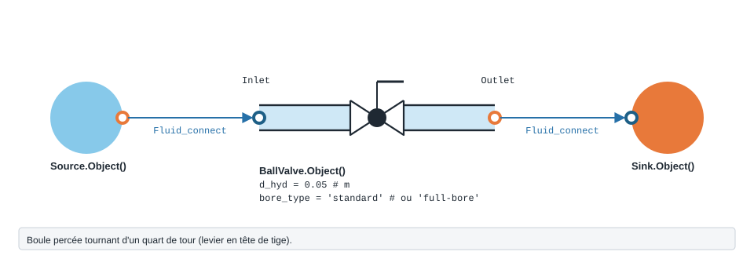

.. _ball_valve:

Vanne à boule
=============

   Forme, ports et raccordement de ``BallValve`` ; paramètres sous leur
   nom de code, avec leur valeur par défaut.

À quoi ça sert
--------------

``BallValve`` donne la perte de charge d'un robinet à tournant sphérique (vanne
à boule, quart de tour), passage standard ou intégral, avec deux jeux de
coefficients :

* ``source = "legacy"`` (défaut) — forme 2K ``ζ = K1/Re + K∞ (1 + 1/D_pouces)``
  avec des coefficients internes, et un facteur d'ouverture partielle ;
* ``source = "crane"`` — le coefficient publié par Crane TP-410 (p. A-29) :
  ``K = 3 f_T``, à **pleine ouverture** seulement (voir :doc:`methodes_2k_3k`).

Exemple : robinet sphérique DN50 ouvert, 10 m³/h d'eau
------------------------------------------------------

.. code-block:: python

    from ThermodynamicCycles.Source import Source
    from ThermodynamicCycles.Connect import Fluid_connect
    from ThermodynamicCycles.Hydraulic import BallValve

    def source(debit_m3h=10.0):
        s = Source.Object()
        s.fluid, s.Ti_degC, s.Pi_bar = "water", 20, 3.0
        s.F_m3h = debit_m3h
        s.calculate()
        return s

    def boule(ouverture_pct=100, source_coeff="legacy", passage="standard"):
        v = BallValve.Object()
        v.d_hyd, v.D_in_pouces = 0.0525, 2.0      # DN50 (2"), diamètre intérieur Sch40
        v.bore_type, v.source = passage, source_coeff
        Fluid_connect(v.Inlet, source().Outlet)    # raccorder AVANT set_opening
        v.set_opening(ouverture_pct)               # règle l'ouverture et recalcule
        return v

    for src in ["legacy", "crane"]:
        v = boule(100, src)
        print(f"source {src:6s}: V {v.V:.2f} m/s, zeta {v.zeta:.3f}, dP {v.delta_P:.0f} Pa")

Sortie réelle :

.. code-block:: text

   source legacy: V 1.28 m/s, zeta 0.375, dP 308 Pa
   source crane : V 1.28 m/s, zeta 0.057, dP 47 Pa

Les deux sources diffèrent d'un facteur **6,6** pour le même robinet grand
ouvert. Le docstring attribue les coefficients ``legacy`` à Hooper (1988) et à
Crane TP-410, mais Crane, tel que tabulé dans la bibliothèque, donne 0,057.
**Pour un robinet ouvert, préférez** ``source = "crane"``.

Fiche du modèle
---------------

* **Ports** : ``Inlet``, ``Outlet`` (voir :doc:`../ports_connexions`).
* **Nœud de l'IHM** : « Vanne à boule (Ball) ».
* **Exceptions levées par le code** : ``ValueError``.

.. list-table::
   :header-rows: 1
   :widths: 26 26 48

   * - Entrée
     - Défaut
     - Commentaire du code
   * - ``d_hyd``
     - ``0.05``
     - Diamètre hydraulique (m)
   * - ``D_in_pouces``
     - ``2.0``
     - Diamètre nominal (pouces)
   * - ``bore_type``
     - ``'standard'``
     - 'standard' ou 'full-bore'
   * - ``source``
     - ``'legacy'``
     - —
   * - ``coeff_base``
     - ``(table interne)``
     - —
   * - ``K1``
     - ``None``
     - Coefficient laminaire
   * - ``K_inf``
     - ``None``
     - Coefficient turbulent

Lignes du ``df`` de sortie : ``fluid``, ``Bore type``, ``Ouverture (%)``, ``Angle (°)``, ``V (m/s)``, ``Re``, ``ζ (-)``, ``ΔP (Pa)``, ``P_in (Pa)``, ``P_out (Pa)``.

Paramètres à personnaliser
--------------------------

.. list-table::
   :header-rows: 1
   :widths: 24 30 46

   * - Grandeur
     - Valeur à saisir
     - Effet sur le résultat
   * - ``source``
     - ``"crane"`` (sourcé, pleine ouverture) ou ``"legacy"`` (défaut)
     - Facteur 6,6 entre les deux à pleine ouverture.
   * - ``set_opening(pourcentage)``
     - ouverture de 0 à 100 %, **après** le raccordement (la méthode recalcule)
     - Mode ``legacy`` seulement ; ignoré en mode ``crane``.
   * - ``bore_type``
     - ``"standard"`` ou ``"full-bore"`` (passage intégral)
     - Change les coefficients ``legacy`` ; en mode ``crane``, les deux
       donnent la même famille Crane.
   * - ``d_hyd``, ``D_in_pouces``
     - diamètre intérieur (m) et taille nominale (pouces), **cohérents**
     - Vitesse ; facteur de taille de la forme 2K et ``f_T`` de Crane.

Variante exécutée : ouverture partielle
---------------------------------------

.. code-block:: python

    # variante : ouverture partielle (à la suite)
    print("ouverture   zeta legacy   dP legacy (Pa)   zeta crane")
    for pct in [100, 75, 50, 25, 10, 0]:
        l, c = boule(pct, "legacy"), boule(pct, "crane")
        print(f"  {pct:3d} %     {l.zeta:9.3f}   {l.delta_P:12.0f}     {c.zeta:7.3f}")

Sortie réelle :

.. code-block:: text

   ouverture   zeta legacy   dP legacy (Pa)   zeta crane
     100 %         0.375            308       0.057
      75 %         0.705            579       0.057
      50 %         1.715           1410       0.057
      25 %         7.754           6372       0.057
      10 %        51.304          42165       0.057
       0 %        37.501          30821       0.057

.. warning::

   **L'ouverture partielle n'est pas fiable.**

   * En mode ``legacy``, ζ croît jusqu'à 10 % d'ouverture puis **redescend**
     à vanne fermée (37,5 contre 51,3) : une vanne fermée laisse passer tout
     le débit avec une perte finie, moindre qu'entrouverte. Le facteur
     d'ouverture (``ouverture^2,2`` du code, et ``× 100`` à la fermeture) n'a
     pas de source citée.
   * En mode ``crane``, l'ouverture est **ignorée** : ζ reste celui de la
     pleine ouverture, faute de données Crane pour les ouvertures partielles.

   Un robinet sphérique est un organe d'isolement, pas de réglage : modélisez-le
   ouvert (``crane``) ou retirez la branche quand il est fermé. Pour du réglage,
   voir :doc:`TA_valve` ou :doc:`valve_3_voies`. Défauts consignés dans
   ``BUGS_LIB.md``.

Cas limite refusé
-----------------

.. code-block:: python

    # à la suite : source de coefficients inconnue
    try:
        boule(100, "idelchik")
    except ValueError as erreur:
        print("Refusé :", erreur)

Sortie réelle :

.. code-block:: text

   Refusé : source 'idelchik' inconnue ; attendu 'legacy' ou 'crane'

Pièges
------

.. code-block:: python

    # à la suite : régler l'ouverture avant de raccorder
    v = BallValve.Object()
    try:
        v.set_opening(50)                          # set_opening appelle calculate()
    except TypeError:
        print("set_opening avant Fluid_connect : TypeError (ports encore vides)")

Sortie réelle :

.. code-block:: text

   set_opening avant Fluid_connect : TypeError (ports encore vides)

* **set_opening recalcule immédiatement** : appelez-le après
  ``Fluid_connect``, sinon une ``TypeError`` de CoolProp signale des ports
  vides.
* **Une vanne fermée n'arrête pas le débit** dans ce modèle (avertissement
  ci-dessus).
* **D_in_pouces et d_hyd ne sont pas reliés** : déclarez la même taille dans
  les deux unités.

Voir :doc:`index` pour la liste de tous les modèles hydrauliques.
