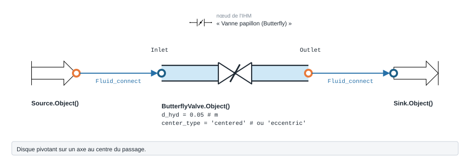
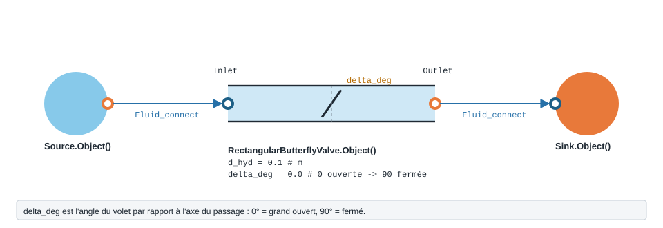

.. _butterfly_valve:

Vanne papillon
==============

   Forme, ports et raccordement de ``ButterflyValve`` ; paramètres sous leur
   nom de code, avec leur valeur par défaut.

   Forme, ports et raccordement de ``RectangularButterflyValve`` ; paramètres sous leur
   nom de code, avec leur valeur par défaut.

À quoi ça sert
--------------

``ButterflyValve`` donne la perte de charge d'une vanne papillon en conduite
circulaire, avec deux jeux de coefficients :

* ``source = "legacy"`` (défaut) — forme 2K avec des coefficients internes
  (disque ``"centered"`` ou ``"eccentric"``) et un facteur d'ouverture ;
* ``source = "crane"`` — Crane TP-410 (p. A-29) : ``K = n f_T``, avec ``n``
  selon le **type de disque** (``crane_disc_type`` : ``"centric"``,
  ``"double_offset"``, ``"triple_offset"``) et la plage de taille, à
  **pleine ouverture**.

``RectangularButterflyValve`` traite un volet papillon en gaine rectangulaire
(Idel'chik, diagramme 9.18) ; il n'a pas de variante sur cette page.

Exemple : papillon DN100 ouvert, 30 m³/h d'eau, selon le type de disque
------------------------------------------------------------------------

.. code-block:: python

    from ThermodynamicCycles.Source import Source
    from ThermodynamicCycles.Connect import Fluid_connect
    from ThermodynamicCycles.Hydraulic import ButterflyValve

    def source(debit_m3h=30.0):
        s = Source.Object()
        s.fluid, s.Ti_degC, s.Pi_bar = "water", 20, 3.0
        s.F_m3h = debit_m3h
        s.calculate()
        return s

    def papillon(ouverture_pct=100, source_coeff="legacy", disque=None):
        v = ButterflyValve.Object()
        v.d_hyd, v.D_in_pouces = 0.1023, 4.0      # DN100 (4"), diamètre intérieur Sch40
        v.source, v.crane_disc_type = source_coeff, disque
        Fluid_connect(v.Inlet, source().Outlet)    # raccorder AVANT set_opening
        v.set_opening(ouverture_pct)               # règle l'ouverture et recalcule
        return v

    for src, disque in [("legacy", None), ("crane", "centric"),
                        ("crane", "double_offset"), ("crane", "triple_offset")]:
        v = papillon(100, src, disque)
        print(f"{src:6s} {str(disque):14s}: V {v.V:.2f} m/s, zeta {v.zeta:.3f}, dP {v.delta_P:.0f} Pa")

Sortie réelle :

.. code-block:: text

   legacy None          : V 1.01 m/s, zeta 0.375, dP 192 Pa
   crane  centric       : V 1.01 m/s, zeta 0.720, dP 369 Pa
   crane  double_offset : V 1.01 m/s, zeta 1.184, dP 607 Pa
   crane  triple_offset : V 1.01 m/s, zeta 3.488, dP 1790 Pa

Le type de disque compte plus que tout : un papillon triple excentré, choisi
pour son étanchéité, perd **cinq fois** plus qu'un papillon centré ouvert. Le
coefficient ``legacy`` est deux fois plus faible que celui de Crane pour un
papillon centré. **Préférez** ``source = "crane"`` avec le type de disque de
la fiche.

Paramètres à personnaliser
--------------------------

.. list-table::
   :header-rows: 1
   :widths: 24 30 46

   * - Grandeur
     - Valeur à saisir
     - Effet sur le résultat
   * - ``source``, ``crane_disc_type``
     - ``"crane"`` et le type de disque de la fiche (``"centric"``,
       ``"double_offset"``, ``"triple_offset"``)
     - Facteur 5 entre centré et triple excentré.
   * - ``set_opening(pourcentage)``
     - ouverture de 0 à 100 %, **après** le raccordement
     - Mode ``legacy`` seulement ; ignoré en mode ``crane``.
   * - ``center_type``
     - ``"centered"`` ou ``"eccentric"`` (mode ``legacy``)
     - Sans ``crane_disc_type``, le mode ``crane`` les traduit en
       ``centric`` / ``double_offset``.
   * - ``d_hyd``, ``D_in_pouces``
     - diamètre intérieur (m) et taille nominale (pouces), cohérents
     - Vitesse et ``f_T`` de Crane.

Variante exécutée : ouverture partielle
---------------------------------------

.. code-block:: python

    # variante : ouverture partielle, legacy et Crane (à la suite)
    print("ouverture   zeta legacy   dP legacy (Pa)   zeta crane centric")
    for pct in [100, 75, 50, 25, 10, 0]:
        l, c = papillon(pct, "legacy"), papillon(pct, "crane", "centric")
        print(f"  {pct:3d} %     {l.zeta:9.3f}   {l.delta_P:12.0f}     {c.zeta:7.3f}")

Sortie réelle :

.. code-block:: text

   ouverture   zeta legacy   dP legacy (Pa)   zeta crane centric
     100 %         0.375            192       0.720
      75 %         0.475            244       0.720
      50 %         1.058            543       0.720
      25 %         6.574           3373       0.720
      10 %        77.669          39851       0.720
       0 %        37.500          19241       0.720

.. warning::

   **Même défaut que la vanne à boule** (:doc:`vanne_boule`) : en mode
   ``legacy``, la vanne fermée (ζ = 37,5) perd deux fois moins qu'à 10 %
   d'ouverture (ζ = 77,7) et laisse passer tout le débit ; la loi
   d'ouverture en ``1/cos³`` du code n'a pas de source citée. En mode
   ``crane``, l'ouverture est ignorée. Modélisez la vanne ouverte avec Crane,
   et une vanne de réglage avec un modèle prévu pour (:doc:`TA_valve`,
   :doc:`valve_3_voies`). Défaut consigné dans ``BUGS_LIB.md``.

Cas limites refusés
-------------------

.. code-block:: python

    # à la suite : saisies refusées
    for nom, kw in [("source inconnue", dict(source_coeff="idelchik")),
                    ("disque inconnu", dict(source_coeff="crane", disque="centrique"))]:
        try:
            papillon(100, **kw)
        except ValueError as erreur:
            print(f"{nom:16s} refusé : {str(erreur)[:80]}")

Sortie réelle :

.. code-block:: text

   source inconnue  refusé : source 'idelchik' inconnue ; attendu 'legacy' ou 'crane'
   disque inconnu   refusé : unknown butterfly disc type 'centrique'; expected 'centric', 'double_offset' or

Pièges
------

* **set_opening recalcule immédiatement** : à appeler après
  ``Fluid_connect`` (sinon ``TypeError``, comme pour la vanne à boule).
* **Une vanne fermée n'arrête pas le débit** dans ce modèle.
* **RectangularButterflyValve** utilise, pour la part quadratique de ζ, une
  corrélation analytique que son docstring présente comme « cohérente avec la
  tendance » de la courbe d'Idel'chik, pas comme une valeur publiée :
  vérifiez-la sur le diagramme 9.18 avant un dimensionnement.

Fiches des modèles
------------------

``ButterflyValve`` — Vanne papillon (butterfly valve).

.. code-block:: python

   from ThermodynamicCycles.Hydraulic import ButterflyValve
   modele = ButterflyValve.Object()

* **Ports** : ``Inlet``, ``Outlet`` (voir :doc:`../ports_connexions`).
* **Nœud de l'IHM** : « Vanne papillon (Butterfly) ».
* **Exceptions levées par le code** : ``ValueError``.

.. list-table::
   :header-rows: 1
   :widths: 26 26 48

   * - Entrée
     - Défaut
     - Commentaire du code
   * - ``d_hyd``
     - ``0.05``
     - Diamètre hydraulique (m)
   * - ``D_in_pouces``
     - ``2.0``
     - Diamètre nominal (pouces)
   * - ``center_type``
     - ``'centered'``
     - 'centered' ou 'eccentric'
   * - ``source``
     - ``'legacy'``
     - —
   * - ``crane_disc_type``
     - ``None``
     - —
   * - ``coeff_base``
     - ``(table interne)``
     - —
   * - ``K1``
     - ``None``
     - Coefficient laminaire
   * - ``K_inf``
     - ``None``
     - Coefficient turbulent

Lignes du ``df`` de sortie : ``fluid``, ``Center type``, ``Ouverture (%)``, ``Angle (°)``, ``V (m/s)``, ``Re``, ``ζ (-)``, ``ΔP (Pa)``, ``P_in (Pa)``, ``P_out (Pa)``.

``RectangularButterflyValve`` — vanne papillon rectangulaire (Idelchik 9.18).

.. code-block:: python

   from ThermodynamicCycles.Hydraulic import RectangularButterflyValve
   modele = RectangularButterflyValve.Object()

* **Ports** : ``Inlet``, ``Outlet`` (voir :doc:`../ports_connexions`).
* **Nœud de l'IHM** : « Papillon rectangulaire ».
* **Exceptions levées par le code** : ``ValueError``.

.. list-table::
   :header-rows: 1
   :widths: 26 26 48

   * - Entrée
     - Défaut
     - Commentaire du code
   * - ``d_hyd``
     - ``0.1``
     - m
   * - ``delta_deg``
     - ``0.0``
     - deg, 0 ouverte -> 90 fermee

Lignes du ``df`` de sortie : ``fluid``, ``F_kgs``, ``d_hyd_mm``, ``delta_deg``, ``V_ms``, ``Re``, ``ksi_loc_lam``, ``ksi_loc_quad``, ``ksi_loc``, ``dP_Pa``.

Voir :doc:`index` pour la liste de tous les modèles hydrauliques.
