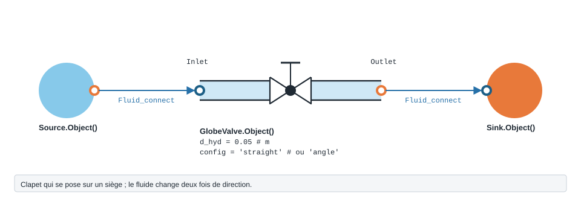

.. _globe_valve:

Vanne à soupape
===============

   Forme, ports et raccordement de ``GlobeValve`` ; paramètres sous leur
   nom de code, avec leur valeur par défaut.

À quoi ça sert
--------------

``GlobeValve`` donne la perte de charge d'un robinet à soupape (globe), d'arrêt
ou de régulation, droit (``config = "straight"``) ou d'angle
(``config = "angle"``), avec deux jeux de coefficients :

* ``source = "legacy"`` (défaut) — forme 2K avec des coefficients internes et
  une loi d'ouverture exponentielle ;
* ``source = "crane"`` — Crane TP-410 (p. A-28) : ``K = n f_T``, à **pleine
  ouverture** (familles ``globe_z`` et ``globe_y`` de :doc:`methodes_2k_3k`).

Exemple : robinet à soupape DN50 ouvert, 10 m³/h d'eau
------------------------------------------------------

.. code-block:: python

    from ThermodynamicCycles.Source import Source
    from ThermodynamicCycles.Connect import Fluid_connect
    from ThermodynamicCycles.Hydraulic import GlobeValve

    def source(debit_m3h=10.0):
        s = Source.Object()
        s.fluid, s.Ti_degC, s.Pi_bar = "water", 20, 3.0
        s.F_m3h = debit_m3h
        s.calculate()
        return s

    def soupape(ouverture_pct=100, source_coeff="legacy", config="straight"):
        v = GlobeValve.Object()
        v.d_hyd, v.D_in_pouces = 0.0525, 2.0      # DN50 (2"), diamètre intérieur Sch40
        v.source, v.config = source_coeff, config
        Fluid_connect(v.Inlet, source().Outlet)    # raccorder AVANT set_opening
        v.set_opening(ouverture_pct)
        return v

    for src in ["legacy", "crane"]:
        for cfg in ["straight", "angle"]:
            v = soupape(100, src, cfg)
            print(f"{src:6s} {cfg:8s}: zeta {v.zeta:.3f}, dP {v.delta_P:.0f} Pa")

Sortie réelle :

.. code-block:: text

   legacy straight: zeta 3.600, dP 2959 Pa
   legacy angle   : zeta 4.200, dP 3452 Pa
   crane  straight: zeta 6.460, dP 5309 Pa
   crane  angle   : zeta 1.045, dP 859 Pa

Pour le robinet droit, Crane donne près de deux fois le coefficient ``legacy``.
Pour la configuration d'angle, les deux sources ne vont **même pas dans le même
sens** : voir les pièges.

Fiche du modèle
---------------

* **Ports** : ``Inlet``, ``Outlet`` (voir :doc:`../ports_connexions`).
* **Nœud de l'IHM** : « Vanne Globe (arrêt/régulation) ».
* **Exceptions levées par le code** : ``ValueError``.

.. list-table::
   :header-rows: 1
   :widths: 26 26 48

   * - Entrée
     - Défaut
     - Commentaire du code
   * - ``d_hyd``
     - ``0.05``
     - Diamètre hydraulique (m)
   * - ``D_in_pouces``
     - ``2.0``
     - Diamètre nominal (pouces)
   * - ``config``
     - ``'straight'``
     - 'straight' ou 'angle'
   * - ``source``
     - ``'legacy'``
     - —
   * - ``coeff_base``
     - ``(table interne)``
     - —
   * - ``K1``
     - ``None``
     - Coefficient laminaire
   * - ``K_inf``
     - ``None``
     - Coefficient turbulent

Lignes du ``df`` de sortie : ``fluid``, ``Config``, ``Ouverture (%)``, ``V (m/s)``, ``Re``, ``ζ (-)``, ``ΔP (Pa)``, ``P_in (Pa)``, ``P_out (Pa)``.

Paramètres à personnaliser
--------------------------

.. list-table::
   :header-rows: 1
   :widths: 24 30 46

   * - Grandeur
     - Valeur à saisir
     - Effet sur le résultat
   * - ``source``
     - ``"crane"`` (sourcé, pleine ouverture) ou ``"legacy"`` (défaut)
     - Facteur 1,8 sur le robinet droit ouvert.
   * - ``config``
     - ``"straight"`` ou ``"angle"`` (exactement)
     - Change la famille de coefficients (voir les pièges pour ``"angle"``).
   * - ``set_opening(pourcentage)``
     - ouverture de 0 à 100 %, après le raccordement
     - Mode ``legacy`` : facteur ``exp(3 (1 − ouverture))`` ; ignoré en mode
       ``crane``.
   * - ``d_hyd``, ``D_in_pouces``
     - diamètre intérieur (m) et taille nominale (pouces), cohérents
     - Vitesse et ``f_T`` de Crane.

Variante exécutée : ouverture partielle
---------------------------------------

.. code-block:: python

    # variante : ouverture partielle (à la suite)
    print("ouverture   zeta legacy   dP legacy (Pa)   zeta crane")
    for pct in [100, 75, 50, 25, 10, 0]:
        l, c = soupape(pct, "legacy"), soupape(pct, "crane")
        print(f"  {pct:3d} %     {l.zeta:9.3f}   {l.delta_P:12.0f}     {c.zeta:7.3f}")

Sortie réelle :

.. code-block:: text

   ouverture   zeta legacy   dP legacy (Pa)   zeta crane
     100 %         3.600           2959       6.460
      75 %         7.621           6264       6.460
      50 %        16.134          13260       6.460
      25 %        34.156          28072       6.460
      10 %        53.567          44026       6.460
       0 %       360.003         295879       6.460

Lecture : contrairement à la vanne à boule et à la vanne papillon, la loi
d'ouverture ``legacy`` est ici **monotone** : la perte croît jusqu'à la
fermeture. Mais la vanne fermée reste **passante** (ζ = 360, 296 kPa) et la
loi ``exp(3 (1 − ouverture))`` n'a pas de source citée ; le mode ``crane``
ignore l'ouverture. Pour une vanne de régulation, préférez un modèle à Kv
(:doc:`valve_3_voies`, :doc:`dimensionnement_vannes`).

Cas limites refusés
-------------------

.. code-block:: python

    # à la suite : saisies refusées
    for nom, kw in [("source inconnue", dict(source_coeff="idelchik")),
                    ("config inconnue (crane)", dict(source_coeff="crane", config="trois_voies"))]:
        try:
            soupape(100, **kw)
        except ValueError as erreur:
            print(f"{nom:24s} refusé : {str(erreur)[:75]}")

Sortie réelle :

.. code-block:: text

   source inconnue          refusé : source 'idelchik' inconnue ; attendu 'legacy' ou 'crane'
   config inconnue (crane)  refusé : variante 'trois_voies' sans equivalent tabule par Crane TP-410 ; familles c

Pièges
------

.. code-block:: python

    # à la suite : ce qui passe sans message
    v = soupape(100, "legacy", "trois_voies")    # config inconnue en mode legacy
    print(f"config 'trois_voies' (legacy) : zeta {v.zeta:.3f} (comme 'straight')")
    v = soupape(0, "legacy")
    print(f"vanne fermée (legacy) : débit {v.Inlet.F:.2f} kg/s, dP {v.delta_P / 1000:.0f} kPa")

Sortie réelle :

.. code-block:: text

   config 'trois_voies' (legacy) : zeta 3.600 (comme 'straight')
   vanne fermée (legacy) : débit 2.77 kg/s, dP 296 kPa

* **La configuration « angle » n'a pas le même sens dans les deux modes.** En
  mode ``legacy``, elle est plus résistante que le robinet droit (4,2 contre
  3,6) ; en mode ``crane``, le code la relie à la famille ``globe_y``, que la
  bibliothèque décrit comme le robinet à soupape **incliné en Y**, et elle
  devient six fois moins résistante (1,045 contre 6,46). Un robinet d'angle
  n'est pas un robinet en Y : vérifiez la famille Crane de votre robinet
  (``crane_valves.citation``) avant de l'utiliser. Écart consigné dans
  ``BUGS_LIB.md``.
* **Une configuration inconnue** retombe sur ``"straight"`` en mode ``legacy``
  sans message ; seul le mode ``crane`` la refuse.
* **Une vanne fermée laisse passer le débit** : le modèle n'arrête jamais
  l'écoulement.
* **set_opening** est à appeler après ``Fluid_connect``.

Voir :doc:`index` pour la liste de tous les modèles hydrauliques.
