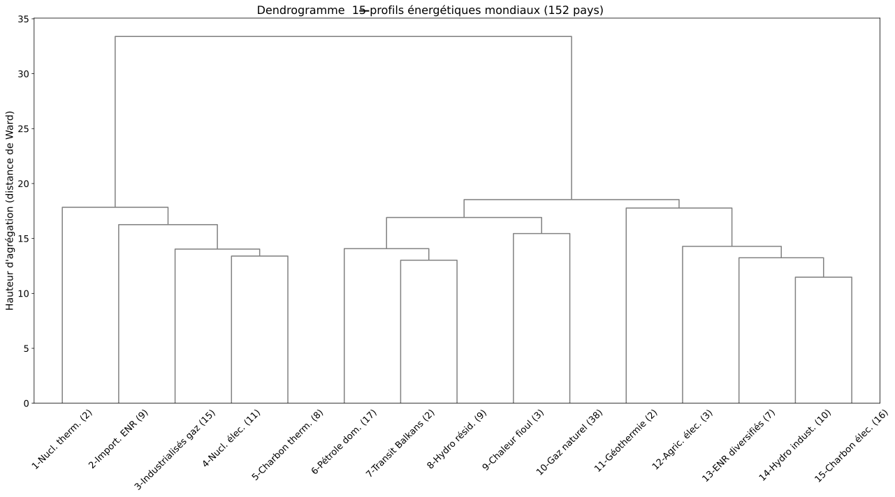

.. _profils-energetiques:

Profils énergétiques des pays
=============================

Cette page complète le chapitre 1 du *Manuel d'ingénierie énergétique* : elle
publie la classification complète dont le livre ne garde que la synthèse. Le mix
d'un pays fixe le contenu carbone du kWh et donc la rentabilité des solutions
d'électrification, de récupération de chaleur ou de diversification.

Construire un profil
--------------------

Les volumes nationaux ne sont pas comparables : la Chine produit 168 320 PJ, le Sénégal 290 PJ, soit un rapport de 1 à 580. Le profil d'un pays exprime donc chaque flux en **part relative** du total national. La France et l'Algérie, très différentes en volume, le sont aussi en structure :

- **France** [IEA_WEB_2019, p. II.77--II.79] : nucléaire 44%, pétrole 29%, gaz 15%, biocarburants 7%, charbon 4%. Électricité 72% nucléaire. Autosuffisance 55%.

- **Algérie** [IEA_WEB_2019, p. II.188--II.189] : gaz naturel 65%, pétrole 33%. Électricité quasi 100% gaz. Exportations = 2× la consommation.

C'est cette **structure relative** qui fixe les solutions pertinentes et leur **rentabilité**. Une pompe à chaleur électrique est très performante en France (électricité décarbonée à 92%, coût marginal bas). Elle est peu pertinente en Pologne (électricité 70% charbon), où passer au gaz naturel évite davantage de CO₂ par euro investi. De même, récupérer de la chaleur fatale n'a de sens que là où existe déjà un réseau de chaleur. Quatre dimensions structurent le profil :

- **les sources de l'électricité et de la chaleur** : elles fixent le contenu carbone du kWh, donc la rentabilité de l'électrification ;

- **la répartition sectorielle** de la consommation finale : elle oriente les priorités (isolation, mobilité ou procédés industriels) ;

- **la dépendance aux importations** (imports/supply) : elle mesure la vulnérabilité aux prix internationaux et l'intérêt des ENR locales ;

- **la chaleur de réseau** (cogénération, chaufferies urbaines) : elle ouvre ou ferme l'accès à la récupération de chaleur fatale.

Exprimés en pourcentages, ces indicateurs forment un **vecteur de 24 variables** par pays. Une classification non supervisée regroupe alors les pays aux profils voisins en **familles de stratégies énergétiques**.

Méthodologie de classification
------------------------------

Une analyse statistique multivariée (ACP suivie d'une classification ascendante hiérarchique, méthode de Ward) portant sur **152 pays** (plus 11 agrégats régionaux en individus supplémentaires) et **24 variables** énergétiques actives (données IEA *World Energy Balances* 2023, en %) a permis d'identifier **15 profils énergétiques** distincts. La qualité statistique de la partition est satisfaisante (R² = 62,2%, silhouette = 0,212, Davies-Bouldin = 1,241, 22/24 variables significatives au test de Fisher).

Le choix de k = 15 classes résulte d'une analyse comparative : au-delà de 15, le gain marginal en $R^2$ chute sous 1,6%/classe. Par rapport à k = 9, la partition à 15 classes résout le problème des « classes fourre-tout » (32, 37 et 35 pays) en les subdivisant en sous-profils interprétables de taille comparable (2 à 17 pays).

   Dendrogramme tronqué (CAH, méthode de Ward) des 15 profils parmi 152 pays.
   Les classes fusionnées tardivement (hauteur élevée) sont les plus différentes.

Les 15 profils
--------------

.. list-table:: Les 15 profils énergétiques mondiaux (ACP + CAH, 152 pays, données IEA 2023, R² = 62,2 %)
   :header-rows: 1
   :widths: 5 18 5 6 26 40

   * - Cl.
     - Profil
     - N
     - Sil.
     - Règle de classification
     - Pays
   * - 
     - **Profils avec production de chaleur (5 classes, 39 pays)**
     - 
     - 
     - 
     - 
   * - 1
     - Nucléaire thermique
     - 2
     - 0,56
     - Chaleur nucléaire > 2%
     - Suisse, Slovaquie
   * - 3
     - Industrialisés gaz
     - 15
     - 0,25
     - Chaleur industrie > 40% au gaz
     - Japon, Belgique, Italie, Allemagne, Brésil, Pays-Bas, Corée du Sud, Nlle-Zélande, Portugal, Royaume-Uni, Ouzbékistan, États-Unis, Turquie, Biélorussie, Canada
   * - 4
     - Nucléaire électrique
     - 11
     - 0,17
     - Élec. nucléaire > 55%
     - France, Ukraine, Finlande, Hongrie, Rép. tchèque, Bulgarie, Roumanie, Slovénie, Suède, Kosovo, Russie
   * - 5
     - Charbon thermique
     - 8
     - 0,01
     - Chaleur charbon > 70%
     - Grèce, Chine, Kazakhstan, Serbie, Pologne, Mongolie, Bosnie-Herzégovine, Taïwan
   * - 9
     - Chaleur au fioul
     - 3
     - 0,29
     - Chaleur pétrole > 40%
     - Honduras, Jamaïque, Moldavie
   * - 
     - **Profils sans production de chaleur (6 classes, 97 pays)**
     - 
     - 
     - 
     - 
   * - 6
     - Pétrole dominant
     - 17
     - 0,27
     - Élec. pétrole > 70%, pas de chaleur
     - Niger, Angola, Chypre, Équateur, Érythrée, Irak, Cuba, Syrie, Yémen, Madagascar, Tchad, Burkina Faso, Haïti, Suriname, Curaçao, Soudan du Sud, Liban
   * - 8
     - Hydro résidentiel
     - 9
     - 0,23
     - Hydro > 80%, résidentiel > 50%
     - Soudan, Népal, Paraguay, Tadjikistan, Colombie, Éthiopie, Kirghizistan, Venezuela, Albanie
   * - 10
     - Gaz naturel
     - 38
     - 0,22
     - Élec. gaz > 60%, pas de chaleur
     - Trinité-et-Tobago, Espagne, Mexique, Tanzanie, Congo, Côte d'Ivoire, Bénin, Bolivie, Argentine, Bahreïn, Émirats arabes unis, Arménie, Géorgie, Oman, Nigeria, Myanmar, Panama, Libye, Tunisie, Togo, Azerbaïdjan, Pakistan, Arabie Saoudite, Qatar, Brunei, Guinée équatoriale, Bangladesh, Algérie, Israël, Égypte, Gabon, Ghana, Iran, Irlande, Koweït, Jordanie, Singapour, Rwanda
   * - 13
     - Renouvelables diversifiés
     - 7
     - 0,11
     - Biocarburants > 15% + ENR > 40%
     - Uruguay, Kenya, Costa Rica, Guatemala, Thaïlande, El Salvador, Nicaragua
   * - 14
     - Hydro industriel
     - 10
     - 0,16
     - Hydro > 50%, industrie > 60%
     - Zambie, Cameroun, RD Congo, Pérou, Namibie, Eswatini, Ouganda, Corée du Nord, Lao, Mozambique
   * - 15
     - Charbon électrique
     - 16
     - 0,21
     - Élec. charbon > 50%, pas de chaleur
     - Australie, Rép. dominicaine, Chili, Botswana, Cambodge, Indonésie, Inde, Afrique du Sud, Vietnam, Zimbabwe, Sri Lanka, Maroc, Maurice, Malaisie, Philippines, Hong Kong
   * - 
     - **Profils spécifiques (4 classes, 16 pays)**
     - 
     - 
     - 
     - 
   * - 2
     - Importateurs ENR europ.
     - 9
     - 0,11
     - Imports élec. > 50% + chaleur renouvelable
     - Autriche, Danemark, Luxembourg, Lituanie, Croatie, Estonie, Malte, Norvège, Lettonie
   * - 7
     - Transit Balkans
     - 2
     - 0,54
     - Import + Export > 100% du supply
     - Macédoine du Nord, Monténégro
   * - 11
     - Géothermie
     - 2
     - 0,22
     - Chaleur géothermique = 100%
     - Islande, Sénégal
   * - 12
     - Agriculture électrique
     - 3
     - 0,36
     - Conso. agricole > 20%
     - Mali, Turkménistan, Mauritanie

Signature et cas frontières de chaque profil
--------------------------------------------

Chaque classe se lit par sa variable signature : part dans la classe contre moyenne mondiale, avec la valeur-test (v.test). Les pays de silhouette proche de zéro ou négative sont à la frontière d'une autre classe.

**Profils avec production de chaleur.**

**Classe 1** : chaleur nucléaire 2,4% contre 0,04% (v.test = 11,7) et électricité nucléaire 75,4% contre 8,9%. La Suisse complète avec l'hydraulique (nucléaire 64%, hydro 32%), la Slovaquie est quasi exclusivement nucléaire (87%).

**Classe 3** : chaleur industrielle au gaz 61,5% contre 18,6% (v.test = 5,4), classe des grandes économies : États-Unis (gaz 37%, nucléaire 28%), Japon (charbon 36%, gaz 31%), Allemagne (charbon 47%, renouvelables 31%), Corée du Sud (nucléaire 40%, charbon 39%). Le Brésil (hydro 60%) y figure pour sa chaleur industrielle, pas pour son mix électrique.

**Classe 4** : électricité nucléaire 68% contre 8,9% (v.test = 9,1). La France mène (84%), devant la Finlande (77%), la Suède (59%) et la Rép. tchèque (56%). Cas frontières : Ukraine (sil. 0,01 ; nucléaire 65% + charbon 27%), Roumanie (0,03 ; nucléaire 36%) et Kosovo (0,06 ; données atypiques).

**Classe 5** : charbon 73,9% de la chaleur contre 8,3% (v.test = 9,0), portée par la Chine (charbon 64% de l'électricité, chaleur 33 201 PJ) et la Pologne (chaleur au charbon, 1 298 PJ). Cas frontières, rattachés par leur chaleur au charbon et non par leur électricité : Taïwan (−0,10 ; gaz 43% + charbon 41%), Kazakhstan (−0,08 ; gaz 73%), Grèce (−0,04 ; gaz 40%), Serbie (−0,02 ; charbon 81%).

**Classe 9** : chaleur au pétrole 46,9% contre 2,2% (v.test = 10,6). Elle réunit trois mix électriques sans rapport : Honduras (pétrole 52%), Jamaïque (gaz 59%), Moldavie (gaz 95%).

**Profils sans production de chaleur.**

**Classe 6** : pétrole 76% de l'électricité contre 14,4% (v.test = 9,7), classe homogène (Tchad 100%, Soudan du Sud 99%, Érythrée 97%, Haïti 91%). Cas frontières avec la classe 8 : Angola (0,05 ; hydro 46% + pétrole 39%) et Équateur (0,06 ; hydro 49% + pétrole 43%).

**Classe 8** : hydraulique 85,3% contre 20,1% (v.test = 7,0) et consommation résidentielle (54% contre 36,5%), signe d'un faible développement industriel. Cas purs : Kirghizistan et Tadjikistan (100%), Paraguay (99%), Albanie (97%), Éthiopie (96%). Cas frontière : Colombie (0,04 ; hydro 42% + gaz 24% + charbon 20%).

**Classe 10** : gaz 69,6% contre 26,7% (v.test = 8,1), la plus grande classe. Elle va du quasi pur (Trinité, Qatar, Bahreïn : gaz > 99%) au mixte (Pakistan : gaz 25% + nucléaire 25% + charbon 19%). Cas frontières : Rwanda (0,01 ; gaz 32% + charbon 30% + hydro 26%), Géorgie (0,05 ; hydro 59% + gaz 41%), Gabon (0,05 ; gaz 52% + hydro 22%). L'Espagne (0,12 ; nucléaire 37%) est l'un des rares pays de l'OCDE de la classe.

**Classe 13** : biocarburants 19,0% de l'électricité contre 2,7% (v.test = 6,9) et renouvelables 43,4% contre 10,8% (v.test = 4,6). Les stratégies diffèrent : Kenya (renouvelables 89%, surtout géothermie), Guatemala (biomasse 53%), Uruguay (renouvelables 41% + hydro 27%), Costa Rica (59% + 34%). La Thaïlande (0,07 ; gaz 51%) y entre par ses 27% de biocarburants.

**Classe 14** : hydraulique 61,4% contre 20,1% (v.test = 4,7), mais c'est l'industrie qui la distingue de la classe 8 : 63,2% de l'électricité contre 35,6% (v.test = 5,6). Hydro et industries minières : RD Congo (92%), Mozambique (65%, aluminium), Zambie (64%, cuivre), Lao (hydro 49% + charbon 51%). Le Pérou (−0,06 ; gaz 61%) y entre par sa part industrielle.

**Classe 15** : charbon 63,3% de l'électricité contre 16,4% (v.test = 7,4), *sans* chaleur associée, contrairement à la classe 5. Inde (85%, 7 046 PJ) et Afrique du Sud (88%) sont les plus concentrés, devant le Vietnam (67%), l'Australie (65%), les Philippines (59%) et l'Indonésie (53%). Cas frontières avec la classe 10 : Chili (0,01 ; gaz 28% + charbon 25% + renouvelables 24%) et Hong Kong (0,01 ; gaz 49% + charbon 48%).

**Profils spécifiques.**

**Classe 2** : petits pays européens interconnectés, importateurs d'électricité, à chaleur renouvelable. Piliers : Danemark (renouvelables 100%, sil. 0,24) et Norvège (hydro 90%). Cas frontières : Croatie (−0,09 ; hydro 55% + charbon 22%) et Estonie (0,00 ; charbon 67%).

**Classe 7** : pays de transit électrique des Balkans, imports et exports supérieurs à 100% de leur consommation. Macédoine du Nord : charbon 69%, imports 146% du supply. Monténégro : charbon 63%, hydro 32%.

**Classe 11** : 100% de la chaleur est géothermique, contre 1,8% en moyenne (v.test = 12,0). L'Islande (hydro 66%, géothermie 34%) et le Sénégal (pétrole 86%) n'ont aucun mix électrique en commun : ici, la variable thermique prime sur la variable électrique.

**Classe 12** : part agricole de l'électricité 23,2% contre 3,1% (v.test = 7,4), dominée par le Turkménistan (irrigation intensive, chaleur 410 530 TJ). Le Mali et la Mauritanie ont des données identiques (problème possible de source API), mais un profil agricole cohérent avec leur économie sahélienne.
