.. _interface_scenes:

Scènes d'exemple
================

.. Page GÉNÉRÉE par tools/scenes_exemple.py — ne pas éditer à la main.

La bibliothèque livre **49 scènes** prêtes à ouvrir dans ``PyqtSimulator`` :
des cycles, des machines frigorifiques, des réseaux hydrauliques et quelques
chaînes de composants. Elles sont installées avec ``pip install
energysystemmodels`` et se trouvent dans le menu **File > Exemples**, rangées en
quatre dossiers. C'est le moyen le plus rapide de voir un modèle travailler sans
écrire une ligne de Python — et un bon point de départ pour son propre schéma.

Chaque fiche ci-dessous a été produite le 2026-11-24 en ouvrant la scène
**comme le fait l'IHM**, puis en cliquant sur **Simuler** : l'export de la scène, les nœuds qu'elle emploie et les
valeurs que ses nœuds affichent sont relevés, pas recopiés. Quand une scène ne
calcule pas ce qu'elle annonce, la fiche le dit.

Ouvrir et lancer une scène
--------------------------

1. Lancer l'interface : ``python -m PyqtSimulator`` (voir :doc:`../gui_tools`).
2. Menu **File > Exemples**, puis le dossier et la scène : le sous-menu reproduit
   l'arborescence ``PyqtSimulator/json/``.
3. **La scène s'ouvre sans calcul** (depuis le 16/11/2026, comme dans ProSim
   Plus) : cliquer sur **Simuler** (F5). Le moteur est choisi par la scène : un
   réseau hydraulique que le solveur nodal sait traduire est résolu par lui ;
   toute autre scène, ou partie de scène, passe par le moteur historique.
4. Après une modification, cliquer de nouveau sur **Simuler**.
5. **Double-cliquer sur un nœud** ouvre sa fenêtre : onglet *Résultats* (ce que le
   nœud a calculé) et onglet *Configuration* (ses réglages).

La barre d'outils affiche un statut après chaque calcul. « Convergé » veut dire que
le point fixe a été **constaté** ; le moteur historique, qui fait une passe unique,
affiche honnêtement « convergence non mesurée » : ses résultats ne sont pas faux
pour autant, mais rien ne les a recoupés.

La simulation dans le temps (niveau d'une bâche, régulation PID) et le coup de
bélier ont leurs propres boutons ; ils sont décrits dans
:doc:`../013-simulation-temporelle/index`.

Ce qu'il faut savoir avant d'exploiter une scène
------------------------------------------------

Relevé en ouvrant les scènes, et consigné dans le suivi des défauts de la
bibliothèque :

- **Le moteur historique ne résout pas une boucle fermée** : sans nœud *Sortie* ni
  *Capteur*, il n'a pas de point de départ, et une boucle sans coupure ne se calcule
  pas. « Absorption a simple effet » ne calcule donc rien ; « Machine frigorifique
  bi-etagee » ouvre sa boucle HP par une **source de coupure** dont les valeurs ont été
  convergées à la main.
- Le nœud *Source* lit l'unité de débit « m³/h » écrite avec exposant comme « m3/h »
  et **refuse** une unité inconnue (le nœud passe en erreur) au lieu de la prendre,
  sans le dire, pour des kg/s (corrigé le 28/09/2026).
- **Sur une scène résolue par le solveur nodal, le nœud Source continue d'afficher
  15 °C et 1,013 bar**, ses valeurs de construction : lire la température et la
  pression réelles sur un capteur. Les tableaux ci-dessous omettent donc ces sources.
- Un **titre de nœud** est un libellé saisi (« Pompe à courbe — point réseau
  25,87 m³/h ») : il ne suit pas le calcul.

Cycles thermodynamiques
-----------------------

Brayton - turbine a gaz
~~~~~~~~~~~~~~~~~~~~~~~

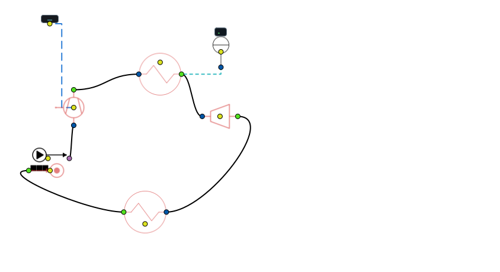

   Export SVG de la scène livrée, par le chemin de l'action « Exporter la scène en
   SVG… » de l'IHM.

**Ce qu'elle montre.** Le cycle de Joule-Brayton d'une turbine à gaz, sous sa forme la plus simple : 1 kg/s d'air à 25 °C et 1 bar est comprimé à 16 bar (rendement 0,85), chauffé à 1065 °C (la combustion est représentée par un réchauffeur), détendu à 1 bar dans la turbine, puis ramené à 25 °C pour fermer le cycle.

**Nœuds employés** (8 nœuds, 7 liaisons) : Heater_Cooler ×2, Source, Compresseur, Turbine, Sortie, Afficheur multi-signaux, Capteur.

**Ouvrir.** Menu **File > Exemples > 1 - Cycles thermodynamiques > Brayton - turbine a gaz**, puis bouton **Simuler** (la scène s'ouvre sans calcul). Elle est calculée par le moteur historique (une passe, de l'amont vers les sorties) ; statut affiché : **convergé** (point fixe constaté).

**Ce qu'on observe.** Le compresseur absorbe 424,8 kW, la source chaude apporte 719,8 kW, la turbine rend 655,1 kW et le refroidisseur rejette 489,4 kW. Le travail net vaut 230,4 kW, soit un **rendement de cycle de 32,0 %** (travail net / chaleur apportée) ; le bilan se ferme : chaleur apportée − chaleur rejetée = 230,4 kW. C'est l'ordre de grandeur d'une turbine à gaz simple sans récupération.

Valeurs affichées par les nœuds après **Simuler** (relevé automatique) :

.. list-table::
   :header-rows: 1
   :widths: 26 16 58

   * - Nœud
     - Type
     - Valeurs affichées
   * - Air 25C 1bar
     - Source
     - Temp. effective (°C) = 25.000 ; Pression effective (bar) = 1.000
   * - Compresseur 16 bar
     - Compresseur
     - Q_comp(kW) = 424.772 ; Energie dissipée (kW) = 0.000 ; Temp. sortie sans refroid. (°C) = 435.45
   * - Combustion 1065C
     - Heater_Cooler
     - Qth(kW) = 719.761 ; Temp. sortie (°C) = 1065.00
   * - Turbine 1 bar
     - Turbine
     - Q_turb(kW) = 655.134 ; Temp. isentrop. (°C) = 388.09
   * - Refroidisseur -> 25C
     - Heater_Cooler
     - Qth(kW) = -489.399 ; Temp. sortie (°C) = 25.00
   * - Retour etat initial
     - Sortie
     - Température (°C) = 25.0 °C ; Pression (bar) = 1.000 bar ; Débit (kg/h) = 3600.000 kg/h
   * - Afficheur multi-signaux
     - Afficheur multi-signaux
     - Puissance de compression (W) : 424772.1 ; Température sortie sans refroidissement (K) : 708.6 ; Valeurs = 424772.1 ; 708.6 ; Source = Compresseur
   * - Capteur
     - Capteur
     - 1065.0 °C

Brayton helium - nucleaire
~~~~~~~~~~~~~~~~~~~~~~~~~~

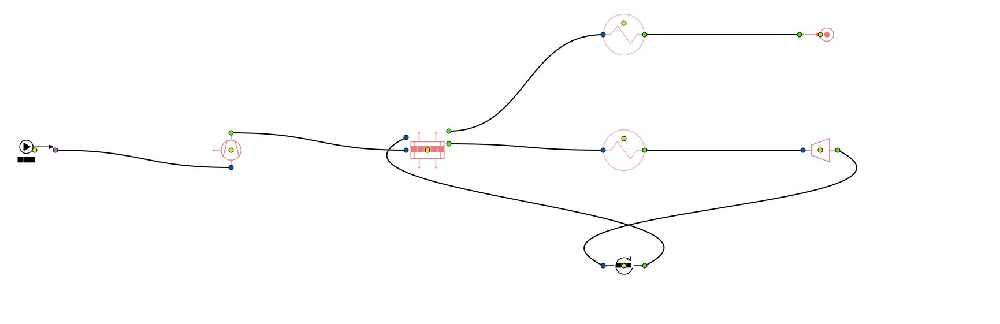

   Export SVG de la scène livrée, par le chemin de l'action « Exporter la scène en
   SVG… » de l'IHM.

**Ce qu'elle montre.** Le même cycle de Brayton, fermé, avec de l'hélium comme dans les réacteurs à haute température : 140 kg/s comprimés de 25 à 70 bar (rendement 0,7), réchauffés dans un régénérateur puis portés à 900 °C dans le cœur, détendus à 25 bar (rendement 0,7) puis refroidis à 28 °C (pré-refroidisseur) ; un nœud *Bouclage* ferme le cycle.

**Nœuds employés** (8 nœuds, 8 liaisons) : Heater_Cooler ×2, Source, Compresseur, Échangeur ε-NUT, Turbine, Bouclage (recyclage), Sortie.

**Ouvrir.** Menu **File > Exemples > 1 - Cycles thermodynamiques > Brayton helium - nucleaire**, puis bouton **Simuler** (la scène s'ouvre sans calcul). Elle est calculée par le moteur historique (une passe, de l'amont vers les sorties) ; statut affiché : **convergé** (point fixe constaté).

**Ce qu'on observe.** Le compresseur absorbe 129 002,8 kW, la source chaude apporte 280 512,3 kW, la turbine rend 257 389,4 kW et le refroidisseur rejette 152 125,7 kW. Le travail net vaut 128 386,5 kW, soit un **rendement de cycle de 45,8 %** (travail net / chaleur apportée) ; le bilan se ferme : chaleur apportée − chaleur rejetée = 128 386,5 kW. Le compresseur consomme 50,1 % du travail de la turbine : c'est le talon d'Achille des cycles à gaz, que les réacteurs à hélium compensent par un récupérateur, absent de cette scène.

Valeurs affichées par les nœuds après **Simuler** (relevé automatique) :

.. list-table::
   :header-rows: 1
   :widths: 26 16 58

   * - Nœud
     - Type
     - Valeurs affichées
   * - Helium 28C 25bar
     - Source
     - Temp. effective (°C) = 28.000 ; Pression effective (bar) = 25.000
   * - Compresseur 70 bar
     - Compresseur
     - Q_comp(kW) = 129002.816 ; Energie dissipée (kW) = 0.000 ; Temp. sortie sans refroid. (°C) = 202.67
   * - Regenerateur
     - Échangeur ε-NUT
     - Puissance (kW) = 226016.804 ; Efficacité ε (-) = 0.900 ; Efficacité sur les enthalpies (-) = 0.900
   * - Reacteur 900C
     - Heater_Cooler
     - Qth(kW) = 280512.276 ; Temp. sortie (°C) = 900.00
   * - Turbine
     - Turbine
     - Q_turb(kW) = 257389.355 ; Temp. isentrop. (°C) = 516.06
   * - Bouclage
     - Bouclage (recyclage)
     - Résidu relatif (-) = 0.00e+00 ; Itérations = 2 ; Statut = convergé
   * - Precooler -> 28C
     - Heater_Cooler
     - Qth(kW) = -152125.737 ; Temp. sortie (°C) = 28.00
   * - Retour etat initial
     - Sortie
     - Température (°C) = 28.0 °C ; Pression (bar) = 25.000 bar ; Débit (kg/h) = 504000.000 kg/h

CO2 supercritique
~~~~~~~~~~~~~~~~~

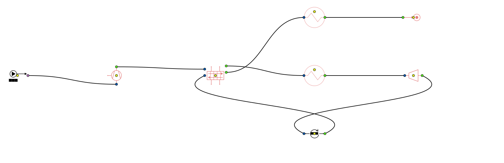

   Export SVG de la scène livrée, par le chemin de l'action « Exporter la scène en
   SVG… » de l'IHM.

**Ce qu'elle montre.** Un cycle de Brayton au CO₂ supercritique : 3000 kg/s de CO₂ pris à 32,5 °C et 77 bar, juste au-dessus du point critique, comprimés à 200 bar, réchauffés dans un régénérateur puis chauffés à 650 °C, détendus à 77 bar et refroidis ; un nœud *Bouclage* ferme le cycle.

**Nœuds employés** (8 nœuds, 8 liaisons) : Heater_Cooler ×2, Source, Compresseur, Echangeur discretise, Turbine, Bouclage (recyclage), Sortie.

**Ouvrir.** Menu **File > Exemples > 1 - Cycles thermodynamiques > CO2 supercritique**, puis bouton **Simuler** (la scène s'ouvre sans calcul). Elle est calculée par le moteur historique (une passe, de l'amont vers les sorties) ; statut affiché : **convergé** (point fixe constaté).

**Ce qu'on observe.** Le compresseur absorbe 64 276,8 kW, la source chaude apporte 1 070 514,1 kW, la turbine rend 425 145,7 kW et le refroidisseur rejette 709 645,2 kW. Le travail net vaut 360 868,9 kW, soit un **rendement de cycle de 33,7 %** (travail net / chaleur apportée) ; le bilan se ferme : chaleur apportée − chaleur rejetée = 360 868,9 kW. Le compresseur, qui travaille près du point critique (31 °C, 73,8 bar), ne prend que 15,1 % du travail de turbine — c'est l'intérêt du CO₂ supercritique. Le rendement reste faible parce que la scène n'a **pas de récupérateur** : la chaleur sortant de la turbine (encore à 528 °C environ) part au refroidisseur.

Valeurs affichées par les nœuds après **Simuler** (relevé automatique) :

.. list-table::
   :header-rows: 1
   :widths: 26 16 58

   * - Nœud
     - Type
     - Valeurs affichées
   * - CO2 32.5C 77bar
     - Source
     - Temp. effective (°C) = 32.500 ; Pression effective (bar) = 77.000
   * - Compresseur 200 bar
     - Compresseur
     - Q_comp(kW) = 64276.842 ; Energie dissipée (kW) = 0.000 ; Temp. sortie sans refroid. (°C) = 65.35
   * - Regenerateur
     - Echangeur discretise
     - Puissance (kW) = 1395639.997 ; T sortie canal 1 (C) = 361.42 ; T sortie canal 2 (C) = 124.61
   * - Reacteur 650C
     - Heater_Cooler
     - Qth(kW) = 1070514.050 ; Temp. sortie (°C) = 650.00
   * - Turbine 77 bar
     - Turbine
     - Q_turb(kW) = 425145.695 ; Temp. isentrop. (°C) = 514.69
   * - Bouclage
     - Bouclage (recyclage)
     - Résidu relatif (-) = 0.00e+00 ; Itérations = 2 ; Statut = convergé
   * - Refroidisseur -> 32.5C
     - Heater_Cooler
     - Qth(kW) = -709645.197 ; Temp. sortie (°C) = 32.50
   * - Retour etat initial
     - Sortie
     - Température (°C) = 32.5 °C ; Pression (bar) = 77.000 bar ; Débit (kg/h) = 10800000.000 kg/h

Geothermie
~~~~~~~~~~

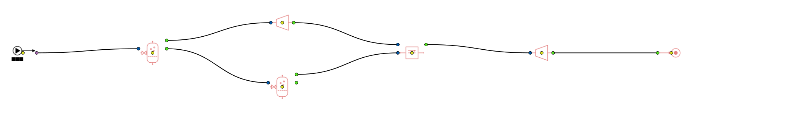

   Export SVG de la scène livrée, par le chemin de l'action « Exporter la scène en
   SVG… » de l'IHM.

**Ce qu'elle montre.** Une centrale géothermique à **double flash** : 760 kg/s d'eau de puits à 230 °C et 28 bar sont détendus dans un premier ballon à 6 bar ; la vapeur alimente une turbine HP, le liquide est de nouveau vaporisé à 0,931 bar ; les deux vapeurs sont mélangées et détendues dans une turbine BP jusqu'au condenseur à 0,123 bar.

**Nœuds employés** (7 nœuds, 7 liaisons) : Ballon de flash ×2, Turbine ×2, Source, Mélangeur fluides, Sortie.

**Ouvrir.** Menu **File > Exemples > 1 - Cycles thermodynamiques > Geothermie**, puis bouton **Simuler** (la scène s'ouvre sans calcul). Elle est calculée par le moteur historique (une passe, de l'amont vers les sorties) ; statut affiché : **convergé** (point fixe constaté).

**Ce qu'on observe.** Le premier flash à 6 bar vaporise 15,3 % de l'eau du puits (158,8 °C) ; le second, à 0,931 bar, en reprend 11,5 %. Les deux turbines produisent 31,3 MW (HP) et 47,1 MW (BP), soit **78,3 MW** pour 760 kg/s d'eau géothermale.

Valeurs affichées par les nœuds après **Simuler** (relevé automatique) :

.. list-table::
   :header-rows: 1
   :widths: 26 16 58

   * - Nœud
     - Type
     - Valeurs affichées
   * - Eau puits 230C
     - Source
     - Temp. effective (°C) = 230.000 ; Pression effective (bar) = 28.000
   * - Flash 1 (6 bar)
     - Ballon de flash
     - Fraction vapeur (-) = 0.153 ; T° flash (°C) = 158.83 ; Chaleur latente (kW) = 243057.847
   * - Turbine HP
     - Turbine
     - Q_turb(kW) = 31257.588 ; Temp. isentrop. (°C) = 97.62
   * - Flash 2 (0.931 bar)
     - Ballon de flash
     - Fraction vapeur (-) = 0.115 ; T° flash (°C) = 97.62 ; Chaleur latente (kW) = 168105.624
   * - Melange vapeurs
     - Mélangeur fluides
     - T° sortie (°C) = 97.62 ; Débit mélangé (kg/s) = 190.8269
   * - Turbine BP
     - Turbine
     - Q_turb(kW) = 47076.773 ; Temp. isentrop. (°C) = 49.92
   * - Condenseur
     - Sortie
     - Température (°C) = 49.9 °C ; Pression (bar) = 0.123 bar ; Débit (kg/h) = 686976.989 kg/h

Rankine - centrale a vapeur
~~~~~~~~~~~~~~~~~~~~~~~~~~~

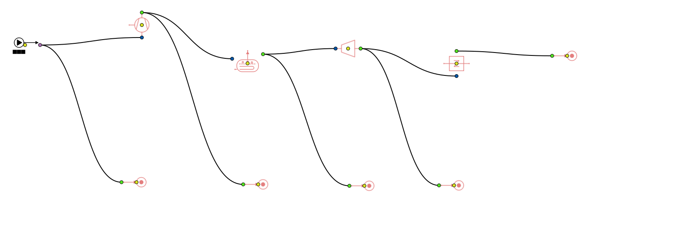

   Export SVG de la scène livrée, par le chemin de l'action « Exporter la scène en
   SVG… » de l'IHM.

**Ce qu'elle montre.** Un cycle de Rankine idéal à vapeur d'eau : 1 kg/s de condensat à 26 °C et 0,0356 bar, pompé à 128 bar (nœud compresseur, rendement 1), vaporisé et surchauffé de 117,4 K, détendu dans une turbine isentropique jusqu'à 0,0356 bar puis condensé, avec des nœuds *Sortie* branchés entre chaque organe pour lire l'état du fluide.

**Nœuds employés** (10 nœuds, 9 liaisons) : Sortie ×5, Evaporateur, Source, Compresseur, Turbine, Condenseur.

**Ouvrir.** Menu **File > Exemples > 1 - Cycles thermodynamiques > Rankine - centrale a vapeur**, puis bouton **Simuler** (la scène s'ouvre sans calcul). Elle est calculée par le moteur historique (une passe, de l'amont vers les sorties) ; statut affiché : **convergé** (point fixe constaté).

**Ce qu'on observe.** Pour 1 kg/s d'eau, la « compression » du condensat à 128 bar (rendement 1) demande 12,8 kW, l'évaporateur apporte 3 065,6 kW et sort la vapeur à 447 °C, la turbine isentropique rend 1 318,3 kW jusqu'à 0,0356 bar et le condenseur rejette 1 756,1 kW. **Rendement du cycle idéal : 42,6 %** (travail net / chaleur apportée). Les nœuds *Sortie* intercalés donnent l'état du fluide entre chaque organe. La scène était enregistrée dans l'ancien format (réglages en liste, que les nœuds ne relisaient pas) : elle a été réécrite le 28/09/2026, source réglée à 26 °C, sous la saturation (26,96 °C à 0,0356 bar), pour que la pompe reçoive bien du liquide.

Valeurs affichées par les nœuds après **Simuler** (relevé automatique) :

.. list-table::
   :header-rows: 1
   :widths: 26 16 58

   * - Nœud
     - Type
     - Valeurs affichées
   * - Output
     - Sortie
     - Température (°C) = 447.0 °C ; Pression (bar) = 128.000 bar ; Débit (kg/h) = 3600.000 kg/h
   * - Evaporateur
     - Evaporateur
     - Q_evap (kW) = 3065.615 ; Tevap(°C) = 329.65
   * - Source
     - Source
     - Temp. effective (°C) = 26.000 ; Pression effective (bar) = 0.036
   * - Compresseur
     - Compresseur
     - Q_comp(kW) = 12.802 ; Energie dissipée (kW) = 0.000 ; Temp. sortie sans refroid. (°C) = 26.25
   * - Output
     - Sortie
     - Température (°C) = 26.3 °C ; Pression (bar) = 128.000 bar ; Débit (kg/h) = 3600.000 kg/h
   * - Output
     - Sortie
     - Température (°C) = 26.0 °C ; Pression (bar) = 0.036 bar ; Débit (kg/h) = 3600.000 kg/h
   * - Turbine
     - Turbine
     - Q_turb(kW) = 1318.319 ; Temp. isentrop. (°C) = 26.96
   * - Condenseur
     - Condenseur
     - Q_cond (kW) = 1756.121 ; Tcond(°C) = 26.96
   * - Output
     - Sortie
     - Température (°C) = 27.0 °C ; Pression (bar) = 0.036 bar ; Débit (kg/h) = 3600.000 kg/h
   * - Output
     - Sortie
     - Température (°C) = 27.0 °C ; Pression (bar) = 0.036 bar ; Débit (kg/h) = 3600.000 kg/h

Rankine - cycle vapeur
~~~~~~~~~~~~~~~~~~~~~~

   Export SVG de la scène livrée, par le chemin de l'action « Exporter la scène en
   SVG… » de l'IHM.

**Ce qu'elle montre.** Le cycle de Rankine d'une centrale à vapeur, repris de Gicquel : 1 kg/s de condensat à 19 °C et 0,023 bar, pompe à 165 bar, chaudière à 560 °C, turbine (rendement 0,85) jusqu'à 0,023 bar, condenseur.

**Nœuds employés** (6 nœuds, 5 liaisons) : Source, Pompe, Heater_Cooler, Turbine, Condenseur, Sortie.

**Ouvrir.** Menu **File > Exemples > 1 - Cycles thermodynamiques > Rankine - cycle vapeur**, puis bouton **Simuler** (la scène s'ouvre sans calcul). Elle est calculée par le moteur historique (une passe, de l'amont vers les sorties) ; statut affiché : **convergé** (point fixe constaté).

**Ce qu'on observe.** Pour 1 kg/s de condensat pris à 19 °C sous 0,023 bar (la saturation est à 19,73 °C : c'est bien du liquide), la pompe demande 19,37 kW à l'arbre pour 1 684 m de hauteur, la chaudière apporte 3 362,9 kW, la turbine rend 1 327,7 kW et le condenseur rejette 2 051,5 kW. **Rendement du cycle : 38,9 %.** La pompe est réglée en « Débit imposé » : sur sa courbe par défaut (2 à 30 m³/h, 44 m au plus), elle ne pourrait pas refouler à cette pression. Scène corrigée le 28/09/2026 : la source était réglée au-dessus de la saturation et délivrait de la vapeur à la pompe.

Valeurs affichées par les nœuds après **Simuler** (relevé automatique) :

.. list-table::
   :header-rows: 1
   :widths: 26 16 58

   * - Nœud
     - Type
     - Valeurs affichées
   * - Eau condensat
     - Source
     - Temp. effective (°C) = 19.000 ; Pression effective (bar) = 0.023
   * - Pompe -> 165 bar
     - Pompe
     - Débit de fonctionnement (m³/h) = 3.606 ; Puissance à l'arbre (kW) = 19.369 ; Puissance électrique absorbée (kW) = - (rendement moteur ou variateur non renseigné)
   * - Chaudiere 560C
     - Heater_Cooler
     - Qth(kW) = 3362.943 ; Temp. sortie (°C) = 560.00
   * - Turbine 0.023 bar
     - Turbine
     - Q_turb(kW) = 1327.739 ; Temp. isentrop. (°C) = 19.73
   * - Condenseur
     - Condenseur
     - Q_cond (kW) = 2051.532 ; Tcond(°C) = 19.73
   * - Sortie
     - Sortie
     - Température (°C) = 19.7 °C ; Pression (bar) = 0.023 bar ; Débit (kg/h) = 3600.000 kg/h

Solaire a concentration (SEGS)
~~~~~~~~~~~~~~~~~~~~~~~~~~~~~~

   Export SVG de la scène livrée, par le chemin de l'action « Exporter la scène en
   SVG… » de l'IHM.

**Ce qu'elle montre.** Le cycle vapeur d'une centrale solaire à concentration de type SEGS : 1 kg/s de condensat à 41 °C sous 0,082 bar, pompe à 100 bar, « chaudière solaire » (champ de capteurs cylindro-paraboliques) à 371 °C, turbine, condenseur à 42 °C.

**Nœuds employés** (6 nœuds, 5 liaisons) : Source, Pompe, Heater_Cooler, Turbine, Condenseur, Sortie.

**Ouvrir.** Menu **File > Exemples > 1 - Cycles thermodynamiques > Solaire a concentration (SEGS)**, puis bouton **Simuler** (la scène s'ouvre sans calcul). Elle est calculée par le moteur historique (une passe, de l'amont vers les sorties) ; statut affiché : **convergé** (point fixe constaté).

**Ce qu'on observe.** Pour 1 kg/s de condensat pris à 41 °C sous 0,082 bar (la saturation est à 41,98 °C : c'est bien du liquide), la pompe demande 14,36 kW à l'arbre pour 1 027 m de hauteur, la chaudière apporte 2 816,3 kW, la turbine rend 937,2 kW et le condenseur rejette 1 889,4 kW. **Rendement du cycle : 32,8 %.** La pompe est réglée en « Débit imposé » : sur sa courbe par défaut (2 à 30 m³/h, 44 m au plus), elle ne pourrait pas refouler à cette pression. Scène corrigée le 28/09/2026 : la source était réglée au-dessus de la saturation et délivrait de la vapeur à la pompe.

Valeurs affichées par les nœuds après **Simuler** (relevé automatique) :

.. list-table::
   :header-rows: 1
   :widths: 26 16 58

   * - Nœud
     - Type
     - Valeurs affichées
   * - Condensat 42C
     - Source
     - Temp. effective (°C) = 41.000 ; Pression effective (bar) = 0.082
   * - Pompe -> 100 bar
     - Pompe
     - Débit de fonctionnement (m³/h) = 3.630 ; Puissance à l'arbre (kW) = 14.362 ; Puissance électrique absorbée (kW) = - (rendement moteur ou variateur non renseigné)
   * - Chaudiere solaire 371C
     - Heater_Cooler
     - Qth(kW) = 2816.329 ; Temp. sortie (°C) = 371.00
   * - Turbine
     - Turbine
     - Q_turb(kW) = 937.165 ; Temp. isentrop. (°C) = 41.98
   * - Condenseur 42C
     - Condenseur
     - Q_cond (kW) = 1889.439 ; Tcond(°C) = 41.98
   * - Sortie
     - Sortie
     - Température (°C) = 42.0 °C ; Pression (bar) = 0.082 bar ; Débit (kg/h) = 3600.000 kg/h

Turbine a gaz - modele detaille
~~~~~~~~~~~~~~~~~~~~~~~~~~~~~~~

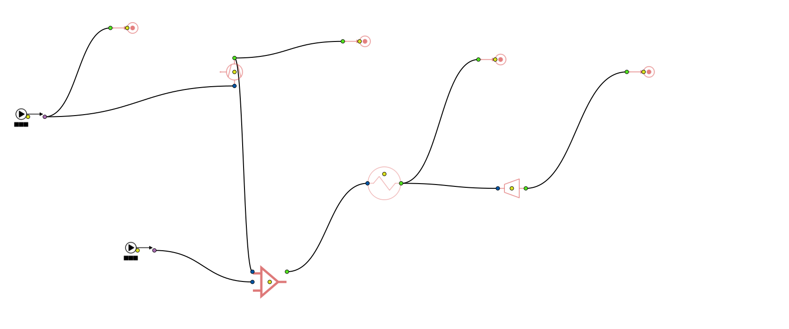

   Export SVG de la scène livrée, par le chemin de l'action « Exporter la scène en
   SVG… » de l'IHM.

**Ce qu'elle montre.** Une turbine à gaz détaillée : air comprimé, injection d'un débit de combustible par un mélangeur, chambre de combustion (réchauffeur à 1065 °C), turbine, avec des nœuds *Sortie* intermédiaires.

**Nœuds employés** (10 nœuds, 9 liaisons) : Sortie ×4, Source ×2, Compresseur, Heater_Cooler, Mélangeur, Turbine.

**Ouvrir.** Menu **File > Exemples > 1 - Cycles thermodynamiques > Turbine a gaz - modele detaille**, puis bouton **Simuler** (la scène s'ouvre sans calcul). Elle est calculée par le moteur historique (une passe, de l'amont vers les sorties) ; statut affiché : **convergé** (point fixe constaté).

**Ce qu'on observe.** 1 kg/s d'air à 15 °C est comprimé à 16 bar (410,8 kW, sortie à 413 °C) ; le mélangeur y ajoute 0,05 kg/s d'un second courant (le « combustible », représenté par de l'air à 20 bar) ; la chambre de combustion (un réchauffeur) apporte 801,7 kW pour atteindre 1065 °C, et la turbine rend 768,8 kW jusqu'à 1 bar. Travail net 358,0 kW, **rendement 44,7 %** — sans modèle de combustion : pour le bilan d'une vraie combustion, voir le nœud « Turbine à gaz ». Scène réécrite le 28/09/2026 depuis l'ancien format (réglages en liste, ignorés) ; la perte de charge de −4 bar du fichier d'origine, qui faisait **monter** la pression dans la chambre, a été ramenée à 0.

Valeurs affichées par les nœuds après **Simuler** (relevé automatique) :

.. list-table::
   :header-rows: 1
   :widths: 26 16 58

   * - Nœud
     - Type
     - Valeurs affichées
   * - Source
     - Source
     - Temp. effective (°C) = 15.000 ; Pression effective (bar) = 1.000
   * - Output
     - Sortie
     - Température (°C) = 15.0 °C ; Pression (bar) = 1.000 bar ; Débit (kg/h) = 3600.000 kg/h
   * - Compresseur
     - Compresseur
     - Q_comp(kW) = 410.810 ; Energie dissipée (kW) = 0.000 ; Temp. sortie sans refroid. (°C) = 413.15
   * - Output
     - Sortie
     - Température (°C) = 413.2 °C ; Pression (bar) = 16.000 bar ; Débit (kg/h) = 3600.000 kg/h
   * - Heater_Cooler
     - Heater_Cooler
     - Qth(kW) = 801.744 ; Temp. sortie (°C) = 1065.00
   * - Source
     - Source
     - Temp. effective (°C) = 15.000 ; Pression effective (bar) = 20.000
   * - Output
     - Sortie
     - Température (°C) = 1065.0 °C ; Pression (bar) = 16.000 bar ; Débit (kg/h) = 3780.000 kg/h
   * - Turbine
     - Turbine
     - Q_turb(kW) = 768.819 ; Temp. isentrop. (°C) = 388.09
   * - Output
     - Sortie
     - Température (°C) = 424.1 °C ; Pression (bar) = 1.000 bar ; Débit (kg/h) = 3780.000 kg/h

Turboreacteur
~~~~~~~~~~~~~

   Export SVG de la scène livrée, par le chemin de l'action « Exporter la scène en
   SVG… » de l'IHM.

**Ce qu'elle montre.** Un turboréacteur simple flux en altitude : 27,8 kg/s d'air à −50 °C et 0,265 bar, diffuseur d'entrée (effet dynamique), compresseur à 11,67 bar, combustion à 1318 °C, turbine qui entraîne le compresseur (détente à 2,4 bar), tuyère de poussée détendue jusqu'à la pression ambiante.

**Nœuds employés** (7 nœuds, 6 liaisons) : Source, Diffuseur, Compresseur, Heater_Cooler, Turbine, Tuyère, Sortie.

**Ouvrir.** Menu **File > Exemples > 1 - Cycles thermodynamiques > Turboreacteur**, puis bouton **Simuler** (la scène s'ouvre sans calcul). Elle est calculée par le moteur historique (une passe, de l'amont vers les sorties) ; statut affiché : **convergé** (point fixe constaté).

**Ce qu'on observe.** Le diffuseur relève la pression d'arrêt de 0,265 à 0,280 bar ; le compresseur absorbe 14,24 MW, la combustion apporte 28,02 MW et la turbine du générateur de gaz, détendue jusqu'à 2,4 bar, rend 14,24 MW : **elle entraîne le compresseur** (14,24 ≥ 14,24 MW). La tuyère détend le gaz jusqu'à la pression ambiante (0,265 bar) : **jet à 1 036 m/s** pour 27,8 kg/s, soit un débit de quantité de mouvement de 28,8 kN en sortie (la poussée nette en retranche le débit multiplié par la vitesse de vol, que la scène ne donne pas). La section de tuyère saisie s'écarte de -0,0027 % de la section requise par le débit (0,1997 m²).

Valeurs affichées par les nœuds après **Simuler** (relevé automatique) :

.. list-table::
   :header-rows: 1
   :widths: 26 16 58

   * - Nœud
     - Type
     - Valeurs affichées
   * - Air altitude
     - Source
     - Temp. effective (°C) = -50.000 ; Pression effective (bar) = 0.265
   * - Diffuseur (ram)
     - Diffuseur
     - Pression sortie (bar) = 0.2798 ; Enthalpie isentr. sortie (kJ/kg) = 352.81
   * - Compresseur
     - Compresseur
     - Q_comp(kW) = 14237.927 ; Energie dissipée (kW) = 0.000 ; Temp. sortie sans refroid. (°C) = 451.47
   * - Combustion 1318C
     - Heater_Cooler
     - Qth(kW) = 28024.125 ; Temp. sortie (°C) = 1318.34
   * - Turbine (gen. gaz)
     - Turbine
     - Q_turb(kW) = 14238.133 ; Temp. isentrop. (°C) = 813.34
   * - Tuyere (poussee)
     - Tuyère
     - Vitesse sortie (m/s) = 1035.94 ; Titre vapeur (-) = 1.000 ; Section requise par le débit amont (m²) = 0.199726
   * - Jet
     - Sortie
     - Température (°C) = 413.9 °C ; Pression (bar) = 0.265 bar ; Débit (kg/h) = 100080.000 kg/h

Froid et cryogénie
------------------

Absorption a simple effet
~~~~~~~~~~~~~~~~~~~~~~~~~

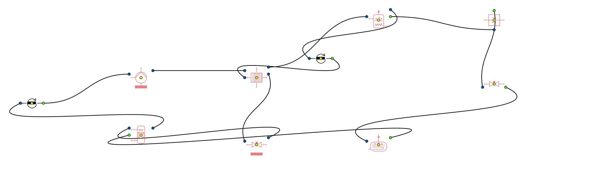

   Export SVG de la scène livrée, par le chemin de l'action « Exporter la scène en
   SVG… » de l'IHM.

**Ce qu'elle montre.** Une machine frigorifique à absorption LiBr-H₂O simple effet, assemblée organe par organe : absorbeur, pompe de solution, échangeur de solution, générateur, détendeur de solution ; condenseur, détendeur de réfrigérant, évaporateur.

**Nœuds employés** (10 nœuds, 12 liaisons) : Bouclage solution ×2, Absorbeur, Pompe de solution, Échangeur de solution (SHE), Générateur (désorbeur), Détendeur de solution, Condenseur, Détendeur, Evaporateur.

**Ouvrir.** Menu **File > Exemples > 2 - Froid et cryogenie > Absorption a simple effet**, puis bouton **Simuler** (la scène s'ouvre sans calcul). Elle est calculée par le moteur historique (une passe, de l'amont vers les sorties) ; statut affiché : **convergé** (point fixe constaté).

**Ce qu'on observe.** Les deux boucles fermées convergent (nœuds *Bouclage solution*, 4 itérations). L'évaporateur produit **17,60 kW** de froid à 4,96 °C pour 22,84 kW apportés au générateur : **COP = 0,77**. L'absorbeur rejette 21,65 kW, le condenseur 18,80 kW ; la pompe de solution ne demande que 0,26 W. Bilan de la machine : -0,002 kW (apports − rejets). La solution riche contient 44,32 % d'eau, la pauvre 35,28 %. Le modèle en Python : :doc:`../002-thermodynamic_cycles/froid_absorption`.

Valeurs affichées par les nœuds après **Simuler** (relevé automatique) :

.. list-table::
   :header-rows: 1
   :widths: 26 16 58

   * - Nœud
     - Type
     - Valeurs affichées
   * - Absorbeur
     - Absorbeur
     - Fraction réfrigérant riche (-) = 0.4432 ; Débit solution riche (kg/s) = 0.05332 ; Chaleur absorbeur (kW) = 21.653
   * - Bouclage solution
     - Bouclage solution
     - Résidu relatif (-) = 0.00e+00 ; Itérations = 4 ; Statut = convergé
   * - Bouclage solution pauvre
     - Bouclage solution
     - Résidu relatif (-) = 0.00e+00 ; Itérations = 4 ; Statut = convergé
   * - Pompe solution
     - Pompe de solution
     - Puissance (kW, majorant) = 0.00026 ; Échauffement (K) = 0.0024
   * - Échangeur de solution
     - Échangeur de solution (SHE)
     - T° riche préchauffée (°C) = 63.93 ; T° pauvre refroidie (°C) = 51.51 ; Chaleur échangée (kW) = 3.129
   * - Générateur
     - Générateur (désorbeur)
     - Fraction réfrigérant pauvre (-) = 0.3528 ; Débit réfrigérant (kg/s) = 0.00745 ; Chaleur générateur (kW) = 22.845
   * - Détendeur solution (V2)
     - Détendeur de solution
     - T° sortie (°C) = 51.51 ; Écart à l'équilibre aval (K) = -1.52
   * - Condenseur
     - Condenseur
     - Q_cond (kW) = 18.795 ; Tcond(°C) = 35.00
   * - Détendeur réfrigérant (V1)
     - Détendeur
     - Q_exp (kW) = 0.000 ; Tcond(°C) = 4.96
   * - Évaporateur
     - Evaporateur
     - Q_evap (kW) = 17.601 ; Tevap(°C) = 4.96

Cryogenie
~~~~~~~~~

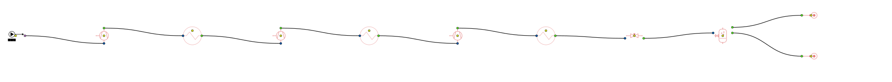

   Export SVG de la scène livrée, par le chemin de l'action « Exporter la scène en
   SVG… » de l'IHM.

**Ce qu'elle montre.** La liquéfaction du méthane par le procédé de Linde le plus simple : compression à 100 bar, refroidissement à 210 K (−63 °C), détente de Joule-Thomson à 1 bar, séparation du liquide et de la vapeur (qui serait recyclée).

**Nœuds employés** (11 nœuds, 10 liaisons) : Compresseur ×3, Heater_Cooler ×3, Sortie ×2, Source, Détendeur, Ballon de flash.

**Ouvrir.** Menu **File > Exemples > 2 - Froid et cryogenie > Cryogenie**, puis bouton **Simuler** (la scène s'ouvre sans calcul). Elle est calculée par le moteur historique (une passe, de l'amont vers les sorties) ; statut affiché : **convergé** (point fixe constaté).

**Ce qu'on observe.** Après compression à 100 bar (227,2 kW, rendement isentropique réglé à 1), refroidissement à −63 °C et détente de Joule-Thomson à 1 bar, le séparateur reçoit un mélange à 81,6 % de vapeur : **18,4 % du méthane est liquéfié** (661 kg/h à -161,6 °C). Rapporté au liquide produit, le compresseur dépense 0,34 kWh par kg de GNL — sans compter le froid externe du refroidisseur.

Valeurs affichées par les nœuds après **Simuler** (relevé automatique) :

.. list-table::
   :header-rows: 1
   :widths: 26 16 58

   * - Nœud
     - Type
     - Valeurs affichées
   * - Methane 280K 1bar
     - Source
     - Temp. effective (°C) = 6.850 ; Pression effective (bar) = 1.000
   * - Compression 5 bar
     - Compresseur
     - Q_comp(kW) = 281.478 ; Energie dissipée (kW) = 0.000 ; Temp. sortie sans refroid. (°C) = 127.62
   * - Refroid. 280K (1)
     - Heater_Cooler
     - Qth(kW) = -285.861 ; Temp. sortie (°C) = 6.85
   * - Compression 25 bar
     - Compresseur
     - Q_comp(kW) = 279.569 ; Energie dissipée (kW) = 0.000 ; Temp. sortie sans refroid. (°C) = 129.49
   * - Refroid. 280K (2)
     - Heater_Cooler
     - Qth(kW) = -302.051 ; Temp. sortie (°C) = 6.85
   * - Compression 100 bar
     - Compresseur
     - Q_comp(kW) = 227.248 ; Energie dissipée (kW) = 0.000 ; Temp. sortie sans refroid. (°C) = 116.70
   * - Refroid. 210K
     - Heater_Cooler
     - Qth(kW) = -653.531 ; Temp. sortie (°C) = -63.15
   * - Detente JT 1 bar
     - Détendeur
     - Q_exp (kW) = 0.000 ; Tcond(°C) = -161.64
   * - Separateur 1 bar
     - Ballon de flash
     - Fraction vapeur (-) = 0.816 ; T° flash (°C) = -161.64 ; Chaleur latente (kW) = 417.227
   * - Vapeur recyclee
     - Sortie
     - Température (°C) = -161.6 °C ; Pression (bar) = 1.000 bar ; Débit (kg/h) = 2938.681 kg/h
   * - Methane liquide
     - Sortie
     - Température (°C) = -161.6 °C ; Pression (bar) = 1.000 bar ; Débit (kg/h) = 661.319 kg/h

1 - Cycle mono-etage
~~~~~~~~~~~~~~~~~~~~

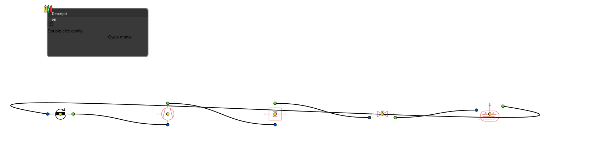

   Export SVG de la scène livrée, par le chemin de l'action « Exporter la scène en
   SVG… » de l'IHM.

**Ce qu'elle montre.** Le cycle frigorifique de référence du dossier : un étage de compression au R507A, évaporation à −35 °C, condensation à +40 °C, 100 kW de froid ; la boucle est fermée par un nœud *Bouclage* à l'aspiration.

**Nœuds employés** (6 nœuds, 5 liaisons) : Bouclage (recyclage), Compresseur, Condenseur, Détendeur, Evaporateur, Libelle.

**Ouvrir.** Menu **File > Exemples > 2 - Froid et cryogenie > Cycles frigorifiques > 1 - Cycle mono-etage**, puis bouton **Simuler** (la scène s'ouvre sans calcul). Elle est calculée par le moteur historique (une passe, de l'amont vers les sorties) ; statut affiché : **convergé** (point fixe constaté).

**Ce qu'on observe.** L'évaporateur absorbe **100,0 kW** de froid, les compresseurs absorbent 71,4 kW au total, le condenseur rejette 171,4 kW : **COP froid = 1,40**. Le bilan se ferme à 0,00 kW près (froid + travail − rejet). Le libellé de la scène annonce un COP de conception de 1,40. Les huit montages de ce dossier partagent la même puissance froide et, sauf la cascade, les mêmes températures (R507A, −35 / +40 °C) : comparer leurs COP, c'est comparer les montages.

Valeurs affichées par les nœuds après **Simuler** (relevé automatique) :

.. list-table::
   :header-rows: 1
   :widths: 26 16 58

   * - Nœud
     - Type
     - Valeurs affichées
   * - Bouclage - Aspiration
     - Bouclage (recyclage)
     - Résidu relatif (-) = 0.00e+00 ; Itérations = 1 ; Statut = convergé
   * - Compresseur
     - Compresseur
     - Q_comp(kW) = 71.403 ; Energie dissipée (kW) = 0.000 ; Temp. sortie sans refroid. (°C) = 67.55
   * - Condenseur
     - Condenseur
     - Q_cond (kW) = 171.403 ; Tcond(°C) = 40.00
   * - Detendeur BP
     - Détendeur
     - Q_exp (kW) = 0.000 ; Tcond(°C) = -35.00
   * - Evaporateur
     - Evaporateur
     - Q_evap (kW) = 100.000 ; Tevap(°C) = -35.00
   * - Description
     - Libelle
     - Texte = Cycle mono-etage R507A (-35 / +40 C) ; Point de conception : Q0 = 100.0 kW, W = 71.4 kW, COP = 1.40

2 - Bi-etage inj. partielle - desurchauffe par detendeur
~~~~~~~~~~~~~~~~~~~~~~~~~~~~~~~~~~~~~~~~~~~~~~~~~~~~~~~~

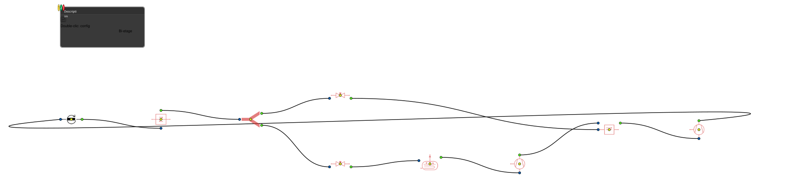

   Export SVG de la scène livrée, par le chemin de l'action « Exporter la scène en
   SVG… » de l'IHM.

**Ce qu'elle montre.** Deux étages de compression au R507A ; un piquage après le condenseur détend une part du liquide à la pression intermédiaire et l'injecte au refoulement BP pour le désurchauffer avant l'étage HP.

**Nœuds employés** (10 nœuds, 10 liaisons) : Détendeur ×2, Compresseur ×2, Bouclage (recyclage), Condenseur, Diviseur, Evaporateur, Mélangeur fluides, Libelle.

**Ouvrir.** Menu **File > Exemples > 2 - Froid et cryogenie > Cycles frigorifiques > 2 - Bi-etage inj. partielle - desurchauffe par detendeur**, puis bouton **Simuler** (la scène s'ouvre sans calcul). Elle est calculée par le moteur historique (une passe, de l'amont vers les sorties) ; statut affiché : **convergé** (point fixe constaté).

**Ce qu'on observe.** L'évaporateur absorbe **100,0 kW** de froid, les compresseurs absorbent 74,3 kW au total, le condenseur rejette 174,3 kW : **COP froid = 1,35**. Le bilan se ferme à 0,00 kW près (froid + travail − rejet). Le libellé de la scène annonce un COP de conception de 1,35. Les huit montages de ce dossier partagent la même puissance froide et, sauf la cascade, les mêmes températures (R507A, −35 / +40 °C) : comparer leurs COP, c'est comparer les montages.

Valeurs affichées par les nœuds après **Simuler** (relevé automatique) :

.. list-table::
   :header-rows: 1
   :widths: 26 16 58

   * - Nœud
     - Type
     - Valeurs affichées
   * - Bouclage - Refoulement HP
     - Bouclage (recyclage)
     - Résidu relatif (-) = 0.00e+00 ; Itérations = 2 ; Statut = convergé
   * - Condenseur
     - Condenseur
     - Q_cond (kW) = 174.341 ; Tcond(°C) = 40.00
   * - Piquage injection
     - Diviseur
     - Débit sortie 1 (kg/s) = 0.1351 ; Débit sortie 2 (kg/s) = 1.1053
   * - Detendeur de desurchauffe
     - Détendeur
     - Q_exp (kW) = 0.000 ; Tcond(°C) = -2.95
   * - Detendeur BP
     - Détendeur
     - Q_exp (kW) = 0.000 ; Tcond(°C) = -35.00
   * - Evaporateur
     - Evaporateur
     - Q_evap (kW) = 100.000 ; Tevap(°C) = -35.00
   * - Compresseur BP
     - Compresseur
     - Q_comp(kW) = 35.112 ; Energie dissipée (kW) = 0.000 ; Temp. sortie sans refroid. (°C) = 15.96
   * - Injection de desurchauffe
     - Mélangeur fluides
     - T° sortie (°C) = 2.07 ; Débit mélangé (kg/s) = 1.2404
   * - Compresseur HP
     - Compresseur
     - Q_comp(kW) = 39.230 ; Energie dissipée (kW) = 0.000 ; Temp. sortie sans refroid. (°C) = 55.49
   * - Description
     - Libelle
     - Texte = Bi-etage injection partielle, desurchauffe par detendeur R507A ; Point de conception : Q0 = 100.0 kW, W = 74.3 kW, COP = 1.35

3 - Bi-etage inj. partielle - sous-refroid. et desurchauffe
~~~~~~~~~~~~~~~~~~~~~~~~~~~~~~~~~~~~~~~~~~~~~~~~~~~~~~~~~~~

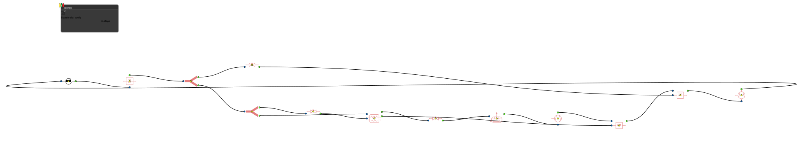

   Export SVG de la scène livrée, par le chemin de l'action « Exporter la scène en
   SVG… » de l'IHM.

**Ce qu'elle montre.** Deux étages au R507A avec deux piquages : l'un sous-refroidit le liquide dans un échangeur avant le détendeur BP, l'autre désurchauffe le refoulement BP par injection.

**Nœuds employés** (14 nœuds, 16 liaisons) : Détendeur ×3, Diviseur ×2, Compresseur ×2, Mélangeur fluides ×2, Bouclage (recyclage), Condenseur, Évapocondenseur, Evaporateur, Libelle.

**Ouvrir.** Menu **File > Exemples > 2 - Froid et cryogenie > Cycles frigorifiques > 3 - Bi-etage inj. partielle - sous-refroid. et desurchauffe**, puis bouton **Simuler** (la scène s'ouvre sans calcul). Elle est calculée par le moteur historique (une passe, de l'amont vers les sorties) ; statut affiché : **convergé** (point fixe constaté).

**Ce qu'on observe.** L'évaporateur absorbe **100,0 kW** de froid, les compresseurs absorbent 57,8 kW au total, le condenseur rejette 157,8 kW : **COP froid = 1,73**. Le bilan se ferme à 0,00 kW près (froid + travail − rejet). Le libellé de la scène annonce un COP de conception de 1,73. Les huit montages de ce dossier partagent la même puissance froide et, sauf la cascade, les mêmes températures (R507A, −35 / +40 °C) : comparer leurs COP, c'est comparer les montages.

Valeurs affichées par les nœuds après **Simuler** (relevé automatique) :

.. list-table::
   :header-rows: 1
   :widths: 26 16 58

   * - Nœud
     - Type
     - Valeurs affichées
   * - Bouclage - Refoulement HP
     - Bouclage (recyclage)
     - Résidu relatif (-) = 3.93e-11 ; Itérations = 1 ; Statut = convergé
   * - Condenseur
     - Condenseur
     - Q_cond (kW) = 157.806 ; Tcond(°C) = 40.00
   * - Piquage desurchauffe
     - Diviseur
     - Débit sortie 1 (kg/s) = 0.1372 ; Débit sortie 2 (kg/s) = 1.0356
   * - Detendeur de desurchauffe
     - Détendeur
     - Q_exp (kW) = 0.000 ; Tcond(°C) = -2.95
   * - Piquage sous-refroidisseur
     - Diviseur
     - Débit sortie 1 (kg/s) = 0.3417 ; Débit sortie 2 (kg/s) = 0.6939
   * - Detendeur sous-refroidisseur
     - Détendeur
     - Q_exp (kW) = 0.000 ; Tcond(°C) = -2.95
   * - Sous-refroidisseur
     - Évapocondenseur
     - Puissance (kW) = 37.223 ; T° sortie chaud (°C) = 2.05 ; T° sortie froid (°C) = 2.07
   * - Detendeur BP
     - Détendeur
     - Q_exp (kW) = 0.000 ; Tcond(°C) = -35.00
   * - Evaporateur
     - Evaporateur
     - Q_evap (kW) = 100.000 ; Tevap(°C) = -35.00
   * - Compresseur BP
     - Compresseur
     - Q_comp(kW) = 22.042 ; Energie dissipée (kW) = 0.000 ; Temp. sortie sans refroid. (°C) = 15.96
   * - Melange aspiration HP
     - Mélangeur fluides
     - T° sortie (°C) = 11.35 ; Débit mélangé (kg/s) = 1.0356
   * - Compresseur HP
     - Compresseur
     - Q_comp(kW) = 35.764 ; Energie dissipée (kW) = 0.000 ; Temp. sortie sans refroid. (°C) = 50.76
   * - Injection de desurchauffe
     - Mélangeur fluides
     - T° sortie (°C) = -2.93 ; Débit mélangé (kg/s) = 1.1728
   * - Description
     - Libelle
     - Texte = Bi-etage injection partielle, sous-refroidissement + desurchauffe R507A ; Point de conception : Q0 = 100.0 kW, W = 57.8 kW, COP = 1.73

4 - Bi-etage inj. partielle - sous-refroidissement
~~~~~~~~~~~~~~~~~~~~~~~~~~~~~~~~~~~~~~~~~~~~~~~~~~

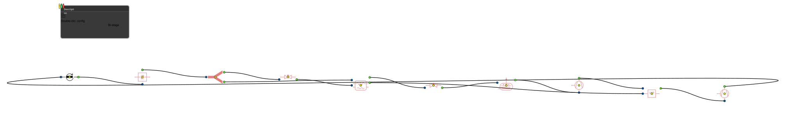

   Export SVG de la scène livrée, par le chemin de l'action « Exporter la scène en
   SVG… » de l'IHM.

**Ce qu'elle montre.** Deux étages au R507A ; un piquage détendu à la pression intermédiaire sous-refroidit le liquide principal dans un échangeur, et sa vapeur rejoint l'aspiration HP.

**Nœuds employés** (11 nœuds, 12 liaisons) : Détendeur ×2, Compresseur ×2, Bouclage (recyclage), Condenseur, Diviseur, Évapocondenseur, Evaporateur, Mélangeur fluides, Libelle.

**Ouvrir.** Menu **File > Exemples > 2 - Froid et cryogenie > Cycles frigorifiques > 4 - Bi-etage inj. partielle - sous-refroidissement**, puis bouton **Simuler** (la scène s'ouvre sans calcul). Elle est calculée par le moteur historique (une passe, de l'amont vers les sorties) ; statut affiché : **convergé** (point fixe constaté).

**Ce qu'on observe.** L'évaporateur absorbe **100,0 kW** de froid, les compresseurs absorbent 57,0 kW au total, le condenseur rejette 156,9 kW : **COP froid = 1,76**. Le bilan se ferme à 0,00 kW près (froid + travail − rejet). Le libellé de la scène annonce un COP de conception de 1,76. Les huit montages de ce dossier partagent la même puissance froide et, sauf la cascade, les mêmes températures (R507A, −35 / +40 °C) : comparer leurs COP, c'est comparer les montages.

Valeurs affichées par les nœuds après **Simuler** (relevé automatique) :

.. list-table::
   :header-rows: 1
   :widths: 26 16 58

   * - Nœud
     - Type
     - Valeurs affichées
   * - Bouclage - Refoulement HP
     - Bouclage (recyclage)
     - Résidu relatif (-) = 5.49e-11 ; Itérations = 1 ; Statut = convergé
   * - Condenseur
     - Condenseur
     - Q_cond (kW) = 156.950 ; Tcond(°C) = 40.00
   * - Piquage sous-refroidisseur
     - Diviseur
     - Débit sortie 1 (kg/s) = 0.3544 ; Débit sortie 2 (kg/s) = 0.6939
   * - Detendeur sous-refroidisseur
     - Détendeur
     - Q_exp (kW) = 0.000 ; Tcond(°C) = -2.95
   * - Sous-refroidisseur
     - Évapocondenseur
     - Puissance (kW) = 37.223 ; T° sortie chaud (°C) = 2.05 ; T° sortie froid (°C) = -1.93
   * - Detendeur BP
     - Détendeur
     - Q_exp (kW) = 0.000 ; Tcond(°C) = -35.00
   * - Evaporateur
     - Evaporateur
     - Q_evap (kW) = 100.000 ; Tevap(°C) = -35.00
   * - Compresseur BP
     - Compresseur
     - Q_comp(kW) = 22.042 ; Energie dissipée (kW) = 0.000 ; Temp. sortie sans refroid. (°C) = 15.96
   * - Melange aspiration HP
     - Mélangeur fluides
     - T° sortie (°C) = 9.87 ; Débit mélangé (kg/s) = 1.0482
   * - Compresseur HP
     - Compresseur
     - Q_comp(kW) = 34.908 ; Energie dissipée (kW) = 0.000 ; Temp. sortie sans refroid. (°C) = 63.03
   * - Description
     - Libelle
     - Texte = Bi-etage injection partielle, sous-refroidissement R507A ; Point de conception : Q0 = 100.0 kW, W = 57.0 kW, COP = 1.76

5 - Bi-etage injection totale
~~~~~~~~~~~~~~~~~~~~~~~~~~~~~

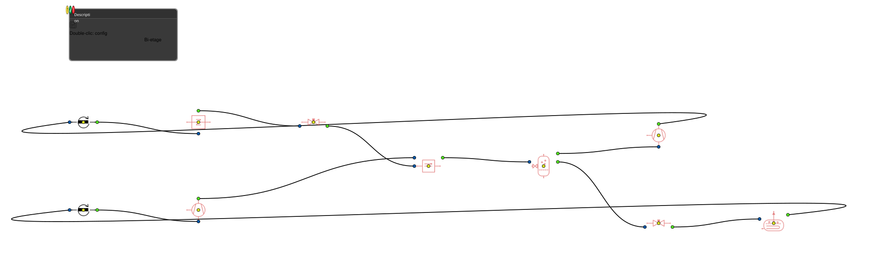

   Export SVG de la scène livrée, par le chemin de l'action « Exporter la scène en
   SVG… » de l'IHM.

**Ce qu'elle montre.** Deux étages au R507A avec bouteille intermédiaire : tout le liquide est détendu dans la bouteille (ballon de flash), qui désurchauffe par barbotage le refoulement BP ; deux nœuds *Bouclage* ferment les boucles.

**Nœuds employés** (11 nœuds, 11 liaisons) : Bouclage (recyclage) ×2, Détendeur ×2, Compresseur ×2, Condenseur, Mélangeur fluides, Ballon de flash, Evaporateur, Libelle.

**Ouvrir.** Menu **File > Exemples > 2 - Froid et cryogenie > Cycles frigorifiques > 5 - Bi-etage injection totale**, puis bouton **Simuler** (la scène s'ouvre sans calcul). Elle est calculée par le moteur historique (une passe, de l'amont vers les sorties) ; statut affiché : **convergé** (point fixe constaté).

**Ce qu'on observe.** L'évaporateur absorbe **100,0 kW** de froid, les compresseurs absorbent 56,5 kW au total, le condenseur rejette 156,5 kW : **COP froid = 1,77**. Le bilan se ferme à 0,00 kW près (froid + travail − rejet). Le libellé de la scène annonce un COP de conception de 1,77. Les huit montages de ce dossier partagent la même puissance froide et, sauf la cascade, les mêmes températures (R507A, −35 / +40 °C) : comparer leurs COP, c'est comparer les montages.

Valeurs affichées par les nœuds après **Simuler** (relevé automatique) :

.. list-table::
   :header-rows: 1
   :widths: 26 16 58

   * - Nœud
     - Type
     - Valeurs affichées
   * - Bouclage - Refoulement HP
     - Bouclage (recyclage)
     - Résidu relatif (-) = 3.27e-12 ; Itérations = 1 ; Statut = convergé
   * - Condenseur
     - Condenseur
     - Q_cond (kW) = 156.493 ; Tcond(°C) = 40.00
   * - Detendeur HP
     - Détendeur
     - Q_exp (kW) = 0.000 ; Tcond(°C) = -2.95
   * - Bouclage - Aspiration BP
     - Bouclage (recyclage)
     - Résidu relatif (-) = 3.27e-12 ; Itérations = 1 ; Statut = convergé
   * - Compresseur BP
     - Compresseur
     - Q_comp(kW) = 21.027 ; Energie dissipée (kW) = 0.000 ; Temp. sortie sans refroid. (°C) = 15.96
   * - Bouteille - barbotage BP
     - Mélangeur fluides
     - T° sortie (°C) = -2.94 ; Débit mélangé (kg/s) = 1.8249
   * - Bouteille intermediaire
     - Ballon de flash
     - Fraction vapeur (-) = 0.637 ; T° flash (°C) = -2.95 ; Chaleur latente (kW) = 191.508
   * - Compresseur HP
     - Compresseur
     - Q_comp(kW) = 35.466 ; Energie dissipée (kW) = 0.000 ; Temp. sortie sans refroid. (°C) = 50.76
   * - Detendeur BP
     - Détendeur
     - Q_exp (kW) = 0.000 ; Tcond(°C) = -35.00
   * - Evaporateur
     - Evaporateur
     - Q_evap (kW) = 100.000 ; Tevap(°C) = -35.00
   * - Description
     - Libelle
     - Texte = Bi-etage injection totale R507A ; Point de conception : Q0 = 100.0 kW, W = 56.5 kW, COP = 1.77

6 - Economiseur a injection partielle
~~~~~~~~~~~~~~~~~~~~~~~~~~~~~~~~~~~~~

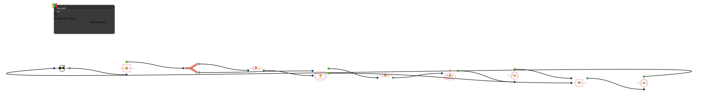

   Export SVG de la scène livrée, par le chemin de l'action « Exporter la scène en
   SVG… » de l'IHM.

**Ce qu'elle montre.** Un compresseur à vis à port économiseur, représenté par deux tronçons de compression ; un piquage détendu sous-refroidit le liquide dans un échangeur et sa vapeur entre au port économiseur.

**Nœuds employés** (11 nœuds, 12 liaisons) : Détendeur ×2, Compresseur ×2, Bouclage (recyclage), Condenseur, Diviseur, Évapocondenseur, Evaporateur, Mélangeur fluides, Libelle.

**Ouvrir.** Menu **File > Exemples > 2 - Froid et cryogenie > Cycles frigorifiques > 6 - Economiseur a injection partielle**, puis bouton **Simuler** (la scène s'ouvre sans calcul). Elle est calculée par le moteur historique (une passe, de l'amont vers les sorties) ; statut affiché : **convergé** (point fixe constaté).

**Ce qu'on observe.** L'évaporateur absorbe **100,0 kW** de froid, les compresseurs absorbent 56,8 kW au total, le condenseur rejette 156,8 kW : **COP froid = 1,76**. Le bilan se ferme à 0,00 kW près (froid + travail − rejet). Le libellé de la scène annonce un COP de conception de 1,76. Les huit montages de ce dossier partagent la même puissance froide et, sauf la cascade, les mêmes températures (R507A, −35 / +40 °C) : comparer leurs COP, c'est comparer les montages.

Valeurs affichées par les nœuds après **Simuler** (relevé automatique) :

.. list-table::
   :header-rows: 1
   :widths: 26 16 58

   * - Nœud
     - Type
     - Valeurs affichées
   * - Bouclage - Refoulement HP
     - Bouclage (recyclage)
     - Résidu relatif (-) = 3.37e-11 ; Itérations = 1 ; Statut = convergé
   * - Condenseur
     - Condenseur
     - Q_cond (kW) = 156.849 ; Tcond(°C) = 40.00
   * - Piquage economiseur
     - Diviseur
     - Débit sortie 1 (kg/s) = 0.3417 ; Débit sortie 2 (kg/s) = 0.6939
   * - Detendeur economiseur
     - Détendeur
     - Q_exp (kW) = 0.000 ; Tcond(°C) = -2.95
   * - Echangeur economiseur
     - Évapocondenseur
     - Puissance (kW) = 37.223 ; T° sortie chaud (°C) = 2.05 ; T° sortie froid (°C) = 2.07
   * - Detendeur BP
     - Détendeur
     - Q_exp (kW) = 0.000 ; Tcond(°C) = -35.00
   * - Evaporateur
     - Evaporateur
     - Q_evap (kW) = 100.000 ; Tevap(°C) = -35.00
   * - Vis - troncon aspiration
     - Compresseur
     - Q_comp(kW) = 22.042 ; Energie dissipée (kW) = 0.000 ; Temp. sortie sans refroid. (°C) = 15.96
   * - Vis - port economiseur
     - Mélangeur fluides
     - T° sortie (°C) = 11.35 ; Débit mélangé (kg/s) = 1.0356
   * - Vis - troncon refoulement
     - Compresseur
     - Q_comp(kW) = 34.807 ; Energie dissipée (kW) = 0.000 ; Temp. sortie sans refroid. (°C) = 64.49
   * - Description
     - Libelle
     - Texte = Economiseur a injection partielle (echangeur) R507A ; Point de conception : Q0 = 100.0 kW, W = 56.8 kW, COP = 1.76

7 - Economiseur a injection totale
~~~~~~~~~~~~~~~~~~~~~~~~~~~~~~~~~~

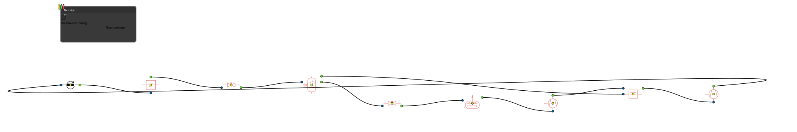

   Export SVG de la scène livrée, par le chemin de l'action « Exporter la scène en
   SVG… » de l'IHM.

**Ce qu'elle montre.** Le compresseur à vis à port économiseur, cette fois avec une bouteille flash : le liquide y est détendu à la pression intermédiaire, la vapeur de flash entre au port économiseur.

**Nœuds employés** (10 nœuds, 10 liaisons) : Détendeur ×2, Compresseur ×2, Bouclage (recyclage), Condenseur, Ballon de flash, Evaporateur, Mélangeur fluides, Libelle.

**Ouvrir.** Menu **File > Exemples > 2 - Froid et cryogenie > Cycles frigorifiques > 7 - Economiseur a injection totale**, puis bouton **Simuler** (la scène s'ouvre sans calcul). Elle est calculée par le moteur historique (une passe, de l'amont vers les sorties) ; statut affiché : **convergé** (point fixe constaté).

**Ce qu'on observe.** L'évaporateur absorbe **100,0 kW** de froid, les compresseurs absorbent 55,7 kW au total, le condenseur rejette 155,7 kW : **COP froid = 1,80**. Le bilan se ferme à -0,00 kW près (froid + travail − rejet). Le libellé de la scène annonce un COP de conception de 1,80. Les huit montages de ce dossier partagent la même puissance froide et, sauf la cascade, les mêmes températures (R507A, −35 / +40 °C) : comparer leurs COP, c'est comparer les montages.

Valeurs affichées par les nœuds après **Simuler** (relevé automatique) :

.. list-table::
   :header-rows: 1
   :widths: 26 16 58

   * - Nœud
     - Type
     - Valeurs affichées
   * - Bouclage - Refoulement HP
     - Bouclage (recyclage)
     - Résidu relatif (-) = 7.39e-11 ; Itérations = 1 ; Statut = convergé
   * - Condenseur
     - Condenseur
     - Q_cond (kW) = 155.707 ; Tcond(°C) = 40.00
   * - Detendeur HP
     - Détendeur
     - Q_exp (kW) = 0.000 ; Tcond(°C) = -2.95
   * - Bouteille flash economiseur
     - Ballon de flash
     - Fraction vapeur (-) = 0.368 ; T° flash (°C) = -2.95 ; Chaleur latente (kW) = 63.473
   * - Detendeur BP
     - Détendeur
     - Q_exp (kW) = 0.000 ; Tcond(°C) = -35.00
   * - Evaporateur
     - Evaporateur
     - Q_evap (kW) = 100.000 ; Tevap(°C) = -35.00
   * - Vis - troncon aspiration
     - Compresseur
     - Q_comp(kW) = 21.027 ; Energie dissipée (kW) = 0.000 ; Temp. sortie sans refroid. (°C) = 15.96
   * - Vis - port economiseur
     - Mélangeur fluides
     - T° sortie (°C) = 8.95 ; Débit mélangé (kg/s) = 1.0474
   * - Vis - troncon refoulement
     - Compresseur
     - Q_comp(kW) = 34.679 ; Energie dissipée (kW) = 0.000 ; Temp. sortie sans refroid. (°C) = 62.14
   * - Description
     - Libelle
     - Texte = Economiseur a injection totale (bouteille flash) R507A ; Point de conception : Q0 = 100.0 kW, W = 55.7 kW, COP = 1.80

8 - Cascade R744-R507A - evapocondenseur
~~~~~~~~~~~~~~~~~~~~~~~~~~~~~~~~~~~~~~~~

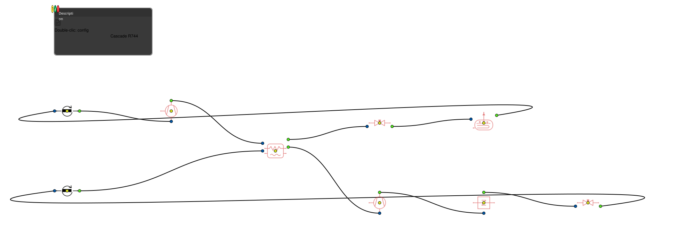

   Export SVG de la scène livrée, par le chemin de l'action « Exporter la scène en
   SVG… » de l'IHM.

**Ce qu'elle montre.** Une cascade : un étage au CO₂ (R744, −35 / −5 °C) dont le condenseur est l'évaporateur d'un étage au R507A (−10 / +40 °C), les deux reliés par un évapocondenseur.

**Nœuds employés** (10 nœuds, 10 liaisons) : Bouclage (recyclage) ×2, Compresseur ×2, Détendeur ×2, Évapocondenseur, Evaporateur, Condenseur, Libelle.

**Ouvrir.** Menu **File > Exemples > 2 - Froid et cryogenie > Cycles frigorifiques > 8 - Cascade R744-R507A - evapocondenseur**, puis bouton **Simuler** (la scène s'ouvre sans calcul). Elle est calculée par le moteur historique (une passe, de l'amont vers les sorties) ; statut affiché : **convergé** (point fixe constaté).

**Ce qu'on observe.** L'évaporateur absorbe **100,0 kW** de froid, les compresseurs absorbent 65,2 kW au total, le condenseur rejette 165,2 kW : **COP froid = 1,53**. Le bilan se ferme à 0,00 kW près (froid + travail − rejet). Le libellé de la scène annonce un COP de conception de 1,53. Les huit montages de ce dossier partagent la même puissance froide et, sauf la cascade, les mêmes températures (R507A, −35 / +40 °C) : comparer leurs COP, c'est comparer les montages.

Valeurs affichées par les nœuds après **Simuler** (relevé automatique) :

.. list-table::
   :header-rows: 1
   :widths: 26 16 58

   * - Nœud
     - Type
     - Valeurs affichées
   * - Bouclage - Aspiration R744
     - Bouclage (recyclage)
     - Résidu relatif (-) = 0.00e+00 ; Itérations = 1 ; Statut = convergé
   * - Compresseur R744
     - Compresseur
     - Q_comp(kW) = 21.220 ; Energie dissipée (kW) = 0.000 ; Temp. sortie sans refroid. (°C) = 44.90
   * - Evapocondenseur
     - Évapocondenseur
     - Puissance (kW) = 121.220 ; T° sortie chaud (°C) = -7.01 ; T° sortie froid (°C) = -4.99
   * - Detendeur BP
     - Détendeur
     - Q_exp (kW) = 0.000 ; Tcond(°C) = -35.00
   * - Evaporateur
     - Evaporateur
     - Q_evap (kW) = 100.000 ; Tevap(°C) = -35.00
   * - Bouclage - Detente R507A
     - Bouclage (recyclage)
     - Résidu relatif (-) = 0.00e+00 ; Itérations = 1 ; Statut = convergé
   * - Compresseur R507A
     - Compresseur
     - Q_comp(kW) = 43.933 ; Energie dissipée (kW) = 0.000 ; Temp. sortie sans refroid. (°C) = 57.61
   * - Condenseur
     - Condenseur
     - Q_cond (kW) = 165.153 ; Tcond(°C) = 40.00
   * - Detendeur R507A
     - Détendeur
     - Q_exp (kW) = 0.000 ; Tcond(°C) = -10.01
   * - Description
     - Libelle
     - Texte = Cascade R744 (-35/-5 C) / R507A (-10/+40 C), evapocondenseur ; Point de conception : Q0 = 100.0 kW, W = 65.2 kW, COP = 1.53

Liquefaction simple
~~~~~~~~~~~~~~~~~~~

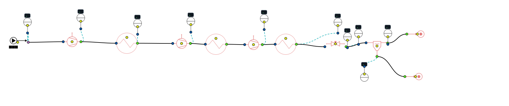

   Export SVG de la scène livrée, par le chemin de l'action « Exporter la scène en
   SVG… » de l'IHM.

**Ce qu'elle montre.** Une liquéfaction de méthane plus réaliste : compression étagée avec refroidissement intermédiaire, pré-refroidissement, détente, séparateur liquide/vapeur, et un capteur après chaque organe.

**Nœuds employés** (21 nœuds, 20 liaisons) : Capteur ×10, Compresseur ×3, Heater_Cooler ×3, Sortie ×2, Source, Détendeur, Séparateur liq/vap.

**Ouvrir.** Menu **File > Exemples > 2 - Froid et cryogenie > Liquefaction simple**, puis bouton **Simuler** (la scène s'ouvre sans calcul). Elle est calculée par le moteur historique (une passe, de l'amont vers les sorties) ; statut affiché : **convergé** (point fixe constaté).

**Ce qu'on observe.** Trois étages de compression (5, 25 puis 100 bar, rendement 0,7) séparés par des refroidisseurs à 6,85 °C, un pré-refroidissement à −65 °C, puis détente à 1 bar et séparation. Les compresseurs absorbent 1 122,3 kW au total ; le séparateur sort **0,206 kg/s de méthane liquide** sur 1 kg/s (20,6 %), soit 1,51 kWh par kg de liquide. Les capteurs de la scène affichent la température après chaque organe : on lit la montée à chaque compression et le retour à 6,85 °C à chaque refroidisseur, jusqu'à -161,6 °C après la détente.

Machine frigorifique bi-etagee
~~~~~~~~~~~~~~~~~~~~~~~~~~~~~~

   Export SVG de la scène livrée, par le chemin de l'action « Exporter la scène en
   SVG… » de l'IHM.

**Ce qu'elle montre.** Une machine frigorifique R134a à deux étages de compression avec bouteille intermédiaire à injection (3,5 bar) : l'étage BP aspire à 1 bar, l'étage HP refoule à 12 bar ; la boucle HP est ouverte par une source de coupure.

**Nœuds employés** (12 nœuds, 11 liaisons) : Compresseur ×2, Détendeur ×2, Sortie ×2, Source, Mélangeur fluides, Ballon de flash, Condenseur, Evaporateur, Source_P_h.

**Ouvrir.** Menu **File > Exemples > 2 - Froid et cryogenie > Machine frigorifique bi-etagee**, puis bouton **Simuler** (la scène s'ouvre sans calcul). Elle est calculée par le moteur historique (une passe, de l'amont vers les sorties) ; statut affiché : **convergé** (point fixe constaté).

**Ce qu'on observe.** 1 kg/s de R134a vaporisé à -26,4 °C absorbe **179,8 kW de froid**. L'étage BP comprime la vapeur de 1 à 3,5 bar (32,6 kW) ; dans la bouteille à 3,5 bar, le liquide détendu de l'étage HP la refroidit et s'y vaporise en partie : le séparateur envoie 58,5 % du débit, en vapeur, à l'étage HP (1,412 kg/s comprimés à 12 bar, 45,2 kW) et le reste, liquide, à l'évaporateur. **COP froid = 2,31.** La boucle HP est **ouverte** à l'entrée de la bouteille : la source « Injection HP (coupure de boucle) » y porte le débit et l'enthalpie que le nœud de contrôle « Retour detente HP » relit en sortie de détente (1,4119 kg/s relus pour 1,4119 kg/s injectés). Le moteur historique ne sait pas résoudre une boucle fermée : les valeurs de coupure ont été convergées par substitution le 28/09/2026 ; **si vous modifiez la scène, recopiez dans la source les valeurs du nœud de contrôle et relancez jusqu'à ce qu'elles coïncident.**

Valeurs affichées par les nœuds après **Simuler** (relevé automatique) :

.. list-table::
   :header-rows: 1
   :widths: 26 16 58

   * - Nœud
     - Type
     - Valeurs affichées
   * - R134a vap BP
     - Source
     - Temp. effective (°C) = -21.000 ; Pression effective (bar) = 1.000
   * - Compresseur BP
     - Compresseur
     - Q_comp(kW) = 32.572 ; Energie dissipée (kW) = 0.000 ; Temp. sortie sans refroid. (°C) = 24.73
   * - Bouteille flash (inj.)
     - Mélangeur fluides
     - T° sortie (°C) = 5.03 ; Débit mélangé (kg/s) = 2.4119
   * - Separateur 3.5 bar
     - Ballon de flash
     - Fraction vapeur (-) = 0.585 ; T° flash (°C) = 5.03 ; Chaleur latente (kW) = 274.926
   * - Compresseur HP
     - Compresseur
     - Q_comp(kW) = 45.159 ; Energie dissipée (kW) = 0.000 ; Temp. sortie sans refroid. (°C) = 56.17
   * - Condenseur 12 bar
     - Condenseur
     - Q_cond (kW) = 257.795 ; Tcond(°C) = 46.31
   * - Detente HP -> 3.5 bar
     - Détendeur
     - Q_exp (kW) = 0.000 ; Tcond(°C) = 5.03
   * - Detente BP -> 1 bar
     - Détendeur
     - Q_exp (kW) = 0.000 ; Tcond(°C) = -26.36
   * - Evaporateur
     - Evaporateur
     - Q_evap (kW) = 179.777 ; Tevap(°C) = -26.36
   * - Retour detente HP (controle de coupure)
     - Sortie
     - Température (°C) = 5.0 °C ; Pression (bar) = 3.500 bar ; Débit (kg/h) = 5082.904 kg/h
   * - Sortie evaporateur
     - Sortie
     - Température (°C) = -21.4 °C ; Pression (bar) = 1.000 bar ; Débit (kg/h) = 3600.000 kg/h

Machine frigorifique
~~~~~~~~~~~~~~~~~~~~

   Export SVG de la scène livrée, par le chemin de l'action « Exporter la scène en
   SVG… » de l'IHM.

**Ce qu'elle montre.** Le cycle frigorifique à compression de vapeur de base, au R134a : compression de 1 à 12 bar, condenseur (sous-refroidissement 10 K), détendeur à 1 bar, évaporateur (surchauffe 5 K).

**Nœuds employés** (6 nœuds, 5 liaisons) : Source, Compresseur, Condenseur, Détendeur, Evaporateur, Sortie.

**Ouvrir.** Menu **File > Exemples > 2 - Froid et cryogenie > Machine frigorifique**, puis bouton **Simuler** (la scène s'ouvre sans calcul). Elle est calculée par le moteur historique (une passe, de l'amont vers les sorties) ; statut affiché : **convergé** (point fixe constaté).

**Ce qu'on observe.** Pour 1 kg/s de R134a, l'évaporateur absorbe 135,7 kW à -26,4 °C, le compresseur consomme 66,7 kW et le condenseur rejette 202,4 kW à 46,3 °C. **COP froid = 2,03**. C'est la scène dont le guide publie l'export (:doc:`../002-thermodynamic_cycles/chiller`).

Valeurs affichées par les nœuds après **Simuler** (relevé automatique) :

.. list-table::
   :header-rows: 1
   :widths: 26 16 58

   * - Nœud
     - Type
     - Valeurs affichées
   * - R134a vap BP
     - Source
     - Temp. effective (°C) = -21.360 ; Pression effective (bar) = 1.000
   * - Compresseur 12 bar
     - Compresseur
     - Q_comp(kW) = 66.700 ; Energie dissipée (kW) = 0.000 ; Temp. sortie sans refroid. (°C) = 74.17
   * - Condenseur
     - Condenseur
     - Q_cond (kW) = 202.361 ; Tcond(°C) = 46.31
   * - Detendeur 1 bar
     - Détendeur
     - Q_exp (kW) = 0.000 ; Tcond(°C) = -26.36
   * - Evaporateur
     - Evaporateur
     - Q_evap (kW) = 135.660 ; Tevap(°C) = -26.36
   * - Sortie
     - Sortie
     - Température (°C) = -21.4 °C ; Pression (bar) = 1.000 bar ; Débit (kg/h) = 3600.000 kg/h

Hydraulique
-----------

Remplissage regule par niveau
~~~~~~~~~~~~~~~~~~~~~~~~~~~~~

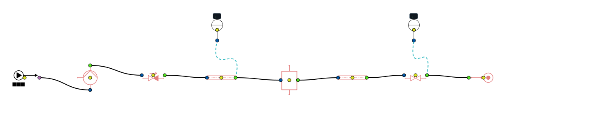

   Export SVG de la scène livrée, par le chemin de l'action « Exporter la scène en
   SVG… » de l'IHM.

**Ce qu'elle montre.** Une bâche de stockage remplie par une pompe (avec clapet) et vidée par un usage (vanne Kv 4) : la base d'une régulation de niveau.

**Nœuds employés** (10 nœuds, 9 liaisons) : Tuyau droit ×2, Capteur ×2, Source, Pompe, Clapet anti-retour, Bâche (niveau variable), Vanne générique (Kv), Sortie.

**Ouvrir.** Menu **File > Exemples > 3 - Hydraulique > Baches > Remplissage regule par niveau**, puis bouton **Simuler** (la scène s'ouvre sans calcul). Elle est calculée par le solveur nodal des réseaux (Newton sur les pressions) ; statut affiché : **convergé** (point fixe constaté).

**Ce qu'on observe.** La pompe de remplissage débite 8,19 m³/h sous 14,8 m de HMT, l'usage soutire 2,0 m³/h : la bâche reçoit un débit net de **6,22 m³/h**. L'ouverture donne l'instant initial ; l'évolution du niveau, l'arrêt de la pompe au niveau haut et son redémarrage relèvent de la simulation temporelle (:doc:`../013-simulation-temporelle/index`).

Valeurs affichées par les nœuds après **Simuler** (relevé automatique) :

.. list-table::
   :header-rows: 1
   :widths: 26 16 58

   * - Nœud
     - Type
     - Valeurs affichées
   * - Pompe de remplissage
     - Pompe
     - P refoulement (bar) = 2.4674 ; Puissance à l'arbre (kW) = 0.507 ; Puissance électrique absorbée (kW) = - (rendement moteur ou variateur non renseigné)
   * - Clapet
     - Clapet anti-retour
     - Perte de charge (Pa) = 1340.55 ; Pression sortie (bar) = 2.4540
   * - Refoulement DN32
     - Tuyau droit
     - Vitesse (m/s) = 2.8293 ; Reynolds (-) = 90230 ; Perte de charge (Pa) = 119601.77
   * - Bâche de stockage
     - Bâche (niveau variable)
     - Débit net entrant (m³/h) = 6.2222 ; Pression au fond (bar) = 1.25798
   * - Départ usage
     - Tuyau droit
     - Vitesse (m/s) = 0.2786 ; Reynolds (-) = 13883 ; Perte de charge (Pa) = 233.72
   * - Usage (Kv 4)
     - Vanne générique (Kv)
     - Perte de charge (Pa) = 24238.95 ; Pression sortie (bar) = 1.0132
   * - Q remplissage
     - Capteur
     - 8.2 m³/h
   * - Q usage
     - Capteur
     - 2.0 m³/h

Batiment 7 - debit variable
~~~~~~~~~~~~~~~~~~~~~~~~~~~

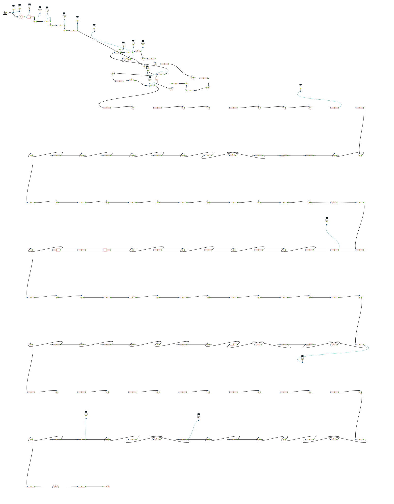

   Export SVG de la scène livrée, par le chemin de l'action « Exporter la scène en
   SVG… » de l'IHM.

**Ce qu'elle montre.** Le réseau de chauffage réel d'un bâtiment : 164 nœuds, dont 65 tronçons droits, 60 coudes, 9 vannes d'équilibrage et 18 capteurs de pression et de débit.

**Nœuds employés** (164 nœuds, 163 liaisons) : Tuyau droit ×65, Coude courbe ×60, Capteur ×18, Vanne TA ×9, Retrecissement ×4, Elargissement ×4, Source, Sortie, Té divergent, Pompe.

**Ouvrir.** Menu **File > Exemples > 3 - Hydraulique > Batiment 7 - debit variable**, puis bouton **Simuler** (la scène s'ouvre sans calcul). Elle est calculée par le solveur nodal des réseaux (Newton sur les pressions) ; statut affiché : **convergé** (point fixe constaté).

**Ce qu'on observe.** Une seule pompe alimente tout le bâtiment : 1,16 m³/h sous 44,5 m de HMT. Les capteurs de piquage donnent la pression disponible le long du réseau, de 5,34 bar au départ A à 1,10 bar au retour B : c'est la lecture qui sert à régler les neuf vannes d'équilibrage.

Valeurs affichées par les nœuds après **Simuler** (relevé automatique) :

.. list-table::
   :header-rows: 1
   :widths: 26 16 58

   * - Nœud
     - Type
     - Valeurs affichées
   * - Piquage A départ
     - Capteur
     - 5.34 bar
   * - Piquage B départ
     - Capteur
     - 4.61 bar
   * - Piquage 1 départ
     - Capteur
     - 4.61 bar
   * - Piquage A CTA
     - Capteur
     - 4.24 bar
   * - Piquage A retour
     - Capteur
     - 3.71 bar
   * - Piquage 1 retour
     - Capteur
     - 1.19 bar
   * - Piquage B retour
     - Capteur
     - 1.10 bar
   * - Piquage A départ
     - Capteur
     - 5.34 bar
   * - Piquage A départ
     - Capteur
     - 0.80 Nm³/h
   * - Pompe
     - Pompe
     - P refoulement (bar) = 5.3556 ; Puissance à l'arbre (kW) = 0.394 ; Puissance électrique absorbée (kW) = - (rendement moteur ou variateur non renseigné)

Eau glacee glycolee MEG 30
~~~~~~~~~~~~~~~~~~~~~~~~~~

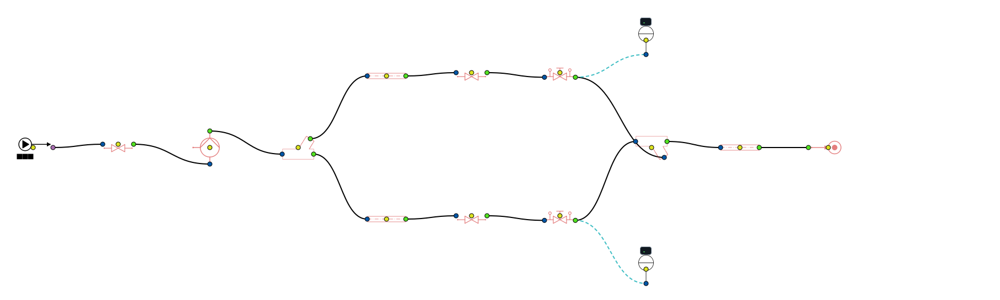

   Export SVG de la scène livrée, par le chemin de l'action « Exporter la scène en
   SVG… » de l'IHM.

**Ce qu'elle montre.** Un réseau d'eau glacée en eau glycolée (éthylène glycol à 30 %) : évaporateur, pompe, deux batteries de CTA avec vanne 2 voies et vanne d'équilibrage.

**Nœuds employés** (15 nœuds, 15 liaisons) : Vanne générique (Kv) ×3, Tuyau droit ×3, Vanne TA ×2, Capteur ×2, Source, Pompe, Té divergent, Té convergent, Sortie.

**Ouvrir.** Menu **File > Exemples > 3 - Hydraulique > Fluides > Eau glacee glycolee MEG 30**, puis bouton **Simuler** (la scène s'ouvre sans calcul). Elle est calculée par le solveur nodal des réseaux (Newton sur les pressions) ; statut affiché : **convergé** (point fixe constaté).

**Ce qu'on observe.** En eau glycolée à 30 % (MEG), la pompe débite 14,41 m³/h sous 30,0 m de HMT. La batterie 1 (vanne 2 voies à 80 %) reçoit 10,0 m³/h, la batterie 2 (vanne à 50 %) 4,4 m³/h ; les capteurs lisent 7,1 °C, la température du vase.

Valeurs affichées par les nœuds après **Simuler** (relevé automatique) :

.. list-table::
   :header-rows: 1
   :widths: 26 16 58

   * - Nœud
     - Type
     - Valeurs affichées
   * - Évaporateur (Kv 60)
     - Vanne générique (Kv)
     - Perte de charge (Pa) = 6017.23 ; Pression sortie (bar) = 2.4398
   * - Pompe eau glacée
     - Pompe
     - P refoulement (bar) = 5.5037 ; Puissance à l'arbre (kW) = 1.850 ; Puissance électrique absorbée (kW) = - (rendement moteur ou variateur non renseigné)
   * - Départ batteries
     - Té divergent
     - Débit sortie straight (kg/s) = 1.2621
   * - Batterie CTA 1
     - Tuyau droit
     - Vitesse (m/s) = 2.2212 ; Reynolds (-) = 27976 ; Perte de charge (Pa) = 51698.14
   * - V2V batterie 1 (80 %)
     - Vanne générique (Kv)
     - Perte de charge (Pa) = 166960.27 ; Pression sortie (bar) = 3.2838
   * - Équilibrage batterie 1
     - Vanne TA
     - Perte de charge (Pa) = 64331.09 ; Pression sortie (bar) = 2.6405 ; Kv (-) = 12.800
   * - Batterie CTA 2
     - Tuyau droit
     - Vitesse (m/s) = 0.9631 ; Reynolds (-) = 12131 ; Perte de charge (Pa) = 19041.10
   * - V2V batterie 2 (50 %)
     - Vanne générique (Kv)
     - Perte de charge (Pa) = 256341.28 ; Pression sortie (bar) = 2.7484
   * - Équilibrage batterie 2
     - Vanne TA
     - Perte de charge (Pa) = 12095.06 ; Pression sortie (bar) = 2.6274 ; Kv (-) = 12.800
   * - Retour eau glacée
     - Tuyau droit
     - Vitesse (m/s) = 1.2059 ; Reynolds (-) = 24681 ; Perte de charge (Pa) = 12292.21
   * - Q batterie 1
     - Capteur
     - 10.0 m³/h
   * - Q batterie 2
     - Capteur
     - 4.4 m³/h

Pompe - deux branches en pression
~~~~~~~~~~~~~~~~~~~~~~~~~~~~~~~~~

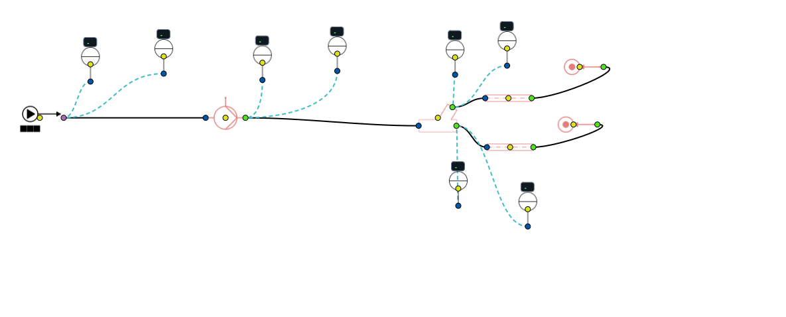

   Export SVG de la scène livrée, par le chemin de l'action « Exporter la scène en
   SVG… » de l'IHM.

**Ce qu'elle montre.** Une pompe qui alimente deux branches débouchant à des pressions différentes : la démonstration de la loi des nœuds.

**Nœuds employés** (15 nœuds, 14 liaisons) : Capteur ×8, Tuyau droit ×2, Sortie ×2, Source, Pompe, Té divergent.

**Ouvrir.** Menu **File > Exemples > 3 - Hydraulique > Loi des noeuds > Pompe - deux branches en pression**, puis bouton **Simuler** (la scène s'ouvre sans calcul). Elle est calculée par le solveur nodal des réseaux (Newton sur les pressions) ; statut affiché : **convergé** (point fixe constaté).

**Ce qu'on observe.** La source est en **pression imposée** : c'est le réseau qui fixe le débit. La pompe s'établit à 24,04 m³/h sous 26,6 m de HMT ; le nœud de distribution partage le débit entre les branches A (3,5 kg/s) et B (3,2 kg/s), dont les sorties sont à 1,0 et 1,2 bar. La somme des deux retrouve le débit de la pompe : c'est la loi des nœuds (:doc:`../004-hydraulic/loi_des_noeuds`). Le titre du nœud pompe annonce un autre débit : c'est un libellé saisi, pas un résultat.

Valeurs affichées par les nœuds après **Simuler** (relevé automatique) :

.. list-table::
   :header-rows: 1
   :widths: 26 16 58

   * - Nœud
     - Type
     - Valeurs affichées
   * - Pompe à courbe — point réseau 25,87 m³/h (solveur nodal, tés Idel'chik)
     - Pompe
     - P refoulement (bar) = 3.6019 ; Puissance à l'arbre (kW) = 2.273 ; Puissance électrique absorbée (kW) = - (rendement moteur ou variateur non renseigné)
   * - Nœud de distribution — Q = Q₁ + Q₂
     - Té divergent
     - Débit sortie straight (kg/s) = 3.4705
   * - Branche A — DN40 — 150 m
     - Tuyau droit
     - Vitesse (m/s) = 2.7642 ; Reynolds (-) = 97109 ; Perte de charge (Pa) = 260454.55
   * - Branche B — DN40 — 150 m
     - Tuyau droit
     - Vitesse (m/s) = 2.5490 ; Reynolds (-) = 89548 ; Perte de charge (Pa) = 225115.69
   * - Capteur — Source débit massique
     - Capteur
     - 6.7 kg/s
   * - Capteur — Pompe débit massique
     - Capteur
     - 6.7 kg/s
   * - Capteur — Branche B débit massique
     - Capteur
     - 3.2 kg/s
   * - Capteur — Branche A débit massique
     - Capteur
     - 3.5 kg/s
   * - Capteur — Source pression
     - Capteur
     - 1.0 bar
   * - Capteur — Pompe pression
     - Capteur
     - 3.6 bar
   * - Capteur — Branche B pression
     - Capteur
     - 3.6 bar
   * - Capteur — Branche A pression
     - Capteur
     - 3.6 bar

Pompe et vanne d equilibrage
~~~~~~~~~~~~~~~~~~~~~~~~~~~~

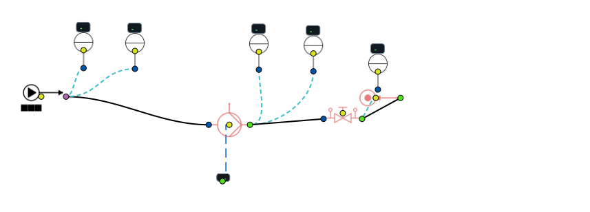

   Export SVG de la scène livrée, par le chemin de l'action « Exporter la scène en
   SVG… » de l'IHM.

**Ce qu'elle montre.** Le montage minimal : une pompe et une vanne d'équilibrage TA, avec capteurs de débit et de pression.

**Nœuds employés** (10 nœuds, 9 liaisons) : Capteur ×5, Source, Sortie, Pompe, Afficheur, Vanne TA.

**Ouvrir.** Menu **File > Exemples > 3 - Hydraulique > Pompe et vanne d equilibrage**, puis bouton **Simuler** (la scène s'ouvre sans calcul). Elle est calculée par le solveur nodal des réseaux (Newton sur les pressions) ; statut affiché : **convergé** (point fixe constaté).

**Ce qu'on observe.** Point de fonctionnement : 20,18 m³/h sous 30,4 m de HMT. La vanne d'équilibrage prend 39,0 kPa. La scène est détaillée dans :doc:`../004-hydraulic/TA_valve`.

**À quoi sert ce montage.** C'est le cas d'école de l'équilibrage : la pompe fournit une hauteur, le réseau et la vanne TA la consomment, et c'est le réglage de la vanne (en tours) qui place le point de fonctionnement sur la courbe de la pompe. Fermer la TA fait monter sa perte de charge, baisser le débit et remonter la HMT ; l'ouvrir fait l'inverse.

**Paramètres à changer.** Dans la *Vanne TA* : l'« Ouverture (tours) » ; pour obtenir un débit visé, renseignez « Débit visé pour TAValveOptim » et lisez « Réglage conseillé par TAValveOptim (tours) ». Dans la *Pompe* : sa courbe et sa fréquence (:doc:`../002-thermodynamic_cycles/pompe`). L'*Afficheur* regroupe les grandeurs lues sur les nœuds par liaison de signal.

**Pièges.** Le réglage est borné par la plage de la vanne (« Ouvertures admises ») : un nombre de tours hors plage est refusé. Le Kv affiché par le nœud **n'est pas un signal publié** : l'afficheur peut montrer ``q``, ``delta_P`` et ``nb_tours`` de la vanne, pas son Kv (voir :doc:`../004-hydraulic/TA_valve`, section « Signaux publiés »).

Valeurs affichées par les nœuds après **Simuler** (relevé automatique) :

.. list-table::
   :header-rows: 1
   :widths: 26 16 58

   * - Nœud
     - Type
     - Valeurs affichées
   * - Pompe
     - Pompe
     - P refoulement (bar) = 3.9902 ; Puissance à l'arbre (kW) = 2.057 ; Puissance électrique absorbée (kW) = - (rendement moteur ou variateur non renseigné)
   * - Capteur
     - Capteur
     - 20.2 Nm³/h
   * - Capteur
     - Capteur
     - 20.2 Nm³/h
   * - Capteur
     - Capteur
     - 4.0 bar
   * - Capteur
     - Capteur
     - 1.0 bar
   * - Afficheur de signal
     - Afficheur
     - — ; Source = —
   * - Vanne TA
     - Vanne TA
     - Perte de charge (Pa) = 39015.92 ; Pression sortie (bar) = 3.6000 ; Kv (-) = 32.300
   * - Capteur
     - Capteur
     - 3.6 bar

Pompes en parallele avec clapets
~~~~~~~~~~~~~~~~~~~~~~~~~~~~~~~~

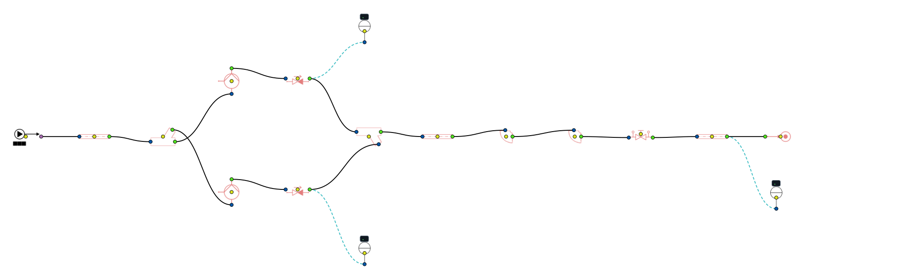

   Export SVG de la scène livrée, par le chemin de l'action « Exporter la scène en
   SVG… » de l'IHM.

**Ce qu'elle montre.** Deux pompes en parallèle, chacune avec son clapet anti-retour.

**Nœuds employés** (17 nœuds, 17 liaisons) : Tuyau droit ×3, Capteur ×3, Pompe ×2, Clapet anti-retour ×2, Coude courbe ×2, Source, Té divergent, Té convergent, Vanne TA, Sortie.

**Ouvrir.** Menu **File > Exemples > 3 - Hydraulique > Pompes > Pompes en parallele avec clapets**, puis bouton **Simuler** (la scène s'ouvre sans calcul). Elle est calculée par le solveur nodal des réseaux (Newton sur les pressions) ; statut affiché : **convergé** (point fixe constaté).

**Ce qu'on observe.** Les deux pompes identiques se partagent le débit : P1 12,4 m³/h, P2 12,1 m³/h, total **24,5 m³/h** — moins du double d'une pompe seule, parce que la perte de charge du réseau croît avec le débit.

**Pourquoi pas le double.** Une pompe ne fixe pas son débit : il se lit à l'intersection de sa courbe HMT(Q) et de la courbe du réseau, dont la perte de charge croît comme le carré du débit. Deux pompes en parallèle ajoutent leurs débits **à hauteur égale** ; or doubler le débit du réseau exigerait environ quatre fois la hauteur. Le point de fonctionnement s'établit donc plus haut sur les deux courbes, à un débit total inférieur au double. La mécanique de la courbe de pompe est décrite dans :doc:`../002-thermodynamic_cycles/pompe`.

**Paramètres à changer.** Dans chaque nœud *Pompe* (double-clic) : la courbe (« Débits courbe », « HMT courbe », « Rendements courbe ») et la « Fréquence de fonctionnement (Hz) » pour une pompe à variateur. Dans la *Vanne TA* : son ouverture, qui déplace la courbe du réseau (:doc:`../004-hydraulic/TA_valve`). Le *Clapet anti-retour* empêche une pompe arrêtée ou plus faible d'être traversée à l'envers ; son état (« État clapet ») est affiché.

**Pièges.** Deux pompes **différentes** en parallèle : la plus faible peut se retrouver contre un clapet fermé si la hauteur commune dépasse sa hauteur à débit nul — lisez son débit et l'état du clapet. Le débit saisi sur la source n'est qu'un point de départ : c'est le réseau qui le fixe. Pour afficher les grandeurs d'une pompe ailleurs dans la scène, voir les signaux publiés (``F_m3h``, ``hmt``, ``Q_pump`` en W…) dans :doc:`../002-thermodynamic_cycles/pompe`.

Valeurs affichées par les nœuds après **Simuler** (relevé automatique) :

.. list-table::
   :header-rows: 1
   :widths: 26 16 58

   * - Nœud
     - Type
     - Valeurs affichées
   * - Aspiration DN80
     - Tuyau droit
     - Vitesse (m/s) = 1.3553 ; Reynolds (-) = 108065 ; Perte de charge (Pa) = 1177.10
   * - Collecteur aspiration
     - Té divergent
     - Débit sortie straight (kg/s) = 3.4448
   * - Pompe P1
     - Pompe
     - P refoulement (bar) = 4.9761 ; Puissance à l'arbre (kW) = 1.637 ; Puissance électrique absorbée (kW) = - (rendement moteur ou variateur non renseigné)
   * - Pompe P2
     - Pompe
     - P refoulement (bar) = 4.9744 ; Puissance à l'arbre (kW) = 1.614 ; Puissance électrique absorbée (kW) = - (rendement moteur ou variateur non renseigné)
   * - Clapet P1
     - Clapet anti-retour
     - Perte de charge (Pa) = 1079.58 ; Pression sortie (bar) = 4.9653
   * - Clapet P2
     - Clapet anti-retour
     - Perte de charge (Pa) = 1024.50 ; Pression sortie (bar) = 4.9642
   * - Réseau DN80 - 60 m
     - Tuyau droit
     - Vitesse (m/s) = 1.3553 ; Reynolds (-) = 108065 ; Perte de charge (Pa) = 14125.17
   * - Coude
     - Coude courbe
     - Perte de charge (Pa) = 240.42 ; Pression sortie (bar) = 4.8169
   * - Coude
     - Coude courbe
     - Perte de charge (Pa) = 240.42 ; Pression sortie (bar) = 4.8145
   * - Vanne d'équilibrage réseau
     - Vanne TA
     - Perte de charge (Pa) = 267320.64 ; Pression sortie (bar) = 2.1413 ; Kv (-) = 15.000
   * - Retour DN80 - 60 m
     - Tuyau droit
     - Vitesse (m/s) = 1.3553 ; Reynolds (-) = 108065 ; Perte de charge (Pa) = 14125.17
   * - Q pompe P1
     - Capteur
     - 12.4 m³/h
   * - Q pompe P2
     - Capteur
     - 12.1 m³/h
   * - Q total
     - Capteur
     - 24.5 m³/h

Pompes en serie (surpression)
~~~~~~~~~~~~~~~~~~~~~~~~~~~~~

   Export SVG de la scène livrée, par le chemin de l'action « Exporter la scène en
   SVG… » de l'IHM.

**Ce qu'elle montre.** Deux pompes en série : une pompe de gavage suivie d'une pompe de surpression.

**Nœuds employés** (12 nœuds, 11 liaisons) : Tuyau droit ×4, Pompe ×2, Coude courbe ×2, Source, Vanne TA, Sortie, Capteur.

**Ouvrir.** Menu **File > Exemples > 3 - Hydraulique > Pompes > Pompes en serie (surpression)**, puis bouton **Simuler** (la scène s'ouvre sans calcul). Elle est calculée par le solveur nodal des réseaux (Newton sur les pressions) ; statut affiché : **convergé** (point fixe constaté).

**Ce qu'on observe.** Même débit dans les deux pompes (16,6 m³/h), et les hauteurs s'additionnent : la pression passe à 4,85 bar après la pompe de gavage puis à 7,70 bar après la surpression.

Valeurs affichées par les nœuds après **Simuler** (relevé automatique) :

.. list-table::
   :header-rows: 1
   :widths: 26 16 58

   * - Nœud
     - Type
     - Valeurs affichées
   * - Aspiration
     - Tuyau droit
     - Vitesse (m/s) = 1.3871 ; Reynolds (-) = 89862 ; Perte de charge (Pa) = 1590.35
   * - Pompe 1 (gavage)
     - Pompe
     - P refoulement (bar) = 4.8492 ; Puissance à l'arbre (kW) = 1.909 ; Puissance électrique absorbée (kW) = - (rendement moteur ou variateur non renseigné)
   * - Liaison
     - Tuyau droit
     - Vitesse (m/s) = 1.3871 ; Reynolds (-) = 89862 ; Perte de charge (Pa) = 954.21
   * - Pompe 2 (surpression)
     - Pompe
     - P refoulement (bar) = 7.7048 ; Puissance à l'arbre (kW) = 1.909 ; Puissance électrique absorbée (kW) = - (rendement moteur ou variateur non renseigné)
   * - Réseau DN50 - 150 m
     - Tuyau droit
     - Vitesse (m/s) = 2.3442 ; Reynolds (-) = 116821 ; Perte de charge (Pa) = 178896.71
   * - Coude
     - Coude courbe
     - Perte de charge (Pa) = 710.05 ; Pression sortie (bar) = 5.9088
   * - Coude
     - Coude courbe
     - Perte de charge (Pa) = 710.05 ; Pression sortie (bar) = 5.9017
   * - Vanne d'équilibrage
     - Vanne TA
     - Perte de charge (Pa) = 211269.31 ; Pression sortie (bar) = 3.7890 ; Kv (-) = 11.400
   * - Retour DN50 - 150 m
     - Tuyau droit
     - Vitesse (m/s) = 2.3442 ; Reynolds (-) = 116821 ; Perte de charge (Pa) = 178896.71
   * - Q réseau
     - Capteur
     - 16.6 m³/h

Reducteur de pression et buses
~~~~~~~~~~~~~~~~~~~~~~~~~~~~~~

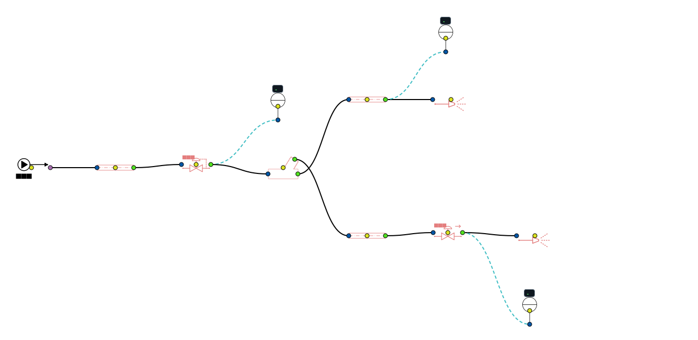

   Export SVG de la scène livrée, par le chemin de l'action « Exporter la scène en
   SVG… » de l'IHM.

**Ce qu'elle montre.** Un réseau à 6 bar ramené à 3,5 bar par un réducteur de pression aval, qui alimente deux buses : l'une libre, l'autre derrière un limiteur de débit.

**Nœuds employés** (12 nœuds, 11 liaisons) : Tuyau droit ×3, Capteur ×3, Émetteur (buse, sprinkler, fuite) ×2, Source, Réducteur de pression aval (PRV), Té divergent, Limiteur de débit (FCV).

**Ouvrir.** Menu **File > Exemples > 3 - Hydraulique > Regulation > Reducteur de pression et buses**, puis bouton **Simuler** (la scène s'ouvre sans calcul). Elle est calculée par le solveur nodal des réseaux (Newton sur les pressions) ; statut affiché : **convergé** (point fixe constaté).

**Ce qu'on observe.** Le réducteur ramène le réseau à **3,50 bar** (régime : régule (consigne tenue)) et laisse passer 9,07 m³/h. La buse A, libre, débite 6,07 m³/h sous 2,61 bar ; la buse B est tenue par le limiteur à 3,00 m³/h, qui absorbe 2,06 bar. Un émetteur (buse, sprinkler, fuite) débite selon la pression qu'il reçoit : Q = K·√P.

Valeurs affichées par les nœuds après **Simuler** (relevé automatique) :

.. list-table::
   :header-rows: 1
   :widths: 26 16 58

   * - Nœud
     - Type
     - Valeurs affichées
   * - Tuyau DN50 - 30 m
     - Tuyau droit
     - Vitesse (m/s) = 1.2829 ; Reynolds (-) = 63951 ; Perte de charge (Pa) = 11427.64
   * - Réducteur de pression 3,5 bar
     - Réducteur de pression aval (PRV)
     - Perte de charge absorbée (Pa) = 238572.36 ; P sortie (bar) = 3.5000 ; Débit (m³/h) = 9.0681
   * - P aval réducteur
     - Capteur
     - 3.5 bar
   * - Collecteur
     - Té divergent
     - Débit sortie straight (kg/s) = 1.6829
   * - Antenne A DN25
     - Tuyau droit
     - Vitesse (m/s) = 3.4338 ; Reynolds (-) = 85588 ; Perte de charge (Pa) = 88920.80
   * - Buse A (K 80)
     - Émetteur (buse, sprinkler, fuite)
     - Débit rejeté (m³/h) = 6.0681 ; Pression à la buse (bar) = 2.6114
   * - Antenne B DN25
     - Tuyau droit
     - Vitesse (m/s) = 1.6977 ; Reynolds (-) = 42314 ; Perte de charge (Pa) = 23197.07
   * - Limiteur 3 m³/h
     - Limiteur de débit (FCV)
     - Perte de charge absorbée (Pa) = 205725.78 ; P sortie (bar) = 1.2023 ; Débit (m³/h) = 3.0000
   * - Buse B (K 115)
     - Émetteur (buse, sprinkler, fuite)
     - Débit rejeté (m³/h) = 3.0000 ; Pression à la buse (bar) = 1.2023
   * - Q buse A
     - Capteur
     - 6.1 m³/h
   * - Q buse B
     - Capteur
     - 3.0 m³/h

Regulateur de pression differentielle (STAP)
~~~~~~~~~~~~~~~~~~~~~~~~~~~~~~~~~~~~~~~~~~~~

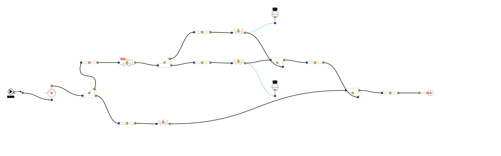

   Export SVG de la scène livrée, par le chemin de l'action « Exporter la scène en
   SVG… » de l'IHM.

**Ce qu'elle montre.** Un réseau à deux étages dont une branche est tenue par un régulateur de pression différentielle (type STAP).

**Nœuds employés** (19 nœuds, 20 liaisons) : Tuyau droit ×6, Vanne TA ×3, Té divergent ×2, Té convergent ×2, Capteur ×2, Source, Pompe, Régulateur de Δp, Sortie.

**Ouvrir.** Menu **File > Exemples > 3 - Hydraulique > Regulation > Regulateur de pression differentielle (STAP)**, puis bouton **Simuler** (la scène s'ouvre sans calcul). Elle est calculée par le solveur nodal des réseaux (Newton sur les pressions) ; statut affiché : **convergé** (point fixe constaté).

**Ce qu'on observe.** La pompe réseau débite 28,49 m³/h sous 24,0 m de HMT ; le régulateur de pression différentielle tient la pression de sa branche quelle que soit la demande des autres : étage 1 2,8 m³/h, étage 2 2,0 m³/h. Modèle : :doc:`../004-hydraulic/regulateur_dp`.

Valeurs affichées par les nœuds après **Simuler** (relevé automatique) :

.. list-table::
   :header-rows: 1
   :widths: 26 16 58

   * - Nœud
     - Type
     - Valeurs affichées
   * - Pompe réseau
     - Pompe
     - P refoulement (bar) = 4.3458 ; Puissance à l'arbre (kW) = 2.619 ; Puissance électrique absorbée (kW) = - (rendement moteur ou variateur non renseigné)
   * - Départ colonnes
     - Té divergent
     - Débit sortie straight (kg/s) = 6.5701
   * - Aller colonne
     - Tuyau droit
     - Vitesse (m/s) = 0.6788 ; Reynolds (-) = 33827 ; Perte de charge (Pa) = 2337.46
   * - STAP colonne
     - Régulateur de Δp
     - Perte de charge absorbée (Pa) = 189729.17 ; Pression sortie (bar) = 2.3949 ; Régime = régule (consigne tenue)
   * - Étage 1 / étage 2
     - Té divergent
     - Débit sortie straight (kg/s) = 0.5528
   * - Étage 1
     - Tuyau droit
     - Vitesse (m/s) = 0.9686 ; Reynolds (-) = 30892 ; Perte de charge (Pa) = 5935.62
   * - Équilibrage étage 1
     - Vanne TA
     - Perte de charge (Pa) = 13025.83 ; Pression sortie (bar) = 2.1983 ; Kv (-) = 7.770
   * - Étage 2
     - Tuyau droit
     - Vitesse (m/s) = 0.6886 ; Reynolds (-) = 21962 ; Perte de charge (Pa) = 5278.99
   * - Équilibrage étage 2
     - Vanne TA
     - Perte de charge (Pa) = 14587.25 ; Pression sortie (bar) = 2.1962 ; Kv (-) = 5.220
   * - Retour colonne
     - Tuyau droit
     - Vitesse (m/s) = 0.6788 ; Reynolds (-) = 33827 ; Perte de charge (Pa) = 2337.46
   * - Autre circuit
     - Tuyau droit
     - Vitesse (m/s) = 3.3520 ; Reynolds (-) = 167045 ; Perte de charge (Pa) = 94779.42
   * - Équilibrage autre circuit
     - Vanne TA
     - Perte de charge (Pa) = 121448.58 ; Pression sortie (bar) = 2.1846 ; Kv (-) = 21.500
   * - Retour
     - Tuyau droit
     - Vitesse (m/s) = 2.3851 ; Reynolds (-) = 154516 ; Perte de charge (Pa) = 17797.48
   * - Q étage 1
     - Capteur
     - 2.8 m³/h
   * - …
     - 
     - 1 autres nœuds non reproduits

Regulation de debit par PID
~~~~~~~~~~~~~~~~~~~~~~~~~~~

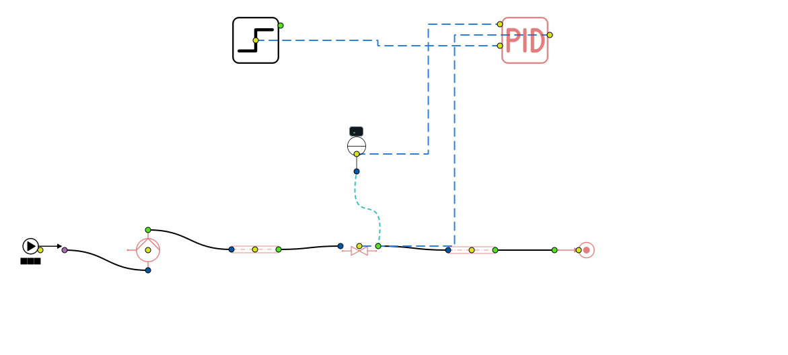

   Export SVG de la scène livrée, par le chemin de l'action « Exporter la scène en
   SVG… » de l'IHM.

**Ce qu'elle montre.** Une boucle de régulation de débit : capteur de débit, régulateur PID, vanne de régulation motorisée, consigne en échelon.

**Nœuds employés** (9 nœuds, 9 liaisons) : Tuyau droit ×2, Source, Pompe, Vanne générique (Kv), Sortie, Capteur, PID, Échelon.

**Ouvrir.** Menu **File > Exemples > 3 - Hydraulique > Regulation > Regulation de debit par PID**, puis bouton **Simuler** (la scène s'ouvre sans calcul). Elle est calculée par le solveur nodal des réseaux (Newton sur les pressions) ; statut affiché : **convergé** (point fixe constaté).

**Ce qu'on observe.** Le calcul stationnaire donne 5,15 m³/h sous 16,8 m de HMT et 5,1 m³/h dans la branche ; la vanne de régulation prend 140 kPa. Le PID n'agit qu'en simulation temporelle : la régulation (consigne en échelon, capteur → PID → vanne) est expliquée dans :doc:`../013-simulation-temporelle/index`.

Valeurs affichées par les nœuds après **Simuler** (relevé automatique) :

.. list-table::
   :header-rows: 1
   :widths: 26 16 58

   * - Nœud
     - Type
     - Valeurs affichées
   * - Pompe
     - Pompe
     - P refoulement (bar) = 3.6447 ; Puissance à l'arbre (kW) = 0.409 ; Puissance électrique absorbée (kW) = - (rendement moteur ou variateur non renseigné)
   * - Aller DN40
     - Tuyau droit
     - Vitesse (m/s) = 1.1376 ; Reynolds (-) = 45353 ; Perte de charge (Pa) = 12073.95
   * - Vanne de régulation (Kvs 25)
     - Vanne générique (Kv)
     - Perte de charge (Pa) = 140325.41 ; Pression sortie (bar) = 2.1207
   * - Retour DN40
     - Tuyau droit
     - Vitesse (m/s) = 1.1376 ; Reynolds (-) = 45353 ; Perte de charge (Pa) = 12073.95
   * - Débit branche
     - Capteur
     - 5.1 m³/h
   * - Consigne débit (m³/h)
     - Échelon
     - Valeur de sortie = 0

Vanne d isolement fermee
~~~~~~~~~~~~~~~~~~~~~~~~

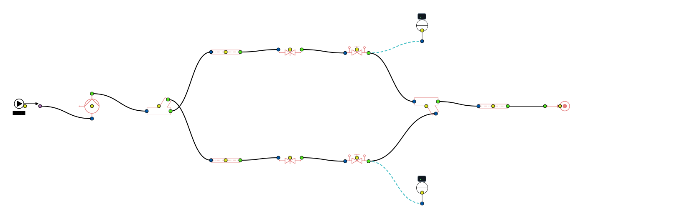

   Export SVG de la scène livrée, par le chemin de l'action « Exporter la scène en
   SVG… » de l'IHM.

**Ce qu'elle montre.** Deux circuits en parallèle, dont l'un est fermé par sa vanne d'isolement.

**Nœuds employés** (14 nœuds, 14 liaisons) : Tuyau droit ×3, Vanne d'isolement (Gate) ×2, Vanne TA ×2, Capteur ×2, Source, Pompe, Té divergent, Té convergent, Sortie.

**Ouvrir.** Menu **File > Exemples > 3 - Hydraulique > Regulation > Vanne d isolement fermee**, puis bouton **Simuler** (la scène s'ouvre sans calcul). Elle est calculée par le solveur nodal des réseaux (Newton sur les pressions) ; statut affiché : **convergé** (point fixe constaté).

**Ce qu'on observe.** La vanne B est fermée : le circuit B affiche 0,0 m³/h et tout le débit passe par A (24,8 m³/h). La pompe remonte sur sa courbe : 24,80 m³/h sous 25,9 m de HMT. Modèle : :doc:`../004-hydraulic/vanne_isolement`.

Valeurs affichées par les nœuds après **Simuler** (relevé automatique) :

.. list-table::
   :header-rows: 1
   :widths: 26 16 58

   * - Nœud
     - Type
     - Valeurs affichées
   * - Pompe
     - Pompe
     - P refoulement (bar) = 4.5333 ; Puissance à l'arbre (kW) = 2.396 ; Puissance électrique absorbée (kW) = - (rendement moteur ou variateur non renseigné)
   * - Départ
     - Té divergent
     - Débit sortie straight (kg/s) = 6.8754
   * - Circuit A
     - Tuyau droit
     - Vitesse (m/s) = 3.5077 ; Reynolds (-) = 174807 ; Perte de charge (Pa) = 103459.83
   * - Vanne A (ouverte)
     - Vanne d'isolement (Gate)
     - Vitesse (m/s) = 3.5077 ; Reynolds (-) = 174807 ; Perte de charge (Pa) = 3224.24
   * - Équilibrage A
     - Vanne TA
     - Perte de charge (Pa) = 132996.93 ; Pression sortie (bar) = 2.1365 ; Kv (-) = 21.500
   * - Circuit B
     - Tuyau droit
     - Vitesse (m/s) = 0.0000 ; Reynolds (-) = 0 ; Perte de charge (Pa) = 0.00
   * - Vanne B (FERMÉE)
     - Vanne d'isolement (Gate)
     - Vitesse (m/s) = 0.0000 ; Reynolds (-) = 0 ; Perte de charge (Pa) = 0.00
   * - Équilibrage B
     - Vanne TA
     - Perte de charge (Pa) = 0.00 ; Pression sortie (bar) = 4.5118 ; Kv (-) = 21.500
   * - Retour
     - Tuyau droit
     - Vitesse (m/s) = 2.0756 ; Reynolds (-) = 134467 ; Perte de charge (Pa) = 13649.64
   * - Q circuit A
     - Capteur
     - 24.8 m³/h
   * - Q circuit B
     - Capteur
     - 0.0 m³/h

Vannes 2 voies - debit variable
~~~~~~~~~~~~~~~~~~~~~~~~~~~~~~~

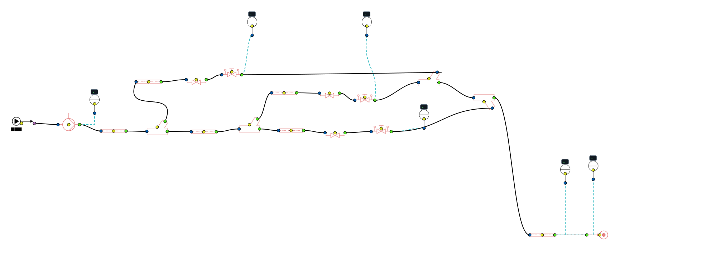

   Export SVG de la scène livrée, par le chemin de l'action « Exporter la scène en
   SVG… » de l'IHM.

**Ce qu'elle montre.** Un réseau à débit variable : trois terminaux régulés par vanne 2 voies, chacun avec sa vanne d'équilibrage.

**Nœuds employés** (25 nœuds, 26 liaisons) : Tuyau droit ×6, Capteur ×6, Vanne générique (Kv) ×3, Vanne TA ×3, Té divergent ×2, Té convergent ×2, Source, Pompe, Sortie.

**Ouvrir.** Menu **File > Exemples > 3 - Hydraulique > Regulation > Vannes 2 voies - debit variable**, puis bouton **Simuler** (la scène s'ouvre sans calcul). Elle est calculée par le solveur nodal des réseaux (Newton sur les pressions) ; statut affiché : **convergé** (point fixe constaté).

**Ce qu'on observe.** Trois terminaux à vanne 2 voies ouvertes différemment : 13,4, 4,2 et 1,5 m³/h. La pompe réseau fournit la somme : 19,21 m³/h sous 28,3 m de HMT. En fermant une vanne (double-clic, onglet *Configuration*), on voit le débit total baisser et la pression monter.

**Pourquoi le débit total chute.** Chaque vanne 2 voies est une résistance variable : en se fermant, elle diminue son Kv effectif, le débit de son terminal baisse, et comme rien ne le dérive ailleurs, le débit total de la pompe baisse aussi. La pompe remonte alors sur sa courbe : sa HMT augmente et les terminaux restés ouverts reçoivent un peu plus de pression, donc un peu plus de débit. C'est le principe du réseau à **débit variable**, celui qui permet de réduire la vitesse de la pompe quand la demande baisse.

**Paramètres à changer.** Dans chaque *Vanne générique (Kv)* : l'« Ouverture (%) », le « Coefficient Kv max » et la « Courbe d'ouverture » (logarithmique ou linéaire) ; un régulateur peut piloter l'ouverture par la socket de signal (le champ se grise alors). Dans les *Vannes TA* : la position de réglage, qui fixe la part de pression de chaque terminal (:doc:`../004-hydraulic/TA_valve`). Dans la *Pompe* : sa courbe ou sa fréquence (:doc:`../002-thermodynamic_cycles/pompe`).

**Pièges.** Une vanne réglée à 0 % n'est pas étanche dans le modèle (le Kv vaut 0,1 % du Kvs). La loi d'ouverture par défaut n'a pas de source : pour juger l'autorité d'une vanne, chargez la caractéristique du constructeur. Le ζ exporté en mode « historique » est faux dès qu'on change le Kv max ; la perte de charge, elle, est juste. Détails et signaux publiés (``Q_m3_h``, ``delta_P``, ``ouverture`` en fraction) : :doc:`../004-hydraulic/vanne_generique`.

Valeurs affichées par les nœuds après **Simuler** (relevé automatique) :

.. list-table::
   :header-rows: 1
   :widths: 26 16 58

   * - Nœud
     - Type
     - Valeurs affichées
   * - Pompe réseau
     - Pompe
     - P refoulement (bar) = 4.7714 ; Puissance à l'arbre (kW) = 2.068 ; Puissance électrique absorbée (kW) = - (rendement moteur ou variateur non renseigné)
   * - Q terminal 1
     - Capteur
     - 13.4 m³/h
   * - Q terminal 2
     - Capteur
     - 4.2 m³/h
   * - Q terminal 3
     - Capteur
     - 1.5 m³/h

Reseau de distribution
~~~~~~~~~~~~~~~~~~~~~~

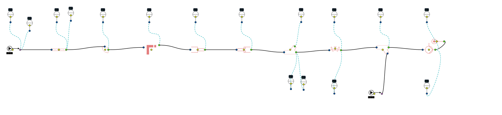

   Export SVG de la scène livrée, par le chemin de l'action « Exporter la scène en
   SVG… » de l'IHM.

**Ce qu'elle montre.** Un réseau de distribution qui rassemble presque toutes les singularités hydrauliques de la bibliothèque, jalonné de capteurs.

**Nœuds employés** (28 nœuds, 27 liaisons) : Capteur ×16, Source ×2, Tuyau droit, Coude courbe, Coude vif, Retrecissement, Elargissement, Té divergent, Vanne TA, Té convergent, Pompe, Sortie.

**Ouvrir.** Menu **File > Exemples > 3 - Hydraulique > Reseau de distribution**, puis bouton **Simuler** (la scène s'ouvre sans calcul). Elle est calculée par le solveur nodal des réseaux (Newton sur les pressions) ; statut affiché : **convergé** (point fixe constaté).

**Ce qu'on observe.** La pompe refoule à 7,50 bar pour 23,76 m³/h sous 26,8 m de HMT ; les seize capteurs relèvent pression et débit le long des singularités (coudes, rétrécissement, élargissement, tés, vanne d'équilibrage). C'est la scène qui rassemble le plus de modèles de :doc:`../004-hydraulic/index`.

Valeurs affichées par les nœuds après **Simuler** (relevé automatique) :

.. list-table::
   :header-rows: 1
   :widths: 26 16 58

   * - Nœud
     - Type
     - Valeurs affichées
   * - Pompe
     - Pompe
     - P refoulement (bar) = 7.5000 ; Puissance à l'arbre (kW) = 2.256 ; Puissance électrique absorbée (kW) = - (rendement moteur ou variateur non renseigné)

Usine - reseau industriel maille
~~~~~~~~~~~~~~~~~~~~~~~~~~~~~~~~

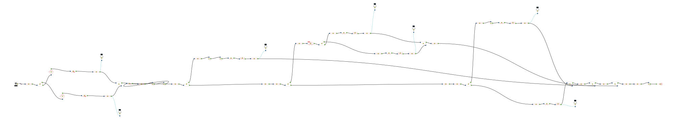

   Export SVG de la scène livrée, par le chemin de l'action « Exporter la scène en
   SVG… » de l'IHM.

**Ce qu'elle montre.** Le réseau d'eau d'une usine, **maillé** : deux pompes, clapets, vanne d'isolement, régulateur de pression différentielle, cinq branches.

**Nœuds employés** (65 nœuds, 69 liaisons) : Tuyau droit ×22, Capteur ×7, Coude courbe ×6, Té divergent ×5, Té convergent ×5, Vanne générique (Kv) ×5, Vanne TA ×5, Pompe ×2, Clapet anti-retour ×2, Confuseur conique ×2, Source, Vanne d'isolement (Gate), Régulateur de Δp, Sortie.

**Ouvrir.** Menu **File > Exemples > 3 - Hydraulique > Reseaux mailles > Usine - reseau industriel maille**, puis bouton **Simuler** (la scène s'ouvre sans calcul). Elle est calculée par le solveur nodal des réseaux (Newton sur les pressions) ; statut affiché : **convergé** (point fixe constaté).

**Ce qu'on observe.** Deux pompes en parallèle (P1 47,5 m³/h, P2 46,1 m³/h) alimentent un réseau **maillé** : branches A 14,3, B1 6,5, B2 3,0, C 24,8 et tour 44,9 m³/h. Seul le solveur nodal répartit correctement les débits dans une maille ; l'IHM le choisit d'elle-même pour cette scène.

Valeurs affichées par les nœuds après **Simuler** (relevé automatique) :

.. list-table::
   :header-rows: 1
   :widths: 26 16 58

   * - Nœud
     - Type
     - Valeurs affichées
   * - P1
     - Pompe
     - P refoulement (bar) = 5.6019 ; Puissance à l'arbre (kW) = 4.773 ; Puissance électrique absorbée (kW) = - (rendement moteur ou variateur non renseigné)
   * - P2
     - Pompe
     - P refoulement (bar) = 5.5986 ; Puissance à l'arbre (kW) = 4.645 ; Puissance électrique absorbée (kW) = - (rendement moteur ou variateur non renseigné)
   * - Q P1
     - Capteur
     - 47.5 m³/h
   * - Q P2
     - Capteur
     - 46.1 m³/h
   * - Q A
     - Capteur
     - 14.3 m³/h
   * - Q B1
     - Capteur
     - 6.5 m³/h
   * - Q B2
     - Capteur
     - 3.0 m³/h
   * - Q C
     - Capteur
     - 24.8 m³/h
   * - Q tour
     - Capteur
     - 44.9 m³/h

Montage en injection
~~~~~~~~~~~~~~~~~~~~

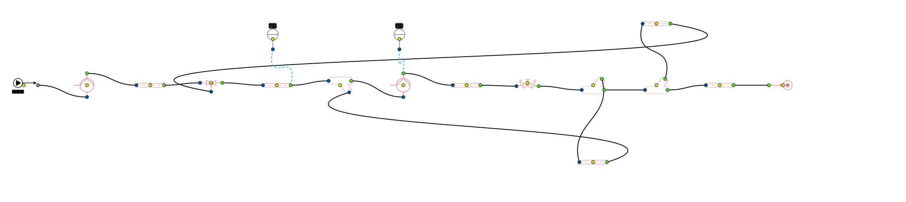

   Export SVG de la scène livrée, par le chemin de l'action « Exporter la scène en
   SVG… » de l'IHM.

**Ce qu'elle montre.** Vanne 3 voies en montage **en injection** : deux pompes, primaire et secondaire.

**Nœuds employés** (17 nœuds, 18 liaisons) : Tuyau droit ×6, Pompe ×2, Té divergent ×2, Capteur ×2, Source, Vanne 3 voies, Té convergent, Vanne TA, Sortie.

**Ouvrir.** Menu **File > Exemples > 3 - Hydraulique > Vanne 3 voies > Montage en injection**, puis bouton **Simuler** (la scène s'ouvre sans calcul). Elle est calculée par le solveur nodal des réseaux (Newton sur les pressions) ; statut affiché : **convergé** (point fixe constaté).

**Ce qu'on observe.** La pompe primaire (3,25 m³/h sous 17,6 m de HMT) injecte 3,4 m³/h dans la boucle secondaire, dont la pompe fait circuler 8,4 m³/h. Montage expliqué dans :doc:`../004-hydraulic/valve_3_voies`.

**Pourquoi le montage découple primaire et secondaire.** Chaque boucle a sa pompe : la pompe secondaire fait circuler un débit à peu près constant dans les émetteurs, quelle que soit la position de la vanne. La vanne 3 voies ne règle que la part de débit **primaire injectée** ; le reste du secondaire recircule par le bypass. La puissance livrée varie donc par la température de départ, pas par le débit des émetteurs, et les deux pompes ne se « voient » qu'à travers la vanne et le bypass.

**Paramètres à changer.** Dans la *Vanne 3 voies* : l'« Ouverture (%) », la « Caractéristique vanne », le « DN (déduit le Kvs) », et pour juger l'autorité la « ΔP branche variable (bar) » avec le « Débit design autorité » (à saisir : à 0, le calcul prend le débit maximal du nœud, pas le débit réel). Dans les deux *Pompes* : leurs courbes ; dans la *Vanne TA* : son réglage, qui équilibre la branche primaire.

**Pièges.** L'ouverture est une **commande** : la vanne ne se règle pas seule sur une température (la régulation interne a été retirée, voir :doc:`../004-hydraulic/valve_3_voies`) ; pour une régulation, reliez un régulateur à son signal d'ouverture. Le verdict de dimensionnement affiché (« Dimensionnement ») est **inversé** par rapport à son message : lisez l'autorité et le message. Signaux publiés (``alpha`` en fraction, ``opening`` en %, ``dp_valve_bar`` en bar) : même page.

Valeurs affichées par les nœuds après **Simuler** (relevé automatique) :

.. list-table::
   :header-rows: 1
   :widths: 26 16 58

   * - Nœud
     - Type
     - Valeurs affichées
   * - Pompe primaire
     - Pompe
     - P refoulement (bar) = 3.1898 ; Puissance à l'arbre (kW) = 0.317 ; Puissance électrique absorbée (kW) = - (rendement moteur ou variateur non renseigné)
   * - Aller primaire
     - Tuyau droit
     - Vitesse (m/s) = 0.7183 ; Reynolds (-) = 69613 ; Perte de charge (Pa) = 1492.47
   * - Injection
     - Tuyau droit
     - Vitesse (m/s) = 0.7482 ; Reynolds (-) = 72511 ; Perte de charge (Pa) = 806.16
   * - Pompe secondaire
     - Pompe
     - P refoulement (bar) = 2.8934 ; Puissance à l'arbre (kW) = 0.501 ; Puissance électrique absorbée (kW) = - (rendement moteur ou variateur non renseigné)
   * - Émetteurs
     - Tuyau droit
     - Vitesse (m/s) = 1.8457 ; Reynolds (-) = 178882 ; Perte de charge (Pa) = 54720.79
   * - Équilibrage émetteurs
     - Vanne TA
     - Perte de charge (Pa) = 83095.27 ; Pression sortie (bar) = 1.5153 ; Kv (-) = 9.160
   * - Retour secondaire
     - Té divergent
     - Débit sortie straight (kg/s) = 0.9193
   * - Découplage
     - Tuyau droit
     - Vitesse (m/s) = 1.0976 ; Reynolds (-) = 106370 ; Perte de charge (Pa) = 669.30
   * - Retour vers primaire
     - Té divergent
     - Débit sortie straight (kg/s) = 0.8826
   * - Bypass vanne
     - Tuyau droit
     - Vitesse (m/s) = 0.0299 ; Reynolds (-) = 2898 ; Perte de charge (Pa) = 1.20
   * - Retour primaire
     - Tuyau droit
     - Vitesse (m/s) = 0.7183 ; Reynolds (-) = 69613 ; Perte de charge (Pa) = 1492.47
   * - Q injecté
     - Capteur
     - 3.4 m³/h
   * - Q secondaire
     - Capteur
     - 8.4 m³/h

Montage en melange
~~~~~~~~~~~~~~~~~~

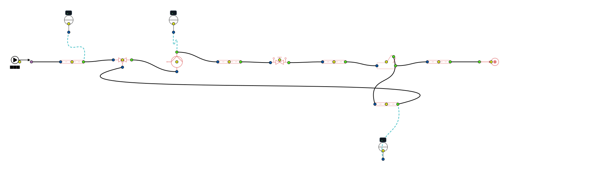

   Export SVG de la scène livrée, par le chemin de l'action « Exporter la scène en
   SVG… » de l'IHM.

**Ce qu'elle montre.** Vanne 3 voies en montage **en mélange** : une pompe secondaire, un bypass de mélange.

**Nœuds employés** (14 nœuds, 14 liaisons) : Tuyau droit ×5, Capteur ×3, Source, Vanne 3 voies, Pompe, Vanne TA, Té divergent, Sortie.

**Ouvrir.** Menu **File > Exemples > 3 - Hydraulique > Vanne 3 voies > Montage en melange**, puis bouton **Simuler** (la scène s'ouvre sans calcul). Elle est calculée par le solveur nodal des réseaux (Newton sur les pressions) ; statut affiché : **convergé** (point fixe constaté).

**Ce qu'on observe.** La vanne 3 voies mélange 2,0 m³/h venus du primaire et 1,9 m³/h repris sur le retour : le secondaire circule à 3,9 m³/h. Voir :doc:`../004-hydraulic/valve_3_voies`.

Valeurs affichées par les nœuds après **Simuler** (relevé automatique) :

.. list-table::
   :header-rows: 1
   :widths: 26 16 58

   * - Nœud
     - Type
     - Valeurs affichées
   * - Aller primaire
     - Tuyau droit
     - Vitesse (m/s) = 0.4445 ; Reynolds (-) = 43073 ; Perte de charge (Pa) = 303.02
   * - Pompe secondaire
     - Pompe
     - P refoulement (bar) = 3.2574 ; Puissance à l'arbre (kW) = 0.351 ; Puissance électrique absorbée (kW) = - (rendement moteur ou variateur non renseigné)
   * - Émetteurs (aller)
     - Tuyau droit
     - Vitesse (m/s) = 0.8728 ; Reynolds (-) = 84590 ; Perte de charge (Pa) = 12964.12
   * - Équilibrage émetteurs
     - Vanne TA
     - Perte de charge (Pa) = 9516.44 ; Pression sortie (bar) = 3.0326 ; Kv (-) = 12.800
   * - Émetteurs (retour)
     - Tuyau droit
     - Vitesse (m/s) = 0.8728 ; Reynolds (-) = 84590 ; Perte de charge (Pa) = 12964.12
   * - Té de retour
     - Té divergent
     - Débit sortie straight (kg/s) = 0.5461
   * - Bypass de mélange
     - Tuyau droit
     - Vitesse (m/s) = 0.4284 ; Reynolds (-) = 41516 ; Perte de charge (Pa) = 169.77
   * - Retour primaire
     - Tuyau droit
     - Vitesse (m/s) = 0.4445 ; Reynolds (-) = 43073 ; Perte de charge (Pa) = 303.02
   * - Q primaire (voie directe)
     - Capteur
     - 2.0 m³/h
   * - Q bypass
     - Capteur
     - 1.9 m³/h
   * - Q secondaire
     - Capteur
     - 3.9 m³/h

Montage en repartition-decharge
~~~~~~~~~~~~~~~~~~~~~~~~~~~~~~~

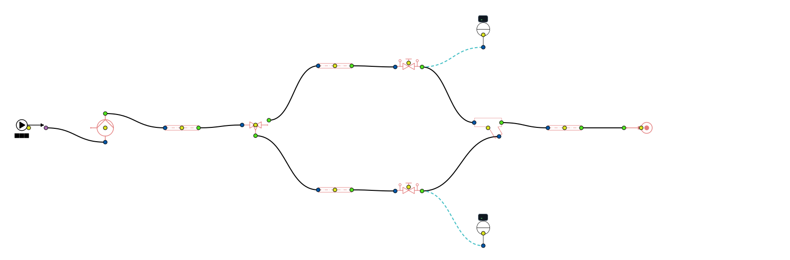

   Export SVG de la scène livrée, par le chemin de l'action « Exporter la scène en
   SVG… » de l'IHM.

**Ce qu'elle montre.** Vanne 3 voies en montage **en répartition** (décharge) : la vanne partage le débit primaire entre l'utilisateur et un circuit de décharge.

**Nœuds employés** (13 nœuds, 13 liaisons) : Tuyau droit ×4, Vanne TA ×2, Capteur ×2, Source, Pompe, Vanne 3 voies, Té convergent, Sortie.

**Ouvrir.** Menu **File > Exemples > 3 - Hydraulique > Vanne 3 voies > Montage en repartition-decharge**, puis bouton **Simuler** (la scène s'ouvre sans calcul). Elle est calculée par le solveur nodal des réseaux (Newton sur les pressions) ; statut affiché : **convergé** (point fixe constaté).

**Ce qu'on observe.** La pompe primaire (9,64 m³/h sous 13,7 m de HMT) voit un débit presque constant ; la vanne le répartit entre l'utilisateur (6,4 m³/h) et la décharge (3,2 m³/h). Voir :doc:`../004-hydraulic/valve_3_voies`.

Valeurs affichées par les nœuds après **Simuler** (relevé automatique) :

.. list-table::
   :header-rows: 1
   :widths: 26 16 58

   * - Nœud
     - Type
     - Valeurs affichées
   * - Pompe primaire
     - Pompe
     - P refoulement (bar) = 3.3095 ; Puissance à l'arbre (kW) = 0.533 ; Puissance électrique absorbée (kW) = - (rendement moteur ou variateur non renseigné)
   * - Aller
     - Tuyau droit
     - Vitesse (m/s) = 2.1313 ; Reynolds (-) = 206552 ; Perte de charge (Pa) = 12061.84
   * - Circuit utilisateur
     - Tuyau droit
     - Vitesse (m/s) = 1.4220 ; Reynolds (-) = 137811 ; Perte de charge (Pa) = 22023.78
   * - Équilibrage circuit
     - Vanne TA
     - Perte de charge (Pa) = 25257.43 ; Pression sortie (bar) = 2.1296 ; Kv (-) = 12.800
   * - Décharge (bypass)
     - Tuyau droit
     - Vitesse (m/s) = 0.7093 ; Reynolds (-) = 68742 ; Perte de charge (Pa) = 728.69
   * - Équilibrage décharge
     - Vanne TA
     - Perte de charge (Pa) = 26358.65 ; Pression sortie (bar) = 2.1236 ; Kv (-) = 6.250
   * - Retour
     - Tuyau droit
     - Vitesse (m/s) = 2.1313 ; Reynolds (-) = 206552 ; Perte de charge (Pa) = 12061.84
   * - Q circuit
     - Capteur
     - 6.4 m³/h
   * - Q décharge
     - Capteur
     - 3.2 m³/h

Vanne grande ouverte
~~~~~~~~~~~~~~~~~~~~

   Export SVG de la scène livrée, par le chemin de l'action « Exporter la scène en
   SVG… » de l'IHM.

**Ce qu'elle montre.** Le montage en mélange, vanne grande ouverte et bypass fermé.

**Nœuds employés** (14 nœuds, 14 liaisons) : Tuyau droit ×5, Capteur ×3, Source, Vanne 3 voies, Pompe, Vanne TA, Té divergent, Sortie.

**Ouvrir.** Menu **File > Exemples > 3 - Hydraulique > Vanne 3 voies > Vanne grande ouverte**, puis bouton **Simuler** (la scène s'ouvre sans calcul). Elle est calculée par le solveur nodal des réseaux (Newton sur les pressions) ; statut affiché : **convergé** (point fixe constaté).

**Ce qu'on observe.** Voie directe grande ouverte, bypass fermé : 0,0 m³/h dans le bypass, et le secondaire (7,3 m³/h) prend tout le primaire (7,3 m³/h). C'est le cas limite du montage en mélange.

Valeurs affichées par les nœuds après **Simuler** (relevé automatique) :

.. list-table::
   :header-rows: 1
   :widths: 26 16 58

   * - Nœud
     - Type
     - Valeurs affichées
   * - Aller primaire
     - Tuyau droit
     - Vitesse (m/s) = 1.6037 ; Reynolds (-) = 155419 ; Perte de charge (Pa) = 3473.11
   * - Pompe secondaire
     - Pompe
     - P refoulement (bar) = 4.0895 ; Puissance à l'arbre (kW) = 0.471 ; Puissance électrique absorbée (kW) = - (rendement moteur ou variateur non renseigné)
   * - Émetteurs (aller)
     - Tuyau droit
     - Vitesse (m/s) = 1.6037 ; Reynolds (-) = 155419 ; Perte de charge (Pa) = 41677.38
   * - Équilibrage émetteurs
     - Vanne TA
     - Perte de charge (Pa) = 32125.60 ; Pression sortie (bar) = 3.3515 ; Kv (-) = 12.800
   * - Émetteurs (retour)
     - Tuyau droit
     - Vitesse (m/s) = 1.6037 ; Reynolds (-) = 155419 ; Perte de charge (Pa) = 41677.38
   * - Té de retour
     - Té divergent
     - Débit sortie straight (kg/s) = 1.9706
   * - Bypass de mélange
     - Tuyau droit
     - Vitesse (m/s) = 0.0000 ; Reynolds (-) = 0 ; Perte de charge (Pa) = 0.00
   * - Retour primaire
     - Tuyau droit
     - Vitesse (m/s) = 1.6037 ; Reynolds (-) = 155419 ; Perte de charge (Pa) = 3473.11
   * - Q primaire (voie directe)
     - Capteur
     - 7.3 m³/h
   * - Q bypass
     - Capteur
     - 0.0 m³/h
   * - Q secondaire
     - Capteur
     - 7.3 m³/h

Composants et utilités
----------------------

Appoint electrique d'une chaufferie gaz - spot et aFRR
~~~~~~~~~~~~~~~~~~~~~~~~~~~~~~~~~~~~~~~~~~~~~~~~~~~~~~

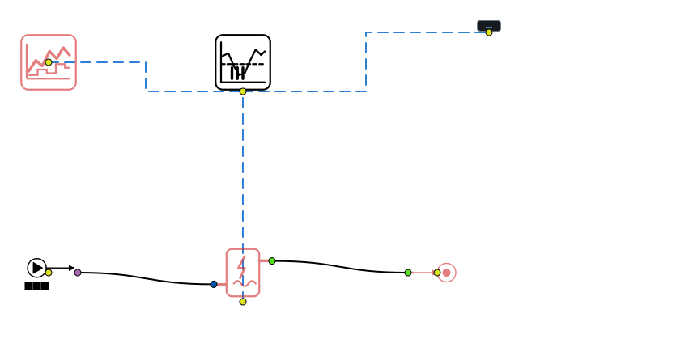

   Export SVG de la scène livrée, par le chemin de l'action « Exporter la scène en
   SVG… » de l'IHM.

**Ce qu'elle montre.** Une chaudière électrique de 1 MW en appoint d'une chaufferie gaz, pilotée sur une année de prix spot et de charge thermique synthétiques, avec participation à la réserve aFRR de RTE ; un afficheur multi-signaux résume le bilan.

**Nœuds employés** (6 nœuds, 5 liaisons) : Séries chronologiques, Source, Chaudière électrique, Sortie, Appoint électrique : dispatch (France), Afficheur multi-signaux.

**Ouvrir.** Menu **File > Exemples > 4 - Composants et utilites > Appoint electrique d'une chaufferie gaz - spot et aFRR**, puis bouton **Simuler** (la scène s'ouvre sans calcul). Elle est calculée par le moteur historique (une passe, de l'amont vers les sorties) ; statut affiché : **convergé** (point fixe constaté).

**Ce qu'on observe.** Sur une année synthétique de 8 760 pas horaires, la chaudière électrique prend **28,9 %** de la chaleur (2 889 MWh basculés du gaz vers l'électricité, aux heures où le spot est sous le coût marginal du gaz). Économie d'énergie 103 272 €, revenus de réserve aFRR 86 104 €, surcoût de puissance souscrite 32 300 € : **gain net 157 076 € par an**, affiché par l'afficheur multi-signaux. Modèle : :doc:`../010-achat-energie/appoint_electrique_spot`.

Valeurs affichées par les nœuds après **Simuler** (relevé automatique) :

.. list-table::
   :header-rows: 1
   :widths: 26 16 58

   * - Nœud
     - Type
     - Valeurs affichées
   * - Charge thermique et prix (synthetiques)
     - Séries chronologiques
     - Pas de temps = 8760 ; Instant courant (s) = 0 ; Indice courant = 0
   * - Retour chaufferie
     - Source
     - Temp. effective (°C) = 60.000 ; Pression effective (bar) = 3.000
   * - Chaudiere electrique 1 MW
     - Chaudière électrique
     - Chaleur utile (kW) = 921.8 ; Puissance électrique (kW) = 931.1 ; Taux de charge (%) = 93.1
   * - Depart chaufferie
     - Sortie
     - Température (°C) = 80.0 °C ; Pression (bar) = 3.000 bar ; Débit (kg/h) = 39600.000 kg/h
   * - Appoint electrique : dispatch
     - Appoint électrique : dispatch (France)
     - Gaz marginal retenu (€/MWh PCS) = 63.37 (champ saisi) ; PS souscrite pour l'appoint = à partir de HPH ; Spot d'équilibre moyen (€/MWh) = 41.46
   * - Resultats
     - Afficheur multi-signaux
     - Gain net : 157076 EUR/an ; PS souscrite : à partir de HPH ; Part electrique : 28.9 % ; Economie energie : 103272 EUR ; Revenus aFRR : 86104 EUR ; Surcout PS : 32300 EUR ; Valeurs = 157076 ; à partir de HPH ; 28.9 ; 103272 ; 86104 ; 32300 ; Source = Appoint électrique : dispatch (France)

Ballon stratifie
~~~~~~~~~~~~~~~~

   Export SVG de la scène livrée, par le chemin de l'action « Exporter la scène en
   SVG… » de l'IHM.

**Ce qu'elle montre.** Un ballon de stockage d'eau chaude **stratifié** (30 strates), chargé en eau chaude par le haut et en eau froide par le bas, avec capteurs de débit et de température sur chaque piquage.

**Nœuds employés** (11 nœuds, 10 liaisons) : Capteur ×8, Source ×2, Ballon stratifie.

**Ouvrir.** Menu **File > Exemples > 4 - Composants et utilites > Ballon stratifie**, puis bouton **Simuler** (la scène s'ouvre sans calcul). Elle est calculée par le moteur historique (une passe, de l'amont vers les sorties) ; statut affiché : **convergé** (point fixe constaté).

**Ce qu'on observe.** Le ballon de 2,5 m³ en 30 strates, initialement à 50 °C, reçoit en haut 10 m³/h d'eau chaude à 70 °C et en bas 8 m³/h d'eau froide à 12 °C pendant un pas de 3600 s. On lit **69,99 °C en haut et 19,34 °C en bas**, et le ballon stocke 37,91 kWh. Les capteurs d'entrée relisent bien 10,0 et 8,0 m³/h. Scène corrigée le 28/09/2026 : l'unité était écrite « m³/h » avec un exposant, que le nœud Source remplaçait sans le dire par des kg/s (10 « m³/h » valaient 36,8 m³/h) ; le nœud lit désormais l'exposant et refuse toute unité inconnue. Le ballon se simule aussi dans le temps : voir :doc:`../013-simulation-temporelle/index`.

Valeurs affichées par les nœuds après **Simuler** (relevé automatique) :

.. list-table::
   :header-rows: 1
   :widths: 26 16 58

   * - Nœud
     - Type
     - Valeurs affichées
   * - Source
     - Source
     - Temp. effective (°C) = 70.000 ; Pression effective (bar) = 1.013
   * - Source
     - Source
     - Temp. effective (°C) = 12.000 ; Pression effective (bar) = 1.013
   * - Ballon stratifie
     - Ballon stratifie
     - Temperature haute (degC) = 69.99 ; Temperature basse (degC) = 19.34 ; Energie stockee (kWh) = 37.90710
   * - Capteur
     - Capteur
     - 8.2 m³/h
   * - Capteur
     - Capteur
     - 9.8 m³/h
   * - Capteur
     - Capteur
     - 70.0 °C
   * - Capteur
     - Capteur
     - 12.0 °C
   * - Capteur
     - Capteur
     - 70.0 °C
   * - Capteur
     - Capteur
     - 19.3 °C
   * - Capteur
     - Capteur
     - 8.0 m³/h
   * - Capteur
     - Capteur
     - 10.0 m³/h

Chaine de valeur energetique
~~~~~~~~~~~~~~~~~~~~~~~~~~~~

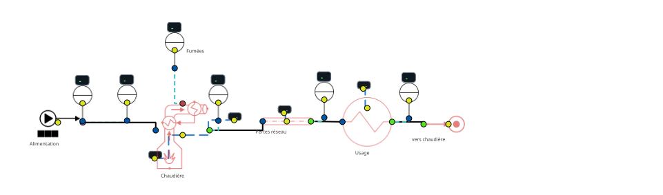

   Export SVG de la scène livrée, par le chemin de l'action « Exporter la scène en
   SVG… » de l'IHM.

**Ce qu'elle montre.** La chaîne complète d'une chaufferie au gaz : chaudière → 500 m de tuyauterie → usage, avec quatre **afficheurs** reliés par des liaisons de signal qui suivent l'énergie maillon par maillon.

**Nœuds employés** (15 nœuds, 14 liaisons) : Capteur ×6, Afficheur ×4, Source, Tuyau droit, Heater_Cooler, Sortie, Chaudière GN.

**Ouvrir.** Menu **File > Exemples > 4 - Composants et utilites > Chaine de valeur energetique**, puis bouton **Simuler** (la scène s'ouvre sans calcul). Elle est calculée par le moteur historique (une passe, de l'amont vers les sorties) ; statut affiché : « convergence non mesurée » (une passe unique ne prouve rien).

**Ce qu'on observe.** Le gaz entre avec 1 057 kW sur PCS ; la chaudière en rend 900 kW à l'eau (rendement 94,5 % sur PCI, 84,5 % sur PCS) ; les 500 m de tuyauterie DN100 non isolée en perdent 70 kW ; l'usage reçoit 830 kW. **Du gaz à l'usage, 78,6 % de l'énergie arrive.** Les quatre afficheurs, reliés par des liaisons de signal, montrent chaque maillon ; la chaudière indique aussi 134 kW récupérables dans ses fumées (point de rosée 55,7 °C).

Valeurs affichées par les nœuds après **Simuler** (relevé automatique) :

.. list-table::
   :header-rows: 1
   :widths: 26 16 58

   * - Nœud
     - Type
     - Valeurs affichées
   * - Source
     - Source
     - Temp. effective (°C) = 60.000 ; Pression effective (bar) = 5.000
   * - Afficheur
     - Afficheur
     - 1057 kW ; Source = Chaudière GN.Q_ng_HHV
   * - Tuyau droit
     - Tuyau droit
     - Vitesse (m/s) = 1.1291 ; Reynolds (-) = 328293 ; Perte de charge (Pa) = 44211.41
   * - Capteur
     - Capteur
     - 60.0 °C
   * - Afficheur
     - Afficheur
     - 900 kW ; Source = Chaudière GN.useful_heat_LHV
   * - Afficheur
     - Afficheur
     - 70 kW ; Source = Tuyau droit.heat_loss_W / / 1000
   * - Heater_Cooler
     - Heater_Cooler
     - Qth(kW) = -830.452 ; Temp. sortie (°C) = 60.00
   * - Sortie
     - Sortie
     - Température (°C) = 60.0 °C ; Pression (bar) = 4.557 bar ; Débit (kg/h) = 30926.992 kg/h
   * - Afficheur
     - Afficheur
     - 830 kW ; Source = Heater_Cooler.heat_duty_kW / x -1
   * - Chaudière GN
     - Chaudière GN
     - Rendement sur PCI (%) = 94.45 ; Puissance combustible PCS (kW) = 1057.02 ; Puissance utile calculée, bilan PCI (kW) = 900.13
   * - Capteur
     - Capteur
     - 83.1 °C
   * - Capteur
     - Capteur
     - 85.0 °C
   * - Capteur
     - Capteur
     - 110.2 °C
   * - Capteur
     - Capteur
     - 60.0 °C
   * - …
     - 
     - 1 autres nœuds non reproduits

Chaudiere
~~~~~~~~~

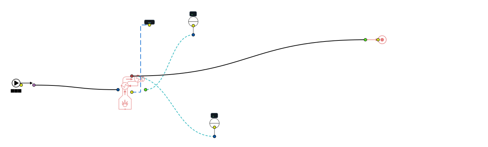

   Export SVG de la scène livrée, par le chemin de l'action « Exporter la scène en
   SVG… » de l'IHM.

**Ce qu'elle montre.** Une chaudière au gaz naturel seule : bilan de combustion (composition du gaz, excès d'air, fumées) et capteurs sur l'eau et les fumées.

**Nœuds employés** (6 nœuds, 5 liaisons) : Capteur ×2, Chaudière GN, Source, Sortie, Afficheur multi-signaux.

**Ouvrir.** Menu **File > Exemples > 4 - Composants et utilites > Chaudiere**, puis bouton **Simuler** (la scène s'ouvre sans calcul). Elle est calculée par le moteur historique (une passe, de l'amont vers les sorties) ; statut affiché : **convergé** (point fixe constaté).

**Ce qu'on observe.** La chaudière affiche un rendement de 91,3 % sur PCI (81,7 % sur PCS), un excès d'air de 18,1 % pour 3,5 % d'O₂ et des fumées à 120,3 °C. L'eau (0,278 kg/s à 15 °C) est portée à 180 °C **sous 1,013 bar** : elle sort en vapeur surchauffée, d'où une puissance demandée de 770,2 kW. Pour de l'eau chaude liquide, relever la pression de la source ou baisser la température de sortie. Scène corrigée le 28/09/2026 : la source avait gardé le fluide par défaut du nœud (ammoniac). Le modèle est documenté dans :doc:`../002-thermodynamic_cycles/ng_boiler_efficiency`.

Valeurs affichées par les nœuds après **Simuler** (relevé automatique) :

.. list-table::
   :header-rows: 1
   :widths: 26 16 58

   * - Nœud
     - Type
     - Valeurs affichées
   * - Chaudière GN
     - Chaudière GN
     - Rendement sur PCI (%) = 91.33 ; Puissance combustible PCS (kW) = 935.41 ; Puissance utile calculée, bilan PCI (kW) = 770.22
   * - Source
     - Source
     - Temp. effective (°C) = 15.000 ; Pression effective (bar) = 1.013
   * - Capteur
     - Capteur
     - 1.000 Nm³/h
   * - Capteur
     - Capteur
     - 120.337 °C
   * - Output
     - Sortie
     - Température (°C) = 120.3 °C ; Pression (bar) = 1.013 bar ; Débit (kg/h) = 1310.258 kg/h
   * - Afficheur multi-signaux
     - Afficheur multi-signaux
     - Rendement PCI : 91.3 % ; Rendement PCS : 81.7 % ; Puissance utile : 770 kW ; Débit de gaz : 85.5 Nm3/h ; Pertes fumées : 38.3 kW ; Valeurs = 91.3 ; 81.7 ; 770 ; 85.5 ; 38.3 ; Source = Chaudière GN

Compresseur
~~~~~~~~~~~

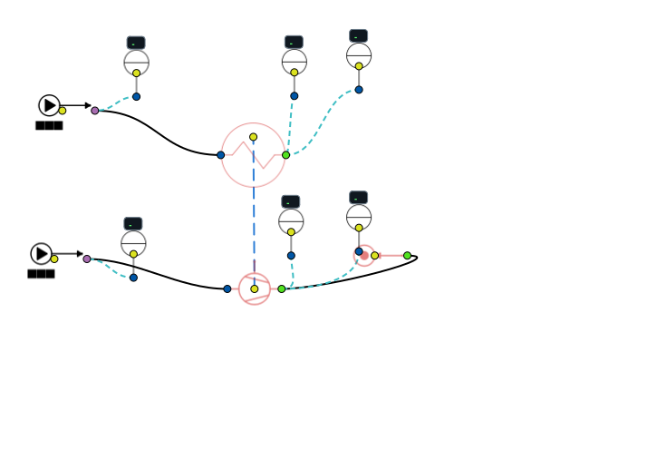

   Export SVG de la scène livrée, par le chemin de l'action « Exporter la scène en
   SVG… » de l'IHM.

**Ce qu'elle montre.** Un compresseur d'air refroidi, dont la chaleur dissipée est transmise par une liaison de signal à un circuit d'eau : la récupération de chaleur sur compresseur.

**Nœuds employés** (11 nœuds, 10 liaisons) : Capteur ×6, Source ×2, Compresseur, Sortie, Heater_Cooler.

**Ouvrir.** Menu **File > Exemples > 4 - Composants et utilites > Compresseur**, puis bouton **Simuler** (la scène s'ouvre sans calcul). Elle est calculée par le moteur historique (une passe, de l'amont vers les sorties) ; statut affiché : **convergé** (point fixe constaté).

**Ce qu'on observe.** 1000 kg/h d'air comprimés de 1 à 15 bar (rendement 0,7) demandent 135,3 kW ; le compresseur est refroidi pour sortir à 80 °C et dissipe 119,1 kW, soit **88 % de sa puissance récupérable** en chaleur. Une liaison de signal transmet cette puissance au réchauffeur d'un circuit d'eau de 4 m³/h (1,11 kg/s), qui passe de 15,0 à 40,7 °C. Scène corrigée le 28/09/2026 : le débit d'eau était saisi en « Nm³/h » avec exposant, pris pour 4 kg/s ; il est désormais en m³/h, l'unité d'un débit de liquide.

Valeurs affichées par les nœuds après **Simuler** (relevé automatique) :

.. list-table::
   :header-rows: 1
   :widths: 26 16 58

   * - Nœud
     - Type
     - Valeurs affichées
   * - Source
     - Source
     - Temp. effective (°C) = 20.000 ; Pression effective (bar) = 1.013
   * - Compresseur
     - Compresseur
     - Q_comp(kW) = 135.299 ; Energie dissipée (kW) = 119.106 ; Temp. sortie sans refroid. (°C) = 488.19
   * - Sortie
     - Sortie
     - Température (°C) = 80.0 °C ; Pression (bar) = 15.000 bar ; Débit (kg/h) = 1000.000 kg/h
   * - Source
     - Source
     - Temp. effective (°C) = 15.000 ; Pression effective (bar) = 1.013
   * - Heater_Cooler
     - Heater_Cooler
     - Qth(kW) = 119.106 ; Temp. sortie (°C) = 40.66
   * - Capteur
     - Capteur
     - 80.0 °C
   * - Capteur
     - Capteur
     - 773.4 Nm³/h
   * - Capteur
     - Capteur
     - 40.7 °C
   * - Capteur
     - Capteur
     - 15.0 °C
   * - Capteur
     - Capteur
     - 4.0 Nm³/h
   * - Capteur
     - Capteur
     - 20.0 °C

Depart chauffage - PI adaptatif
~~~~~~~~~~~~~~~~~~~~~~~~~~~~~~~

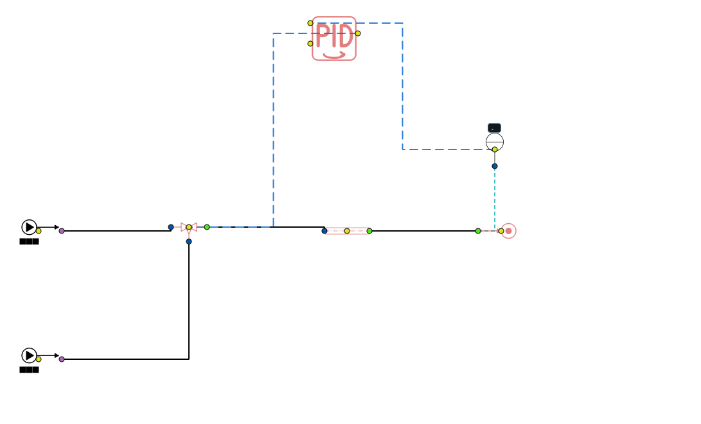

   Export SVG de la scène livrée, par le chemin de l'action « Exporter la scène en
   SVG… » de l'IHM.

**Ce qu'elle montre.** Un départ de chauffage régulé par vanne 3 voies mélangeuse : primaire à 40 °C, retour à 25 °C, un tuyau de transport de 20 m et un régulateur PI adaptatif qui estime le gain du procédé.

**Nœuds employés** (7 nœuds, 7 liaisons) : Source ×2, Vanne 3 voies, Tuyau droit, Capteur, PID adaptatif, Sortie.

**Ouvrir.** Menu **File > Exemples > 4 - Composants et utilites > Depart chauffage - PI adaptatif**, puis bouton **Simuler** (la scène s'ouvre sans calcul). Elle est calculée par le moteur historique (une passe, de l'amont vers les sorties) ; statut affiché : « convergence non mesurée » (une passe unique ne prouve rien).

**Ce qu'on observe.** Le calcul stationnaire montre l'état de départ de la régulation : le PI adaptatif sort 0,204 (écart consigne − mesure 5,00 K), la vanne 3 voies est ouverte à 20,4 %, et le départ lit encore 25,0 °C : le tuyau de transport retarde la mesure de 50,1 s. La scène se lit en **simulation dans le temps** (:doc:`../013-simulation-temporelle/index`), où le gain du procédé est estimé en ligne et les gains du PI adaptés.

Valeurs affichées par les nœuds après **Simuler** (relevé automatique) :

.. list-table::
   :header-rows: 1
   :widths: 26 16 58

   * - Nœud
     - Type
     - Valeurs affichées
   * - Primaire chaudière (40 °C)
     - Source
     - Temp. effective (°C) = 40.000 ; Pression effective (bar) = 3.000
   * - Retour circuit (25 °C)
     - Source
     - Temp. effective (°C) = 25.000 ; Pression effective (bar) = 3.000
   * - Vanne 3 voies mélangeuse
     - Vanne 3 voies
     - Ouverture (%) = 20.4 ; Ratio α effectif (-) = 0.204 ; Kvs voie directe eff. (m3/h) = 8.00
   * - Départ DN40 - 20 m (transport)
     - Tuyau droit
     - Vitesse (m/s) = 0.3990 ; Reynolds (-) = 17883 ; Perte de charge (Pa) = 1057.56
   * - Sonde de départ (τ 30 s)
     - Capteur
     - 25.0 °C
   * - PI adaptatif départ
     - PID adaptatif
     - Sortie PID = 0.203544 ; Delta consigne-mesure = 4.99863 ; Terme P = 0.199945
   * - Vers émetteurs
     - Sortie
     - Température (°C) = 25.0 °C ; Pression (bar) = 2.938 bar ; Débit (kg/h) = 1800.000 kg/h

Paroi composite en reseau thermique
~~~~~~~~~~~~~~~~~~~~~~~~~~~~~~~~~~~

   Export SVG de la scène livrée, par le chemin de l'action « Exporter la scène en
   SVG… » de l'IHM.

**Ce qu'elle montre.** Une paroi extérieure (parpaings, laine de verre, plâtre) montée en réseau thermique : cinq éléments en série, de la convection extérieure à la convection intérieure, entre deux limites à −10 et 20 °C.

**Nœuds employés** (7 nœuds, 6 liaisons) : Élément thermique ×5, Limite thermique ×2.

**Ouvrir.** Menu **File > Exemples > 4 - Composants et utilites > Paroi composite en reseau thermique**, puis bouton **Simuler** (la scène s'ouvre sans calcul). Elle est calculée par le moteur historique (une passe, de l'amont vers les sorties) ; statut affiché : **convergé** (point fixe constaté).

**Ce qu'on observe.** Entre −10 et 20 °C, la paroi laisse passer **91,5 W** (résistance totale 0,3279 K/W). La laine de verre porte 89,7 % de la résistance : la température y passe de -8,3 à 18,6 °C. Chaque couche est un élément thermique en série, chaque limite une température imposée : le calcul de :doc:`../001-heat_transfer/composite_wall_heat_transfer`, assemblé en réseau.

Valeurs affichées par les nœuds après **Simuler** (relevé automatique) :

.. list-table::
   :header-rows: 1
   :widths: 26 16 58

   * - Nœud
     - Type
     - Valeurs affichées
   * - Extérieur -10 °C
     - Limite thermique
     - Flux fourni au réseau (W) = -91.50 ; Température (°C) = -10.000
   * - Convection extérieure
     - Élément thermique
     - Flux a → b (W) = -91.50 ; T côté a (°C) = -10.000 ; T côté b (°C) = -9.602
   * - Parpaings creux
     - Élément thermique
     - Flux a → b (W) = -91.50 ; T côté a (°C) = -9.602 ; T côté b (°C) = -8.295
   * - Laine de verre
     - Élément thermique
     - Flux a → b (W) = -91.50 ; T côté a (°C) = -8.295 ; T côté b (°C) = 18.618
   * - Plâtre
     - Élément thermique
     - Flux a → b (W) = -91.50 ; T côté a (°C) = 18.618 ; T côté b (°C) = 18.856
   * - Convection intérieure
     - Élément thermique
     - Flux a → b (W) = -91.50 ; T côté a (°C) = 18.856 ; T côté b (°C) = 20.000
   * - Intérieur 20 °C
     - Limite thermique
     - Flux fourni au réseau (W) = 91.50 ; Température (°C) = 20.000

Series chronologiques - ballon pilote par fichier
~~~~~~~~~~~~~~~~~~~~~~~~~~~~~~~~~~~~~~~~~~~~~~~~~

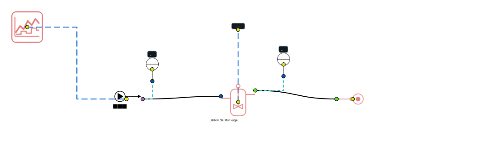

   Export SVG de la scène livrée, par le chemin de l'action « Exporter la scène en
   SVG… » de l'IHM.

**Ce qu'elle montre.** Une source pilotée par un fichier de séries chronologiques alimente un ballon de stockage ; capteurs en entrée et en sortie, afficheur multi-signaux sur le ballon.

**Nœuds employés** (7 nœuds, 7 liaisons) : Capteur ×2, Séries chronologiques, Source, Ballon de stockage, Sortie, Afficheur multi-signaux.

**Ouvrir.** Menu **File > Exemples > 4 - Composants et utilites > Series chronologiques - ballon pilote par fichier**, puis bouton **Simuler** (la scène s'ouvre sans calcul). Elle est calculée par le moteur historique (une passe, de l'amont vers les sorties) ; statut affiché : **convergé** (point fixe constaté).

**Ce qu'on observe.** Le fichier fournit 72 pas de temps qui pilotent la source ; au premier pas, l'eau entre à 20,0 °C dans un ballon à 60,0 °C, qui cède 8,55 kW (puissance de stockage négative = décharge). L'afficheur multi-signaux regroupe les trois grandeurs du ballon. La scène est faite pour la **simulation dans le temps**, où le ballon suit le fichier pas à pas.

Valeurs affichées par les nœuds après **Simuler** (relevé automatique) :

.. list-table::
   :header-rows: 1
   :widths: 26 16 58

   * - Nœud
     - Type
     - Valeurs affichées
   * - Series chronologiques
     - Séries chronologiques
     - Pas de temps = 72 ; Instant courant (s) = 0 ; Indice courant = 0
   * - Source (pilotee par le fichier)
     - Source
     - Temp. effective (°C) = 20.000 ; Pression effective (bar) = 2.000
   * - Ballon de stockage
     - Ballon de stockage
     - T° ballon (°C) = 60.00 ; Puissance stockage (kW) = -8.550 ; Déperdition par le port (W) = -
   * - Sortie
     - Sortie
     - Température (°C) = 60.0 °C ; Pression (bar) = 2.000 bar ; Débit (kg/h) = 180.000 kg/h
   * - Afficheur multi-signaux
     - Afficheur multi-signaux
     - T ballon : 60.0 °C ; T entrée : 20.0 °C ; Puissance stockée : -8.5 kW ; Valeurs = 60.0 ; 20.0 ; -8.5 ; Source = Ballon de stockage
   * - Capteur
     - Capteur
     - 60.0 °C
   * - Capteur
     - Capteur
     - 20.0 °C

Tuyau calorifuge et reseau thermique
~~~~~~~~~~~~~~~~~~~~~~~~~~~~~~~~~~~~

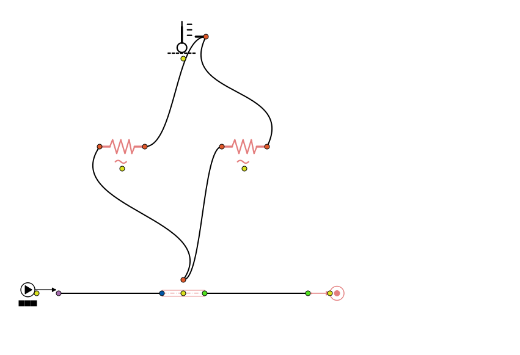

   Export SVG de la scène livrée, par le chemin de l'action « Exporter la scène en
   SVG… » de l'IHM.

**Ce qu'elle montre.** Un tuyau d'eau chaude calorifugé dont la déperdition passe par un réseau thermique extérieur : convection naturelle et rayonnement en parallèle vers une ambiance à 20 °C.

**Nœuds employés** (6 nœuds, 6 liaisons) : Élément thermique ×2, Source, Tuyau droit, Sortie, Limite thermique.

**Ouvrir.** Menu **File > Exemples > 4 - Composants et utilites > Tuyau calorifuge et reseau thermique**, puis bouton **Simuler** (la scène s'ouvre sans calcul). Elle est calculée par le moteur historique (une passe, de l'amont vers les sorties) ; statut affiché : « convergence non mesurée » (une passe unique ne prouve rien).

**Ce qu'on observe.** Le tuyau perd **0,588 kW** : sa surface est à 26,1 °C, et la chaleur part par convection naturelle (220 W, h = 3,18 W/m².K) et par rayonnement (368 W) vers l'ambiance à 20 °C. L'eau arrive à 79,9 °C. Le réseau thermique extérieur (deux éléments en parallèle et une limite) remplace le coefficient d'échange unique du tuyau.

Valeurs affichées par les nœuds après **Simuler** (relevé automatique) :

.. list-table::
   :header-rows: 1
   :widths: 26 16 58

   * - Nœud
     - Type
     - Valeurs affichées
   * - Départ eau chaude
     - Source
     - Temp. effective (°C) = 80.000 ; Pression effective (bar) = 3.000
   * - Tuyau calorifugé
     - Tuyau droit
     - Vitesse (m/s) = 0.7130 ; Reynolds (-) = 102733 ; Perte de charge (Pa) = 2532.13
   * - Arrivée
     - Sortie
     - Température (°C) = 79.9 °C ; Pression (bar) = 2.975 bar ; Débit (kg/h) = 5400.000 kg/h
   * - Convection naturelle
     - Élément thermique
     - Flux a → b (W) = 220.29 ; T côté a (°C) = 26.111 ; T côté b (°C) = 20.000
   * - Rayonnement
     - Élément thermique
     - Flux a → b (W) = 367.60 ; T côté a (°C) = 26.111 ; T côté b (°C) = 20.000
   * - Ambiance 20 °C
     - Limite thermique
     - Flux fourni au réseau (W) = -587.89 ; Température (°C) = 20.000

Voir aussi
----------

- :doc:`noeuds` — tous les nœuds de la palette, famille par famille ;
- :doc:`../gui_tools` — l'interface, les connexions, l'écriture d'un nœud ;
- :doc:`../004-hydraulic/index` — les modèles des scènes hydrauliques ;
- :doc:`../013-simulation-temporelle/index` — simulation temporelle et régulation.
