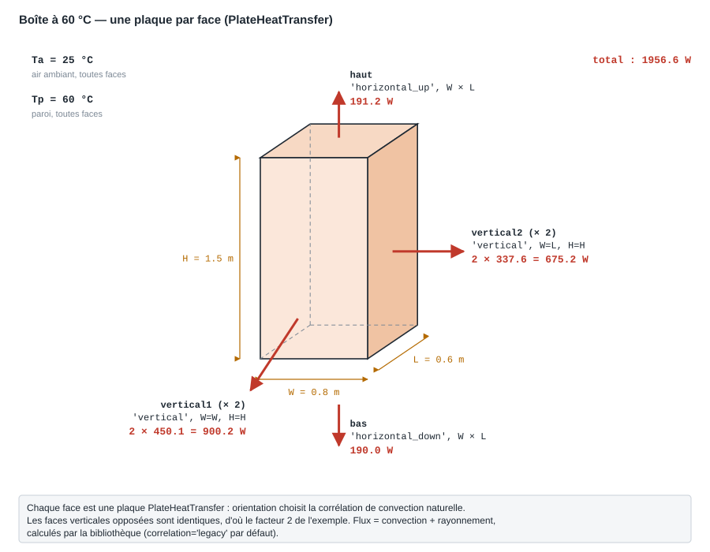

Convection naturelle sur une plaque — PlateHeatTransfer
=======================================================

   Simulation de l'exemple ci-dessous : échangeur à plaques non isolé, paroi à
   60 °C dans un air à 25 °C, une plaque ``PlateHeatTransfer`` par face ; flux
   convectif + radiatif calculés par la bibliothèque.

``orientation`` choisit la corrélation : ``'horizontal_up'`` (face chaude vers
le haut), ``'horizontal_down'`` (vers le bas) ou ``'vertical'``. À l'horizontale,
la plaque mesure ``W × L`` ; à la verticale, ``W × H`` (``L`` n'est alors pas
lu).

Les déperditions de chaleur à travers les parois de l'échangeur de chaleur à plaques peuvent être calculées en utilisant la classe PlateHeatTransfer. Cette classe permet de calculer les déperditions de chaleur à travers les parois horizontales et verticales de l'échangeur de chaleur à plaques. Les déperditions de chaleur à travers les parois horizontales et verticales peuvent être calculées en utilisant les paramètres suivants :

.. code-block:: python

    from HeatTransfer import PlateHeatTransfer

    # Température de la paroi en °C
    Tp = 60
    # Température ambiante en °C
    Ta = 25
    # Longueur en mètres
    L = 0.6
    # Largeur en mètres
    W = 0.8
    # Hauteur en mètres
    H = 1.5

    # Calcul du transfert de chaleur pour la paroi horizontale supérieure
    haut = PlateHeatTransfer.Object(
        orientation='horizontal_up',
        Tp=Tp,  # Température de la paroi en °C
        Ta=Ta,  # Température ambiante en °C
        W=W,    # Largeur en mètres
        L=L     # Longueur en mètres
    ).calculate()

    # Calcul du transfert de chaleur pour la paroi horizontale inférieure
    bas = PlateHeatTransfer.Object(
        orientation='horizontal_down',
        Tp=Tp,  # Température de la paroi en °C
        Ta=Ta,  # Température ambiante en °C
        W=W,    # Largeur en mètres
        L=L     # Longueur en mètres
    ).calculate()

    # Calcul du transfert de chaleur pour la première paroi verticale
    vertical1 = PlateHeatTransfer.Object(
        orientation='vertical',
        Tp=Tp,  # Température de la paroi en °C
        Ta=Ta,  # Température ambiante en °C
        W=W,    # Largeur en mètres
        H=H     # Hauteur en mètres
    ).calculate() * 2

    # Calcul du transfert de chaleur pour la deuxième paroi verticale
    vertical2 = PlateHeatTransfer.Object(
        orientation='vertical',
        Tp=Tp,  # Température de la paroi en °C
        Ta=Ta,  # Température ambiante en °C
        W=L,    # Largeur en mètres
        H=H     # Hauteur en mètres
    ).calculate() * 2

    # Calcul du transfert de chaleur total
    total = haut + bas + vertical1 + vertical2
    print(f"{round(total, 0)} W = {round(haut, 0)} W + {round(bas, 0)} W + {round(vertical1, 0)} W + {round(vertical2, 0)} W")

    # Acces au DataFrame de resultats (conserver la reference)
    plate = PlateHeatTransfer.Object(orientation='horizontal_up', Tp=Tp, Ta=Ta, W=W, L=L)
    plate.calculate()
    print(plate.df)

Sortie réelle :

.. code-block:: text

   1957.0 W = 191.0 W + 190.0 W + 900.0 W + 675.0 W
               PlateHeatTransfer
   Orientation     horizontal_up
   Tp (C)                     60
   Ta (C)                     25
   dT (C)                     35
   q_total (W)            191.19
   Correlation            legacy

.. warning::

   **L'exemple ci-dessus utilise la corrélation par défaut, ``"legacy"``.** La
   bibliothèque en propose une seconde, ``correlation = "cengel"``, qui applique
   la source citée (Çengel & Ghajar, *Heat and Mass Transfer*, 5ᵉ éd., ch. 9,
   table 9-1) et reproduit l'exemple résolu 9-2 de l'ouvrage. Les deux
   divergent fortement sur certains cas (variante ci-dessous). Le défaut est
   conservé pour ne pas changer d'anciens résultats ; **pour un calcul neuf,
   écrivez** ``correlation = "cengel"``.

Paramètres à personnaliser
--------------------------

.. list-table::
   :header-rows: 1
   :widths: 24 30 46

   * - Grandeur
     - Valeur à saisir
     - Effet sur le résultat
   * - ``correlation``
     - ``"cengel"`` (citée, recommandée) ou ``"legacy"`` (défaut)
     - Jusqu'à un facteur 66 d'écart sur une petite plaque verticale.
   * - ``orientation``
     - ``"vertical"``, ``"horizontal_up"`` (face chaude vers le haut),
       ``"horizontal_down"``
     - Choisit la corrélation de Nusselt.
   * - ``W``, ``L`` ou ``H``
     - dimensions en m (``W × L`` à l'horizontale, ``W × H`` à la verticale)
     - Surface et longueur caractéristique, donc le Rayleigh.
   * - ``Tp``, ``Ta``
     - température de paroi et d'ambiance (°C)
     - Moteur de la convection et du rayonnement.
   * - ``e``
     - émissivité de la paroi (0,85 par défaut ; 0 pour la convection seule)
     - Le rayonnement est souvent du même ordre que la convection.
   * - ``k``, ``mu``, ``rhoref``, ``Cp``, ``beta``
     - propriétés de l'air (valeurs par défaut vers 20 °C)
     - À ajuster à la température de film pour retrouver un cas publié.

Variante exécutée : l'exemple 9-2 de Çengel, deux corrélations
--------------------------------------------------------------

Plaque de 0,6 × 0,6 m à 90 °C dans une pièce à 30 °C, convection seule
(``e = 0``), propriétés de l'air données par l'ouvrage à 60 °C. Les puissances
publiées sont celles de l'ouvrage, p. 546-547.

.. code-block:: python

    # variante : exemple 9-2 de Çengel, corrélation par défaut contre corrélation citée
    from HeatTransfer import PlateHeatTransfer

    # Propriétés de l'air à Tf = 60 °C, telles que l'ouvrage les donne
    k_air, Pr, nu, beta, rho = 0.02808, 0.7202, 1.896e-5, 1.0 / 333.0, 1.059
    air = dict(k=k_air, mu=nu * rho, rhoref=rho, Cp=k_air / (rho * nu / Pr), beta=beta, e=0.0)
    publie = {"vertical": 115.0, "horizontal_up": 128.0, "horizontal_down": 64.2}

    print("orientation        Ra        Q cengel   Q legacy   publié (W)")
    for o, q_pub in publie.items():
        dims = dict(W=0.6, H=0.6) if o == "vertical" else dict(W=0.6, L=0.6)
        c = PlateHeatTransfer.Object(orientation=o, Tp=90, Ta=30, correlation="cengel", **dims, **air)
        l = PlateHeatTransfer.Object(orientation=o, Tp=90, Ta=30, correlation="legacy", **dims, **air)
        qc, ql = c.calculate(), l.calculate()
        print(f"{o:16s} {c.Ra:9.3e}   {qc:8.1f}   {ql:8.1f}   {q_pub:8.1f}")

Sortie réelle :

.. code-block:: text

   orientation        Ra        Q cengel   Q legacy   publié (W)
   vertical         7.649e+08      114.6     7535.2      115.0
   horizontal_up    1.195e+07      128.4      128.9      128.0
   horizontal_down  1.195e+07       64.2      124.3       64.2

Lecture : la corrélation ``"cengel"`` retrouve les trois valeurs publiées. La
corrélation par défaut est **66 fois trop forte** sur la plaque verticale (elle
élève au carré une forme laminaire, défaut décrit dans le code de la
bibliothèque) et **deux fois trop forte** face chaude vers le bas ; l'accord
face vers le haut est une coïncidence.

Le défaut vertical ne touche que les Rayleigh inférieurs à 10⁹, soit les
plaques de moins de 0,65 m environ. Sur la boîte de l'exemple principal
(côtés de 1,5 m de haut), il ne joue pas :

.. code-block:: python

    # à la suite : la boîte de l'exemple principal avec la corrélation citée
    faces = [("dessus", "horizontal_up", dict(W=0.8, L=0.6), 1),
             ("dessous", "horizontal_down", dict(W=0.8, L=0.6), 1),
             ("côtés 0,8 x 1,5", "vertical", dict(W=0.8, H=1.5), 2),
             ("côtés 0,6 x 1,5", "vertical", dict(W=0.6, H=1.5), 2)]
    for nom, o, dims, n in faces:
        ligne = f"{nom:16s}: legacy {n * PlateHeatTransfer.Object(orientation=o, Tp=60, Ta=25, **dims).calculate():6.0f} W"
        try:
            q = n * PlateHeatTransfer.Object(orientation=o, Tp=60, Ta=25, correlation="cengel", **dims).calculate()
            ligne += f", cengel {q:6.0f} W"
        except PlateHeatTransfer.OutOfRangeError as erreur:
            ligne += f", cengel refusé ({str(erreur)[:40]}…)"
        print(ligne)

Sortie réelle :

.. code-block:: text

   dessus          : legacy    191 W, cengel refusé (Ra = 1.769e+07 hors du domaine de l'eq. …)
   dessous         : legacy    190 W, cengel    147 W
   côtés 0,8 x 1,5 : legacy    900 W, cengel    900 W
   côtés 0,6 x 1,5 : legacy    675 W, cengel    675 W

La face supérieure sort du domaine de l'équation citée (Ra au-delà de 1,2·10⁷) :
``"cengel"`` **refuse** plutôt que d'appliquer une corrélation que l'ouvrage ne
confirme pas, là où ``"legacy"`` calcule sans prévenir.

Cas limites refusés
-------------------

.. code-block:: python

    # à la suite : saisies refusées
    for nom, kw in [("corrélation inconnue", dict(orientation="vertical", correlation="mcadams")),
                    ("orientation inconnue", dict(orientation="inclinee"))]:
        try:
            PlateHeatTransfer.Object(Tp=60, Ta=25, W=0.6, H=0.6, L=0.6, **kw).calculate()
        except ValueError as erreur:
            print(f"{nom:21s} refusé : {str(erreur)[:80]}")

Sortie réelle :

.. code-block:: text

   corrélation inconnue  refusé : correlation='mcadams' inconnue ; attendu l'un de ('legacy', 'cengel')
   orientation inconnue  refusé : Invalid orientation. Choose from 'horizontal_down', 'horizontal_up', or 'vertica

Pièges
------

* **Le défaut est la corrélation historique** : sur une plaque verticale de
  moins de ~0,65 m, elle donne une puissance des dizaines de fois trop forte.
* **Le rayonnement est inclus par défaut** (``e = 0,85``) : pour comparer à
  une corrélation de convection seule, mettez ``e = 0``.
* **Les propriétés de l'air par défaut** valent vers 20 °C ; à 60 °C de film,
  elles décalent le résultat de quelques pour cent.
* **Une boîte entière** (cinq ou six faces, isolées ou non) se calcule plus
  simplement avec :doc:`001-heat_transfer/corps_parallelepipedique`, qui
  enchaîne ces plaques.

Explication des équations utilisées
-----------------------------------

Les équations ci-dessous sont celles de la corrélation ``legacy`` (défaut). La
corrélation ``cengel`` suit la table 9-1 de Çengel & Ghajar, citée dans le code.

La classe `PlateHeatTransfer` utilise différentes équations pour calculer les déperditions de chaleur en fonction de l'orientation de la plaque (horizontale ou verticale). Voici les principales équations utilisées :

Paramètres calculés
~~~~~~~~~~~~~~~~~~~~

**Température du film (Tf)** : Température moyenne entre la paroi et l'air ambiant.

.. math::

   Tf = \frac{Tp + Ta}{2}

**Viscosité cinématique (v)** :

.. math::

   v = \frac{\mu}{\rho_{ref}}

**Densité à la température du film (ρ)** :

.. math::

   \rho = \rho_{ref} \left(1 - \beta (Tf - 20)\right)

**Diffusivité thermique (a)** :

.. math::

   a = \frac{k}{\rho \cdot Cp}

**Nombre de Prandtl (Pr)** :

.. math::

   Pr = \frac{v}{a}

**Nombre de Grashof (Gr)** :

.. math::

   Gr = \frac{g \cdot \beta \cdot (Tp - Ta) \cdot \left(\frac{W \cdot L}{2W + 2L}\right)^3}{v^2}

**Nombre de Rayleigh (Ra)** :

.. math::

   Ra = Gr \cdot Pr

Plaque horizontale face vers le bas
~~~~~~~~~~~~~~~~~~~~~~~~~~~~~~~~~~~~~

**Nombre de Nusselt (Nu)** :

.. math::

   Nu = 0.27 \cdot Ra^{0.25} \quad \text{si} \quad 10^4 < Ra < 10^7

.. math::

   Nu = 0.54 \cdot Ra^{0.25} \quad \text{si} \quad Ra \geq 10^7

**Coefficient de transfert de chaleur (h)** :

.. math::

   h = \frac{Nu \cdot k}{\frac{W \cdot L}{2W + 2L}}

Plaque horizontale face vers le haut
~~~~~~~~~~~~~~~~~~~~~~~~~~~~~~~~~~~~~~

**Nombre de Nusselt (Nu)** :

.. math::

   Nu = 0.15 \cdot Ra^{0.33}

Plaque verticale
~~~~~~~~~~~~~~~~~

**Nombre de Nusselt (Nu)** :

.. math::

   Nu = \left(0.68 + \frac{0.67 \cdot Ra^{1/4}}{\left(1 + \left(\frac{0.492}{Pr}\right)^{9/16}\right)^{4/9}}\right)^2 \quad \text{si} \quad Ra < 10^9

.. math::

  Nu = \left(0.825 + \frac{0.387 \cdot Ra^{1/6}}{\left(1 + \left(\frac{0.492}{Pr}\right)^{9/16}\right)^{8/27}}\right)^2 \quad \text{si} \quad Ra \geq 10^9

Transfert de chaleur convectif (q_conv)
~~~~~~~~~~~~~~~~~~~~~~~~~~~~~~~~~~~~~~~~~

.. math::

  q_{conv} = h \cdot W \cdot L \cdot (Tp - Ta)

Transfert de chaleur radiatif (q_rad)
~~~~~~~~~~~~~~~~~~~~~~~~~~~~~~~~~~~~~~~

.. math::

  q_{rad} = \sigma \cdot W \cdot L \cdot e \cdot \left((Tp + 273.15)^4 - (Ta + 273.15)^4\right)

Transfert de chaleur total (q_total)
~~~~~~~~~~~~~~~~~~~~~~~~~~~~~~~~~~~~~~

.. math::

  q_{total} = q_{conv} + q_{rad}
